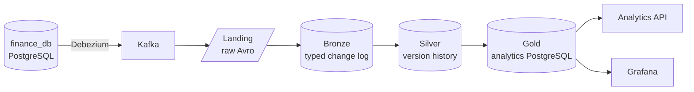
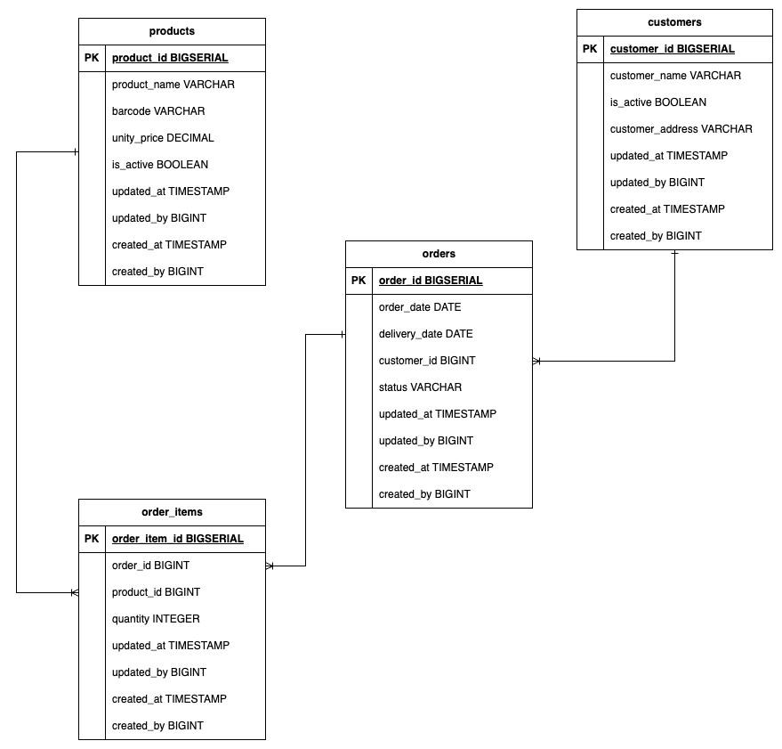

## Data Engineering Take-Home Task

[](https://github.com/jonathan5p/deel-home-task/actions/workflows/ci.yml)
[](https://jonathan5p.github.io/deel-home-task/)
[](docs/development/testing.md)


A change data capture pipeline for Deel's data engineering take-home. Debezium streams every change of the supplied `finance_db` PostgreSQL database to Kafka. Spark Structured Streaming lands the changes in an Iceberg lake on SeaweedFS (landing, bronze, silver) and keeps a dimensional model up to date in a separate PostgreSQL (gold). The four business questions are answered by gold views, served over an HTTP API and a Grafana dashboard. Everything runs locally in Docker Compose.



This README is the quick start. Every part of the project has its own guide in [`docs/`](docs/README.md), also published as the [docs site](https://jonathan5p.github.io/deel-home-task/) with the table reference; the [index](#documentation) below lists them.

For a one-page visual tour of the pipeline, open the [interactive showcase](https://jonathan5p.github.io/deel-home-task/showcase/).

### Contents

- [Install](#install)
- [Reproduce the results](#reproduce-the-results)
- [Use the stack](#use-the-stack)
- [Debug](#debug)
- [Develop](#develop)
- [Documentation](#documentation)
- [The supplied assignment stack](#the-supplied-assignment-stack)

### Install

You need [Docker](https://www.docker.com/products/docker-desktop/) with [Compose v2](https://docs.docker.com/compose/install/), GNU Make and [uv](https://docs.astral.sh/uv/) (`make up` uses it to render the gold DDL). The Spark workers alone can claim 10 GiB of executor memory, so give Docker enough memory for the whole stack ([sizing](docs/architecture/sizing.md)).

With the Docker engine running, from the repository root:

```sh
make up             # Render the gold DDL, build changed local images and start the default stack (source/CDC, analytics database, analytics API, data lake, Spark cluster, Grafana)
make up PROFILES="monitoring history"  # Also start optional services (any combination of profiles)
make down           # Stop/remove all project containers, including optional profiles; keep volumes
make help           # Show every command
```

Optional services are grouped in Compose profiles and are not started by a plain `make up`:

| Profile | Starts | Guide |
| --- | --- | --- |
| `monitoring` | Conduktor, a Kafka console | [Debugging](docs/operations/debugging.md#optional-kafka-monitoring) |
| `history` | The Spark History Server | [Spark cluster](docs/architecture/infrastructure.md#spark-history-server-optional) |
| `maintenance` | Scheduled lake maintenance and gold retention | [Maintenance and recovery](docs/operations/maintenance-and-recovery.md) |
| `data-quality` | Every data quality check on a schedule | [Data quality checks](docs/lakehouse/data-quality.md#data-quality-checks) |
| `catalog` | A read-only Iceberg REST catalog of the lake, for engines such as DuckDB | [Query the lake from DuckDB](docs/serving/lake-access.md#query-the-lake-from-duckdb) |
| `metrics` | Prometheus, scraping every Spark driver, the master and the workers, the Spark History Server and an exporter of its completed stages and of the Iceberg tables' file statistics; Grafana's Spark and lake dashboards read it | [Monitoring Spark](docs/operations/monitoring.md) |

`make down` keeps every volume, so the source database, Kafka, the lake and gold survive a restart. To work on the code, also run `uv sync --frozen` and `make hooks` ([testing](docs/development/testing.md)).

### Reproduce the results

1. **Start the stack and every pipeline job.** `make pipeline` starts the default stack, the History Server and the streaming jobs as long-running services:

   ```sh
   make pipeline PIPELINE=all
   ```

   Debezium snapshots the source tables, then streams every change; the landing, bronze, silver and gold jobs pick them up within a few micro-batches (10 seconds each). Follow them with `make pipeline-logs PIPELINE=all`, or watch the Structured Streaming tab of each job's UI ([running the pipeline](docs/operations/running-the-pipeline.md)). Until a layer has data, the next job stops with `PATH_NOT_FOUND` or `TABLE_OR_VIEW_NOT_FOUND` and Compose restarts it; that is expected.

2. **Check the data.** Each check compares one layer with the one before it, from Kafka to gold, and fails if anything is missing, duplicated or different:

   ```sh
   make data-quality
   ```

   It ends with a `DATA QUALITY` summary and exits with code 1 if any check fails; `make up PROFILES=data-quality` runs every check on a schedule instead ([data quality checks](docs/lakehouse/data-quality.md)).

3. **Answer the four business questions.** Each one is a view in the `gold` schema with a ready-made query in `analytics/sql/gold/`:

   | Question | Query | API endpoint |
   | --- | --- | --- |
   | Number of open orders by delivery date and status | `01_open_orders_by_delivery_date_and_status.sql` | `/metrics/open-orders-by-delivery-date-and-status` |
   | Top 3 delivery dates with more open orders | `02_top_delivery_dates_by_open_orders.sql` | `/metrics/top-delivery-dates-by-open-orders` |
   | Number of open pending items by product | `03_pending_items_by_product.sql` | `/metrics/pending-items-by-product` |
   | Top 3 customers with more pending orders | `04_top_customers_by_pending_orders.sql` | `/metrics/top-customers-by-pending-orders` |

   ```sh
   docker compose exec -T analytics-db psql -U analytics -d analytics < analytics/sql/gold/01_open_orders_by_delivery_date_and_status.sql
   curl -s localhost:8000/metrics/top-customers-by-pending-orders
   curl -s localhost:8000/freshness
   ```

   Or open the **Gold metrics** dashboard at <http://localhost:3000/d/gold-metrics>, one panel per question plus freshness. An open order is one whose current status is not `COMPLETED`; the top 3 questions include ties, so more than three rows can come back ([gold](docs/lakehouse/gold/index.md), [the gold model](docs/lakehouse/gold/model.md)).

4. **Stop.** `make down` stops everything and keeps the data; `make pipeline-stop PIPELINE=<job>` stops one job.

### Use the stack

| Service | From the host | Credentials |
| --- | --- | --- |
| Source database (`finance_db`) | `localhost:5432` | `finance_db_user` / `1234` |
| Kafka | `localhost:9092` | none |
| Analytics database (gold, Iceberg catalog) | `localhost:5433`, database `analytics` | `analytics` / `analytics`; read-only `api_reader`, `grafana`, `lake_catalog_reader` |
| SeaweedFS S3 API and filer | <http://localhost:8333>, <http://localhost:8888/buckets/lake/> | `lakeadmin` / `lakeadmin-secret` |
| Spark master | <http://localhost:8080> | none |
| Pipeline job UIs | landing <http://localhost:4040>, bronze 4041, silver 4042, gold 4045 | none |
| Spark History Server | <http://localhost:18080> | none |
| Lake REST catalog (`catalog` profile) | <http://localhost:8181> | none; read-only |
| Analytics API | <http://localhost:8000>, docs at <http://localhost:8000/docs> | none |
| Grafana | <http://localhost:3000> | anonymous viewer; `admin` / `admin` |
| Prometheus (`metrics` profile) | <http://localhost:9090> | none |
| Conduktor (`monitoring` profile) | <http://localhost:8090> | `admin@local.test` / `LocalConsole123!` |
| Docs site (`make docs-serve`) | <http://localhost:8001> | none |

These are local development credentials from `.env`; variables exported in the shell override them ([configuration](docs/operations/configuration.md)).

| Command | Does |
| --- | --- |
| `make pipeline PIPELINE=<job>` | Starts `landing`, `bronze`, `silver`, `gold` or `all` as long-running services |
| `make pipeline-logs PIPELINE=<job>`, `make pipeline-stop PIPELINE=<job>` | Follows a job's logs, stops a job |
| `make data-quality CHECK=<check>` | Runs the `landing`, `bronze`, `silver`, `gold` or `all` data quality checks |
| `make spark-sql` | Opens a Spark SQL shell on the lake ([landing examples](docs/lakehouse/landing.md#inspecting-the-landing-zone-with-spark-sql)) |
| `make spark-submit SPARK_APP=<path>` | Runs an application in its own driver container ([submitting a job](docs/architecture/infrastructure.md#submitting-a-job)) |
| `make lake-views` | Creates or updates the silver and gold views in the lake |
| `make lake-maintenance`, `make gold-retention` | Compacts and cleans the lake tables, trims gold history ([maintenance](docs/operations/maintenance-and-recovery.md)) |
| `make bronze-replay TOPIC=… FROM_OFFSET=… TO_OFFSET=…` | Re-feeds a landing range into bronze ([replay](docs/operations/maintenance-and-recovery.md#replaying-a-landing-range-into-bronze)) |
| `make gold-reset CONFIRM=1`, `make gold-rebuild CONFIRM=1` | Empties gold, or rebuilds it from silver ([rebuild](docs/operations/maintenance-and-recovery.md#rebuilding-gold-from-silver)) |
| `make spark-history` | Starts or stops the Spark History Server |

### Debug

- **Services:** `docker compose ps` shows what is up and healthy; `docker compose logs -f <service>` follows any service.
- **Spark:** each job's UI (above) while it runs, the History Server for past or crashed runs, and `make spark-sql` to query the lake (or DuckDB through the [REST catalog](docs/serving/lake-access.md#query-the-lake-from-duckdb)).
- **Files and reports:** the SeaweedFS filer at <http://localhost:8888/buckets/lake/> shows the landing files, the checkpoints and the data quality reports.
- **Common errors:** `port is already allocated` means a pipeline job holds the UI port, so pass `SPARK_UI_PORT=4050`; `Some data may have been lost because they are not available in Kafka any more` means the lake must be reset. The [debugging guide](docs/operations/debugging.md) lists every common error with its fix.
- **Starting over:** **data loss:** `make clean CONFIRM=1` removes the project's containers and volumes, so every database, topic and lake file is deleted ([destructive reset](docs/operations/debugging.md#destructive-reset)).

### Develop

```sh
make test       # unit tests with branch coverage; fails below 90%
make lint       # ruff lint and format check
make format     # format the code and apply safe lint fixes
make typecheck  # check types with ty
make docs       # build the docs site; warnings fail
make test-infra # infra tests against isolated copies of the stack, 2 workers by default (local only)
```

The checks run in containers with the cluster's exact Spark and Python versions; CI runs lint, typecheck and the unit tests on every pull request ([testing and CI](docs/development/testing.md), [code layout](docs/development/code-layout.md)).

### Documentation

| Part | Guides |
| --- | --- |
| Architecture | [Overview](docs/architecture/overview.md) · [Infrastructure](docs/architecture/infrastructure.md) · [Spark sizing](docs/architecture/sizing.md) · [Design decisions](docs/architecture/decisions.md) · [The way to production](docs/architecture/production.md) |
| Lakehouse | [Medallion layers](docs/lakehouse/index.md) · [Source database and CDC](docs/lakehouse/source-and-cdc.md) · [Landing](docs/lakehouse/landing.md) · [Bronze](docs/lakehouse/bronze.md) · [Silver](docs/lakehouse/silver.md) · [Gold](docs/lakehouse/gold/index.md) ([model](docs/lakehouse/gold/model.md), [writer](docs/lakehouse/gold/writer.md)) · [Data quality checks](docs/lakehouse/data-quality.md) |
| Serving | [Analytics API](docs/serving/api.md) · [Grafana](docs/serving/grafana.md) · [Querying the lake](docs/serving/lake-access.md) |
| Operations | [Running the pipeline](docs/operations/running-the-pipeline.md) · [Maintenance and recovery](docs/operations/maintenance-and-recovery.md) · [Debugging](docs/operations/debugging.md) · [Monitoring Spark](docs/operations/monitoring.md) · [Configuration](docs/operations/configuration.md) |
| Development | [Code layout](docs/development/code-layout.md) · [Table and column definitions](docs/development/table-definitions.md) · [Testing and CI](docs/development/testing.md) |
| How it was built | [How I worked](docs/process/how-i-worked.md) · [Building with AI agents](docs/process/ai-agents.md) |
| Reference | [Table reference](https://jonathan5p.github.io/deel-home-task/reference/) (on the docs site, rendered from the schemas) · [Supplied assignment README](docs/reference/original-readme.md) |

### The supplied assignment stack

The assignment came with a pre-built stack: the `finance_db` PostgreSQL database (`operations` schema: customers, products, orders and order items) and a Debezium connector that streams its changes to four Kafka topics, `finance_db.operations.<table>`, on `localhost:9092`. Both are used exactly as provided.



- **Credentials:** username `finance_db_user`, password `1234`, database `finance_db`.
- **Starting it:** the supplied README started it with `docker-compose up`; here `make up` starts it with the rest of the stack.
- **More:** the change event format is in [source database and CDC](docs/lakehouse/source-and-cdc.md), and the supplied text, kept as delivered, in [the original README](docs/reference/original-readme.md). Extra information about the task is in the task description document shared by Deel's recruiting team; questions go to <data-platform@deel.com>.
