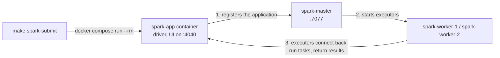

## Data Engineering Take-Home Task

### Welcome

Welcome to Deel's Data Engineering Take-Home task, as mentioned in the Task specification document, this is the pre-built stack that will help you on your solution development. This repository contains a pre-configured database containing the database represented by the following DER:


### Database Configuration

Install [Docker](https://www.docker.com/products/docker-desktop/) with [Compose v2](https://docs.docker.com/compose/install/), GNU Make and [uv](https://docs.astral.sh/uv/) (`make up` uses it to render the gold DDL). With the Docker engine running, run these commands from the repository root:

```sh
make up             # Render the gold DDL, build changed local images and start the default stack (source/CDC, analytics database, data lake, Spark cluster)
make up PROFILES="monitoring history"  # Also start optional services (any combination of profiles)
make down           # Stop/remove all project containers, including optional profiles; keep volumes
make spark-submit   # Submit a job to the Spark cluster (defaults to a one-minute UI check job)
make help           # Show lifecycle commands
```

Optional services are grouped in Compose profiles and are not started by a plain `make up`: `monitoring` (Conduktor, see **Optional Kafka monitoring**) and `history` (Spark History Server, see **Spark History Server**). Pass them with `PROFILES`, separated by spaces.

#### Destructive reset

**Data loss:** `make clean CONFIRM=1` removes this Compose project's containers and volumes, including persisted database, Kafka, and optional monitor data. Use it only when you intend to discard that data. It does not delete images or source files, or perform a global Docker prune. `make clean` refuses before invoking Docker unless GNU Make evaluates `CONFIRM` to exactly `1`. Make normalizes leading assignment whitespace, so `make clean 'CONFIRM= 1'` also explicitly confirms deletion.

All lifecycle targets use the same Compose project selection; `make down` preserves its volumes, so the source database, the Kafka topics (including the offsets Debezium stores in Kafka), the analytics database and the lake survive a restart. Keep the same working directory and Compose environment between commands. `COMPOSE` defaults to `docker compose` and can be overridden for a compatible CLI or a harmless test probe. Compose failures cause Make to fail.

**Stacks started before Kafka had volumes** kept their topics only inside the Kafka container, so the first `make up` with the volumes starts with empty topics and Debezium snapshots the source tables again. Landing then stops with `Some data may have been lost because they are not available in Kafka any more`, because its checkpoint points past the new offsets: reset the lake once with `make clean CONFIRM=1`, or drop its tables and checkpoints, so the pipelines rebuild from the new topics.

Once you have the Database up and running feel free to connect to this using any tool you want, for this you can use the following credentials:

- **Username**: `finance_db_user`
- **Password**: `1234`
- **Database**: `finance_db`

### Analytics database

A separate PostgreSQL instance (`analytics-db`) holds the gold layer and the Iceberg catalog, so analytical load never reaches the source database. It starts with `make up` and keeps its data in the `analytics-pg-data` volume across `make down` / `make up`.

| Setting | From the host | From other containers |
| --- | --- | --- |
| Host and port | `localhost:5433` | `analytics-db:5432` |
| Username | `analytics` | `analytics` |
| Password | `analytics` | `analytics` |
| Database | `analytics` | `analytics` |

The credentials are local development defaults in `.env` (`ANALYTICS_DB_USER`, `ANALYTICS_DB_PASSWORD`, `ANALYTICS_DB_NAME`); variables exported in the shell override them.

```sh
docker compose exec analytics-db psql -U analytics -d analytics
```

#### Schemas and init script

`docker/analytics-db/initdb/01-gold-and-catalog.sql` creates:

- the `gold` schema in the `analytics` database, for the dimensional model;
- the `iceberg_catalog` database, where the Iceberg JDBC catalog creates its own tables on first use.

PostgreSQL runs init scripts **only when the data volume is empty**, so editing the script does not change an existing database. To apply a changed script, recreate only the analytics volume (for gold DDL changes, use `make gold-reset` below instead). **Data loss:** this deletes all gold data and the Iceberg catalog, which then no longer points to the lake tables.

```sh
docker compose down -v analytics-db  # Removes only the analytics container and its volume
make up
```

#### Gold layer

Gold is a star schema built from the silver history tables: SCD2 customer and product dimensions, seeded date and order-status dimensions, append-only history facts for orders and order items (partitioned by month, 3 years kept), and current-state tables for orders and items that the four business questions read. It uses two schemas:

- `gold_internal` holds the tables the pipeline writes, with the metadata it needs to skip replayed batches and order versions (`_commit_sequence`, soft deletes in `_is_deleted`, and in the dimensions `_content_hash`), plus the unlogged staging tables `stage_dim_customer` and `stage_dim_product` that the gold job loads every micro-batch into, and the views `dim_customer_versions` and `dim_product_versions`, which derive each dimension version's fold flag, validity range and current flag.
- `gold` holds the views consumers read, with the same names, without that metadata: the history views add each version's validity range, the current-state views leave deleted rows out, and the dimension views leave out folded and deleted versions.

The design, with the ERD, the grain of every table, the open and pending rules, versioning by `_commit_sequence`, and retention, is in [docs/architecture/gold-model.md](docs/architecture/gold-model.md).

In short:

- **Open order:** current status other than `COMPLETED`, not deleted. **Pending orders** are open orders, and **pending items** are the items of open orders.
- **Current state only moves forward:** a version replaces the current row only if its `_commit_sequence` is higher, so late or replayed events never overwrite newer state; they are still kept as history.
- **Top 3 questions include ties**, so more than three rows can come back.

`docker/analytics-db/initdb/02-gold-model.sql` is generated and git-ignored: `make up` (and `make pipeline` and `make test-infra`) renders it, on the host with [uv](https://docs.astral.sh/uv/), from the Jinja template `analytics/pipelines/src/pipelines/gold/ddl.sql.j2` and the gold Avro schemas (see [table and column definitions](#table-and-column-definitions)), which give every column its type, nullability and description. Edit the template or the schemas, never the SQL file. The file creates both schemas, the tables, views and seeds, and each history table's default partition; the monthly history partitions are created and dropped by the retention job. It runs on an empty volume like the other init scripts, and every statement is idempotent, so it can also be applied to an existing database without losing data:

```sh
docker compose exec -T analytics-db psql -v ON_ERROR_STOP=1 -U analytics -d analytics < docker/analytics-db/initdb/02-gold-model.sql
```

Applying it again only adds what is missing: `CREATE TABLE IF NOT EXISTS` leaves an existing table as it is, so a new column or constraint on a gold table does not reach a database created before it. To rebuild only gold, leaving the lake and the Iceberg catalog alone:

```sh
make gold-reset CONFIRM=1   # Stops the gold job, recreates gold and gold_internal from the rendered DDL, deletes the gold checkpoints
make pipeline PIPELINE=gold # The gold job reloads everything from silver
```

**Data loss:** all gold data is deleted; gold is rebuilt from silver, which keeps the full history. The gold checkpoints (`<CHECKPOINT_ROOT>/gold/`, deleted through the SeaweedFS filer; set `GOLD_CHECKPOINTS` to its path for another `CHECKPOINT_ROOT`) must go with the data, or the job would resume after the batches the dropped rows came from.

The four business questions are in `analytics/sql/gold/`, one query per file, and read only the `gold` views:

| File | Question |
| --- | --- |
| `01_open_orders_by_delivery_date_and_status.sql` | Number of open orders by delivery date and status |
| `02_top_delivery_dates_by_open_orders.sql` | Top 3 delivery dates with more open orders |
| `03_pending_items_by_product.sql` | Number of open pending items by product (items and total quantity) |
| `04_top_customers_by_pending_orders.sql` | Top 3 customers with more pending orders |

```sh
docker compose exec -T analytics-db psql -U analytics -d analytics < analytics/sql/gold/01_open_orders_by_delivery_date_and_status.sql
```

`gold.data_freshness` shows, per entity (customers, products, orders, order items), how up to date gold is. For now it is computed from the data, as the source commit time of the newest change gold holds, so it ages when the source stops changing even though the pipeline is healthy. Later the pipeline metrics (#127) will fill it; its shape stays the same.

```sh
docker compose exec analytics-db psql -U analytics -d analytics -c "select * from gold.data_freshness"
```

### Data lake (SeaweedFS)

[SeaweedFS](https://github.com/seaweedfs/seaweedfs) provides the S3-compatible object store for the data lake. It runs as a single `seaweedfs` container (`weed mini`), starts with `make up`, and keeps its data in the `seaweedfs-data` volume. It creates the `lake` bucket on startup if it does not exist, and the service reports healthy only once the bucket is there.

| Endpoint | From the host | From other containers |
| --- | --- | --- |
| S3 API | `http://localhost:8333` | `http://seaweedfs:8333` |
| Filer UI (browse buckets and files) | http://localhost:8888/buckets/lake/ | `http://seaweedfs:8888` |

| Setting | Value |
| --- | --- |
| Access key | `lakeadmin` |
| Secret key | `lakeadmin-secret` |
| Region | any (for example `us-east-1`); use path-style access |

The credentials are local development defaults in `.env` (`LAKE_S3_ACCESS_KEY`, `LAKE_S3_SECRET_KEY`); variables exported in the shell override them. Any S3-compatible store, or AWS S3 itself, can replace SeaweedFS by changing the endpoint and credentials.

#### Iceberg catalog

Every Spark job gets an [Apache Iceberg](https://iceberg.apache.org/) catalog named `lake`, configured in `docker/spark/spark-defaults.conf`:

- table metadata (the catalog) lives in the `iceberg_catalog` database of `analytics-db`, through Iceberg's JDBC catalog;
- table data and metadata files live in SeaweedFS under `s3://lake/warehouse/<namespace>/<table>/`.

The Spark image bundles Iceberg 1.12.0 (`iceberg-spark-runtime-4.1_2.13`, `iceberg-aws-bundle`) and the PostgreSQL JDBC driver 42.7.14, with pinned checksums, so jobs need no `--packages`. The driver reads the database and S3 credentials from its environment (the `.env` values above).

#### Kafka, Avro and plain files in the lake

The image also bundles, with pinned checksums:

| Library | Version | Used for |
| --- | --- | --- |
| `spark-sql-kafka-0-10`, `spark-token-provider-kafka-0-10`, `kafka-clients`, `commons-pool2` | 4.1.4, 4.1.4, 3.9.1, 2.12.1 | Reading the CDC topics with `spark.readStream.format("kafka")` |
| `spark-avro` | 4.1.4 | Reading and writing Avro files |
| `hadoop-aws` and the AWS SDK's `s3-transfer-manager` and `apache-client` | 3.4.2, 2.54.17 | The S3A filesystem for plain files and streaming checkpoints in SeaweedFS |

Iceberg tables use `s3://` paths through the catalog above. Plain files, such as the landing zone, and streaming checkpoints use `s3a://lake/...` paths. S3A uses the same AWS SDK version as the Iceberg bundle (2.54.17); the image adds only the two SDK modules the bundle does not contain.

Spark does not substitute `${env:...}` in `spark.hadoop.*` settings, so `make spark-submit` passes the S3A credentials from the driver container's environment (`LAKE_S3_ACCESS_KEY`, `LAKE_S3_SECRET_KEY`). Spark ships them to the executors and shows them as `*********(redacted)` in the UI and event logs.

Run the smoke job to check the whole path. It creates or replaces `lake.smoke.iceberg_check`, writes four rows, reads them back, and fails if they differ:

```sh
make spark-submit SPARK_APP=tests/infra/apps/iceberg_smoke_check.py
```

To inspect the result:

```sh
docker compose exec analytics-db psql -U analytics -d iceberg_catalog -c "select * from iceberg_tables"
```

The table files are visible at http://localhost:8888/buckets/lake/warehouse/smoke/iceberg_check/.

### Optional Kafka monitoring

With the source stack already running, start only the optional Conduktor services:

```sh
docker compose --profile monitoring up -d --no-deps --wait conduktor-db
docker compose --profile monitoring up -d --no-deps --wait conduktor-console
```

Open http://localhost:8090 and sign in with `admin@local.test` / `LocalConsole123!`. These are public development-only credentials. The current `8090:8080` mapping publishes on all host interfaces; use `127.0.0.1:8090:8080` if localhost-only binding is required. Console connects to the existing broker at `kafka:29092`.

Only Console and its metadata PostgreSQL database are added. Topic management, message browsing/production, and basic cluster inspection do not require Cortex. Historical metrics dashboards and alerting are not included; no ksqlDB service is required.

Stop only monitoring, keeping the source stack and stored data:

```sh
docker compose --profile monitoring stop conduktor-console conduktor-db
```

The Conduktor integration is prepared but runtime validation is still pending. `make down` stops the entire project; use the service-specific command above when leaving the source running.

### Debezium CDC

The stack includes a Debezium CDC pipeline that streams database changes to Kafka in real-time. Kafka is available at `localhost:9092`.

#### Topics

| Kafka Topic | Source Table |
|---|---|
| `finance_db.operations.customers` | `operations.customers` |
| `finance_db.operations.products` | `operations.products` |
| `finance_db.operations.orders` | `operations.orders` |
| `finance_db.operations.order_items` | `operations.order_items` |

When the connector starts, it first takes a snapshot of each table (`op` = `r`) and then streams every change. The source database and the connector are used exactly as provided; the pipeline handles their format.

#### Message format

Each topic has one partition, messages carry no headers, and both key and value are JSON without embedded schemas.

- **Key:** the row's primary key, for example `{"order_id": 1}`.
- **Value:** a Debezium change event:

| Field | Meaning |
|---|---|
| `before` | The row before the change. `null` for snapshot reads and inserts; the full row for updates and deletes, because the source tables use `REPLICA IDENTITY FULL`. |
| `after` | The row after the change. `null` for deletes. |
| `op` | `r` snapshot read, `c` insert, `u` update, `d` delete. |
| `ts_ms` | When Debezium processed the change, in epoch milliseconds. |
| `source` | Origin of the change: `table`, `txId`, `lsn` (position in the source's write-ahead log, increasing in commit order), `ts_ms` (commit time in the source) and `snapshot` (`first`, `true`, `last` and similar while snapshotting; `false` for streamed changes). |
| `transaction` | Always `null`: transaction metadata is not enabled. |

An update to an order, abbreviated:

```json
{
  "before": {"order_id": 1, "order_date": 20765, "delivery_date": 20775, "status": "PENDING", "updated_at": 1794147633457, "...": "..."},
  "after":  {"order_id": 1, "order_date": 20765, "delivery_date": 20775, "status": "REPROCESSING", "updated_at": 1794147660022, "...": "..."},
  "source": {"connector": "postgresql", "table": "orders", "txId": 952, "lsn": 26767664, "ts_ms": 1794147660025, "snapshot": "false", "...": "..."},
  "op": "u",
  "ts_ms": 1794147660561,
  "transaction": null
}
```

Column values are encoded by type:

| Source type | Columns | Encoding | Example | Reading it in Spark |
|---|---|---|---|---|
| `BIGSERIAL`, `BIGINT`, `INTEGER` | ids, `updated_by`, `created_by`, `quanity` | JSON number | `157` | cast to `long` or `int` |
| `VARCHAR` | names, `barcode`, `status`, `customer_address` | JSON string | `"PENDING"` | as is |
| `BOOLEAN` | `is_active` | JSON boolean | `true` | as is |
| `TIMESTAMP(3)` | `updated_at`, `created_at` | Milliseconds since the epoch of the stored wall-clock time, read as UTC (the source runs in UTC) | `1794147660022` = 2026-11-08 14:21:00.022 | `timestamp_millis(col)`, with the session time zone set to UTC |
| `DATE` | `order_date`, `delivery_date` | Days since 1970-01-01 | `20775` = 2026-11-18 | `date_from_unix_date(col)` |
| `DECIMAL` (no precision or scale) | `unity_price` | Debezium's variable-scale decimal: an object with the `scale` and the unscaled value as base64 big-endian two's-complement bytes | `{"scale": 2, "value": "AJk="}` = 153 × 10⁻² = 1.53 | decode the bytes to an integer and divide by 10^`scale` |

Column names are kept as in the source, including `order_items.quanity`.

**Deletes:** the data generator never deletes rows. If a row is deleted, Debezium sends an event with `op` = `d`, the full row in `before` and `after` = `null`, followed by a *tombstone*: a message with the same key and a `null` value. Consumers must accept `null` values.

**Heartbeats:** every 10 seconds the connector writes `{"ts_ms": ...}` with the key `{"serverName": "finance_db"}` to `__debezium-heartbeat.finance_db`, so the replication slot keeps advancing while the tables are idle. The pipeline does not read this topic.

#### Kafka Connection Example

```properties
bootstrap.servers=localhost:9092
```

### Spark cluster

`make up` also starts a Spark 4.1.4 standalone cluster: one master and two workers built from the `spark` target of `docker/spark/Dockerfile`. Drivers run from the `app` target, which is built on top of the `spark` target and adds the application packages, so drivers and executors always share Spark, Java and Python versions.

| Service | UI | Resources |
|---|---|---|
| `spark-master` | http://localhost:8080 | Cluster manager; accepts jobs at `SPARK_MASTER_URL` |
| `spark-worker-1` | http://localhost:8081 | 4 cores, 4 GiB executor memory |
| `spark-worker-2` | http://localhost:8082 | 4 cores, 4 GiB executor memory |
| `spark-history` (optional) | http://localhost:18080 | History server for finished, crashed and running applications; started with `make spark-history` |
| `spark-app` (one container per run) | http://localhost:4040 | Driver of an application started by `make spark-submit`; its UI is only available while it runs |
| `landing-job` (optional) | http://localhost:4040 | Driver of the landing job, a long-running service started by `make pipeline` (see [Running the pipeline](#running-the-pipeline)) |
| `bronze-job` (optional) | http://localhost:4041 | Driver of the bronze job, started the same way |
| `silver-job` (optional) | http://localhost:4042 | Driver of the silver job, started the same way |
| `gold-job` (optional) | http://localhost:4045 | Driver of the gold job, a long-running service started by `make pipeline PIPELINE=gold` (see [Gold job](#gold-job)) |

Spark runs PySpark on **Python 3.14** (3.14.10), the newest version PySpark 4.1.4 supports. The official `apache/spark` images ship Python 3.10, so the Dockerfile installs CPython 3.14 with [uv](https://docs.astral.sh/uv/) at build time and points `PYSPARK_PYTHON` at it; every driver and executor uses it.

Worker resources are set with `SPARK_WORKER_CORES` and `SPARK_WORKER_MEMORY` in `docker-compose.yaml`. They cap what executors can claim on each worker; the master, worker and driver JVMs need memory on top of that, so make sure Docker has enough memory for the whole stack.

`SPARK_MASTER_URL` defaults to `spark://spark-master:7077` in `.env`, which Docker Compose loads automatically. Exporting the variable in your shell overrides it; recreate the Spark services (`make up`) after changing it.

`.env` also pins the Compose project name (`COMPOSE_PROJECT_NAME=deel_home_task`), so every checkout of the repository, including git worktrees, drives the same local stack. `make up` rebuilds the Spark images from the checkout it runs in. A rebuild without changes keeps the image IDs, so running `make up` again does not restart the cluster or the jobs running on it. Two things keep the IDs stable: each Spark image has a single builder (`spark-master` builds the cluster image, which the workers and the History Server reuse; `spark-app` builds the driver image, which the pipeline jobs reuse), and the Makefile turns off build attestations (`BUILDX_NO_DEFAULT_ATTESTATIONS=1`), which would otherwise give every build a new ID.

#### Submitting a job

```sh
make spark-submit                                                               # Run the one-minute UI check job (default)
make spark-submit SPARK_APP=tests/infra/apps/iceberg_smoke_check.py             # Run another application
make spark-submit SPARK_APP=path/to/app.py SPARK_APP_ARGS="--date 2026-11-05"  # Pass arguments to the application
make spark-submit SPARK_CONF="spark.cores.max=2" SPARK_UI_PORT=4050             # Cap cores and publish the UI on another port
```

| Variable | Default | Meaning |
|---|---|---|
| `SPARK_APP` | `tests/infra/apps/spark_ui_check.py` | Application to run, as a path from the repository root |
| `SPARK_APP_ARGS` | empty | Arguments passed to the application unchanged |
| `SPARK_CONF` | empty | Space-separated `key=value` Spark settings, each passed as `--conf` |
| `SPARK_UI_PORT` | `4040` | Host port for the application UI; `0` picks a free port |

Each run starts its own driver container from the `app` image with `docker compose run --rm`, in client mode, and the container is removed when the application ends. A batch job's container ends with the job; a streaming job's container lives as long as the stream. `make spark-submit` rebuilds the `app` image first when the code changed, and the cluster must already be running (`make up`).



Because every run has its own container, one application's memory, logs and lifecycle never affect another, and stopping `make spark-submit` (Ctrl+C) stops its driver. Executors reach the driver through the container's IP address, and the `common` and `pipelines` packages are shipped to them with `--py-files`.

To run several applications at the same time, give each its own UI port and cap its cores: the standalone master gives an application every free core unless `spark.cores.max` is set, so a second application would wait until the first one ends.

While the pipeline jobs run (`make pipeline`), they hold ports 4040 and up (see [Running the pipeline](#running-the-pipeline)), so give ad-hoc runs another port, for example `make spark-submit SPARK_UI_PORT=4050` (the same applies to `make spark-sql`); otherwise Docker refuses to start the driver with `port is already allocated`.

#### Spark History Server (optional)

Every driver writes event logs to the `spark-events` volume, whether or not the history server is running. Logs roll over at 128 MiB, so long-running streaming applications stay in bounded files. Start the history server only when you need to inspect past runs:

```sh
make spark-history          # Start the history server if it is stopped (http://localhost:18080), stop it if it is running
make up PROFILES=history    # Or start it together with the rest of the stack
```

`make spark-history` is a toggle: run it once to start the history server and again to stop and remove its container. The event logs stay in the volume either way.

When it starts, it lists every application whose event logs are in the volume, including runs that happened while it was stopped. `make down` stops it with the rest of the stack, and `make clean CONFIRM=1` deletes the event logs.

#### Checking the application UI

The application UI at http://localhost:4040 exists only while a driver runs. The default job, [`tests/infra/apps/spark_ui_check.py`](tests/infra/apps/spark_ui_check.py), is a dummy streaming query that runs for one minute so the UI can be inspected. It reads Spark's built-in `rate` source and counts rows per 10-second window every five seconds. While the job runs, open http://localhost:4040:

| Tab | What to look at |
|---|---|
| Jobs and Stages | One job per micro-batch; the windowed count adds a shuffle stage |
| SQL / DataFrame | The plan of each micro-batch |
| Executors | Executors on both workers |
| Structured Streaming | The `rate_window_counts` query, with input and processing rates and batch durations |

The job prints the progress of the latest micro-batch every five seconds. When it finishes, the UI on port 4040 closes.

#### Inspecting the landing zone with Spark SQL

`make spark-sql` opens the Spark SQL shell in its own driver container, like `make spark-submit`: it runs on the cluster, reads the lake with the S3A credentials, and can use the Iceberg catalog `lake` (Spark loads it on first use, so it appears in `SHOW CATALOGS` only after a query such as `SHOW NAMESPACES IN lake;`). It uses Spark's in-memory session catalog, so temporary views live for the session only.

```sh
make spark-sql                                                      # interactive shell
make spark-sql SPARK_SQL_FILE=tools/spark-sql/landing_examples.sql \
  SPARK_SQL_VARS="topic=finance_db.operations.orders key_field=order_id key_value=1 from_offset=0 to_offset=99"
```

[`tools/spark-sql/landing_examples.sql`](tools/spark-sql/landing_examples.sql) inspects one topic at a time and contains no topic or field names. Its variables:

| Variable | Set with | Meaning |
|---|---|---|
| `landing_root` | `LANDING_ROOT` (default `s3a://lake/landing`) | Root of the landing zone |
| `topic` | `SPARK_SQL_VARS` | Topic folder to inspect |
| `key_field`, `key_value` | `SPARK_SQL_VARS` | Key field and value for the `by key` example |
| `from_offset`, `to_offset` | `SPARK_SQL_VARS` | Offset range for the `offset range` example (both ends included) |

It defines a `landing` view that decodes the topic's records: the source coordinates (`record_source`, `source_partition`, `source_offset`, `published_at`), the key as JSON, `change_op` (`create`, `update`, `delete`, `snapshot`), and `before_json`/`after_json`. Tombstones have `tombstone = true` and no operation. Its examples return:

| Example | Returns |
|---|---|
| `latest` | the latest records |
| `by key` | every change of one key, in log order |
| `offset range` | an offset range |
| `last hour` | records published in the last hour |
| `counts` | record counts by operation |
| `tombstones` | tombstone records |

When a whole file runs, the result sets follow each other without headers, so every example's first column is its name. In the shell, set the variables first (for example `SET hivevar:topic=finance_db.operations.orders;`), then paste the views and the queries you need.

The default landing root only has data once the landing job has run; until then the views fail with `PATH_NOT_FOUND`.

Spark reads each topic folder through its file-sink commit log (`_spark_metadata`), so files from failed micro-batches are ignored and counts are exact.

Extra informations and tips about the task execution can be found in the task description document shared by our recruiting team.

For any questions, feel free to reach us out through data-platform@deel.com

### Application code

The Python code is a [uv workspace](https://docs.astral.sh/uv/concepts/projects/workspaces/): one repository-wide lock file and toolchain, with one small project per component under `analytics/`. Each image installs only the project it runs and what that project depends on.

```text
pyproject.toml              workspace root: members, development tools and their settings
uv.lock                     locked versions for the whole workspace (install with uv sync --frozen)
.python-version             Python 3.14.10, the same version the Spark image runs
analytics/
  common/                   project "common": code shared by the components
    src/common/settings.py  shared settings (analytics database) and environment helpers
    tests/
  pipelines/                project "pipelines": the Spark pipelines, depends on common
    src/pipelines/
      settings.py           pipeline settings (Kafka, lake, analytics database)
      schemas/              the Avro table and column schemas, their loader, and the landing record schema
      quality/checks.py     the data quality check framework
      landing/              landing layer: job.py (streaming job), quality.py and quality_job.py (data quality checks)
      lake/                 code the lake layers share: metadata column names, Spark types, Iceberg table creation and description sync, Iceberg view creation and sync, starting and awaiting streaming queries
      bronze/               bronze layer: source entities, the transforms from landing records to bronze rows, and job.py (streaming job)
      silver/               silver layer: the transform from bronze rows to version rows, the history and current views, and job.py (streaming job)
      gold/                 gold layer: ddl.py and ddl.sql.j2 (the gold DDL from the gold Avro schemas), scd2.py (the SCD2 SQL),
                            dimensions.py, sink.py, postgres.py and job.py (the gold streaming job)
    tests/
  sql/gold/                 the four business questions as SQL on the gold views in PostgreSQL
tests/infra/                infra tests that drive an isolated copy of the stack
  apps/                     Spark applications they submit (UI check, Iceberg smoke check, version and hold apps, fixture helpers)
```

Pipeline code is grouped by layer, `pipelines/<layer>/` (for example `pipelines/landing/job.py` for the landing job). Tests mirror the source tree of their project: `analytics/<project>/src/<project>/<path>/<module>.py` is tested in `analytics/<project>/tests/<path>/test_<module>.py`.

PySpark is not a dependency: it comes from the Spark image, so the pipelines always run the cluster's exact Spark version.

To work on the code outside Docker, install uv and run:

```sh
uv sync --frozen          # create .venv with Python 3.14.10, every project and the dev tools
uv run pytest --no-cov    # run the tests that do not need Spark
```

Outside Docker the Spark tests are skipped, so coverage is only meaningful with `make test`, which runs every test in the image.

#### Table and column definitions

The pipelines name and describe their tables and columns from one set of [Avro schemas](https://avro.apache.org/docs/1.12.0/specification/) (`.avsc`, JSON) in `analytics/pipelines/src/pipelines/schemas/`, shipped as package data of `pipelines` (in the wheel and in the executors' `packages.zip`):

```text
audit.avsc                        shared record: the audit columns every source table ends with (updated_at, updated_by, created_at, created_by)
sources/<table>.avsc              one source table of the operations schema (customers, products, orders, order_items)
tables/<table>_template.avsc      one table or view a layer keeps per entity (bronze, bronze_quarantine, silver, silver_history,
                                  silver_current): its description, the column groups it includes and the full definition of the
                                  layer's own columns
gold/<table>.avsc                 one gold table in PostgreSQL (dim_customer, ..., current_order_items) and the data_freshness view
definitions.py                    the loader
gold_definitions.py               the loader of the gold schemas
render.py                         renders every resulting table and view as a flat Avro schema (make schemas, into target/schemas/)
landing.py                        the Spark schema of the landed Kafka records (KAFKA_RECORD_SCHEMA)
```

A source table is one Avro record: `name` is the table, `namespace` the source schema, `doc` the table description, and each field carries its column's `name`, `type` and `doc` (its description), in the source's column order:

```json
{
  "type": "record",
  "name": "order_items",
  "namespace": "operations",
  "doc": "Line items of orders: a product and the quantity ordered",
  "key": "order_item_id",
  "include": ["audit"],
  "fields": [
    {
      "name": "order_item_id",
      "type": "long",
      "doc": "Order item identifier, the source table's primary key"
    },
    {
      "name": "quanity",
      "type": ["null", "int"],
      "default": null,
      "doc": "Number of units ordered (source column quanity)",
      "renamed_to": "quantity"
    }
  ]
}
```

A table template is the layout of one table a layer keeps per entity. It is an ordinary Avro record whose `fields` fully define the columns the layer adds itself, and whose `include` lists the column groups that come before them: `source` is the entity's own fields (under their lake names) and `audit` the shared fields of `audit.avsc` (for the entities that include them). Its `doc` is the table description, with `{entity}` replaced by the source table's name and `{entity_description}` by its description. `partitioned_by` names one of its own timestamp or date fields; the table is partitioned by that field's day:

```json
{
  "type": "record",
  "name": "bronze_template",
  "namespace": "lake",
  "doc": "{entity_description}. Change log of source table {entity}: one typed row per Debezium change event ...",
  "include": ["source", "audit"],
  "partitioned_by": "_published_at",
  "fields": [
    {
      "name": "_record_source",
      "type": "string",
      "doc": "Kafka topic the change event was read from"
    },
    ...
    {
      "name": "_content_hash",
      "type": "string",
      "doc": "Hex SHA-256 of the content columns (key and audit columns excluded); unchanged content keeps its hash"
    }
  ]
}
```

So `lake.bronze.order_items` is the source fields of `order_items`, then its audit fields, then the nine fields of `bronze_template.avsc`; the quarantine template includes nothing (`"include": []`) and its table is just its own fields.

- **Why this shape:** every description is defined once, next to the table that owns the column, and each template reads as the table it produces. Avro can reference a named record from another file, but a reference nests the fields under one column instead of flattening them, so the flat composition (`include` on source records and templates) is our own convention, done by the loader.
- **The resulting tables, flat:** `make schemas` renders the full flat Avro schema of every lake table and view (each template plus the entity's source and audit columns, with every column's type, nullability and description) into the git-ignored `target/schemas/<layer>/<table>.avsc` (`target/schemas/bronze/orders.avsc`, `orders_quarantine.avsc`, `target/schemas/silver/orders_history.avsc`, `orders_current.avsc` and so on), as plain, standard Avro records with namespace `lake.<layer>` and the filled-in table description. They are for reading only: like dbt's `target/`, they are build output, regenerated on every run and never committed. To change a table, edit the definitions in `analytics/pipelines/src/pipelines/schemas/`, not the rendered output. A unit test checks the rendered columns and types against the schema the bronze and silver jobs actually write.
- **Types** follow Avro: `long` (BIGINT), `int` (INTEGER), `string` (VARCHAR), `boolean`, `{"type": "long", "logicalType": "timestamp-millis"}` (TIMESTAMP(3)), `{"type": "int", "logicalType": "date"}` and `{"type": "bytes", "logicalType": "decimal", "precision": 38, "scale": 10}`. The source DECIMAL declares no precision, so it has no exact Avro equivalent: the schemas declare DECIMAL(38,10), the type bronze stores. The lake layers map these types to Spark types in `pipelines/lake/types.py`.
- **Nullability** follows Avro too: a column that is NOT NULL in the source, or always set by the pipeline, has the plain type; a nullable one is the union `["null", <type>]` with `"default": null`.
- **Custom properties** carry what Avro has no attribute for (Avro allows extra attributes and ignores them): `key` on a source record names its primary key, `renamed_to` on a field gives its name in the lake when the source name is misspelled, and `include` composes column groups as above.
- **A metadata (`_`) column used by several schemas** (such as the Kafka coordinates, in bronze and its quarantine, or `_commit_sequence` in bronze and gold) is defined in each, and a unit test checks that every definition of it, in any `.avsc` under `pipelines/schemas/`, has the same type, nullability and description. Business columns are exempt: a key and the references to it share a name but not a description or nullability.
- **Gold columns point at the column they come from** instead of repeating its description. A gold table is one record in `gold/` whose fields list every column in table order with its type and nullability in gold; a field has either its own `doc`, for what only gold has (surrogate keys, `line_amount`), or `"from"`, which takes the description of `<source table>.<lake name>` or `gold.<table>.<column>` (a gold field with its own `doc`). The type must match the referenced column's. Metadata columns (`_commit_sequence`, `_changed_at`, `_valid_to`, ...) are defined in full in each gold record, like in the layer templates, and the consistency test keeps every definition of a `_` column the same across all schemas. `doc` describes the table in `gold_internal`, and an optional `public_doc` its view in `gold` when that differs.

`pipelines.schemas.definitions` reads the files with the standard `json` module, so the Spark image needs no Avro library, into frozen dataclasses: `load_entities()` and `load_entity(name)` (`EntityDefinition`: `name`, `key`, `description`, `columns`, `included_columns`, `all_columns`), `load_shared_columns(name)` and `load_table_templates()` (`TableTemplate`, by name without `_template`: `name`, `description`, `include` (`ColumnGroup`s), `fields`, `layer`, `describe(entity)`, `table_name(entity)`, `columns_for(entity)`). A column is a `ColumnDefinition` (`name`, `type`, `description`, `not_null`, `renamed_to`, `lake_name`). The loader refuses, naming the file, a type it does not support, an unknown property, a missing or blank `doc`, a nullable field without `"default": null`, a key that is not a field, an unknown include, a template without columns or whose name does not end in `_template`, a record whose `name` differs from its file name, or two columns with the same lake name. A unit test also checks every file, and every source table with its included fields, with `fastavro.parse_schema` (a development dependency only).

To add or change a column or a description, edit the schema file (a new field goes where the column is in the source; a new pipeline column goes in the `fields` of each template that holds it, defined the same way in each), then restart the job (run `make schemas` to read the resulting tables): the descriptions of existing tables are updated on start and changed views are replaced, while new table columns also need `ALTER TABLE ... ADD COLUMN` (see schema evolution in the bronze layer). Column names used in code stay typed (the `MetadataColumn` enum in `pipelines/lake/columns.py`, shared by every layer, and bronze's `RawColumn`), and tests check that each of them is defined in a template and that the fields of each bronze and silver template are exactly the columns the job writes to that table or the view returns.

#### Configuration

Settings are read from environment variables into small, immutable settings objects, one per concern. The environment is always passed in explicitly, so code and tests never read or patch the process environment:

```python
import os

from pipelines.settings import PipelineSettings

settings = PipelineSettings.from_env(os.environ)  # only a job's entry point reads os.environ
```

The code holds no deployment details: anything that depends on where it runs (brokers, topics, the lake, the catalog, the database) is a required variable with no default. The local values live in `.env`, and Docker Compose passes them to the `spark-app` driver containers and the pipeline job services; another environment sets its own values. Only tuning settings have defaults; set them in the shell for one run, for example `LANDING_TRIGGER_SECONDS=30 make spark-submit ...`.

| Variable | Settings | Default | Local value in `.env` | Purpose |
| --- | --- | --- | --- | --- |
| `KAFKA_BOOTSTRAP_SERVERS` | `pipelines.settings.KafkaSettings` | required | `kafka:29092` | Kafka brokers to read CDC topics from |
| `KAFKA_TOPICS` | `pipelines.settings.KafkaSettings` | required | the four `finance_db.operations.*` topics | Comma-separated CDC topics to read |
| `LAKE_ROOT` | `pipelines.settings.LakeSettings` | required | `s3a://lake` | Root of the data lake for plain files (S3A) |
| `ICEBERG_CATALOG` | `pipelines.settings.LakeSettings` | required | `lake` | Spark catalog name for Iceberg tables |
| `CHECKPOINT_ROOT` | `pipelines.settings.LakeSettings` | `<LAKE_ROOT>/checkpoints` | not set | Root for Structured Streaming checkpoints |
| `LANDING_TRIGGER_SECONDS` | `pipelines.settings.LandingSettings` | `10` | not set | Micro-batch interval of the landing job (a positive integer) |
| `BRONZE_TRIGGER_SECONDS` | `pipelines.settings.BronzeSettings` | `10` | not set | Micro-batch interval of the bronze job (a positive integer) |
| `SILVER_TRIGGER_SECONDS` | `pipelines.settings.SilverSettings` | `10` | not set | Micro-batch interval of the silver job (a positive integer) |
| `GOLD_TRIGGER_SECONDS` | `pipelines.settings.GoldSettings` | `10` | not set | Micro-batch interval of the gold job (a positive integer) |
| `LANDING_CHECK_LAST_OFFSETS` | `pipelines.settings.LandingQualitySettings` | all landed offsets | not set | Limit the landing data quality checks to the latest offsets of each partition (a positive integer) |
| `ANALYTICS_DB_URL` | `common.settings.AnalyticsDbSettings` | required | `jdbc:postgresql://analytics-db:5432/analytics` | JDBC URL of the analytics database (gold layer) |
| `ANALYTICS_DB_USER` | `common.settings.AnalyticsDbSettings` | required | `analytics` | Analytics database user |
| `ANALYTICS_DB_PASSWORD` | `common.settings.AnalyticsDbSettings` | required | `analytics` | Analytics database password |

`PipelineSettings` combines the Kafka, lake and analytics database settings. `LandingSettings` combines the Kafka and lake settings with the trigger interval and needs no database credentials. `BronzeSettings` needs only `KAFKA_TOPICS`, the lake settings and its trigger interval: it reads the landing zone, not Kafka. `SilverSettings` needs the same, with its own trigger interval: `KAFKA_TOPICS` only names the entities whose bronze tables it reads. `GoldSettings` needs the lake and analytics database settings and its trigger interval: it reads silver and writes PostgreSQL. A missing or empty required variable raises `MissingSettingsError`, which lists every missing name of the settings being built at once; a malformed value, such as an empty topic list or a trigger interval that is not a positive integer, raises `InvalidSettingError`.

#### Landing zone

The landing job (`analytics/pipelines/src/pipelines/landing/job.py`) streams every record of the CDC topics into raw Avro files, exactly as Kafka delivered it, so the lake keeps a replayable copy of the sources:

```sh
make pipeline PIPELINE=landing   # as a long-running service; see Running the pipeline below
make spark-submit SPARK_APP=analytics/pipelines/src/pipelines/landing/job.py SPARK_CONF="spark.cores.max=2" SPARK_UI_PORT=4050   # or ad hoc, in the foreground
```

- **One streaming query per topic,** reading from the earliest offset and writing to `<LAKE_ROOT>/landing/<topic>/`: one folder per topic, with no partition folders.
- **Each record is stored unchanged:** `key` and `value` as raw bytes, plus `topic`, `partition`, `offset`, `timestamp` and `timestampType`. Tombstones keep their `null` value.
- **Restart-safe:** each query keeps its checkpoint in `<CHECKPOINT_ROOT>/landing/<topic>/`, and Spark's file sink records the committed files in `_spark_metadata`. Stopping and restarting the job neither skips nor duplicates records; Spark readers of the folder see only committed files.
- **Micro-batches** run every `LANDING_TRIGGER_SECONDS`. `spark.cores.max` keeps cores free for the other jobs; the job runs until it is stopped.

#### Running the pipeline

`make pipeline` runs the streaming jobs as long-running Compose services (profile `pipeline`), one driver container per job. Name the job with `PIPELINE`, or use `all` for every job:

```sh
make pipeline PIPELINE=landing        # start the stack, the History Server and the landing job
make pipeline PIPELINE=gold           # the same with the gold job
make pipeline PIPELINE=all            # the same with every job
make pipeline-logs PIPELINE=landing   # follow the job's logs (Ctrl+C stops following, not the job)
make pipeline-stop PIPELINE=landing   # stop and remove the job; the rest of the stack keeps running
make lake-views                       # create or update the silver views once (silver and all also start it)
```

`make pipeline` rebuilds changed images like `make up`, starts the default stack and the Spark History Server, then starts the selected jobs. Running it again after a code change restarts only the jobs whose image changed. A change to the Spark image restarts the cluster, and a job's driver does not survive that; `make pipeline` restarts the jobs along with it, but after a plain `make up`, run `make pipeline` again. Without a valid `PIPELINE` (`landing`, `bronze`, `silver`, `gold` or `all`), the targets fail and list the valid names. `make down` stops the jobs with the rest of the stack.

| Job | Service | Application UI |
| --- | --- | --- |
| landing | `landing-job` | http://localhost:4040 |
| bronze | `bronze-job` | http://localhost:4041 |
| silver | `silver-job` | http://localhost:4042 |
| gold | `gold-job` | http://localhost:4045 |

Where to look while a job runs:

- **Application UI** on the job's port (table above), including the Structured Streaming tab with one query per topic.
- **History Server** at http://localhost:18080, for current and past runs, since every driver writes event logs to the `spark-events` volume.
- **Landing files** in the SeaweedFS filer UI at http://localhost:8888/buckets/lake/landing/, one folder per topic.

Each job service submits its application with the same settings as `make spark-submit`, plus `spark.cores.max=2` and the service name as the driver host, so executors on the workers can connect back to it. The services restart unless they were stopped (`restart: unless-stopped`): a job whose driver fails is restarted and resumes from its checkpoints, without skipping or duplicating records. A container stopped with `make pipeline-stop` or `docker stop`/`docker kill` stays stopped until the next `make pipeline`.

The cluster has two workers with 4 cores each, and each job takes at most 2 cores. That leaves room for the three jobs (landing, bronze and silver) plus 2 cores for ad-hoc runs (`make spark-submit`, `make spark-sql`, `make data-quality`); further runs wait for free cores until one ends. Each executor takes Spark's default 1 GiB, within the workers' 4 GiB.

#### Data quality checks

Data quality checks verify the data itself, on the running stack. They are separate from unit tests (the code, on synthetic data) and from infra tests (the platform, on a throwaway stack), and run on demand. The framework lives in `analytics/pipelines/src/pipelines/quality/`, and each layer's checks next to its code (`pipelines/landing/quality.py`); they run as a Spark job:

```sh
make data-quality
```

The landing checks reconcile the landing zone with Kafka for every configured topic and every topic partition. Landed records are read through Spark, so only files committed by the file sink count; files in a topic folder that `_spark_metadata` does not record are ignored. Kafka is the reference, and it is read once per run into one snapshot, so every check sees the same records:

| Check | Checks that |
| --- | --- |
| `topic_found` | a configured topic has records in Kafka or in the landing zone |
| `partition_landed` | every Kafka partition has landed records |
| `unique_offsets` | every offset landed exactly once |
| `contiguous_offsets` | every offset Kafka holds in the compared range landed |
| `starts_at_kafka_min_offset` | landing starts at or before Kafka's earliest retained offset |
| `same_bytes_as_kafka` | landed keys and values equal Kafka's, and Kafka holds every landed offset it still retains |

- **Contiguity is measured against the offsets Kafka actually holds,** not against a dense range of numbers: transaction markers and compaction leave offsets with no record, and those are not gaps. Kafka offsets after the last landed offset are lag, not gaps.
- **Retention:** landed offsets that Kafka no longer retains are not counted as missing in Kafka, including in a partition whose records have all expired.
- **Empty runs fail:** a configured topic with no records anywhere fails `topic_found`, and a run with no results fails.
- **Schema drift fails loudly:** a topic folder whose committed files do not hold the Kafka record columns and types raises an error instead of reading as empty. Only a missing folder, or one without committed files, reads as no records.

Each result is printed as one JSON line prefixed with `LANDING QUALITY`, with the check's description, followed by a summary line, and the job exits with code 1 if any check fails. The `partition_landed` result also reports the row count, the offset range, the number of tombstones, Kafka's offset range (`kafka_min_offset`, `kafka_max_offset`) and the lag behind Kafka; lag is expected while landing runs and is not a failure. The `contiguous_offsets` result reports the compared range (`from_offset`, `to_offset`) and the number of `missing_offsets`.

By default every landed offset is compared, from the first to the last landed offset of each partition. For large topics, `LANDING_CHECK_LAST_OFFSETS=<n> make data-quality` limits the comparison to a window of the last `n` offsets up to the last landed offset of each partition, and skips `starts_at_kafka_min_offset`. The window limits what is compared; Kafka is still read in full. The job runs with `spark.cores.max=2` and a random UI port, so it can run while the landing job is running.

#### Bronze layer

Bronze is a typed, faithful log of every change event: one row per event, no deduplication. The package `analytics/pipelines/src/pipelines/bronze/` holds:

- `entities.py`: one `Entity` per source table, built from its Avro schema in `pipelines/schemas/sources/`, with its key, content and audit columns, its NOT NULL columns and the JSON row schema Debezium emits. `entity_for_topic` resolves the entity from the last segment of a `<prefix>.<schema>.<table>` topic and rejects unknown tables.
- `parse.py`: `parse_changes(records, entity)` turns landing records (the Kafka columns as landed, plus `_landing_file`, the path of the landing file each record was read from) into typed bronze rows and quarantine rows. It is a pure DataFrame transform, so it works on batch and streaming DataFrames.
- `columns.py`: the names of the raw Kafka columns quarantine keeps (`RawColumn`) and the column order of bronze and quarantine metadata, as string enums and tuples used instead of literals. The metadata column names themselves (`MetadataColumn`) and the `_change_op` values (`ChangeOp`) are in `pipelines/lake/columns.py`, shared with silver.
- `decimals.py` and `content_hash.py`: the decimal decoding and the content hash below, in plain Spark SQL functions (no Python UDFs).
- `job.py`: the bronze streaming job, which runs `parse_changes` on every landing topic folder and appends the results to Iceberg tables. Starting the queries and the fail-fast wait below are shared with silver, in `pipelines/lake/streams.py`.

The bronze and quarantine tables are defined by their templates (`tables/bronze_template.avsc` and `tables/bronze_quarantine_template.avsc`, both partitioned by `_published_at`). `table_definition` in `pipelines/lake/tables.py` builds any layer's table from its template, and the same module creates the Iceberg tables and updates their descriptions for every layer.

Run it as a service with `make pipeline PIPELINE=bronze` (see [Running the pipeline](#running-the-pipeline)). It reads what the landing job writes, so run both, or `PIPELINE=all`. Until the landing job has written a topic's first file, the bronze job stops with `PATH_NOT_FOUND` for that topic's folder and Compose restarts it. Don't also start it with `make spark-submit` while the service runs: both would write to the same tables with the same checkpoints.

- **Two streaming queries per topic** in `KAFKA_TOPICS`, for the entity the topic names: bronze rows are appended to `<ICEBERG_CATALOG>.bronze.<entity>` (checkpoint `<CHECKPOINT_ROOT>/bronze/<entity>/`), quarantine rows, plus `_quarantined_at` (the micro-batch's processing time), to `<ICEBERG_CATALOG>.bronze.<entity>_quarantine` (checkpoint `<CHECKPOINT_ROOT>/bronze/<entity>_quarantine/`). Locally that is `lake.bronze.customers`, `lake.bronze.customers_quarantine` and so on.
- **Quarantine rows record their landing file:** the reader adds `_landing_file` from the file source's `_metadata.file_path` column, so each quarantined record points at the Avro file it was read from. Bronze rows do not carry it.
- **Tables are created at start** when missing (`spark.catalog.tableExists`): `CREATE NAMESPACE IF NOT EXISTS`, then `writeTo(...).create()` from an empty DataFrame with the schema of the `parse_changes` output, partitioned by `days(_published_at)`. `write.distribution-mode` is `none`, because streaming runs without adaptive execution and a hash distribution would shuffle every micro-batch into `spark.sql.shuffle.partitions` tasks. Every column is nullable. The schema of an existing table is never altered (see schema evolution below).
- **Every table and column is described from the Avro schemas:** each field of the created schema carries its definition's description as its `comment`, which Iceberg stores as the field's `doc`, and the `comment` table property is the table description from `tables/bronze_template.avsc` or `tables/bronze_quarantine_template.avsc`. Business columns take the `doc` in their source schema (under their lake name, so `quantity`), the metadata and quarantine columns the one in their template's `fields`. `make schemas` renders the flat result to `target/schemas/bronze/`. The job refuses to start when a column has no definition or its Spark type differs from its definition's type (checked for every table before any is created), and a unit test checks every entity's tables. `DESCRIBE TABLE EXTENDED lake.bronze.customers` shows them.
- **Descriptions are kept in sync:** on every start the job compares the stored table comment and column docs of each existing table with the definitions and runs `ALTER TABLE ... SET TBLPROPERTIES ('comment' = ...)` and `ALTER TABLE ... ALTER COLUMN ... COMMENT ...` only for those that differ, so an unchanged table gets no new metadata version. To change a description, edit the schema file and restart the job.
- **Only committed landing files are read:** the file stream source follows the landing sink's `_spark_metadata` log, so files left by a failed landing micro-batch are ignored. The landing topic folders must exist when the job starts, so start it after the landing job has written to them.
- **Restart-safe, exactly once:** each query's checkpoint records the landing files it has processed, and Iceberg's streaming sink stores the query id and batch id in every snapshot and skips a batch it has already committed. Stopping and restarting the job neither skips nor duplicates rows: each `_source_partition` and `_source_offset` of a topic appears once.
- **Micro-batches** run every `BRONZE_TRIGGER_SECONDS` until the job is stopped (Ctrl+C); `SPARK_APP_ARGS=--available-now` processes what has landed so far and then stops.
- **Fail fast:** when any query stops or fails, the job stops the other queries and the Spark session, and exits non-zero if a query failed (an available-now run first lets the other queries finish), so a supervisor (such as Compose's `restart: unless-stopped`) or the operator restarts the whole job from its checkpoints.

| Entity | Key | Content columns | Audit columns |
| --- | --- | --- | --- |
| `customers` | `customer_id` | `customer_name`, `is_active`, `customer_address` | `updated_at`, `updated_by`, `created_at`, `created_by` |
| `products` | `product_id` | `product_name`, `barcode`, `unity_price`, `is_active` | same four |
| `orders` | `order_id` | `order_date`, `delivery_date`, `customer_id`, `status` | same four |
| `order_items` | `order_item_id` | `order_id`, `product_id`, `quantity` | same four |

Columns the pipeline adds start with `_` (for example `_commit_sequence`), so they never clash with source columns and read as metadata; business columns keep their source names.

Bronze columns and where they come from:

| Bronze column | Source | Type |
| --- | --- | --- |
| business columns | the row image: `before` for a delete, `after` otherwise; `quanity` is renamed to `quantity` | `TIMESTAMP(3)` → `timestamp` (`timestamp_millis`, wall clock read as UTC), `DATE` → `date` (`date_from_unix_date`), `DECIMAL` → `decimal(38,10)`, others as in the source |
| `_record_source` | Kafka topic | string |
| `_source_partition`, `_source_offset` | Kafka partition and offset | int, long |
| `_published_at` | Kafka record timestamp | timestamp |
| `_change_op` | `op`: `c` → `create`, `u` → `update`, `d` → `delete`, `r` → `snapshot` | string |
| `_commit_sequence` | `source.lsn` | long |
| `_changed_at` | `source.ts_ms` (commit time in the source) | timestamp |
| `_captured_at` | envelope `ts_ms` (when Debezium processed the change) | timestamp |
| `_content_hash` | the content columns, see below | string (hex SHA-256) |

Kafka coordinates are lineage; the change identity is the entity key, `_commit_sequence` and `_change_op`. `unity_price` is decoded from its base64 two's-complement bytes with `try_to_binary`, `hex` and `conv`, then scaled by its `scale`; values up to eight bytes (a signed long) that fit `decimal(38,10)` exactly are decoded without loss.

**Tombstones** (records with a `null` value) are dropped: they only mark a key for log compaction, and landing keeps them. **Invalid records** do not fail the job; they become quarantine rows with `_record_source`, `_source_partition`, `_source_offset`, `_published_at`, `_landing_file` (the landing file the record was read from), the raw `key` and `value` as strings, and `_failure_reason`, the first failed check:

| `_failure_reason` | When |
| --- | --- |
| `value is not a JSON Debezium envelope` | the value is not JSON, or lacks `op`, `ts_ms`, `source.lsn` or `source.ts_ms` |
| `unknown op` | `op` is not `c`, `u`, `d` or `r` (for example a truncate, `t`) |
| `missing key column: <column>` | the row image has no key value, or there is no row image |
| `missing NOT NULL column: <column>` | a column that is NOT NULL in the source DDL is null or absent |
| `undecodable or overflowing decimal: <column>` | not base64, empty, more than eight bytes, no scale, or not exactly representable as `decimal(38,10)` |

**`_content_hash`** is the SHA-256 (`sha2(…, 256)`) of the entity's content columns, so silver can skip a version whose content did not change (re-snapshots, audit-only updates):

- each non-null content column contributes `name:length:value`, where `length` is the number of characters of `value`; parts are sorted by column name and joined with `|`;
- null columns are left out entirely; an empty string still contributes `name:0:`, so null and `''` differ;
- the key, the audit columns and the change metadata are excluded;
- values are formatted as: dates `yyyy-MM-dd`; timestamps in UTC as `yyyy-MM-dd'T'HH:mm:ss.SSS'Z'`, whatever the session time zone; decimals at the fixed scale of 10 (`1.5300000000`); booleans `true`/`false`; integers and strings as is.

**Schema evolution.** The schemas are explicit, so a source change never alters bronze silently:

| Source change | What happens | Automatic or manual |
| --- | --- | --- |
| Column added | Ignored until it is added to the source table's schema (`sources/<table>.avsc`). Once added, older rows read it as null and keep their hash, because nulls are left out of `_content_hash`; the table needs the column too (`ALTER TABLE ... ADD COLUMN`, the job does not add it). | Adding it to the schema and the table is manual; old hashes stay valid automatically. |
| Column removed | The field is absent from new events, so the column becomes null and drops out of the hash: silver records one new version per key. A removed NOT NULL column quarantines its events until it is no longer declared NOT NULL. | Automatic for nullable columns; manual for NOT NULL ones. |
| Column renamed | The old column becomes null and the new one is ignored until the source schema maps it (`renamed_to` keeps the bronze name stable). | Manual change to the source schema; the next event per key gets a new hash, so silver records one new version per key. |
| Type changed | Values that no longer parse are quarantined (NOT NULL columns, decimals) or read as null. | Manual change to the source schema and its conversion; one new version per key, as for a rename. |

**Tables created by an earlier version of the job.** A local lake whose bronze tables predate the `_` prefix still has `change_position` and unprefixed metadata columns where the job now writes `_commit_sequence` and the other `_` columns, so appends to it fail. Drop those tables (`DROP TABLE lake.bronze.<entity> PURGE` in `make spark-sql`) together with their checkpoints under `<CHECKPOINT_ROOT>/bronze/`, so the job recreates them and reprocesses the landing zone; `make clean CONFIRM=1` does the same by discarding all local data. Tables with the current columns only need a restart of the job to get their descriptions.

#### Silver layer

Silver is the version history of each source table: one row per bronze change, appended and never updated or removed. Gold reads it as a stream, and an Iceberg stream only accepts append snapshots, so silver must stay append-only. A change that bronze holds more than once (Debezium delivers at least once, and a replay delivers changes again) gets one row. Versions that change nothing, such as a re-snapshot or an update of audit columns only, keep rows of their own; the views `<entity>_history` and `<entity>_current` fold them away for readers. The package `analytics/pipelines/src/pipelines/silver/` holds:

- `versions.py`: `versions(bronze, entity)` turns bronze rows into version rows. It is a pure DataFrame transform (no UDFs), so it works on batch and streaming DataFrames.
- `deduplication.py`: `drop_duplicate_changes(rows, entity)` keeps one row per change. It is separate from `versions` because it is stateful on a stream: it needs a checkpoint, and its tests feed several micro-batches.
- `columns.py`: the metadata columns silver copies from bronze and the one it adds, in table order.
- `history.sql.j2` and `current.sql.j2`: the SQL of the history and current views, as Jinja templates filled in with the entity's table, key and columns.
- `views.py`: `silver_views(entity, settings)`, the definitions of an entity's history and current views (their rendered SQL and their descriptions), and `refresh_views(spark, settings)`, which creates or updates the views of every entity.
- `views_job.py`: the one-shot job that runs `refresh_views` (`make lake-views`).
- `job.py`: the silver streaming job, which creates its tables at start, then reads each bronze table as an Iceberg stream, turns its rows into versions, drops duplicate changes and appends the rest to the silver table, defined by `tables/silver_template.avsc` (partitioned by `_changed_at`) through `table_definition`, as in bronze.

Run it as a service with `make pipeline PIPELINE=silver` (see [Running the pipeline](#running-the-pipeline)). It reads the bronze tables, so bronze must be running too (with landing before it), or use `PIPELINE=all`. Until the bronze job has created an entity's table, the silver job stops at start with `TABLE_OR_VIEW_NOT_FOUND` for that table, before it creates any silver table, and Compose restarts it. Don't also start it with `make spark-submit` while the service runs: both would write to the same tables with the same checkpoints.

- **One streaming query per topic** in `KAFKA_TOPICS`, for the entity the topic names (the same configuration and mapping as bronze): it reads `<ICEBERG_CATALOG>.bronze.<entity>` with Iceberg's streaming source (`spark.readStream.table`) and appends to `<ICEBERG_CATALOG>.silver.<entity>` (checkpoint `<CHECKPOINT_ROOT>/silver/<entity>/`). Locally that is `lake.bronze.customers` into `lake.silver.customers` and so on.
- **Columns:** the entity key and the business and audit columns, exactly as bronze has them (under their lake names, so `quantity`, and `unity_price` as `decimal(38,10)`); then `_commit_sequence`, `_change_op`, `_changed_at` and `_content_hash`, copied from bronze; then `_is_deleted`, true when `_change_op` is `delete`. Bronze takes a delete's values from Debezium's `before` image, which holds the full row because the source tables use `REPLICA IDENTITY FULL`, so a delete version keeps the row's last known values. The Kafka coordinates, `_published_at` and `_captured_at` stay in bronze.
- **Tables are created at start** when missing, the same way as bronze (`CREATE NAMESPACE IF NOT EXISTS silver`, then `writeTo(...).create()` from an empty DataFrame with the schema of the version rows), partitioned by `days(_changed_at)`, with `write.distribution-mode` `none` for the same reason as bronze. Every column is nullable. The schema of an existing table is never altered.
- **Every table and column is described from the Avro schemas,** as in bronze: the table comment is the description in `tables/silver_template.avsc`, the business columns take the `doc` of their source schema and the metadata columns the one in the template, which defines the four copied columns exactly as `bronze_template.avsc` does. On every start the job updates only the stored descriptions that differ (`ALTER TABLE ... SET TBLPROPERTIES ('comment' = ...)`, `ALTER TABLE ... ALTER COLUMN ... COMMENT ...`), and it refuses to start when a column has no definition or a different type. `make schemas` renders the flat result to `target/schemas/silver/`, and `DESCRIBE TABLE EXTENDED lake.silver.customers` shows the stored descriptions.
- **Duplicate changes are dropped:** a change is identified by the entity key, `_commit_sequence` and `_change_op`. The Kafka offset and `_captured_at` are not part of it, because Debezium sends a change again at a new offset after a restart. Each query runs `dropDuplicates` on those three columns, so a change that bronze holds twice, in the same micro-batch or in different ones, gets one version row. There is no watermark: a late change, older than versions already stored, is appended like any other and never dropped, and the state keeps every change it has seen (one small entry per change) without ever removing one. Different keys can share a `_commit_sequence` (every row of a snapshot has the snapshot's position), and each of them is kept.
- **Unchanged versions are kept:** a re-snapshot, an update of audit columns only, a delete (which keeps the last known values) and a re-create with the same values each get a row, even when its `_content_hash` equals the previous version's. The history view folds the versions that change nothing (see the views below), so "one version per change that changed the row" holds for the view, not the table, and the table has more rows than the view.
- **Deduplication state in RocksDB:** the job sets `spark.sql.streaming.stateStore.providerClass` to `org.apache.spark.sql.execution.streaming.state.RocksDBStateStoreProvider` on its own Spark session, so the state lives in RocksDB on the executors' local disks instead of in executor memory, and each micro-batch saves it under `<CHECKPOINT_ROOT>/silver/<entity>/state/`. It also sets `spark.sql.shuffle.partitions` to 2, one state partition per core the job gets, instead of Spark's 200, which would save 200 state stores per entity on every micro-batch. The other jobs keep Spark's defaults. A query keeps the provider and the number of state partitions its checkpoint was created with, so changing either needs the reset below.
- **Restart-safe, exactly once:** each query's checkpoint records the bronze snapshots it has read and the deduplication state, and Iceberg's streaming sink skips a batch it has already committed, so a restart neither skips nor repeats bronze rows, and a change seen before the restart is still dropped after it. Bronze keeps every delivery: a change Debezium delivered twice is two rows in bronze and one in silver.
- **Micro-batches** run every `SILVER_TRIGGER_SECONDS` until the job is stopped; `SPARK_APP_ARGS=--available-now` processes the bronze snapshots committed so far and then stops. An `--available-now` restart goes back to the first bronze snapshot its checkpoint recorded, so once lake maintenance has expired that snapshot it fails, and needs the reset below; the service, on its processing-time trigger, is not affected.
- **Fail fast:** like bronze, when any query stops or fails the job stops the others and exits non-zero if a query failed, so Compose restarts it from its checkpoints.

**Views: version history and current state.** Two Iceberg views per entity sit next to the silver table, in the same catalog and namespace (the `lake` catalog stores views because it is a JDBC catalog with schema version V1). They read the table by its fully qualified name. Their SQL is in `silver/history.sql.j2` and `silver/current.sql.j2`, filled in with the entity's table, key and columns.

The streaming job does not manage them. `refresh_views(spark, settings)` in `pipelines/silver/views.py` creates them and updates them, and two commands run it:

- **`make lake-views`** runs it once, as the one-shot job `silver/views_job.py`, against the running stack. Run it after changing a view's SQL or its descriptions. It prints how many views it created or replaced; 0 means all were up to date.
- **`make pipeline PIPELINE=silver`** (or `all`) also starts the `lake-views` service, which runs the same job once. On a fresh stack the silver tables do not exist yet, so it fails with `MissingSilverTablesError`, before creating any view, and Compose restarts it (`restart: on-failure`) until the silver job has created every table. Then it creates the views and exits.

In production, CI would run the same command (`make lake-views`, or the job on the production cluster) whenever a view definition changes.

What the views compute:

- **The fold rule:** per key, ordered by `_commit_sequence`, a version folds into the previous one when its `_content_hash` and its `_is_deleted` both equal the previous version's (`lag`); the first version of a key never folds. So a re-snapshot and an audit-only update fold, while a delete, which keeps the last known values and so the previous hash, does not, and neither does a re-create after it with the same values.
- **`<entity>_history`** (`lake.silver.customers_history`, ...) is the version history: the folded versions are filtered out first, then each remaining version gets `_valid_from` (its `_changed_at`), `_valid_to` (the next remaining version's `_valid_from`, null for the latest) and `_is_current` (whether it is the key's latest remaining version). Columns: the key, the business and audit columns, `_commit_sequence`, `_change_op`, `_changed_at`, `_content_hash`, `_is_deleted`, `_valid_from`, `_valid_to`, `_is_current`. A delete is a version of its own: it ends the validity of the version before it, and it is the current version while the key stays deleted.
- **`<entity>_current`** is the current state: one row per live key, the rows of `<entity>_history` with `_is_current` true and `_is_deleted` false, so a key whose latest version is a delete is left out. It reads the history view, so the fold rule is written once. Columns: the same as the history view without `_valid_to`, `_is_current` and `_is_deleted`.
- **Late versions need no special handling:** the views compute over the whole table on every query, so a version appended after newer ones takes its place by `_commit_sequence`: it is valid until the next version, the version before it now ends at it, and the current state does not change.
- **Described from the Avro schemas,** in `tables/silver_history_template.avsc` and `tables/silver_current_template.avsc`, through `CREATE VIEW ... (<column> COMMENT ..., ...) COMMENT ... AS ...`. `_valid_from`, `_valid_to`, `_is_current` and `_is_deleted` have the same definitions as in gold. `make schemas` renders them to `target/schemas/silver/<entity>_history.avsc` and `<entity>_current.avsc`.
- **Replaced only when they change:** `refresh_views` reads each stored view (its query from `SHOW CREATE TABLE`, its comments from `DESCRIBE TABLE EXTENDED`) and runs `CREATE OR REPLACE VIEW` only when the query or a description differs from the one it builds, so running it again does not write a new view version.
- **Gold applies the same rule:** gold streams the silver table, not the views, so its writer folds versions with the same rule; the silver → gold contract is in [docs/architecture/gold-model.md](docs/architecture/gold-model.md), "Inputs from silver".

Query them in `make spark-sql`:

```sql
-- Every version of customer 7, oldest first, with the time range it was current
SELECT customer_id, customer_name, _change_op, _is_deleted, _valid_from, _valid_to, _is_current
FROM lake.silver.customers_history
WHERE customer_id = 7
ORDER BY _commit_sequence;

-- The orders as they were at a point in time
SELECT order_id, status
FROM lake.silver.orders_history
WHERE _valid_from <= TIMESTAMP '2026-11-08 15:00:00'
  AND (_valid_to IS NULL OR _valid_to > TIMESTAMP '2026-11-08 15:00:00')
  AND NOT _is_deleted;

-- The live orders by status
SELECT status, count(*) AS orders FROM lake.silver.orders_current GROUP BY status;
```

**Tables and checkpoints written before deduplication.** Deduplication adds state to every silver query, and Spark cannot add state to a query whose checkpoint was written without it: the job starts, but fails at the first micro-batch with new bronze rows (`CANNOT_LOAD_STATE_STORE.CANNOT_READ_STREAMING_STATE_FILE`). Those tables can also hold duplicate changes. Reset silver, and only silver:

1. Stop the job: `make pipeline-stop PIPELINE=silver`.
2. Drop the four tables in `make spark-sql`: `DROP TABLE lake.silver.customers PURGE;`, then the same for `lake.silver.products`, `lake.silver.orders` and `lake.silver.order_items`.
3. Delete the silver checkpoints, `<CHECKPOINT_ROOT>/silver/`. Locally: `curl -X DELETE "http://localhost:8888/buckets/lake/checkpoints/silver/?recursive=true"`.
4. Start the job again: `make pipeline PIPELINE=silver`. It creates the tables and versions every bronze row from the start.

Bronze, its tables and its checkpoints are not touched, and the views need nothing: they read the tables by name. `make clean CONFIRM=1` also works, by discarding all local data.

#### Gold job

The gold job (`analytics/pipelines/src/pipelines/gold/job.py`) keeps the SCD2 dimensions `gold_internal.dim_customer` and `gold_internal.dim_product` up to date from the silver tables `<ICEBERG_CATALOG>.silver.customers` and `<ICEBERG_CATALOG>.silver.products`. It needs the silver tables to exist when it starts, and the gold DDL to be applied (`make up`):

```sh
make pipeline PIPELINE=gold   # as a long-running service, UI on http://localhost:4045
make spark-submit SPARK_APP=analytics/pipelines/src/pipelines/gold/job.py SPARK_APP_ARGS=--available-now SPARK_CONF="spark.cores.max=2" SPARK_UI_PORT=4045   # or once, ad hoc
```

- **One streaming query per dimension,** reading its silver table with Iceberg's streaming source, with its checkpoint in `<CHECKPOINT_ROOT>/gold/<table>/`. Micro-batches run every `GOLD_TRIGGER_SECONDS`; `--available-now` processes what silver holds and stops.
- **Every micro-batch** is loaded by Spark's JDBC writer into the dimension's unlogged staging table (`gold_internal.stage_<table>`, emptied first), then merged by the driver in one PostgreSQL transaction ([psycopg](https://www.psycopg.org/psycopg3/)) that only inserts the versions not stored yet. The dimensions are append-only: the fold flag, the validity range and the current flag are computed when they are read, by the `gold_internal.<table>_versions` views, from all of a key's stored versions. A replayed batch, a duplicate or a late version therefore lands correctly, and a failed batch is simply replayed.
- **Unchanged versions are folded, not dropped:** a version whose `_content_hash` and `_is_deleted` equal the previous version's is stored and marked `_is_folded` by the versions view, so a late version that arrives between two equal ones turns it back into a real version. The `gold` dimension views read the versions views and leave folded and deleted versions out.
- **Deletes are final:** a delete is stored as the key's last version, so the key has no current version afterwards, and replays or late events cannot bring it back.
- **The column lists come from the gold Avro schemas:** the staging tables, the INSERT and the versions views are built from `dim_customer.avsc` and `dim_product.avsc` (the views are described by `dim_customer_versions.avsc` and `dim_product_versions.avsc`); a dimension column is loaded from the silver column its `from` names, a metadata column from the silver column of the same name, and `_valid_from` from `_changed_at` (`unit_price` from `unity_price`).
- **Fail fast:** like the bronze job, it stops every query when one stops or fails, and exits non-zero if one failed.

The details, with the fold rule and the transaction, are in [Writing gold](docs/architecture/gold-model.md#writing-gold).

#### Tests, lint and format

The checks run in a throwaway container from the `app` image, with `analytics/` and `tests/` mounted, so they use the cluster's exact Spark and Python versions and pick up edits without a rebuild. They use their own Compose project, named after the checkout folder (`deel-checks-<folder>`, lowercased, with every character other than letters, digits, `_` and `-` replaced by `-`), with one app image (`<project>-spark-app`), so checks in different checkouts or worktrees never share an image and can run in parallel:

```sh
make test       # unit tests with branch coverage; fails below 90%
make lint       # ruff lint and format check
make format     # format the code and apply safe lint fixes (files keep your ownership)
make typecheck  # check types with ty; any diagnostic fails
make schemas    # render the flat Avro schema of every lake table and view to the git-ignored target/schemas/, for reading (on the host, with uv)
```

- **Unit tests** live next to each project and mirror its source tree (`analytics/<project>/tests/test_<module>.py`).
- **Coverage** is measured on the `common` and `pipelines` packages with branch coverage. The 90% floor is configured in `pyproject.toml` (`[tool.coverage.report] fail_under`), and `make test` fails below it even when every test passes.
- **Lint and format** use [ruff](https://docs.astral.sh/ruff/), configured in `pyproject.toml` (`[tool.ruff]`).
- **Typing** is required for all code. ruff's `ANN` rules fail `make lint` when an annotation is missing, and [ty](https://docs.astral.sh/ty/) checks that the annotations are correct, including calls into PySpark, whose types it reads from the image (`[tool.ty]` in `pyproject.toml`). ty is in beta, so its version is pinned in `uv.lock`; it only runs in the container, where PySpark is available.

#### Infra tests

Infra tests check the platform itself rather than the pipeline code. They need Docker and [uv](https://docs.astral.sh/uv/) on the host, and run locally only (not in CI):

```sh
make test-infra   # about five minutes: building images, starting the stack and the Spark runs
```

They start an isolated Compose project named after the checkout folder (`deel-infra-tests-<folder>`, sanitised like the code-check project, with no host ports), so they never touch your running stack or its data, and runs from different worktrees can run in parallel. Each project builds one Spark image (`<project>-spark`, shared by the master and the workers) and one app image (`<project>-spark-app`); at the end the project is removed with its volumes and those two images. Two full stacks at once need enough memory for Docker, so very heavy runs may still be worth staggering. They submit the apps in `tests/infra/apps/` with `make spark-submit` and check that:

- the Iceberg smoke job writes catalog metadata to PostgreSQL and table files to SeaweedFS;
- executors write and read Avro files on `s3a://lake/` and write and read a Kafka topic with the bundled connectors;
- drivers and executors run the same Spark (4.1.4) and Python (3.14) versions;
- each application run gets its own driver container, which is removed when the application ends;
- two applications capped with `spark.cores.max=2` run at the same time, both with executors, in two separate driver containers;
- the landing example queries (`make spark-sql`) return the expected records from neutral, landing-shaped fixture data (topics `topic-a` and `topic-b`), including an update, a delete, a tombstone and a snapshot read, and inspect only the chosen topic;
- the bronze job, run with `--available-now` on records landed through the landing job's file sink (topics `test.operations.<table>`), writes typed rows with their change metadata to each entity's Iceberg table, partitioned by publish day; quarantines invalid records while valid ones flow, each with the path of the landing file it was read from, and drops tombstones; after new records land, a second run appends only those, and a third run with nothing new appends nothing, so every Kafka offset is written exactly once; and ignores an Avro file in a landing folder that the commit log does not record;
- the silver job, run with `--available-now` on the bronze tables those runs leave, writes one version row per bronze change to each entity's silver table, with the bronze values and change metadata and `_is_deleted` true only for the delete, which keeps the last known values; partitions the table by change day and describes every table and column; after bronze appends another change, that change delivered again and an already versioned change delivered again, a second run appends only the new change once, and a third run with nothing new appends nothing; keeps its deduplication state in RocksDB (the checkpoint's state folder holds RocksDB files); and exits with an error when a bronze table is missing; the views job, run after each silver run, creates each entity's history and current views in the JDBC catalog, where the history view folds the unchanged update but keeps the delete and the change after it, and the current view holds the live row with the source values; describes every view and column from its template; leaves the views' metadata files untouched when it runs again with nothing changed; serves the views to `make spark-sql`; and fails before creating any view when a silver table is missing.
- the gold DDL applies again to an existing database, describes every schema, table and column, creates the staging tables unlogged, keeps only views without the pipeline-only columns (`_commit_sequence`, `_content_hash`, `_is_deleted`, `_is_folded`) in `gold` and hides deleted rows from its current-state views, seeds the date and status dimensions, routes history rows to the default partition, rejects replayed history rows, orders versions by `_commit_sequence` despite late events, and the four business queries return the expected rows on a fixture with a completed order, a deleted order, an unknown status and ties for third place (each test rolls its rows back).
- `make gold-reset` refuses without `CONFIRM=1`, recreates `gold` and `gold_internal` empty, can run again, deletes the gold checkpoints and keeps the silver checkpoints and the Iceberg catalog;
- the gold job, run with `--available-now` on silver-shaped fixture tables in a catalog of their own (`gold_fixture`, with its own warehouse), keeps the SCD2 dimensions in PostgreSQL, checked through the versions and public views: a price change closes the previous version and opens a new one, each key has exactly one current version, replaying every batch from a fresh checkpoint changes nothing, a late older version goes into history without becoming current, a re-snapshot or audit-only update is folded and a late differing version between two equal ones unfolds the later one, and a delete leaves no current version that replays or late versions could revive (the test removes its rows afterwards).

#### Pre-commit hooks

Install the hooks once per clone (needs [uv](https://docs.astral.sh/uv/) and Docker):

```sh
make hooks
```

Every `git commit` then runs, in order, stopping at the first failure:

| Hook | Runs when the commit touches | Where |
| --- | --- | --- |
| `uv.lock` matches `pyproject.toml` | any `pyproject.toml`, `uv.lock` | host |
| ruff check, ruff format check | Python files, `pyproject.toml` | host, with the ruff version from `uv.lock` |
| ty | `analytics/`, `tests/`, `pyproject.toml`, `uv.lock` | app container (`make typecheck`) |
| unit tests with the 90% coverage floor | `analytics/`, `tests/`, `pyproject.toml`, `uv.lock` | app container (`make test`) |

A commit that only changes documentation or configuration skips all of them. Commits that touch code take about 20–30 seconds longer, mostly for the container checks. Run `make format` to fix formatting before committing again. `git commit --no-verify` skips the hooks, which is why CI runs the same checks.

#### Continuous integration

[`.github/workflows/ci.yml`](.github/workflows/ci.yml) runs the code checks on every pull request to `main` (before merging) and on every push to `main` (after merging):

| Job | What it runs |
| --- | --- |
| `lint` | `uv lock --check`, `ruff check`, `ruff format --check` |
| `typecheck` | `make typecheck` in the app image |
| `test` | `make test` in the app image, with the 90% coverage floor |

The app image is built once per job with Docker's layer cache stored in GitHub Actions, and `make` reuses it (`APP_BUILD=`), so CI runs exactly the commands used locally. Infra tests are not part of CI; run them locally with `make test-infra`.
