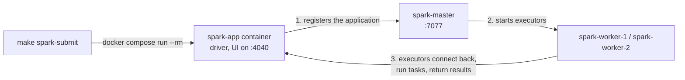

## Data Engineering Take-Home Task

### Welcome

Welcome to Deel's Data Engineering Take-Home task, as mentioned in the Task specification document, this is the pre-built stack that will help you on your solution development. This repository contains a pre-configured database containing the database represented by the following DER:


### Database Configuration

Install [Docker](https://www.docker.com/products/docker-desktop/) with [Compose v2](https://docs.docker.com/compose/install/) and GNU Make. With the Docker engine running, run these commands from the repository root:

```sh
make up             # Build changed local images and start the default stack (source/CDC, analytics database, data lake, Spark cluster)
make up PROFILES="monitoring history"  # Also start optional services (any combination of profiles)
make down           # Stop/remove all project containers, including optional profiles; keep volumes
make spark-submit   # Submit a job to the Spark cluster (defaults to a one-minute UI check job)
make help           # Show lifecycle commands
```

Optional services are grouped in Compose profiles and are not started by a plain `make up`: `monitoring` (Conduktor, see **Optional Kafka monitoring**) and `history` (Spark History Server, see **Spark History Server**). Pass them with `PROFILES`, separated by spaces.

#### Destructive reset

**Data loss:** `make clean CONFIRM=1` removes this Compose project's containers and volumes, including persisted database, Kafka, and optional monitor data. Use it only when you intend to discard that data. It does not delete images or source files, or perform a global Docker prune. `make clean` refuses before invoking Docker unless GNU Make evaluates `CONFIRM` to exactly `1`. Make normalizes leading assignment whitespace, so `make clean 'CONFIRM= 1'` also explicitly confirms deletion.

All lifecycle targets use the same Compose project selection; `make down` preserves its volumes. Keep the same working directory and Compose environment between commands. `COMPOSE` defaults to `docker compose` and can be overridden for a compatible CLI or a harmless test probe. Compose failures cause Make to fail.

Once you have the Database up and running feel free to connect to this using any tool you want, for this you can use the following credentials:

- **Username**: `finance_db_user`
- **Password**: `1234`
- **Database**: `finance_db`

### Analytics database

A separate PostgreSQL instance (`analytics-db`) holds the gold layer and the Iceberg catalog, so analytical load never reaches the source database. It starts with `make up` and keeps its data in the `analytics-pg-data` volume across `make down` / `make up`.

| Setting | From the host | From other containers |
| --- | --- | --- |
| Host and port | `localhost:5433` | `analytics-db:5432` |
| Username | `analytics` | `analytics` |
| Password | `analytics` | `analytics` |
| Database | `analytics` | `analytics` |

The credentials are local development defaults in `.env` (`ANALYTICS_DB_USER`, `ANALYTICS_DB_PASSWORD`, `ANALYTICS_DB_NAME`); variables exported in the shell override them.

```sh
docker compose exec analytics-db psql -U analytics -d analytics
```

#### Schemas and init script

`docker/analytics-db/initdb/01-gold-and-catalog.sql` creates:

- the `gold` schema in the `analytics` database, for the dimensional model;
- the `iceberg_catalog` database, where the Iceberg JDBC catalog creates its own tables on first use.

PostgreSQL runs init scripts **only when the data volume is empty**, so editing the script does not change an existing database. To apply a changed script, recreate only the analytics volume. **Data loss:** this deletes all gold data and the Iceberg catalog, which then no longer points to the lake tables.

```sh
docker compose down -v analytics-db  # Removes only the analytics container and its volume
make up
```

### Data lake (SeaweedFS)

[SeaweedFS](https://github.com/seaweedfs/seaweedfs) provides the S3-compatible object store for the data lake. It runs as a single `seaweedfs` container (`weed mini`), starts with `make up`, and keeps its data in the `seaweedfs-data` volume. It creates the `lake` bucket on startup if it does not exist, and the service reports healthy only once the bucket is there.

| Endpoint | From the host | From other containers |
| --- | --- | --- |
| S3 API | `http://localhost:8333` | `http://seaweedfs:8333` |
| Filer UI (browse buckets and files) | http://localhost:8888/buckets/lake/ | `http://seaweedfs:8888` |

| Setting | Value |
| --- | --- |
| Access key | `lakeadmin` |
| Secret key | `lakeadmin-secret` |
| Region | any (for example `us-east-1`); use path-style access |

The credentials are local development defaults in `.env` (`LAKE_S3_ACCESS_KEY`, `LAKE_S3_SECRET_KEY`); variables exported in the shell override them. Any S3-compatible store, or AWS S3 itself, can replace SeaweedFS by changing the endpoint and credentials.

#### Iceberg catalog

Every Spark job gets an [Apache Iceberg](https://iceberg.apache.org/) catalog named `lake`, configured in `docker/spark/spark-defaults.conf`:

- table metadata (the catalog) lives in the `iceberg_catalog` database of `analytics-db`, through Iceberg's JDBC catalog;
- table data and metadata files live in SeaweedFS under `s3://lake/warehouse/<namespace>/<table>/`.

The Spark image bundles Iceberg 1.12.0 (`iceberg-spark-runtime-4.1_2.13`, `iceberg-aws-bundle`) and the PostgreSQL JDBC driver 42.7.14, with pinned checksums, so jobs need no `--packages`. The driver reads the database and S3 credentials from its environment (the `.env` values above).

#### Kafka, Avro and plain files in the lake

The image also bundles, with pinned checksums:

| Library | Version | Used for |
| --- | --- | --- |
| `spark-sql-kafka-0-10`, `spark-token-provider-kafka-0-10`, `kafka-clients`, `commons-pool2` | 4.1.4, 4.1.4, 3.9.1, 2.12.1 | Reading the CDC topics with `spark.readStream.format("kafka")` |
| `spark-avro` | 4.1.4 | Reading and writing Avro files |
| `hadoop-aws` and the AWS SDK's `s3-transfer-manager` and `apache-client` | 3.4.2, 2.54.17 | The S3A filesystem for plain files and streaming checkpoints in SeaweedFS |

Iceberg tables use `s3://` paths through the catalog above. Plain files, such as the landing zone, and streaming checkpoints use `s3a://lake/...` paths. S3A uses the same AWS SDK version as the Iceberg bundle (2.54.17); the image adds only the two SDK modules the bundle does not contain.

Spark does not substitute `${env:...}` in `spark.hadoop.*` settings, so `make spark-submit` passes the S3A credentials from the driver container's environment (`LAKE_S3_ACCESS_KEY`, `LAKE_S3_SECRET_KEY`). Spark ships them to the executors and shows them as `*********(redacted)` in the UI and event logs.

Run the smoke job to check the whole path. It creates or replaces `lake.smoke.iceberg_check`, writes four rows, reads them back, and fails if they differ:

```sh
make spark-submit SPARK_APP=tests/infra/apps/iceberg_smoke_check.py
```

To inspect the result:

```sh
docker compose exec analytics-db psql -U analytics -d iceberg_catalog -c "select * from iceberg_tables"
```

The table files are visible at http://localhost:8888/buckets/lake/warehouse/smoke/iceberg_check/.

### Optional Kafka monitoring

With the source stack already running, start only the optional Conduktor services:

```sh
docker compose --profile monitoring up -d --no-deps --wait conduktor-db
docker compose --profile monitoring up -d --no-deps --wait conduktor-console
```

Open http://localhost:8090 and sign in with `admin@local.test` / `LocalConsole123!`. These are public development-only credentials. The current `8090:8080` mapping publishes on all host interfaces; use `127.0.0.1:8090:8080` if localhost-only binding is required. Console connects to the existing broker at `kafka:29092`.

Only Console and its metadata PostgreSQL database are added. Topic management, message browsing/production, and basic cluster inspection do not require Cortex. Historical metrics dashboards and alerting are not included; no ksqlDB service is required.

Stop only monitoring, keeping the source stack and stored data:

```sh
docker compose --profile monitoring stop conduktor-console conduktor-db
```

The Conduktor integration is prepared but runtime validation is still pending. `make down` stops the entire project; use the service-specific command above when leaving the source running.

### Debezium CDC

The stack includes a Debezium CDC pipeline that streams database changes to Kafka in real-time. Kafka is available at `localhost:9092`.

#### Topics

| Kafka Topic | Source Table |
|---|---|
| `finance_db.operations.customers` | `operations.customers` |
| `finance_db.operations.products` | `operations.products` |
| `finance_db.operations.orders` | `operations.orders` |
| `finance_db.operations.order_items` | `operations.order_items` |

When the connector starts, it first takes a snapshot of each table (`op` = `r`) and then streams every change. The source database and the connector are used exactly as provided; the pipeline handles their format.

#### Message format

Each topic has one partition, messages carry no headers, and both key and value are JSON without embedded schemas.

- **Key:** the row's primary key, for example `{"order_id": 1}`.
- **Value:** a Debezium change event:

| Field | Meaning |
|---|---|
| `before` | The row before the change. `null` for snapshot reads and inserts; the full row for updates and deletes, because the source tables use `REPLICA IDENTITY FULL`. |
| `after` | The row after the change. `null` for deletes. |
| `op` | `r` snapshot read, `c` insert, `u` update, `d` delete. |
| `ts_ms` | When Debezium processed the change, in epoch milliseconds. |
| `source` | Origin of the change: `table`, `txId`, `lsn` (position in the source's write-ahead log, increasing in commit order), `ts_ms` (commit time in the source) and `snapshot` (`first`, `true`, `last` and similar while snapshotting; `false` for streamed changes). |
| `transaction` | Always `null`: transaction metadata is not enabled. |

An update to an order, abbreviated:

```json
{
  "before": {"order_id": 1, "order_date": 20765, "delivery_date": 20775, "status": "PENDING", "updated_at": 1794147633457, "...": "..."},
  "after":  {"order_id": 1, "order_date": 20765, "delivery_date": 20775, "status": "REPROCESSING", "updated_at": 1794147660022, "...": "..."},
  "source": {"connector": "postgresql", "table": "orders", "txId": 952, "lsn": 26767664, "ts_ms": 1794147660025, "snapshot": "false", "...": "..."},
  "op": "u",
  "ts_ms": 1794147660561,
  "transaction": null
}
```

Column values are encoded by type:

| Source type | Columns | Encoding | Example | Reading it in Spark |
|---|---|---|---|---|
| `BIGSERIAL`, `BIGINT`, `INTEGER` | ids, `updated_by`, `created_by`, `quanity` | JSON number | `157` | cast to `long` or `int` |
| `VARCHAR` | names, `barcode`, `status`, `customer_address` | JSON string | `"PENDING"` | as is |
| `BOOLEAN` | `is_active` | JSON boolean | `true` | as is |
| `TIMESTAMP(3)` | `updated_at`, `created_at` | Milliseconds since the epoch of the stored wall-clock time, read as UTC (the source runs in UTC) | `1794147660022` = 2026-11-08 14:21:00.022 | `timestamp_millis(col)`, with the session time zone set to UTC |
| `DATE` | `order_date`, `delivery_date` | Days since 1970-01-01 | `20775` = 2026-11-18 | `date_from_unix_date(col)` |
| `DECIMAL` (no precision or scale) | `unity_price` | Debezium's variable-scale decimal: an object with the `scale` and the unscaled value as base64 big-endian two's-complement bytes | `{"scale": 2, "value": "AJk="}` = 153 × 10⁻² = 1.53 | decode the bytes to an integer and divide by 10^`scale` |

Column names are kept as in the source, including `order_items.quanity`.

**Deletes:** the data generator never deletes rows. If a row is deleted, Debezium sends an event with `op` = `d`, the full row in `before` and `after` = `null`, followed by a *tombstone*: a message with the same key and a `null` value. Consumers must accept `null` values.

**Heartbeats:** every 10 seconds the connector writes `{"ts_ms": ...}` with the key `{"serverName": "finance_db"}` to `__debezium-heartbeat.finance_db`, so the replication slot keeps advancing while the tables are idle. The pipeline does not read this topic.

#### Kafka Connection Example

```properties
bootstrap.servers=localhost:9092
```

### Spark cluster

`make up` also starts a Spark 4.1.4 standalone cluster: one master and two workers built from the `spark` target of `docker/spark/Dockerfile`. Drivers run from the `app` target, which is built on top of the `spark` target and adds the application packages, so drivers and executors always share Spark, Java and Python versions.

| Service | UI | Resources |
|---|---|---|
| `spark-master` | http://localhost:8080 | Cluster manager; accepts jobs at `SPARK_MASTER_URL` |
| `spark-worker-1` | http://localhost:8081 | 2 cores, 2 GiB executor memory |
| `spark-worker-2` | http://localhost:8082 | 2 cores, 2 GiB executor memory |
| `spark-history` (optional) | http://localhost:18080 | History server for finished, crashed and running applications; started with `make spark-history` |
| `spark-app` (one container per run) | http://localhost:4040 | Driver of an application started by `make spark-submit`; its UI is only available while it runs |

Spark runs PySpark on **Python 3.14** (3.14.10), the newest version PySpark 4.1.4 supports. The official `apache/spark` images ship Python 3.10, so the Dockerfile installs CPython 3.14 with [uv](https://docs.astral.sh/uv/) at build time and points `PYSPARK_PYTHON` at it; every driver and executor uses it.

Worker resources are set with `SPARK_WORKER_CORES` and `SPARK_WORKER_MEMORY` in `docker-compose.yaml`. They cap what executors can claim on each worker; the master, worker and driver JVMs need memory on top of that, so make sure Docker has enough memory for the whole stack.

`SPARK_MASTER_URL` defaults to `spark://spark-master:7077` in `.env`, which Docker Compose loads automatically. Exporting the variable in your shell overrides it; recreate the Spark services (`make up`) after changing it.

`.env` also pins the Compose project name (`COMPOSE_PROJECT_NAME=deel_home_task`), so every checkout of the repository, including git worktrees, drives the same local stack. `make up` rebuilds the Spark images from the checkout it runs in.

#### Submitting a job

```sh
make spark-submit                                                               # Run the one-minute UI check job (default)
make spark-submit SPARK_APP=tests/infra/apps/iceberg_smoke_check.py             # Run another application
make spark-submit SPARK_APP=path/to/app.py SPARK_APP_ARGS="--date 2026-11-05"  # Pass arguments to the application
make spark-submit SPARK_CONF="spark.cores.max=2" SPARK_UI_PORT=4041             # Cap cores and publish the UI on another port
```

| Variable | Default | Meaning |
|---|---|---|
| `SPARK_APP` | `tests/infra/apps/spark_ui_check.py` | Application to run, as a path from the repository root |
| `SPARK_APP_ARGS` | empty | Arguments passed to the application unchanged |
| `SPARK_CONF` | empty | Space-separated `key=value` Spark settings, each passed as `--conf` |
| `SPARK_UI_PORT` | `4040` | Host port for the application UI; `0` picks a free port |

Each run starts its own driver container from the `app` image with `docker compose run --rm`, in client mode, and the container is removed when the application ends. A batch job's container ends with the job; a streaming job's container lives as long as the stream. `make spark-submit` rebuilds the `app` image first when the code changed, and the cluster must already be running (`make up`).



Because every run has its own container, one application's memory, logs and lifecycle never affect another, and stopping `make spark-submit` (Ctrl+C) stops its driver. Executors reach the driver through the container's IP address, and the `common` and `pipelines` packages are shipped to them with `--py-files`.

To run several applications at the same time, give each its own UI port and cap its cores: the standalone master gives an application every free core unless `spark.cores.max` is set, so a second application would wait until the first one ends.

#### Spark History Server (optional)

Every driver writes event logs to the `spark-events` volume, whether or not the history server is running. Logs roll over at 128 MiB, so long-running streaming applications stay in bounded files. Start the history server only when you need to inspect past runs:

```sh
make spark-history          # Start the history server if it is stopped (http://localhost:18080), stop it if it is running
make up PROFILES=history    # Or start it together with the rest of the stack
```

`make spark-history` is a toggle: run it once to start the history server and again to stop and remove its container. The event logs stay in the volume either way.

When it starts, it lists every application whose event logs are in the volume, including runs that happened while it was stopped. `make down` stops it with the rest of the stack, and `make clean CONFIRM=1` deletes the event logs.

#### Checking the application UI

The application UI at http://localhost:4040 exists only while a driver runs. The default job, [`tests/infra/apps/spark_ui_check.py`](tests/infra/apps/spark_ui_check.py), is a dummy streaming query that runs for one minute so the UI can be inspected. It reads Spark's built-in `rate` source and counts rows per 10-second window every five seconds. While the job runs, open http://localhost:4040:

| Tab | What to look at |
|---|---|
| Jobs and Stages | One job per micro-batch; the windowed count adds a shuffle stage |
| SQL / DataFrame | The plan of each micro-batch |
| Executors | Executors on both workers |
| Structured Streaming | The `rate_window_counts` query, with input and processing rates and batch durations |

The job prints the progress of the latest micro-batch every five seconds. When it finishes, the UI on port 4040 closes.

#### Inspecting the landing zone with Spark SQL

`make spark-sql` opens the Spark SQL shell in its own driver container, like `make spark-submit`: it runs on the cluster, reads the lake with the S3A credentials, and can use the Iceberg catalog `lake` (Spark loads it on first use, so it appears in `SHOW CATALOGS` only after a query such as `SHOW NAMESPACES IN lake;`). It uses Spark's in-memory session catalog, so temporary views live for the session only.

```sh
make spark-sql                                                      # interactive shell
make spark-sql SPARK_SQL_FILE=tools/spark-sql/landing_examples.sql \
  SPARK_SQL_VARS="topic=finance_db.operations.orders key_field=order_id key_value=1 from_offset=0 to_offset=99"
```

[`tools/spark-sql/landing_examples.sql`](tools/spark-sql/landing_examples.sql) inspects one topic at a time and contains no topic or field names. Its variables:

| Variable | Set with | Meaning |
|---|---|---|
| `landing_root` | `LANDING_ROOT` (default `s3a://lake/landing`) | Root of the landing zone |
| `topic` | `SPARK_SQL_VARS` | Topic folder to inspect |
| `key_field`, `key_value` | `SPARK_SQL_VARS` | Key field and value for the `by key` example |
| `from_offset`, `to_offset` | `SPARK_SQL_VARS` | Offset range for the `offset range` example (both ends included) |

It defines a `landing` view that decodes the topic's records: the source coordinates (`record_source`, `source_partition`, `source_offset`, `published_at`), the key as JSON, `change_op` (`create`, `update`, `delete`, `snapshot`), and `before_json`/`after_json`. Tombstones have `tombstone = true` and no operation. Its examples return:

| Example | Returns |
|---|---|
| `latest` | the latest records |
| `by key` | every change of one key, in log order |
| `offset range` | an offset range |
| `last hour` | records published in the last hour |
| `counts` | record counts by operation |
| `tombstones` | tombstone records |

When a whole file runs, the result sets follow each other without headers, so every example's first column is its name. In the shell, set the variables first (for example `SET hivevar:topic=finance_db.operations.orders;`), then paste the views and the queries you need.

The default landing root only has data once the landing job has run; until then the views fail with `PATH_NOT_FOUND`.

Spark reads each topic folder through its file-sink commit log (`_spark_metadata`), so files from failed micro-batches are ignored and counts are exact.

Extra informations and tips about the task execution can be found in the task description document shared by our recruiting team.

For any questions, feel free to reach us out through data-platform@deel.com

### Application code

The Python code is a [uv workspace](https://docs.astral.sh/uv/concepts/projects/workspaces/): one repository-wide lock file and toolchain, with one small project per component under `analytics/`. Each image installs only the project it runs and what that project depends on.

```text
pyproject.toml              workspace root: members, development tools and their settings
uv.lock                     locked versions for the whole workspace (install with uv sync --frozen)
.python-version             Python 3.14.10, the same version the Spark image runs
analytics/
  common/                   project "common": code shared by the components
    src/common/settings.py  shared settings (analytics database) and environment helpers
    tests/
  pipelines/                project "pipelines": the Spark pipelines, depends on common
    src/pipelines/
      settings.py           pipeline settings (Kafka, lake, analytics database)
      jobs/                 Spark jobs
      quality/              data quality checks on the lake (run by make data-quality)
    tests/
tests/infra/                infra tests that drive an isolated copy of the stack
  apps/                     Spark applications they submit (UI check, Iceberg smoke check, version and hold apps)
```

Tests mirror the source tree of their project: `analytics/<project>/src/<project>/<module>.py` is tested in `analytics/<project>/tests/test_<module>.py`.

PySpark is not a dependency: it comes from the Spark image, so the pipelines always run the cluster's exact Spark version.

To work on the code outside Docker, install uv and run:

```sh
uv sync --frozen          # create .venv with Python 3.14.10, every project and the dev tools
uv run pytest --no-cov    # run the tests that do not need Spark
```

Outside Docker the Spark tests are skipped, so coverage is only meaningful with `make test`, which runs every test in the image.

#### Configuration

Settings are read from environment variables into small, immutable settings objects, one per concern. The environment is always passed in explicitly, so code and tests never read or patch the process environment:

```python
import os

from pipelines.settings import PipelineSettings

settings = PipelineSettings.from_env(os.environ)  # only a job's entry point reads os.environ
```

The code holds no deployment details: anything that depends on where it runs (brokers, topics, the lake, the catalog, the database) is a required variable with no default. The local values live in `.env`, and Docker Compose passes them to the `spark-app` driver containers; another environment sets its own values. Only tuning settings have defaults; set them in the shell for one run, for example `LANDING_TRIGGER_SECONDS=30 make spark-submit ...`.

| Variable | Settings | Default | Local value in `.env` | Purpose |
| --- | --- | --- | --- | --- |
| `KAFKA_BOOTSTRAP_SERVERS` | `pipelines.settings.KafkaSettings` | required | `kafka:29092` | Kafka brokers to read CDC topics from |
| `KAFKA_TOPICS` | `pipelines.settings.KafkaSettings` | required | the four `finance_db.operations.*` topics | Comma-separated CDC topics to read |
| `LAKE_ROOT` | `pipelines.settings.LakeSettings` | required | `s3a://lake` | Root of the data lake for plain files (S3A) |
| `ICEBERG_CATALOG` | `pipelines.settings.LakeSettings` | required | `lake` | Spark catalog name for Iceberg tables |
| `CHECKPOINT_ROOT` | `pipelines.settings.LakeSettings` | `<LAKE_ROOT>/checkpoints` | not set | Root for Structured Streaming checkpoints |
| `LANDING_TRIGGER_SECONDS` | `pipelines.settings.LandingSettings` | `10` | not set | Micro-batch interval of the landing job (a positive integer) |
| `LANDING_CHECK_LAST_OFFSETS` | `pipelines.settings.LandingQualitySettings` | all landed offsets | not set | Limit the landing data quality checks to the latest offsets of each partition (a positive integer) |
| `ANALYTICS_DB_URL` | `common.settings.AnalyticsDbSettings` | required | `jdbc:postgresql://analytics-db:5432/analytics` | JDBC URL of the analytics database (gold layer) |
| `ANALYTICS_DB_USER` | `common.settings.AnalyticsDbSettings` | required | `analytics` | Analytics database user |
| `ANALYTICS_DB_PASSWORD` | `common.settings.AnalyticsDbSettings` | required | `analytics` | Analytics database password |

`PipelineSettings` combines the Kafka, lake and analytics database settings. `LandingSettings` combines the Kafka and lake settings with the trigger interval and needs no database credentials. A missing or empty required variable raises `MissingSettingsError`, which lists every missing name of the settings being built at once; a malformed value, such as an empty topic list or a trigger interval that is not a positive integer, raises `InvalidSettingError`.

#### Landing zone

The landing job (`analytics/pipelines/src/pipelines/jobs/landing.py`) streams every record of the CDC topics into raw Avro files, exactly as Kafka delivered it, so the lake keeps a replayable copy of the sources:

```sh
make spark-submit SPARK_APP=analytics/pipelines/src/pipelines/jobs/landing.py SPARK_CONF="spark.cores.max=2"
```

- **One streaming query per topic,** reading from the earliest offset and writing to `<LAKE_ROOT>/landing/<topic>/`: one folder per topic, with no partition folders.
- **Each record is stored unchanged:** `key` and `value` as raw bytes, plus `topic`, `partition`, `offset`, `timestamp` and `timestampType`. Tombstones keep their `null` value.
- **Restart-safe:** each query keeps its checkpoint in `<CHECKPOINT_ROOT>/landing/<topic>/`, and Spark's file sink records the committed files in `_spark_metadata`. Stopping and restarting the job neither skips nor duplicates records; Spark readers of the folder see only committed files.
- **Micro-batches** run every `LANDING_TRIGGER_SECONDS`. `spark.cores.max` keeps cores free for the other jobs; the job runs until it is stopped (Ctrl+C).

#### Data quality checks

Data quality checks verify the data itself, on the running stack. They are separate from unit tests (the code, on synthetic data) and from infra tests (the platform, on a throwaway stack), and run on demand. They live in `analytics/pipelines/src/pipelines/quality/` and run as a Spark job:

```sh
make data-quality
```

The landing checks reconcile the landing zone with Kafka for every topic partition. Landed records are read through Spark, so only files committed by the file sink count:

| Check | Fails when |
| --- | --- |
| `landed` | a Kafka partition has no landed records |
| `unique` | an offset landed more than once |
| `contiguous` | an offset between the first and last landed offset is missing |
| `complete_from_start` | landing starts after Kafka's earliest offset |
| `identical` | a landed key or value differs from Kafka, or a landed offset that Kafka still retains is missing there |

Each result is printed as one JSON line prefixed with `LANDING QUALITY`, followed by a summary line, and the job exits with code 1 if any check fails. The `landed` result also reports the row count, the offset range, the number of tombstones and the lag behind Kafka; lag is expected while landing runs and is not a failure.

By default every landed offset is checked. For large topics, `LANDING_CHECK_LAST_OFFSETS=<n> make data-quality` limits the comparison to the latest `n` landed offsets of each partition (and skips `complete_from_start`). The job runs with `spark.cores.max=2` and a random UI port, so it can run while the landing job is running.

#### Tests, lint and format

The checks run in a throwaway container from the `app` image, with `analytics/` and `tests/` mounted, so they use the cluster's exact Spark and Python versions and pick up edits without a rebuild:

```sh
make test       # unit tests with branch coverage; fails below 90%
make lint       # ruff lint and format check
make format     # format the code and apply safe lint fixes (files keep your ownership)
make typecheck  # check types with ty; any diagnostic fails
```

- **Unit tests** live next to each project and mirror its source tree (`analytics/<project>/tests/test_<module>.py`).
- **Coverage** is measured on the `common` and `pipelines` packages with branch coverage. The 90% floor is configured in `pyproject.toml` (`[tool.coverage.report] fail_under`), and `make test` fails below it even when every test passes.
- **Lint and format** use [ruff](https://docs.astral.sh/ruff/), configured in `pyproject.toml` (`[tool.ruff]`).
- **Typing** is required for all code. ruff's `ANN` rules fail `make lint` when an annotation is missing, and [ty](https://docs.astral.sh/ty/) checks that the annotations are correct, including calls into PySpark, whose types it reads from the image (`[tool.ty]` in `pyproject.toml`). ty is in beta, so its version is pinned in `uv.lock`; it only runs in the container, where PySpark is available.

#### Infra tests

Infra tests check the platform itself rather than the pipeline code. They need Docker and [uv](https://docs.astral.sh/uv/) on the host, and run locally only (not in CI):

```sh
make test-infra   # about two minutes, mostly building images and starting the stack
```

They start an isolated Compose project (`deel-infra-tests`, with no host ports), so they never touch your running stack or its data, and remove it with its volumes at the end. They submit the apps in `tests/infra/apps/` with `make spark-submit` and check that:

- the Iceberg smoke job writes catalog metadata to PostgreSQL and table files to SeaweedFS;
- executors write and read Avro files on `s3a://lake/` and write and read a Kafka topic with the bundled connectors;
- drivers and executors run the same Spark (4.1.4) and Python (3.14) versions;
- each application run gets its own driver container, which is removed when the application ends;
- two applications capped with `spark.cores.max=2` run at the same time, both with executors, in two separate driver containers;
- the landing example queries (`make spark-sql`) return the expected records from neutral, landing-shaped fixture data (topics `topic-a` and `topic-b`), including an update, a delete, a tombstone and a snapshot read, and inspect only the chosen topic.

#### Pre-commit hooks

Install the hooks once per clone (needs [uv](https://docs.astral.sh/uv/) and Docker):

```sh
make hooks
```

Every `git commit` then runs, in order, stopping at the first failure:

| Hook | Runs when the commit touches | Where |
| --- | --- | --- |
| `uv.lock` matches `pyproject.toml` | any `pyproject.toml`, `uv.lock` | host |
| ruff check, ruff format check | Python files, `pyproject.toml` | host, with the ruff version from `uv.lock` |
| ty | `analytics/`, `tests/`, `pyproject.toml`, `uv.lock` | app container (`make typecheck`) |
| unit tests with the 90% coverage floor | `analytics/`, `tests/`, `pyproject.toml`, `uv.lock` | app container (`make test`) |

A commit that only changes documentation or configuration skips all of them. Commits that touch code take about 20–30 seconds longer, mostly for the container checks. Run `make format` to fix formatting before committing again. `git commit --no-verify` skips the hooks, which is why CI runs the same checks.

#### Continuous integration

[`.github/workflows/ci.yml`](.github/workflows/ci.yml) runs the code checks on every pull request to `main` (before merging) and on every push to `main` (after merging):

| Job | What it runs |
| --- | --- |
| `lint` | `uv lock --check`, `ruff check`, `ruff format --check` |
| `typecheck` | `make typecheck` in the app image |
| `test` | `make test` in the app image, with the 90% coverage floor |

The app image is built once per job with Docker's layer cache stored in GitHub Actions, and `make` reuses it (`APP_BUILD=`), so CI runs exactly the commands used locally. Infra tests are not part of CI; run them locally with `make test-infra`.
