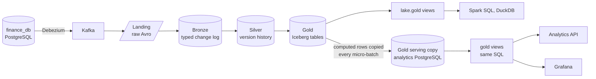

# Deel CDC pipeline

This site is the report for Deel's data engineering take-home: what was asked, what I built, how to run it and why it is built this way. The [repository README](https://github.com/jonathan5p/deel-home-task#readme) is the quick start.

For a short visual tour, open the [interactive showcase](showcase/index.html).

## The assignment

ACME Delivery Services wants to monitor orders with low latency. The task: a Spark Structured Streaming application that reads the Debezium topics of a supplied PostgreSQL database and keeps a consistent dimensional model, with history and current state, that answers four business questions in near real time ([the original README](reference/original-readme.md)).

## What was built



| Part | What it does |
| --- | --- |
| Capture | The supplied database and Debezium connector, as provided, stream every change to Kafka |
| Lake | Spark streams keep an Iceberg lake on SeaweedFS: **landing** keeps every Kafka record, **bronze** types and validates each change, **silver** keeps the deduplicated version history. Every layer runs one streaming query per table |
| Gold | Spark streams build a star schema (SCD2 dimensions, history facts, current state) as Iceberg tables, and copy each batch into PostgreSQL for serving |
| Serving | The same views in PostgreSQL (`gold`) and the lake (`lake.gold`), read by a FastAPI service, Grafana, `psql`, Spark SQL and DuckDB |
| Operations | Bronze replay, gold rebuild, gold retention, scheduled lake maintenance and data quality checks from Kafka to gold |
| Engineering | Typed Python in a uv workspace, unit tests with at least 90% branch coverage, infra tests on isolated stacks, and this site built in strict mode |

### How the requirements are met

| The assignment asks for | How it is met | Read more |
| --- | --- | --- |
| Processing the Debezium topics and joining them with historical data for consistent results | Each batch recomputes the touched keys with their stored history; current state takes only newer versions, so late or replayed events never overwrite it; the views join each change to the dimension version valid at the time | [Gold writer](lakehouse/gold/writer.md#writing-gold), [D31](architecture/decisions.md#d31--late-arrivals-are-history-deduplication-happens-in-silver) |
| History together with the current state (must have) | Silver keeps every version; gold keeps SCD2 dimensions, history facts and current-state tables | [Silver](lakehouse/silver.md), [the gold model](lakehouse/gold/model.md) |
| A dimensional model that answers the business questions (must have) | A star schema with one view per question, the same in Iceberg and PostgreSQL | [The four business questions](lakehouse/gold/model.md#the-four-business-questions) |
| Data ready as soon as possible (must have) | Every hop streams (landing every 10 s, later hops every 2–5 s); a freshness view and endpoint report the lag | [One micro-batch, end to end](architecture/overview.md#one-micro-batch-end-to-end), [analytics API](serving/api.md) |
| An architecture diagram with every component | The containers and their connections, the data flow and the operations | [Architecture overview](architecture/overview.md) |
| The Spark sizing strategy, its variables and the key metrics | The settings, the measured numbers and the metrics to watch | [Spark sizing strategy](architecture/sizing.md) |
| Evidence of the application running | A recording, data quality reports, latency and query timings, infra tests | [Key results and evidence](#key-results-and-evidence) |
| Access for stakeholders: API, dashboards or CLI | All three | [Serving](#serving) |
| A Dockerized application with a detailed README | One Docker Compose stack, driven by `make` | [Repository README](https://github.com/jonathan5p/deel-home-task#readme) |

## Run and verify it

You need Docker with Compose v2, GNU Make and [uv](https://docs.astral.sh/uv/). The README's [install](https://github.com/jonathan5p/deel-home-task#install) and [reproduce the results](https://github.com/jonathan5p/deel-home-task#reproduce-the-results) sections have every step. In short:

```sh
make pipeline PIPELINE=all   # start the stack and every streaming job
make data-quality            # compare each layer with the one before it, from Kafka to gold
curl -s localhost:8000/metrics/top-customers-by-pending-orders
curl -s localhost:8000/freshness
```

Then open the **Gold metrics** dashboard at <http://localhost:3000/d/gold-metrics>. `make down` stops everything and keeps the data.

## Key results and evidence

### The stack running

The stack running on my machine: Debezium changes in Conduktor, the analytics API, the Spark queries in the History Server and the Grafana dashboards.

<video controls preload="metadata" width="100%" src="assets/app-running.mp4">
  <a href="assets/app-running.mp4">Download the recording (MP4)</a>
</video>

### What the checks show

| Claim | Evidence |
| --- | --- |
| The data adds up, layer by layer | `make data-quality`: every Kafka offset landed once, every record in bronze or quarantine once, every change in silver once, PostgreSQL gold an exact copy of the Iceberg tables, and the same answers in both stores. All 68 checks passed, the 28 gold checks among them (report `20261113T054751Z`) ([data quality](lakehouse/data-quality.md)) |
| Streaming, replay and rebuild agree | Infra tests: a gold rebuild equals streaming the same changes, a replay adds only what bronze lacks, a replayed batch changes nothing ([testing](development/testing.md#infra-tests)) |
| Gold is near real time | 13–16 s after the source commit at the median, 16–20 s at p95 (5 probes per entity, 2026-11-13) ([latency](operations/latency.md)) |
| The questions are cheap to answer | 0.15–0.33 ms per view on the running stack, through partial indexes chosen from the query plans ([D40](architecture/decisions.md#d40--gold-indexes-chosen-from-the-query-plans-of-the-current-use-cases)) |
| The cluster keeps up | The metrics to watch and their healthy values ([key metrics](architecture/sizing.md#key-metrics)) |
| The code is checked on every pull request | Lint, types and unit tests with a 90% coverage floor in CI; the site builds in strict mode ([testing and CI](development/testing.md)) |

The platform is simplified for one machine; [the way to production](architecture/production.md) lists what is left.

## Map of the docs

| Section | Start with | Then |
| --- | --- | --- |
| Architecture | [Overview](architecture/overview.md): every service, the containers and their connections, the data flow and the operations | [Infrastructure](architecture/infrastructure.md) · [Spark sizing](architecture/sizing.md) · [Design decisions](architecture/decisions.md) · [The way to production](architecture/production.md) |
| Lakehouse | [Medallion layers](lakehouse/index.md) | [Source and CDC](lakehouse/source-and-cdc.md) · [Landing](lakehouse/landing.md) · [Bronze](lakehouse/bronze.md) · [Silver](lakehouse/silver.md) · [Gold](lakehouse/gold/index.md) ([model](lakehouse/gold/model.md), [writer](lakehouse/gold/writer.md)) · [Data quality checks](lakehouse/data-quality.md) ([latest results](lakehouse/data-quality-results.md)) |
| Serving | [Analytics API](serving/api.md) | [Grafana](serving/grafana.md) · [Querying the lake](serving/lake-access.md) |
| Operations | [Running the pipeline](operations/running-the-pipeline.md) | [Maintenance and recovery](operations/maintenance-and-recovery.md) · [Debugging](operations/debugging.md) · [End-to-end latency](operations/latency.md) ([latest results](operations/latency-results.md)) · [Monitoring Spark](operations/monitoring.md) · [Configuration](operations/configuration.md) |
| Development | [Code layout](development/code-layout.md) | [Table and column definitions](development/table-definitions.md) · [Testing and CI](development/testing.md) |
| How it was built | [How I worked](process/how-i-worked.md): milestones, issues and sub-issues, small stacked pull requests | [Building with AI agents](process/ai-agents.md) |
| Reference | [Table reference](reference/index.md): every [bronze](reference/bronze/index.md), [silver](reference/silver/index.md) and [gold](reference/gold/index.md) table and view, rendered from the Avro schemas on every build | [Supplied assignment README](reference/original-readme.md) |

### Serving

The four business questions can be read over HTTP from the [analytics API](serving/api.md), on the [Grafana](serving/grafana.md) dashboard, or from a terminal with `psql`, Spark SQL or DuckDB ([querying the lake](serving/lake-access.md)).

Every diagram has a full-screen button; hold Alt (Option on a Mac) while scrolling or dragging to zoom and pan.
