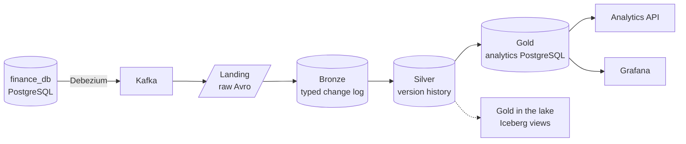

# Deel CDC pipeline

This site is the report for Deel's data engineering take-home: what was asked, what was built, how to run and check it, and why it is built this way. The [repository README](https://github.com/jonathan5p/deel-home-task#readme) is the quick start; these pages go into depth.

## The assignment

ACME Delivery Services wants its logistics leaders to monitor orders with low latency. The task: a Spark Structured Streaming application that reads the Debezium change topics of a supplied PostgreSQL database and keeps a consistent dimensional model, with history and current state, that answers four business questions in near real time. The supplied text is kept as [the original README](reference/original-readme.md).

## What was built



- **Capture.** The supplied database and Debezium connector, used exactly as provided, stream every change of customers, products, orders and order items to Kafka.
- **Lake.** Four Spark streaming jobs keep an Apache Iceberg lake on an S3-compatible store (SeaweedFS): **landing** keeps every Kafka record unchanged, **bronze** types and validates each change, **silver** keeps the deduplicated version history of every entity.
- **Gold.** A fifth job keeps a star schema in a separate PostgreSQL up to date: SCD2 customer and product dimensions, history facts for orders and order items, and current-state tables, each micro-batch applied in one transaction. The same model is also defined in the lake as Iceberg views over silver.
- **Serving.** The four business questions are views in the `gold` schema, served by an HTTP API (FastAPI), a Grafana dashboard, `psql`, Spark SQL and DuckDB.
- **Operations.** Replay of a landing range into bronze, a rebuild of gold from silver, gold retention, scheduled lake maintenance and a chain of data quality checks from Kafka to gold.
- **Engineering.** Typed Python in a uv workspace, unit tests with at least 90% branch coverage in CI, infra tests on isolated copies of the stack, and this site built in strict mode with a table reference rendered from the schemas.

### How the requirements are met

| The assignment asks for | How it is met | Read more |
| --- | --- | --- |
| Processing the Debezium topics and joining them with historical data for consistent results | Gold applies a version only if it is newer than the stored one, and writes each micro-batch in one PostgreSQL transaction, so late or replayed events never overwrite newer state | [Gold writer](lakehouse/gold/writer.md#writing-gold), [D31](architecture/decisions.md#d31--late-arrivals-are-history-deduplication-happens-in-silver) |
| History together with the current state (must have) | Silver keeps every version; gold keeps SCD2 dimensions, history facts and current-state tables | [Silver](lakehouse/silver.md), [the gold model](lakehouse/gold/model.md) |
| A dimensional model that answers the business questions (must have) | A star schema in PostgreSQL with one view per question | [The four business questions](lakehouse/gold/model.md#the-four-business-questions) |
| Data ready as soon as possible (must have) | Every hop is a streaming query with a 10-second trigger; a freshness view and endpoint report the lag per entity | [One micro-batch, end to end](architecture/overview.md#one-micro-batch-end-to-end), [analytics API](serving/api.md) |
| An architecture diagram with every component | Diagrams of the services, the containers and their connections, the data flow and the operations | [Architecture overview](architecture/overview.md) |
| The Spark sizing strategy, its variables and the key metrics | The variables, how cores and memory are shared, and the metrics that show whether the sizing holds | [Spark sizing strategy](architecture/sizing.md) |
| Evidence of the application running | Data quality reports from the running stack, query plans and timings, infra tests | [Key results and evidence](#key-results-and-evidence) |
| Access for stakeholders: API, dashboards or CLI | All three | [Serving](#serving) |
| A Dockerized application with a detailed README | One Docker Compose stack, driven by `make` | [Repository README](https://github.com/jonathan5p/deel-home-task#readme) |

## Run and verify it

You need Docker with Compose v2, GNU Make and [uv](https://docs.astral.sh/uv/). The README's [install](https://github.com/jonathan5p/deel-home-task#install) and [reproduce the results](https://github.com/jonathan5p/deel-home-task#reproduce-the-results) sections have every step; in short:

```sh
make pipeline PIPELINE=all   # start the stack and every streaming job
make data-quality            # compare each layer with the one before it, from Kafka to gold
curl -s localhost:8000/metrics/top-customers-by-pending-orders
curl -s localhost:8000/freshness
```

Then open the **Gold metrics** dashboard at <http://localhost:3000/d/gold-metrics>. `make down` stops everything and keeps the data.

## Key results and evidence

- **The data adds up, layer by layer.** `make data-quality` checks that every Kafka offset is landed once, every landed record reaches bronze or its quarantine exactly once, every bronze change reaches silver once, and every gold view equals the same view computed from silver. Each run writes a JSON report to the lake and exits with code 1 if a check fails ([data quality checks](lakehouse/data-quality.md)).
- **Streaming, replay and rebuild agree.** Infra tests show that rebuilding gold from silver gives the same result as streaming the same changes, that a replayed landing range adds only the changes bronze lacks, and that replaying a micro-batch changes nothing ([testing](development/testing.md#infra-tests)).
- **The business questions are cheap to answer.** The gold indexes were chosen from the query plans of the four questions. On a test database with 1M orders and 3M items, pending items by product went from 344–380 ms to 37–46 ms ([decision D40](architecture/decisions.md#d40--gold-indexes-chosen-from-the-query-plans-of-the-current-use-cases)).
- **The Spark metrics to watch.** The sizing strategy names the streaming metrics that show whether the cluster keeps up, where to read each one, and what a healthy value looks like ([key metrics](architecture/sizing.md#key-metrics)).
- **What is left for production.** The platform is simplified for one machine; [the way to production](architecture/production.md) lists what is left to take it to a real production environment.
- **The code is checked on every pull request.** Lint, type checks and unit tests with a 90% branch-coverage floor run in CI; this site is built in strict mode, so a broken link fails it ([testing and CI](development/testing.md)).

## Map of the docs

| Section | Start with | Then |
| --- | --- | --- |
| Architecture | [Overview](architecture/overview.md): every service, the containers and their connections, the data flow and the operations | [Infrastructure](architecture/infrastructure.md) · [Spark sizing](architecture/sizing.md) · [Design decisions](architecture/decisions.md) · [The way to production](architecture/production.md) |
| Lakehouse | [Medallion layers](lakehouse/index.md) | [Source and CDC](lakehouse/source-and-cdc.md) · [Landing](lakehouse/landing.md) · [Bronze](lakehouse/bronze.md) · [Silver](lakehouse/silver.md) · [Gold](lakehouse/gold/index.md) ([model](lakehouse/gold/model.md), [writer](lakehouse/gold/writer.md)) · [Data quality checks](lakehouse/data-quality.md) |
| Serving | [Analytics API](serving/api.md) | [Grafana](serving/grafana.md) · [Querying the lake](serving/lake-access.md) |
| Operations | [Running the pipeline](operations/running-the-pipeline.md) | [Maintenance and recovery](operations/maintenance-and-recovery.md) · [Debugging](operations/debugging.md) · [End-to-end latency](operations/latency.md) · [Configuration](operations/configuration.md) |
| Development | [Code layout](development/code-layout.md) | [Table and column definitions](development/table-definitions.md) · [Testing and CI](development/testing.md) |
| How it was built | [How I worked](process/how-i-worked.md): milestones, issues and sub-issues, small stacked pull requests | [Building with AI agents](process/ai-agents.md) |
| Reference | [Table reference](reference/index.md): every [bronze](reference/bronze/index.md), [silver](reference/silver/index.md) and [gold](reference/gold/index.md) table and view, rendered from the Avro schemas on every build | [Supplied assignment README](reference/original-readme.md) |

### Serving

The four business questions can be read in three ways: over HTTP from the [analytics API](serving/api.md), on the [Grafana](serving/grafana.md) dashboard, or from a terminal with `psql` on the `gold` views, Spark SQL or DuckDB on the lake ([querying the lake](serving/lake-access.md)).

Use the search box to find a table or a column. Every diagram has a full-screen button; hold Alt (Option on a Mac) while scrolling or dragging to zoom and pan it.
