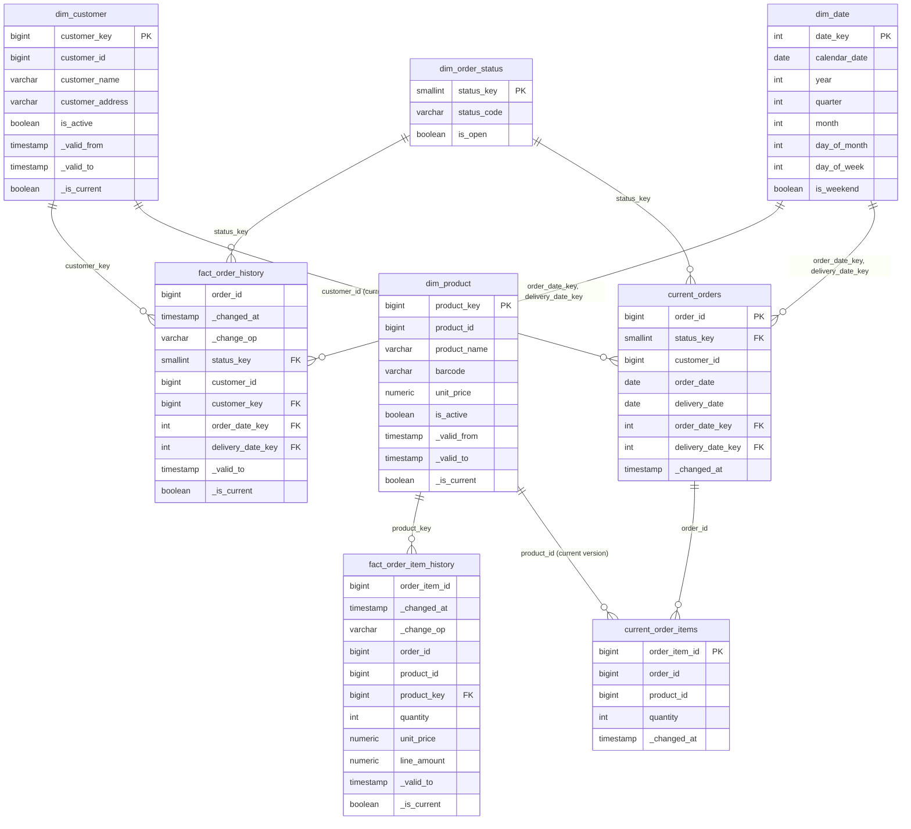

# Gold dimensional model

Gold is the serving layer: a star schema in PostgreSQL (the `analytics` database) that answers the four business questions with near-real-time current state and keeps the history of every change. Spark builds it from the silver history tables in the lake, and writes the same rows to Iceberg gold tables in the lake as a second sink.

## Inputs from silver

Silver keeps one row per version of each source entity (customers, products, orders, order items), appended in the order changes reach it. Its views expose, per version:

| Column | Meaning |
| --- | --- |
| entity key | `customer_id`, `product_id`, `order_id` or `order_item_id` |
| business columns | the source columns, with `unity_price` decoded to a decimal and `quanity` renamed to `quantity` |
| `_commit_sequence` | the change's position in the source database's write-ahead log (Debezium `source.lsn`) |
| `_change_op` | `snapshot`, `create`, `update` or `delete` |
| `_changed_at` | when the change was committed in the source |
| `_valid_from`, `_valid_to`, `_is_current` | the version's validity range, derived from the next version by `_commit_sequence` |
| `_is_deleted`, `content_hash` | whether the version is a delete, and the hash of its business columns |

### What `_commit_sequence` is

`_commit_sequence` is the PostgreSQL log sequence number (LSN) of the change, as a 64-bit integer: the byte position of the change in the source database's write-ahead log. It only grows, in commit order, across the whole database. For one key, a later change always has a higher position than an earlier one; snapshot rows carry the position of the snapshot, which is lower than any change streamed after it. Gold uses it to order versions of a key and to tell a late or replayed event from a newer one. Arrival order and Kafka offsets are not used for ordering.

## Internal tables and public views

Gold has two schemas:

- **`gold_internal`** holds the tables. Only the gold streaming query writes them, and they keep the metadata it needs: `_commit_sequence` to skip replayed batches and to order versions, and `_is_deleted` for soft deletes in current state.
- **`gold`** holds one view per table, with the same name, for consumers: the business queries, the API and anyone browsing the model. The views leave out `_commit_sequence` and `_is_deleted`; the current-state views leave out deleted rows, and the history views add each version's validity range.

Consumers never need to know how the pipeline orders or deduplicates changes, and the tables can change for the pipeline without breaking them.

| Column | In `gold_internal` | In the `gold` views |
| --- | --- | --- |
| `_commit_sequence` | every table except `dim_date` and `dim_order_status` | left out |
| `_is_deleted` | `current_orders`, `current_order_items` | left out; deleted rows are filtered |
| `_valid_to`, `_is_current` of history facts | not stored | computed from the next version by `_commit_sequence` |

## Model

The diagram shows the `gold` views; the keys and relations are enforced on the `gold_internal` tables.



### Tables and grain

| Table | Kind | Grain | Key (in `gold_internal`) |
| --- | --- | --- | --- |
| `dim_customer` | SCD2 dimension | one row per customer version | `customer_key` (surrogate); unique (`customer_id`, `_commit_sequence`); one row with `_is_current` per `customer_id` |
| `dim_product` | SCD2 dimension | one row per product version; a new price is a new version | `product_key` (surrogate); unique (`product_id`, `_commit_sequence`); one row with `_is_current` per `product_id` |
| `dim_date` | seeded dimension | one row per calendar day, 2000-01-01 to 2099-12-31 | `date_key` (`yyyymmdd`) |
| `dim_order_status` | seeded dimension | one row per status: `PENDING`, `PROCESSING`, `REPROCESSING`, `COMPLETED`, `UNKNOWN` | `status_key` |
| `fact_order_history` | history fact | one row per change to an order | (`order_id`, `_commit_sequence`, `_changed_at`) |
| `fact_order_item_history` | history fact | one row per change to an order item | (`order_item_id`, `_commit_sequence`, `_changed_at`) |
| `current_orders` | current state | one row per order; the view leaves deleted orders out | `order_id` |
| `current_order_items` | current state | one row per order item; the view leaves deleted items out | `order_item_id` |

Notes:

- `unity_price` is renamed `unit_price` in gold. `order_id`, `customer_id`, `product_id` and `order_item_id` stay as degenerate keys next to the surrogate keys, so facts can be joined to the source without the dimensions.
- `customer_key` in `fact_order_history` is the customer version valid at the order change's `_changed_at`.
- `product_key`, `unit_price` and `line_amount` (`quantity × unit_price`) in `fact_order_item_history` come from the product version valid at the item's `_changed_at`, which is when the order was placed: the source inserts an order's items right after the order. This keeps the price the order was placed at, even after the product's price changes.
- A delete is a history row with `_change_op = 'delete'` and the row's last values. History has no `_is_deleted` column: `_change_op` already says it.
- The history facts' keys include `_changed_at` because PostgreSQL requires the partition column in the primary key. A change always has the same `_changed_at`, so the key still identifies one change.
- The `gold` history views add `_valid_to` (the next version's `_changed_at`, ordered by `_commit_sequence`) and `_is_current`, so history can be queried as of any time, for example "open orders on 2026-11-01".

## Rules

### Versioning

- **History is idempotent.** A history row is inserted only if (key, `_commit_sequence`) is not already there. Replaying a micro-batch, or a Debezium re-send after a restart, adds nothing.
- **Current state only moves forward.** A version replaces the current row only if its `_commit_sequence` is higher than the stored one. A late version is still appended to history, where its validity range lands in the right place, but it never overwrites newer current state.

  Example: order 7 is stored as `PROCESSING` at position 500. A delayed event `PENDING` at position 420 arrives. History gets the 420 row (valid until the 500 change); `current_orders` stays `PROCESSING`. Then `COMPLETED` at 610 arrives and replaces it.
- **Deletes are soft in current state.** A delete sets `_is_deleted` and keeps the row with the delete's `_commit_sequence`, so a late event older than the delete cannot bring the row back. The `gold` current-state views leave deleted rows out.
- **SCD2 dimensions.** A new version closes the current row (`_valid_to` = the new version's `_valid_from`, `_is_current` false) and inserts the new one. Silver already skips versions whose business columns did not change.

### Open orders and pending items

- **Open order:** an order in `current_orders` that is not deleted and whose status has `is_open`. Every status except `COMPLETED` is open. A null or unexpected status maps to `UNKNOWN`, which is open, so it shows up in the metrics instead of disappearing.

  | Status | Open |
  | --- | --- |
  | `PENDING` | yes |
  | `PROCESSING` | yes |
  | `REPROCESSING` | yes |
  | `UNKNOWN` (null or unexpected) | yes |
  | `COMPLETED` | no |

- **Pending order** (question 4): an open order. `PENDING` alone would leave out orders being processed, and would not match questions 1 to 3.
- **Pending item** (question 3): an item, not deleted, of an open order. Question 3 reports both the number of pending items and their total quantity per product.
- **Top 3:** questions 2 and 4 include ties (`FETCH FIRST 3 ROWS WITH TIES`), so more than three rows come back when several share the third place.

Example: customer 3 has order 10 `PENDING` with two items of product 5 (quantities 4 and 6), and order 11 `COMPLETED` with one item of product 5. Customer 3 has one pending order; product 5 has two pending items with a total quantity of 10.

## Current state and retention

**Current state is stored in tables** updated by the streaming queries, in the same database transaction as the history insert. The metric views read only these small tables, so they stay fast as history grows.

The alternatives were rejected:

- A view that picks the latest version from history gets slower as history grows.
- A materialized view recomputes everything on every refresh, too slow for one refresh per micro-batch.
- Both would lose orders that are still open but whose last change is older than the retention window.

**Retention:** the history facts keep 3 years by default in PostgreSQL. They are range-partitioned by month on `_changed_at`, so retention drops whole partitions instead of deleting rows; a default partition catches rows outside the created range. Current-state tables and the dimensions are never trimmed, so an order that is still open keeps its current row however old it is. The lake gold tables keep the full history.

## Writing gold

For each micro-batch, the gold streaming query:

1. writes the batch's versions to staging tables in `gold_internal`;
2. in one transaction, on the `gold_internal` tables: closes and inserts SCD2 dimension versions, inserts the new history rows, applies newer versions to the current-state tables;
3. merges the same rows into the Iceberg gold tables in the lake, by key and `_commit_sequence`; they are partitioned by month and keep the full history.

No transaction spans PostgreSQL and the lake, so both writes are idempotent: a failed batch is simply replayed.

**Freshness.** `gold.data_freshness` reports, per entity, how up to date gold is. For now it is computed from the data, as the source commit time of the newest change gold holds, so it ages when the source stops changing even though the pipeline is healthy. Later it will be filled from the pipeline statistics, with the same shape. Those statistics (per micro-batch rows, durations, last `_commit_sequence`, last event time) are planned in a separate `observability` catalog in the lake, apart from the business data (#127).

## The four business questions

| Question | Answered from | Query |
| --- | --- | --- |
| Number of open orders by delivery date and status | `current_orders` joined to `dim_order_status`, where open, grouped by `delivery_date` and `status_code` | [01](../../sql/gold/01_open_orders_by_delivery_date_and_status.sql) |
| Top 3 delivery dates with more open orders | the same count by `delivery_date`, ordered descending, top 3 with ties | [02](../../sql/gold/02_top_delivery_dates_by_open_orders.sql) |
| Number of open pending items by product | `current_order_items` joined to open `current_orders`, grouped by `product_id`: item count and total quantity | [03](../../sql/gold/03_pending_items_by_product.sql) |
| Top 3 customers with more pending orders | open `current_orders` by `customer_id`, with the name from the current `dim_customer`, top 3 with ties | [04](../../sql/gold/04_top_customers_by_pending_orders.sql) |

The queries are in [`sql/gold/`](../../sql/gold/) and read only the `gold` views. For example, the core of question 2:

```sql
SELECT o.delivery_date, count(*) AS open_orders
FROM gold.current_orders AS o
JOIN gold.dim_order_status AS s ON s.status_key = o.status_key
WHERE s.is_open
GROUP BY o.delivery_date
ORDER BY open_orders DESC
FETCH FIRST 3 ROWS WITH TIES;
```

## Known source issues

- The data generator looks up "today's order of a customer" by customer and date only when inserting items, so new items can be attached to an order of the same day that is already `COMPLETED`. Gold keeps these items; they are not pending because their order is not open.
- `products.unity_price` is a `DECIMAL` without precision or scale, so `unit_price` is an unconstrained `NUMERIC` in gold, which keeps every price exact.
