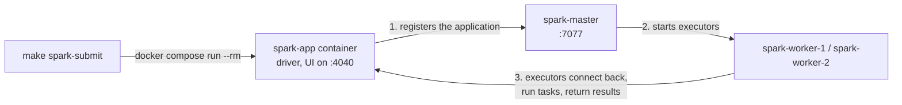

# Infrastructure

Every service runs in one Docker Compose project. The [architecture overview](overview.md#containers-and-connections) shows how they connect; this page covers how each is set up.

## Starting the stack

Install [Docker](https://www.docker.com/products/docker-desktop/) with [Compose v2](https://docs.docker.com/compose/install/), GNU Make and [uv](https://docs.astral.sh/uv/). With Docker running, from the repository root:

```sh
make up                                # Build changed images and start the default stack
make up PROFILES="monitoring history"  # Also start optional profiles
make down                              # Stop all project containers; keep volumes
make spark-submit                      # Submit a job to the Spark cluster (default: a one-minute UI check)
make help                              # Show the lifecycle commands
```

`make up` starts the default services and the `metrics` profile (`DEFAULT_PROFILES=` leaves it out). The other profiles start with `PROFILES`:

| Profile | Starts |
| --- | --- |
| `metrics` | Prometheus, the Spark History Server, the REST catalog and the stage exporter ([metrics](#metrics)) |
| `history` | The Spark History Server ([below](#spark-history-server-optional)) |
| `catalog` | The read-only Iceberg REST catalog ([below](#iceberg-rest-catalog)) |
| `maintenance` | Scheduled [lake maintenance](../operations/maintenance-and-recovery.md#lake-maintenance) and [gold retention](../operations/maintenance-and-recovery.md#gold-retention) |
| `data-quality` | Scheduled [data quality checks](../lakehouse/data-quality.md) |
| `monitoring` | The Conduktor Kafka console ([optional Kafka monitoring](../operations/debugging.md#optional-kafka-monitoring)) |

## Analytics database

A separate PostgreSQL instance, `analytics-db`, holds gold and the Iceberg catalog, so analytical load never reaches the source database. Its data lives in the `analytics-pg-data` volume.

| Setting | From the host | From other containers |
| --- | --- | --- |
| Host and port | `localhost:5433` | `analytics-db:5432` |
| User, password, database | `analytics` | `analytics` |

The credentials are local defaults in `.env`; variables exported in the shell override them.

```sh
docker compose exec analytics-db psql -U analytics -d analytics
```

### Read-only service logins

Consumers never use the `analytics` owner. Each logs in with its own login in the `gold_reader` role, which can read the `gold` views and nothing else. Sessions start read-only, with a statement timeout.

| Login | Used by | Credentials in `.env` | Statement timeout |
| --- | --- | --- | --- |
| `api_reader` | The analytics API | `API_READER_USER`, `API_READER_PASSWORD` | 5 s |
| `grafana` | The Grafana gold datasource ([Grafana](../serving/grafana.md)) | `GRAFANA_READER_USER`, `GRAFANA_READER_PASSWORD` | 30 s |
| `lake_catalog_reader` | The [REST catalog](#iceberg-rest-catalog); reads only `iceberg_catalog`, not in `gold_reader` | `LAKE_CATALOG_READER_USER`, `LAKE_CATALOG_READER_PASSWORD` | none |

```sh
docker compose exec -e PGPASSWORD=api_reader analytics-db psql -h localhost -U api_reader -d analytics -c "select * from gold.data_freshness"
```

The gold DDL creates `gold_reader` and its grants. `docker/analytics-db/initdb/03-service-logins.sh` creates the logins on an empty volume; a new login is one more `create_login` line. On an existing volume:

```sh
make up          # Recreates analytics-db when its credentials changed
make db-logins   # Creates or updates every service login; safe to repeat
```

### Schemas and init script

`docker/analytics-db/initdb/01-gold-and-catalog.sql` creates the `gold` schema and the `iceberg_catalog` database with the JDBC catalog's tables, so the REST catalog can start before Spark has written anything.

PostgreSQL runs init scripts only on an empty volume. To apply a changed script, recreate the analytics volume; for gold changes use `make gold-reset` instead. **Data loss:** this deletes gold and the Iceberg catalog, which then no longer points to the lake tables.

```sh
docker compose down -v analytics-db
make up
```

## Data lake (SeaweedFS)

[SeaweedFS](https://github.com/seaweedfs/seaweedfs) is the S3-compatible object store: one `weed mini` container that creates the `lake` bucket on start and keeps its data in the `seaweedfs-data` volume. I chose it because MinIO is no longer maintained ([D13](decisions.md#d13--object-store-seaweedfs-instead-of-minio)).

| Endpoint | From the host | From other containers |
| --- | --- | --- |
| S3 API | `http://localhost:8333` | `http://seaweedfs:8333` |
| Filer UI | <http://localhost:8888/buckets/lake/> | `http://seaweedfs:8888` |

Access key `lakeadmin`, secret `lakeadmin-secret` (local defaults in `.env`), any region, path-style access. Any S3-compatible store, AWS S3 included, can replace it by changing the endpoint and credentials.

## Spark cluster

`make up` starts a Spark 4.1.4 standalone cluster: one master and two workers from the `spark` target of `docker/spark/Dockerfile`. Drivers use the `app` target, built on top of it, so drivers and executors share Spark, Java and Python versions.

| Service | UI | Role |
|---|---|---|
| `spark-master` | <http://localhost:8080> | Cluster manager at `SPARK_MASTER_URL` (default `spark://spark-master:7077`) |
| `spark-worker-1`, `spark-worker-2` | <http://localhost:8081>, <http://localhost:8082> | 5 cores and 5 GiB of executor memory each |
| `spark-history` | <http://localhost:18080> | History Server (`metrics` or `history` profile) |
| `prometheus` | <http://localhost:9090> | Scrapes the Spark processes ([metrics](#metrics)) |
| `spark-app` | <http://localhost:4040> | Driver of a `make spark-submit` run, while it runs |
| `landing-job`, `bronze-job`, `silver-job` | <http://localhost:4040>, 4041, 4042 | Pipeline drivers, started by `make pipeline` ([running the pipeline](../operations/running-the-pipeline.md)) |
| `gold-job` | <http://localhost:4045> | Gold driver ([gold job](../lakehouse/gold/writer.md#gold-job)) |

- PySpark runs on Python 3.14, the newest PySpark 4.1.4 supports; the Dockerfile installs it with uv.
- The workers' 10 GiB covers executors only; Docker needs memory for the JVMs and drivers on top.
- `.env` pins the Compose project name, so every checkout and worktree drives the same stack. `make up` keeps image IDs stable, so running it again does not restart the cluster.

### Iceberg catalog

Every Spark job gets an [Apache Iceberg](https://iceberg.apache.org/) catalog named `lake` (`docker/spark/spark-defaults.conf`): table metadata in the `iceberg_catalog` database through Iceberg's JDBC catalog, data and metadata files in SeaweedFS under `s3://lake/warehouse/<namespace>/<table>/`. The image bundles Iceberg 1.12.0 and the PostgreSQL JDBC driver with pinned checksums, so jobs need no `--packages`.

### Iceberg REST catalog

The `catalog` profile serves the same catalog through the [Iceberg REST API](https://iceberg.apache.org/rest-catalog-spec/), so any engine that speaks it can attach the lake. `iceberg-rest` runs Apache's REST catalog server over the JDBC catalog Spark writes, as the read-only `lake_catalog_reader`: clients can list and read, not change. Spark keeps using JDBC.

```sh
make up PROFILES=catalog   # REST catalog on http://localhost:8181
```

The `metrics` profile starts it too, for the [Iceberg table statistics](../operations/monitoring.md#iceberg-tables), and `make up` then creates its login first. [Querying the lake](../serving/lake-access.md) shows how to attach it from DuckDB.

### Kafka, Avro and plain files in the lake

The image also bundles, with pinned checksums:

| Library | Version | Used for |
| --- | --- | --- |
| `spark-sql-kafka-0-10` and its dependencies | 4.1.4 (`kafka-clients` 3.9.1) | Reading the CDC topics |
| `spark-avro` | 4.1.4 | Reading and writing Avro files |
| `hadoop-aws` and two AWS SDK modules | 3.4.2, 2.54.17 | S3A for plain files and checkpoints |

Iceberg tables use `s3://` paths through the catalog; plain files and checkpoints use `s3a://lake/...`. `make spark-submit` passes the S3A credentials from the driver's environment, and Spark redacts them in the UI and event logs.

Check the whole path with the smoke job, which writes four rows to `lake.smoke.iceberg_check` and reads them back:

```sh
make spark-submit SPARK_APP=tests/infra/apps/iceberg_smoke_check.py
```

### Submitting a job

```sh
make spark-submit                                                               # The one-minute UI check job (default)
make spark-submit SPARK_APP=path/to/app.py SPARK_APP_ARGS="--date 2026-11-05"  # Another application, with arguments
make spark-submit SPARK_CONF="spark.cores.max=2" SPARK_UI_PORT=4050             # Cap cores, UI on another port
```

| Variable | Default | Meaning |
|---|---|---|
| `SPARK_APP` | `tests/infra/apps/spark_ui_check.py` | Application, as a path from the repository root |
| `SPARK_APP_ARGS` | empty | Arguments passed to the application |
| `SPARK_CONF` | empty | Space-separated `key=value` Spark settings |
| `SPARK_UI_PORT` | `4040` | Host port for the UI; `0` picks a free one |

Each run starts its own driver container in client mode, removed when the application ends ([D27](decisions.md#d27--one-driver-container-per-application-executors-on-shared-workers)). The cluster must be running.



- Without `spark.cores.max`, an application takes every free core and a second one waits; the [sizing strategy](sizing.md) explains how cores are shared.
- While the pipeline runs, it holds ports 4040 and up, so give ad-hoc runs another port (`SPARK_UI_PORT=4050`), or Docker reports `port is already allocated`.

### Spark History Server (optional)

Every driver writes event logs to the `spark-events` volume, rolled at 128 MiB, whether or not the History Server runs. It lists every past run when it starts and deletes logs older than 30 days.

```sh
make spark-history          # Toggle: start it if stopped (http://localhost:18080), stop it if running
make up PROFILES=history    # Or start it with the stack
```

### Metrics

Every Spark process serves Prometheus metrics on its UI port through Spark's `PrometheusServlet` (`docker/spark/metrics.properties`):

| Process | Endpoint |
| --- | --- |
| Driver | `:4040/metrics/prometheus`, `:4040/metrics/executors/prometheus` |
| Master | `:8080/metrics/master/prometheus`, `:8080/metrics/applications/prometheus` |
| Worker | `:8081/metrics/prometheus` |

Streaming query metrics and executor process memory are on, and the namespace is fixed to `spark`, so metric names do not change with the application id.

Prometheus (`metrics` profile, on by default) scrapes every 10 seconds and keeps 30 days in the `prometheus-data` volume. It finds drivers through Docker's DNS by their Compose service names. The stage exporter adds stage and task details from the History Server ([stage history](../operations/monitoring.md#stage-history)) and Iceberg table files ([Iceberg tables](../operations/monitoring.md#iceberg-tables)). Grafana charts them ([Grafana](../serving/grafana.md#spark-dashboards)); [Monitoring Spark](../operations/monitoring.md) explains how to read them.

### Checking the application UI

The default job, [`tests/infra/apps/spark_ui_check.py`](https://github.com/jonathan5p/deel-home-task/blob/main/tests/infra/apps/spark_ui_check.py), is a one-minute streaming query over Spark's `rate` source. While it runs, <http://localhost:4040> shows:

| Tab | What to look at |
|---|---|
| Jobs and Stages | One job per micro-batch; the windowed count adds a shuffle stage |
| SQL / DataFrame | The plan of each micro-batch |
| Executors | Executors on both workers |
| Structured Streaming | The `rate_window_counts` query with its rates and batch durations |
