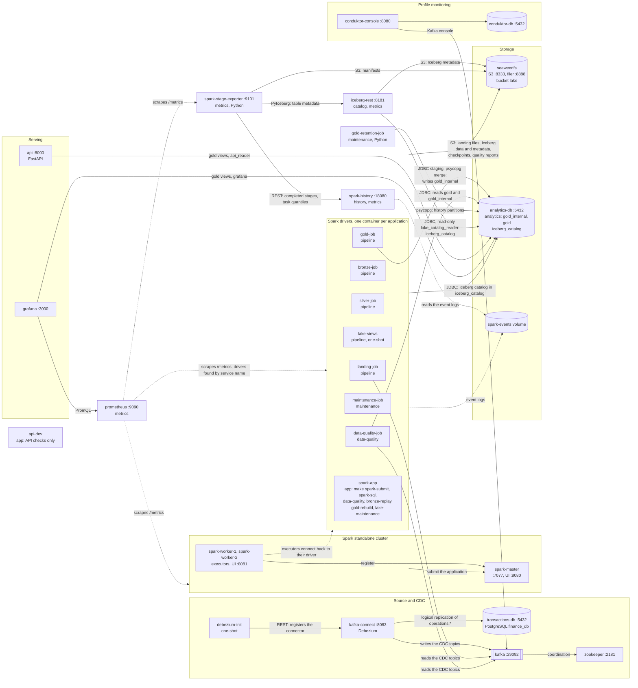
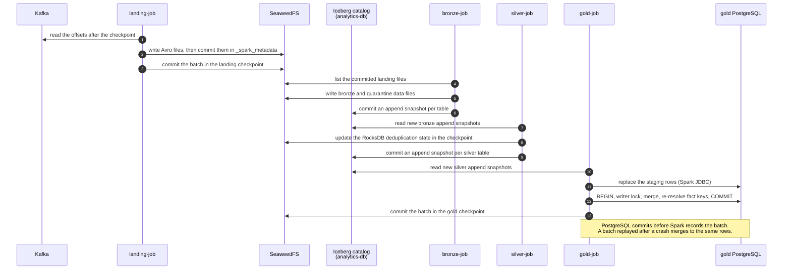
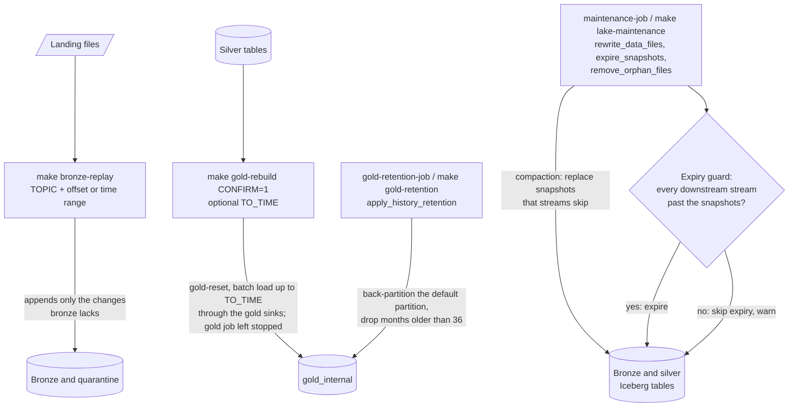

# Architecture overview

The pipeline turns the change stream of the supplied `finance_db` PostgreSQL database into a history-keeping lake and a dimensional model for serving.

1. Debezium captures every change of the four source tables into Kafka.
2. Spark Structured Streaming lands the records as raw files.
3. Spark types them in bronze and versions them in silver, both Iceberg tables on SeaweedFS.
4. Spark loads gold, a star schema in a separate analytics PostgreSQL.
5. The lake also exposes the same gold model as Iceberg views over silver.

Everything runs locally with Docker Compose.

## Services

Every Compose service, grouped by the profile that starts it. Services without a profile start with `make up`. `make pipeline` adds the `pipeline` and `history` profiles, and `make up PROFILES=...` adds the optional ones.

| Service | Profile | Role | Host port |
| --- | --- | --- | --- |
| `transactions-db` | default | Supplied source database `finance_db`, with logical replication | 5432 |
| `zookeeper` | default | Kafka coordination | 2181 |
| `kafka` | default | One broker. Holds the four CDC topics `finance_db.operations.{customers,products,orders,order_items}` | 9092 |
| `kafka-connect` | default | Debezium PostgreSQL connector, as supplied | 8083 |
| `debezium-init` | default | One-shot: registers the supplied connector | none |
| `api` | default | The analytics API (FastAPI): the four business questions and the freshness of gold, read from the `gold` views as the read-only login `api_reader` | 8000 |
| `api-dev` | `app` | Image for the API's own checks (`make test`, `make typecheck`) | none |
| `seaweedfs` | default | S3-compatible object store. Bucket `lake` holds landing files, Iceberg data and metadata, checkpoints and quality reports | 8333 (S3), 8888 (filer) |
| `analytics-db` | default | Analytics PostgreSQL. Database `analytics` holds gold (`gold_internal`, `gold`), and database `iceberg_catalog` holds the Iceberg JDBC catalog. Consumers log in with read-only service logins in the `gold_reader` role (`make db-logins`) | 5433 |
| `iceberg-rest` | `catalog`, `metrics` | Read-only Iceberg REST catalog over the JDBC catalog, for engines such as DuckDB and the exporter's table statistics; logs in as `lake_catalog_reader` | 8181 |
| `spark-master` | default | Standalone master | 8080 |
| `spark-worker-1`, `spark-worker-2` | default | Executors, 5 cores and 5 GiB each | 8081, 8082 |
| `landing-job` | `pipeline` | Kafka to raw Avro landing files | 4040 |
| `bronze-job` | `pipeline` | Landing to typed bronze and quarantine tables | 4041 |
| `silver-job` | `pipeline` | Bronze to deduplicated silver version tables | 4042 |
| `lake-views` | `pipeline` | One-shot: creates or updates the silver views and the lake gold views | none |
| `gold-job` | `pipeline` | Silver to the PostgreSQL gold model | 4045 |
| `maintenance-job` | `maintenance` | Compacts, expires and cleans the lake's Iceberg tables on a schedule | 4044 |
| `gold-retention-job` | `maintenance` | Drops gold history months outside the retention window on a schedule (Python, no Spark) | none |
| `data-quality-job` | `data-quality` | Runs every data quality check on a schedule and writes their reports to the lake | none |
| `spark-app` | `app` | Image for throwaway drivers started by `make spark-submit`, `make spark-sql`, `make data-quality`, `make bronze-replay` (UI 4043), `make gold-rebuild` and `make lake-maintenance` | `SPARK_UI_PORT` |
| `spark-history` | `history`, `metrics` | Spark History Server over the shared `spark-events` volume | 18080 |
| `prometheus` | `metrics` | Scrapes the Spark drivers, master and workers every 10 seconds and keeps 30 days of metrics; evaluates the streaming alert rules | 9090 |
| `spark-stage-exporter` | `metrics` | Serves the completed stages the History Server lists, and the data files of the bronze and silver Iceberg tables, as Prometheus metrics (Python, `spark-app` image) | none |
| `conduktor-console`, `conduktor-db` | `monitoring` | Optional Kafka console and its metadata database | 8090 |

Each job's driver runs in its own container in client mode, and its executors run on the shared workers (decision [D27](decisions.md#d27--one-driver-container-per-application-executors-on-shared-workers)). Each application is capped at `spark.cores.max=2`, so the four streaming jobs use 8 of the 10 cores and leave 2 for ad-hoc runs and maintenance. [The sizing strategy](sizing.md) explains how the cores and memory are shared.

## Containers and connections

Every container of the Compose project, optional profiles included, and the connections between them. An arrow points from the client to the service it connects to, and its label names what flows. The ports are the ones on the Compose network, which containers use to reach each other; the host ports are in the table above. A Spark application is drawn as its driver container, but its executors on the workers do most of the reading and writing, so they open the same connections to Kafka, SeaweedFS and `analytics-db`.

The profile of each container is in its label; containers without one start with `make up`. Each Spark job reads and writes the lake as follows (`<CHECKPOINT_ROOT>` defaults to `s3a://lake/checkpoints`, and every Iceberg commit also updates the catalog in `iceberg_catalog`):

| Container | Reads | Writes |
| --- | --- | --- |
| `kafka-connect` | The write-ahead log of `finance_db` | The four CDC topics, and its own config, offset and status topics |
| `landing-job` | The CDC topics | Avro files in `s3a://lake/landing/<topic>/`, its checkpoints |
| `bronze-job` | The committed landing files | `lake.bronze.<entity>` and `lake.bronze.<entity>_quarantine`, its checkpoints |
| `silver-job` | `lake.bronze.<entity>` | `lake.silver.<entity>`, its checkpoints and RocksDB state |
| `lake-views` | The silver tables | The silver views and the `lake.gold` views (definitions only) |
| `gold-job` | `lake.silver.<entity>` | `gold_internal` in `analytics`, its checkpoints |
| `maintenance-job` | The lake tables and the downstream streams' checkpoints | Compacted data files, expired snapshots, removed orphan files, refreshed views |
| `data-quality-job` | Kafka, landing, bronze, silver, PostgreSQL gold and the checkpoints | Reports in `<LAKE_ROOT>/quality/reports/` |
| `gold-retention-job` | `gold_internal` | Monthly history partitions in `gold_internal`: creates the months ahead, drops expired ones |
| `spark-app` | What its `make` target needs | What its `make` target writes, for example `make bronze-replay` appends to bronze |
| `iceberg-rest` | `iceberg_catalog` and the Iceberg metadata files | Nothing: its login is read-only |
| `api`, `grafana` | The `gold` views; Grafana also queries Prometheus | Nothing: their logins are read-only |
| `spark-history` | The event logs in the `spark-events` volume | Nothing |
| `prometheus` | The metrics pages of the drivers (`:4040`), the master (`:8080`), the workers (`:8081`) and the stage exporter (`:9101`) | Its samples, in the `prometheus-data` volume |
| `spark-stage-exporter` | The History Server's REST API; the bronze and silver table metadata and manifests, through the REST catalog | Nothing: it serves its metrics from memory |

## Data flow

```mermaid
flowchart LR
    src[("finance_db.operations<br/>customers, products,<br/>orders, order_items")]
    topics[["Kafka topics<br/>finance_db.operations.*"]]
    landing[/"Landing<br/>raw Avro files<br/>s3a://lake/landing/TOPIC"/]
    bronze[("Bronze<br/>lake.bronze.ENTITY")]
    quarantine[("Quarantine<br/>lake.bronze.ENTITY_quarantine")]
    silver[("Silver<br/>lake.silver.ENTITY")]
    sviews["Silver views<br/>ENTITY_history, ENTITY_current"]
    stage[("gold_internal.stage_*<br/>unlogged staging")]
    gint[("gold_internal<br/>dimensions, history facts,<br/>current state")]
    gpub["gold views<br/>dimensions, facts, current state,<br/>open_orders, business questions,<br/>data_freshness"]
    lgold["lake.gold views<br/>same relations, natural keys"]
    consumers["Consumers<br/>psql, Spark SQL,<br/>Grafana, FastAPI"]

    src -- "Debezium" --> topics
    topics -- "landing-job" --> landing
    landing -- "bronze-job<br/>parse, type, validate" --> bronze
    landing -- "bronze-job<br/>failed validation" --> quarantine
    bronze -- "silver-job<br/>dropDuplicates on change identity" --> silver
    silver -- "lake-views" --> sviews
    silver -- "gold-job<br/>Spark JDBC" --> stage
    stage -- "one transaction<br/>under the writer lock" --> gint
    gint --> gpub
    sviews -- "lake-views" --> lgold
    gpub --> consumers
    lgold --> consumers

```

| Layer | Where | Written by | What it guarantees |
| --- | --- | --- | --- |
| Landing | Avro files, one folder per topic, `s3a://lake/landing/<topic>/` | `landing-job`, one query per topic | Every Kafka record stored unchanged (key and value as raw bytes, plus topic, partition, offset and timestamp). The file sink and checkpoint make it exactly once, and it is the replay source for bronze |
| Bronze | Iceberg `lake.bronze.<entity>`, partitioned by `days(_published_at)` | `bronze-job`, two queries per topic | A typed, faithful log: one row per change event, deletes with their before image, no deduplication. Records that fail validation go to `<entity>_quarantine` with their landing file. Append-only |
| Silver | Iceberg `lake.silver.<entity>`, partitioned by `days(_changed_at)`, plus the views `<entity>_history` and `<entity>_current` | `silver-job`, one query per topic | One row per change identity (entity key, `_commit_sequence`, `_change_op`), deduplicated with RocksDB state and no watermark, so late changes are appended as history. The views fold versions that change nothing (decision [D36](decisions.md#d36--silver-deduplication-exact-duplicates-on-write-unchanged-versions-on-read)). Append-only, so gold can stream it |
| Gold (PostgreSQL) | Database `analytics`: tables in `gold_internal`, views in `gold` | `gold-job`, one query per silver table | SCD2 dimensions, append-only history facts partitioned by month, and current-state tables that only apply newer versions. Writes are idempotent per micro-batch and serialised by an advisory writer lock. Consumers read the `gold` views, which hide pipeline metadata and soft deletes (decisions [D32](decisions.md#d32--the-gold-dimensional-model), [D35](decisions.md#d35--public-views-over-an-internal-schema)) |
| Gold (lake) | Iceberg views `lake.gold.<relation>` | `lake-views` | The same public relations computed at read time from silver, over the full history, with natural keys instead of surrogate keys (decision [D39](decisions.md#d39--gold-in-the-lake-as-iceberg-views-over-silver)) |

The gold model, its rules and the business-question views are described in [the gold model](../lakehouse/gold/model.md), and every table and column in the [table reference](../reference/index.md), which the docs site renders from the Avro schemas.

## One micro-batch, end to end

Each hop is its own streaming query with its own checkpoint. A restart resumes from the checkpoint and neither skips nor repeats data. The table and file sinks are exactly once, and the gold merge is idempotent. The default trigger of every query is 10 seconds (`*_TRIGGER_SECONDS`).

## Operations

These jobs change the data outside the streaming path. Each one is safe to run while the streams run, unless the operation says otherwise.

- **Bronze replay** (decision [D31](decisions.md#d31--late-arrivals-are-history-deduplication-happens-in-silver), #85): re-reads a landing range in batch and appends only the change identities bronze does not hold yet. Records that fail validation go to quarantine once. It writes only `append` snapshots, so silver keeps streaming.
- **Lake maintenance** (#26, #77): compaction writes `replace` snapshots, which Iceberg's streaming reader skips. Snapshot expiry keeps 7 days and the last 10 snapshots. Before expiring a table, the guard reads the last committed batch of every downstream stream from its checkpoint, and skips expiry when that snapshot would be lost. Orphan files older than 3 days are removed.
- **Gold rebuild** (decision [D38](decisions.md#d38--rebuild-gold-from-silver-with-an-optional-cutoff), #49): resets gold, reloads it from the silver tables in one batch up to an optional `_changed_at` cutoff, and applies retention. Restarting the gold job on fresh checkpoints then replays silver idempotently and continues past the cutoff.
- **Gold retention** (decision [D37](decisions.md#d37--gold-retention-by-monthly-partitions), #48): history facts keep 36 months (`GOLD_RETENTION_MONTHS`). Whole monthly partitions are dropped, after the rows in the default partition are moved into partitions of their own. Current state and dimensions are never trimmed, and the lake keeps the full history.

The data quality checks, which compare each layer with the one before it, are in [data quality checks](../lakehouse/data-quality.md#data-quality-chain).
