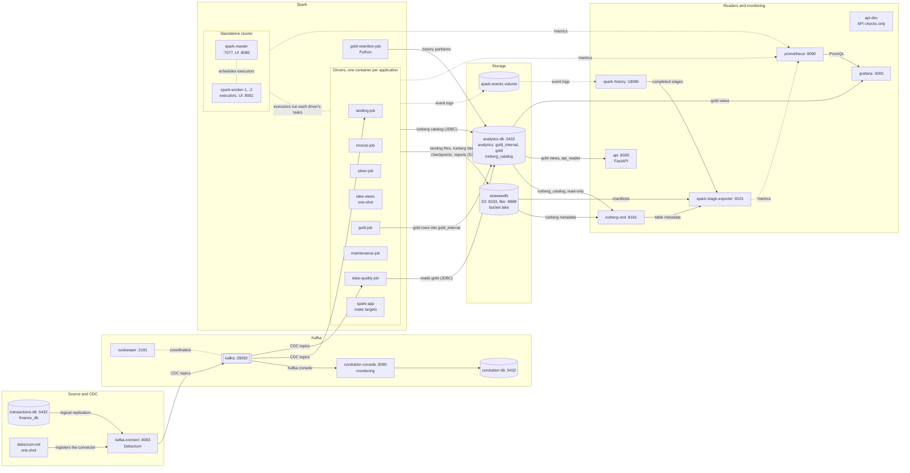
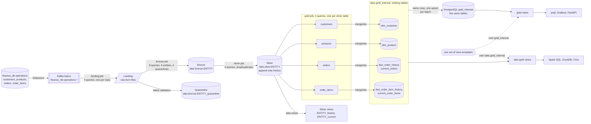
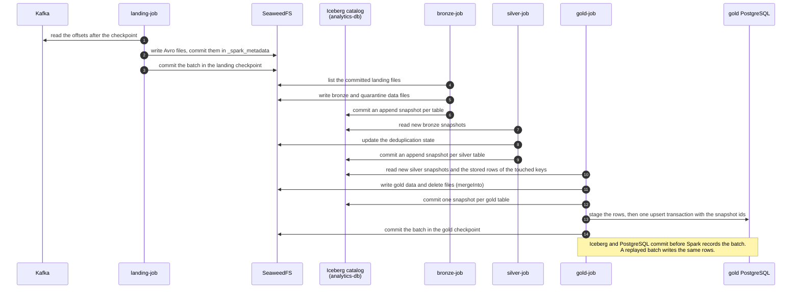
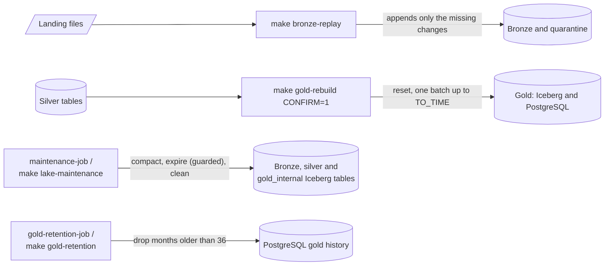

# Architecture overview

The pipeline turns the change stream of the supplied `finance_db` PostgreSQL database into a lake that keeps the full history, and a star schema for serving.

1. Debezium captures every change of the four source tables into Kafka.
2. Spark Structured Streaming lands the records as raw files. Every Spark layer is one application with one streaming query per table (bronze adds one per quarantine), so tables never wait for each other.
3. Spark types them in bronze and versions them in silver, both Iceberg tables on SeaweedFS.
4. Spark computes gold, one stream per silver table, and writes it as Iceberg tables.
5. Each gold batch copies its rows into a separate analytics PostgreSQL, which serves the API and Grafana. Both stores answer through the same views.

Everything runs locally with Docker Compose.

## Services

Services without a profile start with `make up`. `make pipeline` adds the `pipeline` and `history` profiles; `make up PROFILES=...` adds the others.

| Service | Profile | Role | Host port |
| --- | --- | --- | --- |
| `transactions-db` | default | Supplied source database `finance_db`, with logical replication | 5432 |
| `zookeeper` | default | Kafka coordination | 2181 |
| `kafka` | default | One broker with the four CDC topics `finance_db.operations.{customers,products,orders,order_items}` | 9092 |
| `kafka-connect` | default | Debezium PostgreSQL connector, as supplied | 8083 |
| `debezium-init` | default | One-shot: registers the connector | none |
| `seaweedfs` | default | S3-compatible object store; bucket `lake` holds landing files, Iceberg tables, checkpoints and quality reports | 8333 (S3), 8888 (filer) |
| `analytics-db` | default | Analytics PostgreSQL: database `analytics` holds gold (`gold_internal`, `gold`), database `iceberg_catalog` the Iceberg JDBC catalog | 5433 |
| `spark-master` | default | Standalone master | 8080 |
| `spark-worker-1`, `spark-worker-2` | default | Executors, 5 cores and 5 GiB each | 8081, 8082 |
| `api` | default | FastAPI: the four business questions and gold freshness, from the `gold` views | 8000 |
| `grafana` | default | Dashboards over the `gold` views and Prometheus | 3000 |
| `landing-job` | `pipeline` | Kafka to raw Avro landing files | 4040 |
| `bronze-job` | `pipeline` | Landing to typed bronze and quarantine tables | 4041 |
| `silver-job` | `pipeline` | Bronze to deduplicated silver version tables | 4042 |
| `lake-views` | `pipeline` | One-shot: creates the silver views and the lake gold views | none |
| `gold-job` | `pipeline` | Four streams from silver to the gold Iceberg tables, each copying its batches into PostgreSQL | 4045 |
| `maintenance-job` | `maintenance` | Compacts, expires and cleans the Iceberg tables on a schedule | 4044 |
| `gold-retention-job` | `maintenance` | Drops gold history months outside the retention window (Python, no Spark) | none |
| `data-quality-job` | `data-quality` | Runs every data quality check on a schedule | none |
| `spark-app` | `app` | Throwaway drivers for `make spark-submit`, `spark-sql`, `data-quality`, `bronze-replay` (UI 4043), `gold-rebuild` and `lake-maintenance` | `SPARK_UI_PORT` |
| `api-dev` | `app` | Image for the API's checks (`make test`, `make typecheck`) | none |
| `iceberg-rest` | `catalog`, `metrics` | Read-only Iceberg REST catalog for DuckDB and the stage exporter | 8181 |
| `spark-history` | `history`, `metrics` | Spark History Server over the `spark-events` volume | 18080 |
| `prometheus` | `metrics` | Scrapes the Spark processes every 10 s, keeps 30 days, evaluates the alert rules | 9090 |
| `spark-stage-exporter` | `metrics` | Completed stages and Iceberg table files as Prometheus metrics (Python) | none |
| `conduktor-console`, `conduktor-db` | `monitoring` | Optional Kafka console and its database | 8090 |

Each driver runs in its own container in client mode; its executors run on the shared workers ([D27](decisions.md#d27--one-driver-container-per-application-executors-on-shared-workers)). Each application is capped at 2 cores, so the streaming jobs leave room for ad-hoc runs ([sizing](sizing.md)).

## Containers and connections

Every container, optional profiles included. The diagram reads left to right, from the source to the readers; each arrow points the way the data moves and its label says what moves. Ports are the ones on the Compose network. A Spark application is drawn as its driver, but its executors on the workers open the same connections to Kafka, SeaweedFS and `analytics-db`.

What each container reads and writes (every Iceberg commit also updates the catalog in `iceberg_catalog`):

| Container | Reads | Writes |
| --- | --- | --- |
| `kafka-connect` | The write-ahead log of `finance_db` | The four CDC topics and its own config, offset and status topics |
| `landing-job` | The CDC topics | Avro files in `s3a://lake/landing/<topic>/` |
| `bronze-job` | The committed landing files | `lake.bronze.<entity>` and `lake.bronze.<entity>_quarantine` |
| `silver-job` | `lake.bronze.<entity>` | `lake.silver.<entity>` and its RocksDB state |
| `lake-views` | The silver and gold tables | The silver views and the `lake.gold` views |
| `gold-job` | `lake.silver.<entity>` and the stored gold rows of the keys a batch touches | `lake.gold_internal.<table>`, then the same rows into PostgreSQL `gold_internal` |
| `maintenance-job` | The bronze, silver and `gold_internal` tables and the downstream checkpoints | Compacted files, expired snapshots, removed orphan files |
| `data-quality-job` | Kafka, every lake layer, PostgreSQL gold and the checkpoints | Reports in `<LAKE_ROOT>/quality/reports/` |
| `gold-retention-job` | `gold_internal` | Monthly history partitions in `gold_internal` |
| `spark-app` | What its `make` target needs | What its `make` target writes |
| `iceberg-rest`, `api`, `grafana`, `spark-history`, `spark-stage-exporter` | Catalog, views, event logs or metrics | Nothing: read-only |
| `prometheus` | The metrics pages of the drivers, master, workers and stage exporter | Its samples, in the `prometheus-data` volume |

Every streaming job also writes its checkpoints under `<CHECKPOINT_ROOT>` (default `s3a://lake/checkpoints`).

## Data flow

The streaming hops from the source to silver, with the number of streaming queries in each job, the gold streams, their Iceberg tables and PostgreSQL copy, and the one set of views both stores render.

| Layer | Where | Written by | What it guarantees |
| --- | --- | --- | --- |
| Landing | Avro files, `s3a://lake/landing/<topic>/` | `landing-job` | Every Kafka record unchanged, exactly once; the replay source for bronze |
| Bronze | `lake.bronze.<entity>`, by `days(_published_at)` | `bronze-job` | A typed log: one row per change event, no deduplication; invalid records in `<entity>_quarantine`. Append-only |
| Silver | `lake.silver.<entity>`, by `days(_changed_at)`, plus views `<entity>_history` and `<entity>_current` | `silver-job` | One row per change identity; late changes appended as history; the views fold versions that change nothing ([D36](decisions.md#d36--silver-deduplication-exact-duplicates-on-write-unchanged-versions-on-read)). Append-only, so gold can stream it |
| Gold (lake) | `lake.gold_internal.<table>`, plus views `lake.gold.<view>` | `gold-job`, four streams with `mergeInto` | SCD2 dimensions, history facts and current state with the full history; idempotent per batch, no lock between streams ([D32](decisions.md#d32--the-gold-dimensional-model), [D44](decisions.md#d44--gold-modelled-in-spark-on-iceberg-postgresql-as-serving-copy)) |
| Gold (PostgreSQL) | Database `analytics`: tables in `gold_internal`, views in `gold` | `gold-job`, same batch, plain upserts | A serving copy, one transaction per stream batch; history kept 36 months; partial indexes for the business questions ([D35](decisions.md#d35--public-views-over-an-internal-schema), [D40](decisions.md#d40--gold-indexes-chosen-from-the-query-plans-of-the-current-use-cases)) |

The gold tables and views are described in [the gold model](../lakehouse/gold/model.md); every table and column is in the [table reference](../reference/index.md).

## One micro-batch, end to end

Each hop is its own streaming query with its own checkpoint, so a restart neither skips nor repeats data. Gold runs four such queries; the diagram follows one. Triggers: landing 10 s, bronze and silver 2 s, gold 5 s ([sizing](sizing.md#trigger-interval)).

## Operations

These jobs change the data outside the streaming path. Each is safe to run while the streams run.

| Operation | What it does | Details |
| --- | --- | --- |
| Bronze replay ([D31](decisions.md#d31--late-arrivals-are-history-deduplication-happens-in-silver)) | Re-reads a landing range and appends only the changes bronze lacks; silver keeps streaming | [Replay](../operations/maintenance-and-recovery.md#replaying-a-landing-range-into-bronze) |
| Lake maintenance | Compacts data and delete files, expires snapshots older than 24 hours (keeping the last 10) only when every downstream stream is past them, removes orphan files older than 3 days | [Maintenance](../operations/maintenance-and-recovery.md#lake-maintenance) |
| Gold rebuild ([D38](decisions.md#d38--rebuild-gold-from-silver-with-an-optional-cutoff)) | Resets gold and rebuilds it from silver up to an optional cutoff with the gold job's own writer; keys keep their values | [Rebuild](../operations/maintenance-and-recovery.md#rebuilding-gold-from-silver) |
| Gold retention ([D37](decisions.md#d37--gold-retention-by-monthly-partitions)) | Drops PostgreSQL history months older than 36; Iceberg keeps the full history | [Retention](../operations/maintenance-and-recovery.md#gold-retention) |

The checks that compare each layer with the one before it are in [data quality checks](../lakehouse/data-quality.md#data-quality-chain).
