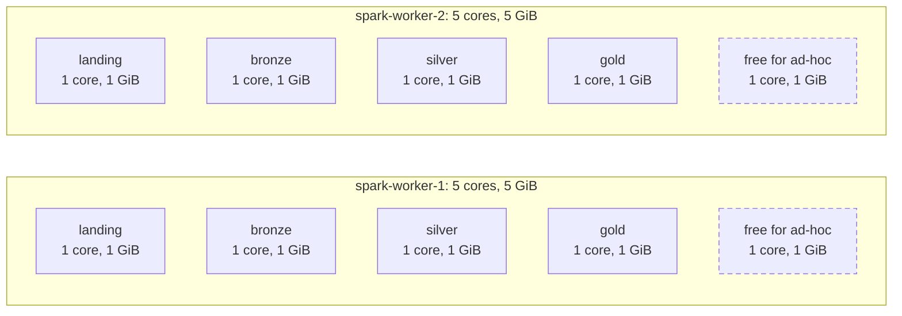

# Spark sizing strategy

The Spark cluster is sized for one developer machine running the whole stack in Docker. This page states the variables the sizing depends on, ties each setting to one of them, and names the metrics that show whether the sizing holds. The measured values come from a real run (#58).

> **In progress.** The "Measured" columns are filled in from a real run in #58.

## Variables

| Variable | Current value | Set in | What it drives |
| --- | --- | --- | --- |
| Input rate | Up to about 2,700 change events per minute, in a burst at the start of each minute | `pg_cron` schedule of the supplied database (`db-scripts/initialize_db_ddl.sql`) | Rows per micro-batch |
| Topic partitions | 1 per topic (broker default; Debezium's topics are auto-created) | Kafka broker | Kafka read parallelism: one task per topic per batch |
| Trigger interval | 10 s per job | `LANDING_`, `BRONZE_`, `SILVER_`, `GOLD_TRIGGER_SECONDS` | Latency per hop, Iceberg commits, file sizes |
| Batch duration | Measured in #58 | — | Must stay below the trigger interval |
| Cores per application | 2 | `spark.cores.max=2` in `docker-compose.yaml` and the Makefile | Tasks a job runs at once |
| Executor memory | 1 GiB per executor (Spark default) | not overridden | Batch size and state a job can hold |
| Worker resources | 2 workers × 5 cores, 5 GiB | `SPARK_WORKER_CORES`, `SPARK_WORKER_MEMORY` | How many applications run at once |
| Shuffle and state partitions | 2 in silver; Spark's default elsewhere, where no query shuffles | `pipelines/silver/job.py` | State stores per silver entity |
| State store | RocksDB, no watermark | `pipelines/silver/job.py` | State grows by one small entry per change |
| Iceberg write distribution | `none` | `pipelines/lake/tables.py` | Files per commit |
| Rate limit | none (`maxOffsetsPerTrigger` unset) | landing job | Size of the first batch after a backlog |
| Gold write path | Spark JDBC into staging, then one PostgreSQL transaction under the writer lock | `pipelines/gold/sink.py`, `pipelines/gold/postgres.py` | Gold throughput |

The input rate follows from the source's schedule:
- `generate_orders(100)` runs every minute. Each of its iterations either creates an order with 26 items or updates the status of an open order.
- `update_customers(5)` and `update_products(10)` run every two minutes.

The figure above is the upper bound, when every iteration creates an order.

## Cluster allocation

The standalone master gives each application at most `spark.cores.max` cores. With `spark.executor.cores` unset and the master's default spread-out placement, a 2-core application should get one 1-core, 1 GiB executor on each worker. This is to be confirmed on the master UI (http://localhost:8080) in #58.

| Application | Kind | Cores | Executor memory |
| --- | --- | --- | --- |
| landing, bronze, silver, gold | Long-running streams | 2 each, 8 in total | 2 GiB each, 8 GiB in total |
| One ad-hoc application at a time: `make spark-submit`, `spark-sql`, `data-quality`, `bronze-replay`, `gold-rebuild`, `lake-maintenance`, or a run of `maintenance-job` | Batch | 2 | 2 GiB |
| `lake-views` | One-shot at `make pipeline` | Uses the ad-hoc share while it runs | |
| `gold-retention-job` | Plain Python against PostgreSQL | none | none |
| **Total** | | **10 of 10** | **10 of 10 GiB** |

- **Two ad-hoc applications at once:** the second one waits in the master's queue until the first ends. This is expected: the free share is sized for one batch application, such as maintenance or a data quality run, next to the streams.
- **Bigger workers rather than a third worker:** this keeps the number of containers and JVMs the same. Docker does not cap CPU per container here, so 10 logical cores on a laptop only bound how many tasks run at once, which suits an I/O-bound pipeline. A third worker would add a failure domain, which matters only in a real cluster.
- **Memory outside the executors:** the workers' 10 GiB covers executor heaps only. Docker also needs memory for:
  - the master and worker JVMs;
  - one driver per application (Spark's default 1 GiB heap);
  - RocksDB's native memory in the silver executors;
  - Kafka, the two PostgreSQL instances and SeaweedFS.

## Settings tied to the variables

### Landing
- Each of the four topics has its own query. Each topic has one partition, so a batch runs four tasks on the job's 2 cores. The source is too small for more parallelism to matter.
- No shuffle, so the shuffle partitions don't apply.
- No rate limit: the first start, or a restart after a long stop, reads the whole backlog in one batch. That is acceptable locally, where Kafka retention bounds the backlog. In production, `maxOffsetsPerTrigger` caps the batch to what one trigger interval can process.

### Bronze
- Two queries per topic (bronze and quarantine) read the committed landing files. A batch has one task per new file, and no query shuffles.
- `write.distribution-mode=none` writes each task's rows without a shuffle. Streaming runs without adaptive execution, so a hash distribution would shuffle every batch into `spark.sql.shuffle.partitions` tasks.
- The result is many small files per day partition. Lake maintenance compacts them.

### Silver
- `dropDuplicates` on the change identity is the only shuffle in the pipeline. `spark.sql.shuffle.partitions=2` gives one state partition per core the job gets, instead of 200 state stores per entity saved on every batch.
- The state lives in RocksDB on the executors' local disks, not on the JVM heap. With no watermark, it grows by one small entry per change and is never cleaned. Its size is the metric to watch.
- A query keeps the number of state partitions its checkpoint was created with. Giving silver more cores later adds no state parallelism without a checkpoint reset. In production, choose the state partitions for the largest expected core count before the first start.

### Gold
- Each of the four queries writes a batch in two steps:
  1. The executors write the batch into an unlogged staging table with Spark's JDBC writer. This runs in parallel and outside the lock.
  2. The driver runs one psycopg transaction that takes the advisory writer lock, merges, and re-resolves dependent fact keys.
- The lock serialises all four gold queries, so the binding constraint is the sum of their transaction times per trigger interval. Spark's cores don't change it. A dimension merge also re-resolves the facts of the keys it touched, which makes dimension batches the most expensive ones.
- The gold queries run no shuffle, so the shuffle partitions don't apply here either.

### Trigger interval
- Every hop triggers every 10 seconds, so a change reaches gold after up to four trigger intervals plus each hop's batch duration. #58 measures the real figure.
- Each batch that has data commits one Iceberg snapshot per table it writes, and adds small files. A shorter trigger lowers latency but adds snapshots and files. A longer one does the opposite.
- Lake maintenance compacts the files and expires snapshots older than 7 days, keeping the last 10, so the default stays manageable.

## PostgreSQL query cost

The serving side is sized by query plans, not by Spark resources. The gold indexes exist only for the current use cases: the four business-question views and `gold.open_orders`. Each index was chosen by reading that query's EXPLAIN plan (decision [D40](decisions.md#d40--gold-indexes-chosen-from-the-query-plans-of-the-current-use-cases), #142).
- `current_orders` stores `is_open`.
- Two partial indexes `WHERE is_open AND NOT _is_deleted` hold only the open orders:
  - `current_orders_open_delivery_idx (delivery_date, status_key)`;
  - `current_orders_open_customer_idx (customer_id)`.
- `current_order_items_live_order_idx (order_id) INCLUDE (product_id, quantity) WHERE NOT _is_deleted` serves the item lookups.
- Four current-state indexes that no plan used were dropped.

The scratch columns come from #142: `postgres:18.6` with 1M orders (about 3% open), 3M items and 50k customers, after `VACUUM ANALYZE`, as ranges over three runs. "Before" is without `is_open` and the partial indexes. #58 fills in the last column from the real run, for example with `EXPLAIN (ANALYZE, BUFFERS) SELECT * FROM gold.<view>` while the pipeline runs.

| View | Index the plan uses | Plan with the index | Scratch, before | Scratch, after | Measured on the real run |
| --- | --- | --- | --- | --- | --- |
| `open_orders_by_delivery_date_and_status` | `current_orders_open_delivery_idx` | Index Only Scan of the open orders + Hash Join | 31–33 ms | 8–10 ms | #58 |
| `top_delivery_dates_by_open_orders` | `current_orders_open_delivery_idx` | Index Only Scan of the open orders | 30–35 ms | 3–4 ms | #58 |
| `pending_items_by_product` | `current_order_items_live_order_idx` | Nested Loop: Bitmap Heap Scan of the open orders → Index Only Scan of their items | 344–380 ms | 37–46 ms | #58 |
| `top_customers_by_pending_orders` | `current_orders_open_customer_idx` | Index Only Scan of the open orders | 16–21 ms | 12–13 ms | #58 |

- These timings scale with the number of open orders and their items, not with the history: the partial indexes skip completed and deleted orders.
- A new use case gets its index the same way: write the query, read its plan on representative data, add the index the plan uses, and drop any index no plan uses.

## Key metrics

#58 collects these from a real run with the full pipeline (`make pipeline PIPELINE=all`):
- from the Spark UI's Structured Streaming tab, or a `StreamingQueryListener`;
- for gold, from timings logged by the sink.

The "Measured" column is filled in from that run.

| Metric | Source | Healthy when | Measured |
| --- | --- | --- | --- |
| Batch duration vs trigger | `StreamingQueryProgress.durationMs.triggerExecution`, with `addBatch` and `walCommit`, per query | Below the trigger interval; otherwise batches run back to back and lag grows | #58 |
| Input rate vs processing rate | `inputRowsPerSecond`, `processedRowsPerSecond`, `numInputRows` | Processing rate at or above the input rate over a window | #58 |
| Kafka lag (landing) | `sources[].metrics.avgOffsetsBehindLatest` and `maxOffsetsBehindLatest` | Back near zero after each minute's burst | #58 |
| State store size (silver) | `stateOperators[].numRowsTotal`, `memoryUsedBytes`, and RocksDB custom metrics such as `rocksdbSstFileSize` and `rocksdbCommitCheckpointLatency` | Grows linearly with changes, and checkpoint commits stay well below the trigger | #58 |
| Iceberg commit time | Iceberg's commit reports (`totalDuration`, `attempts`) in the driver logs, and the snapshot summaries in `lake.<layer>.<table>.snapshots` (files and bytes added per commit) | Commits take a small share of `addBatch`, with one attempt | #58 |
| PostgreSQL transaction time under the writer lock | Lock wait and transaction time per gold batch, logged by the sink; `pg_stat_activity` advisory-lock waits | The four queries' transaction times add up to well below the trigger interval | #58 |
| JDBC staging time | `addBatch` minus the transaction time per gold batch | Small next to the transaction | #58 |
| Executor health | Spark UI Executors tab: GC time, peak memory, failed tasks | Little GC time and no failed tasks | #58 |

## Scaling to production

The local layout mirrors a production deployment but shares one small cluster (decision [D27](decisions.md#d27--one-driver-container-per-application-executors-on-shared-workers)). This is what would change for Spark; [from toy project to production](production.md) covers the rest of the platform:

- **Deployment.** Each streaming job runs as its own application on a managed runtime:
  - Amazon EMR: a long-running step in YARN cluster mode, so the driver runs in the cluster with YARN's restart attempts. EMR Serverless is an option for the batch jobs.
  - Kubernetes: one Spark Operator `SparkApplication` per job, with a driver pod, executor pods and `restartPolicy: OnFailure`.
  - Locally, drivers run in throwaway client-mode containers and share the executors on two workers. In production, each application gets its own executors.
- **Executors.** `spark.cores.max` gives way to a fixed `spark.executor.instances` × `spark.executor.cores` per streaming application, sized from the metrics above. Dynamic allocation fits the batch jobs (replay, rebuild, maintenance, quality checks) better than long-running streams.
- **Parallelism.**
  - More Kafka partitions per topic are the main lever for landing and, through the files they produce, for bronze.
  - Silver's state partitions are fixed when its checkpoint is created, so they are chosen ahead of growth.
  - Gold is bounded by the single writer lock in PostgreSQL. Spark cores don't help there. The options are:
    - longer triggers with larger batches;
    - finer-grained locking once the cross-table consistency rules allow it;
    - a store built for larger fact volumes (decision [D3](decisions.md#d3--gold-in-postgresql-not-clickhouse) names ClickHouse).
- **Rates.** `maxOffsetsPerTrigger` caps catch-up batches, and the triggers are chosen from the latency target and the commit cost.
- **Memory.** Executor memory is sized from the batch size and RocksDB's footprint. `spark.sql.streaming.stateStore.rocksdb.boundedMemoryUsage` bounds RocksDB's native memory per executor.
- **Storage and catalog.**
  - SeaweedFS gives way to S3, a configuration change (decisions [D8](decisions.md#d8--fully-local-no-cloud-services), [D13](decisions.md#d13--object-store-seaweedfs-instead-of-minio)).
  - The JDBC catalog gives way to a REST catalog or AWS Glue.
  - Checkpoints and event logs live on S3, and the history server reads them there.
- **Monitoring.** The metrics above go to a time-series system instead of being read from the UI (#126), and the per-batch stats into an observability catalog (#127).
