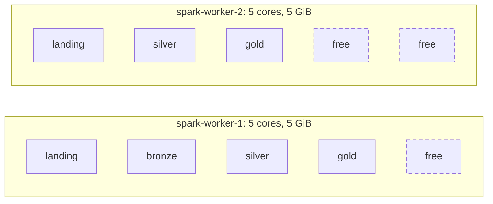

# Spark sizing strategy

The Spark cluster is sized for one developer machine that runs the whole stack in Docker. I changed each setting on its own and measured it against the run before, under the source's own generator and nothing else ([D43](decisions.md#d43--cluster-sizing-and-triggers-from-measured-metrics)).

## Decisions

| Setting | Value | Why |
| --- | --- | --- |
| Trigger interval | Landing 10 s, bronze and silver 2 s, gold 5 s (`*_TRIGGER_SECONDS` in `.env`) | Each hop after landing waits only its own short interval instead of a full 10 s |
| Cores per application | 2; bronze 1 (`spark.cores.max`) | The jobs use 0.1–2.3 % of their cores; the rest stays free for ad-hoc runs |
| Executor shape | 1 core, 1 GiB (`spark.executor.cores`, `spark.executor.memory`) | A 2-core application always gets one executor on each worker |
| Workers | 2 × 5 cores, 5 GiB | Bigger workers instead of a third: same number of containers and JVMs |
| Shuffle partitions | Silver 2, gold 4 | One state partition per silver core; about two tasks per core in gold, instead of Spark's 200 |
| State store | RocksDB with changelog checkpointing, no watermark | State off the heap; each batch uploads only its changes |
| Iceberg write distribution | `none` | No shuffle per batch; maintenance compacts the small files |
| Lake maintenance | Every 6 hours; snapshots kept 24 hours and the last 10 | Small files never pile up for more than a quarter of a day |
| Rate limit | None (`maxOffsetsPerTrigger` unset) | Kafka lag stays at 0; production caps catch-up batches |

## The numbers that matter

The source changes in one burst a minute: `generate_orders(100)` every minute (each iteration creates an order with 26 items or updates an open order's status), `update_customers(5)` and `update_products(10)` every two minutes. That is at most about 2,700 change events a minute, read through one Kafka partition per topic.

| Measure | Value |
| --- | --- |
| Batch p95, landing / bronze / silver | 1.8 s / 0.8 s / 0.9 s, against triggers of 10, 2 and 2 s |
| Busy share of each job's cores | 0.1–2.3 % |
| Executor heap peak | 160–260 MiB of 1 GiB; GC under 3 % of task time; no spill, no failed task |

Gold on the running dev stack, 2026-11-13, from the gold job's `GOLD BATCH` log lines and `make latency-probe PROBES=5`:

| Gold stream | Spark jobs per batch | Batch p50 | Batch p95 | Latency mean | Latency p50 | Latency p95 |
| --- | --- | --- | --- | --- | --- | --- |
| Customers | 11 | 1.6 s | about 5 s | 12.8 s | 13 s | 16 s |
| Products | 11 | 1.6 s | about 5 s | 12.8 s | 13 s | 16 s |
| Orders | 23 | 4.9 s | 8.2 s | 16.8 s | 16 s | 20 s |
| Order items | 20 | 4.3 s | 8.5 s | 15.2 s | 16 s | 19 s |

Batch times count only the batches that carry rows; most batches find no new rows and take a few milliseconds. Latency runs from the source commit to the row in gold. The busiest order and item batches run longer than gold's 5-second trigger, so they run back to back.

## Cluster allocation

The master gives each application at most `spark.cores.max` cores, in 1-core, 1 GiB executors, spread over both workers.

| Application | Kind | Cores | Executor memory |
| --- | --- | --- | --- |
| landing, silver, gold | Streams | 2 each | 2 GiB each |
| bronze | Stream | 1 | 1 GiB |
| One ad-hoc application: `make spark-submit`, `spark-sql`, `data-quality`, `bronze-replay`, `gold-rebuild`, `lake-maintenance` or a `maintenance-job` run | Batch | 2 | 2 GiB |
| A second ad-hoc application | Batch | 1 | 1 GiB |
| **Total** | | **10 of 10** | **10 of 10 GiB** |

- A third ad-hoc application waits in the master's queue. `lake-views` uses the ad-hoc share while it runs; `gold-retention-job` is plain Python and uses none.
- The workers' 10 GiB covers executor heaps only. Docker also needs memory for the master and worker JVMs, one driver per application, RocksDB's native memory, Kafka, the two PostgreSQL instances and SeaweedFS.

## Settings per job

### Landing

- One query per topic, one partition per topic: four tasks per batch on 2 cores. No shuffle.
- No rate limit: a restart after a long stop reads the backlog in one batch, which Kafka retention bounds locally.

### Bronze

- Two queries per topic (bronze and quarantine), one task per new landing file, no shuffle.
- One core: on two cores bronze was busy about 1 % of the time, and on one its batches took as long (p95 about 1 s).
- `write.distribution-mode=none` avoids a shuffle per batch; the many small files are compacted by maintenance.

### Silver

- `dropDuplicates` on the change identity is the only shuffle before gold. `spark.sql.shuffle.partitions=2` gives one state partition per core.
- RocksDB state lives on the executors' disks and grows by one small entry per change, never cleaned. Its size is the metric to watch.
- A query keeps the state partitions its checkpoint was created with, so in production choose them for the largest expected core count before the first start.

### Gold

- Four independent queries, one per silver table, each writing only its own tables, each in its own fair-scheduler pool, with no lock between them ([D44](decisions.md#d44--gold-modelled-in-spark-on-iceberg-postgresql-as-serving-copy)).
- A batch reads only the stored rows of the keys it touches, computes each table once, merges it into Iceberg, then copies the rows into PostgreSQL. Its work grows with the keys it touches, not with the tables.
- The window by key is the only shuffle; `spark.sql.shuffle.partitions=4` and adaptive execution keep the tasks few.
- Each write adds an Iceberg snapshot and a few small data and delete files, so maintenance compacts `gold_internal` like bronze and silver.

### Trigger interval

- With 10 s everywhere, every job started on the same boundaries and a change waited a full interval at each hop: gold was about 39 s behind the commit.
- With 2 s for bronze and silver and 5 s for gold, gold is 13–16 s behind at the median.
- The source changes once a minute, so shorter triggers add no batches; they only start each batch sooner. A trigger shorter than the batch itself (about 1 s for bronze and silver) would only make batches start late.

## Measured on the real load

Each change in [D43](decisions.md#d43--cluster-sizing-and-triggers-from-measured-metrics) ran for 20 minutes on the running stack on 2026-11-12, against the run before it (#195). Gold then still merged its batches in PostgreSQL; the last row is the move of gold to Spark.

| Change | Effect |
| --- | --- |
| Table statistics exporter skips a table it cannot read | All twelve tables published again; one empty snapshot had hidden every series |
| Triggers: bronze and silver 2 s, gold 5 s | Hops after landing from 9–10 s to 1–2.5 s; gold from about 39 s to 12–15 s at p50 |
| Lake maintenance every 6 hours, 24 hours of snapshots | Bronze from 983 to 16 data files, silver from 1,814 to 20; batches briefly faster |
| 1-core, 1 GiB executors | No change at this load; the placement no longer depends on the workers' state |
| Bronze on 1 core | Same batch times (p95 about 1 s); one core back to the ad-hoc share |
| RocksDB changelog checkpointing in silver | State commit p50 from 134–146 ms to 86–92 ms; state kept |
| Gold computed in Spark, four independent streams ([D44](decisions.md#d44--gold-modelled-in-spark-on-iceberg-postgresql-as-serving-copy)) | Gold batches with rows from 12–20 s at p95 to 5–8.5 s; latency 13–16 s at p50 (2026-11-13) |

Latency comes from `make latency-probe`, batch times from the event logs and the `GOLD BATCH` lines, memory and busy share from Prometheus.

### What this load cannot size

The jobs never came near their limits, so the measurements say how little they use, not how much they need.

| Resource | Measured | What it means |
| --- | --- | --- |
| Cores | 0.1–2.3 % busy, one task per stage (two in silver), no skew, no spill | Sizing for a larger source needs a larger source |
| Memory | Heaps 160–260 MiB of 1 GiB, RSS 500–910 MiB, GC under 3 % | 1 GiB executors are not too small, not proven right |
| Rates | Kafka lag 0 at the end of every batch | A rate limit has nothing to limit at this load |

## PostgreSQL query cost

The serving side is sized by query plans, not by Spark. The four business-question views count the open rows of `current_orders` when read, through partial indexes that hold only the open orders ([D40](decisions.md#d40--gold-indexes-chosen-from-the-query-plans-of-the-current-use-cases) has the plans). On the running stack each view answers in 0.15–0.33 ms (32 open orders out of 6,503, 2026-11-13). The cost grows with the open orders, not with the history.

## Key metrics

With the `metrics` profile, Prometheus keeps the Spark metrics for 30 days; the panels are described in [Monitoring Spark](../operations/monitoring.md).

| Metric | Where | Healthy when | Measured |
| --- | --- | --- | --- |
| Batch duration vs trigger | Spark streaming → Batch duration / trigger | Below the trigger | Landing, bronze, silver well below; gold order and item batches up to 8.5 s at p95 against 5 s |
| Input vs processing rate | Spark streaming → Input vs processing rate | Processing at or above input | Keeps up |
| Kafka lag (landing) | `maxOffsetsBehindLatest` in the query progress | Near zero after each burst | 0 |
| Silver state size | Spark streaming → State rows, State size | Grows linearly; commits well below the trigger | Commit p50 87 ms, p95 134 ms |
| Lake file sizes | Iceberg tables → Small files per table | Falls after each maintenance run | 4–8 new files a minute per layer |
| Gold batch steps | The `GOLD BATCH` log line ([monitoring](../operations/monitoring.md#gold-batch-log)) | Below the trigger, few Spark jobs | See [the numbers that matter](#the-numbers-that-matter) |
| Stage shape | Spark stages → Skew, Spill | Skew under about 3, no spill | Skew at most 1.0, no spill |
| Executor health | Spark cluster → Executor heap, GC, Failed tasks | Little GC, no failed tasks | Heap at most 260 MiB, GC under 3 % |

## Scaling to production

The local layout mirrors production but shares one small cluster ([D27](decisions.md#d27--one-driver-container-per-application-executors-on-shared-workers)). For the rest of the platform, see [the way to production](production.md).

| Area | Locally | In production |
| --- | --- | --- |
| Deployment | Client-mode drivers in containers, shared workers | One application per job: an EMR step in YARN cluster mode, or a Spark Operator `SparkApplication` on Kubernetes |
| Executors | `spark.cores.max` | Fixed `spark.executor.instances` × `spark.executor.cores`, sized from the metrics; dynamic allocation for batch jobs |
| Parallelism | One partition per topic | More Kafka partitions for landing and bronze; silver's state partitions chosen ahead of growth; each gold stream its own cores or application |
| Gold at scale | Read-time counts over the open orders | Incremental counts with retractions, or a columnar serving store ([gold serving](production.md#gold-serving)) |
| Rates | No limit | `maxOffsetsPerTrigger`; triggers from the latency target |
| Memory | 1 GiB executors | Sized from batch size and RocksDB; `stateStore.rocksdb.boundedMemoryUsage` |
| Storage and catalog | SeaweedFS, JDBC catalog | S3 ([D13](decisions.md#d13--object-store-seaweedfs-instead-of-minio)), a REST catalog or AWS Glue |
| Monitoring | Prometheus and Grafana | A managed time-series store with Alertmanager |
