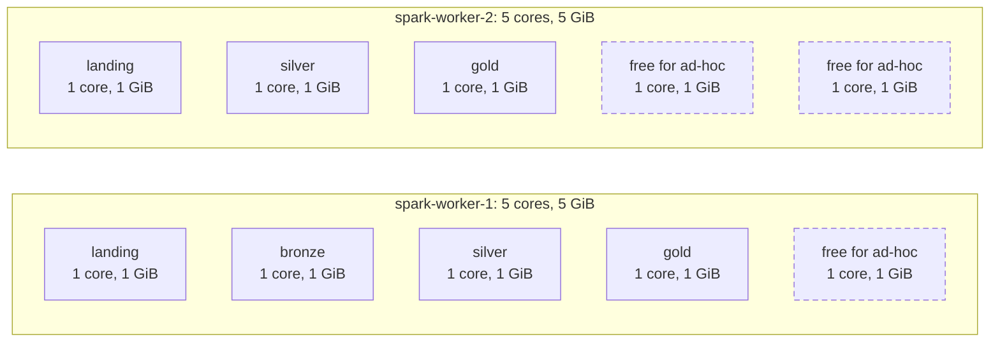

# Spark sizing strategy

The Spark cluster is sized for one developer machine running the whole stack in Docker. This page states the variables the sizing depends on, ties each setting to one of them, and names the metrics that show whether the sizing holds. The settings were changed one at a time and each change was measured on its own against a baseline, under the source's own generator and nothing else ([Measured on the real load](#measured-on-the-real-load), #195).

## Variables

| Variable | Current value | Set in | What it drives |
| --- | --- | --- | --- |
| Input rate | Up to about 2,700 change events per minute, in a burst at the start of each minute | `pg_cron` schedule of the supplied database (`db-scripts/initialize_db_ddl.sql`) | Rows per micro-batch |
| Topic partitions | 1 per topic (broker default; Debezium's topics are auto-created) | Kafka broker | Kafka read parallelism: one task per topic per batch |
| Trigger interval | Landing 10 s, bronze and silver 2 s, gold 5 s | `LANDING_`, `BRONZE_`, `SILVER_`, `GOLD_TRIGGER_SECONDS` in `.env` (code default 10 s) | Latency per hop, Iceberg commits, file sizes |
| Batch duration | p95 about 1–2 s for landing, bronze and silver ([measured](#measured-on-the-real-load)); gold **[pending measurement: gold batch p50 / p95 with the Spark and Iceberg write path]** | — | Must stay below the trigger interval |
| Cores per application | 2; 1 for bronze | `spark.cores.max` in `docker-compose.yaml` and the Makefile | Tasks a job runs at once |
| Executor shape | 1 core and 1 GiB per executor, so 2 executors for a 2-core application | `spark.executor.cores=1`, `spark.executor.memory=1g` in `docker-compose.yaml` and the Makefile | Where an application's tasks run, and the batch size and state an executor can hold |
| Worker resources | 2 workers × 5 cores, 5 GiB | `SPARK_WORKER_CORES`, `SPARK_WORKER_MEMORY` | How many applications run at once |
| Shuffle and state partitions | 2 in silver, 4 in gold; Spark's default elsewhere, where no query shuffles | `pipelines/lake/silver/job.py`, `pipelines/lake/gold/job.py` | State stores per silver entity; tasks per shuffle stage in gold |
| State store | RocksDB, no watermark | `pipelines/lake/silver/job.py` | State grows by one small entry per change |
| Iceberg write distribution | `none` | `pipelines/lake/shared/tables.py` | Files per commit |
| Lake maintenance | Every 6 hours; snapshots kept 24 hours (and the newest 10) | `MAINTENANCE_INTERVAL_HOURS`, `MAINTENANCE_SNAPSHOT_RETENTION_HOURS` in `.env`; `maintenance` profile | Small files and snapshots per table between runs |
| Silver state commits | RocksDB changelog checkpointing | `pipelines/lake/silver/job.py` | What each batch uploads to the checkpoint |
| Rate limit | none (`maxOffsetsPerTrigger` unset) | landing job | Size of the first batch after a backlog |
| Gold write path | Spark transforms of the touched keys, one Iceberg `mergeInto` per table, then Spark JDBC into staging and one PostgreSQL upsert transaction, all under one lock in the driver | `pipelines/lake/gold/writer.py`, `pipelines/lake/gold/serving.py` | Gold throughput |

The input rate follows from the source's schedule:
- `generate_orders(100)` runs every minute. Each of its iterations either creates an order with 26 items or updates the status of an open order.
- `update_customers(5)` and `update_products(10)` run every two minutes.

The figure above is the upper bound, when every iteration creates an order.

## Cluster allocation

The standalone master gives each application at most `spark.cores.max` cores, in executors of `spark.executor.cores=1` core and 1 GiB each. With the master's default spread-out placement, a 2-core application gets one executor on each worker while both have a free core; the measured runs had exactly that for every 2-core job. Without the fixed executor size, an application gets one executor per worker holding every core it can take there, so after a worker restart an application could come back as one 2-core executor on one worker.

| Application | Kind | Cores | Executor memory |
| --- | --- | --- | --- |
| landing, silver, gold | Long-running streams | 2 each | 2 GiB each |
| bronze | Long-running stream | 1 | 1 GiB |
| One ad-hoc application with its 2 cores: `make spark-submit`, `spark-sql`, `data-quality`, `bronze-replay`, `gold-rebuild`, `lake-maintenance`, or a run of `maintenance-job` | Batch | 2 | 2 GiB |
| A second ad-hoc application, on the core left | Batch | 1 | 1 GiB |
| `lake-views` | One-shot at `make pipeline` | Uses the ad-hoc share while it runs | |
| `gold-retention-job` | Plain Python against PostgreSQL | none | none |
| **Total** | | **10 of 10** | **10 of 10 GiB** |

- **Two ad-hoc applications at once:** the second one starts on the core bronze left free, and a third waits in the master's queue until one ends. The free share is sized for one batch application, such as maintenance or a data quality run, next to the streams.
- **Measured headroom:** at the source's rate every streaming job keeps its cores busy for 0.2–2.3 % of the time, executor heaps peak at 160–260 MiB of 1 GiB and GC stays under 3 % of task time. The core and memory limits were never reached, so this run cannot say how far below them the jobs could go (see [What this load cannot size](#what-this-load-cannot-size)).
- **Bigger workers rather than a third worker:** this keeps the number of containers and JVMs the same. Docker does not cap CPU per container here, so 10 logical cores on a laptop only bound how many tasks run at once, which suits an I/O-bound pipeline. A third worker would add a failure domain, which matters only in a real cluster.
- **Memory outside the executors:** the workers' 10 GiB covers executor heaps only. Docker also needs memory for:
  - the master and worker JVMs;
  - one driver per application (Spark's default 1 GiB heap);
  - RocksDB's native memory in the silver executors;
  - Kafka, the two PostgreSQL instances and SeaweedFS.

## Settings tied to the variables

### Landing
- Each of the four topics has its own query. Each topic has one partition, so a batch runs four tasks on the job's 2 cores. The source is too small for more parallelism to matter.
- No shuffle, so the shuffle partitions don't apply.
- No rate limit: the first start, or a restart after a long stop, reads the whole backlog in one batch. That is acceptable locally, where Kafka retention bounds the backlog. In production, `maxOffsetsPerTrigger` caps the batch to what one trigger interval can process.

### Bronze
- Two queries per topic (bronze and quarantine) read the committed landing files. A batch has one task per new file, and no query shuffles.
- One core is enough: on two cores bronze kept them busy about 1 % of the time, and on one core its batches took as long as before (p95 about 1 s) while the freed core went back to the ad-hoc share.
- `write.distribution-mode=none` writes each task's rows without a shuffle. Streaming runs without adaptive execution, so a hash distribution would shuffle every batch into `spark.sql.shuffle.partitions` tasks.
- The result is many small files per day partition. Lake maintenance compacts them.

### Silver
- `dropDuplicates` on the change identity is the only shuffle in the pipeline. `spark.sql.shuffle.partitions=2` gives one state partition per core the job gets, instead of 200 state stores per entity saved on every batch.
- The state lives in RocksDB on the executors' local disks, not on the JVM heap. With no watermark, it grows by one small entry per change and is never cleaned. Its size is the metric to watch.
- Changelog checkpointing commits only each batch's state changes to the checkpoint and writes RocksDB snapshots in the background, instead of a snapshot on every batch. Spark switches an existing checkpoint to it on the next start, and back if it is turned off.
- A query keeps the number of state partitions its checkpoint was created with. Giving silver more cores later adds no state parallelism without a checkpoint reset. In production, choose the state partitions for the largest expected core count before the first start.

### Gold
- Each of the four queries writes a batch in three steps, all under one lock in the driver ([D44](decisions.md#d44--gold-modelled-in-spark-on-iceberg-postgresql-as-serving-copy)):
  1. The executors compute the batch's writes with DataFrames: the stored rows of the keys it touches are read from the gold Iceberg tables, the version windows, lookups and recounts run, and each result is materialised.
  2. The executors merge each result into its Iceberg table, one commit per table written.
  3. The executors stage the rows into PostgreSQL with Spark's JDBC writer, and the driver runs one psycopg upsert transaction.
- The lock serialises all four gold queries, so the binding constraint is the sum of their batch times per trigger interval. Unlike the earlier PostgreSQL merges, steps 1 and 2 run on the executors, so Spark's cores now count. A dimension batch also re-resolves the facts of the keys it touched, and a fact batch recounts the reports, which makes them the most expensive ones.
- The work per batch grows with the keys it touches, not with the tables: only the stored rows of those keys are recomputed, and the top 3 are ranked over the small per-key report tables.
- The version windows, joins and recounts shuffle. `spark.sql.shuffle.partitions=4` gives about two tasks per core instead of Spark's 200, which would mostly be empty tasks at this batch size.
- Each table written adds one Iceberg snapshot and a few small data and delete files per batch (merge-on-read), so the gold tables need compaction like bronze and silver.

### Trigger interval
- With the same 10-second trigger everywhere, all jobs start their batches on the same boundaries, so a change waits one full interval at every hop after landing: gold was about 39 seconds after the commit. Landing keeps 10 seconds, bronze and silver trigger every 2 and gold every 5, so each later hop waits at most its own short interval: gold was then about 12–15 seconds after the commit at the median ([measured](#measured-on-the-real-load), with the earlier PostgreSQL write path). With the Spark and Iceberg write path: **[pending measurement: end-to-end gold latency p50 / p95 per entity]**.
- Each batch that has data commits one Iceberg snapshot per table it writes, and adds small files. The source changes in a burst once a minute, so a shorter trigger downstream does not add batches: bronze and silver still run about one batch per landing batch, now within a couple of seconds of it. A bronze or silver trigger shorter than its batch duration (about 1 s at p95) would only make batches start late.
- With the earlier PostgreSQL merges, gold's batches took 12–20 seconds at p95 (up to 32 s at their slowest late in the day), longer than its 5-second trigger, because the merge under PostgreSQL's advisory lock was the slow part, not Spark. With the Spark and Iceberg write path: **[pending measurement: gold batch p50 / p95 against the 5-second trigger]**. The alert on batches over the trigger compares each job with its own trigger, so long gold batches show there when they last 5 minutes.
- Lake maintenance compacts the files every 6 hours and expires snapshots older than 24 hours, keeping the last 10, so the small files never pile up for longer than a quarter of a day.

## Measured on the real load

Each change was deployed on its own to the running stack, restarting only what it needed, and measured for 20 minutes once the jobs were steady, against the run before it (#195). These runs predate [D44](decisions.md#d44--gold-modelled-in-spark-on-iceberg-postgresql-as-serving-copy): gold then merged its batches in PostgreSQL, so the gold rows below describe that write path. The load is the supplied source's own generator only: no load test, no change to the source database or its generator, as in a real deployment where the source cannot be sped up. The runs were on 2026-11-12, in the windows below (UTC); a column's change adds to every change on its left.

| Run | What changed | Restarted |
| --- | --- | --- |
| Baseline | `main`'s settings, with the table statistics fix (1) already deployed | the whole stack |
| 2. Triggers | Bronze and silver every 2 s, gold every 5 s; landing stays at 10 s | bronze, silver, gold, Prometheus |
| 3. Compaction | Lake maintenance every 6 hours, 24 hours of snapshots; the first run compacted every table just before the window | `maintenance-job` |
| 4. Executors | 1-core, 1 GiB executors for every application | landing, bronze, silver, gold |
| 5. Bronze 1 core | `spark.cores.max=1` for bronze | bronze |
| 6. Changelog | RocksDB changelog checkpointing in silver, after a backup of its checkpoint | silver |

| Measure | Baseline | 2. Triggers | 3. Compaction | 4. Executors | 5. Bronze 1 core | 6. Changelog |
| --- | --- | --- | --- | --- | --- | --- |
| Window (UTC) | 12:05–12:25 | 12:33–12:53 | 12:57–13:14 | 13:25–13:43 | 13:46–14:06 | 14:15–14:35 |
| Hop `kafka_to_landing`, median of entity p50 (s) | 7.9 | 4.7 | 6.3 | 5.3 | 6.4 | 8.4 |
| Hop `landing_to_bronze`, median of entity p50 (s) | 9.0 | 1.0 | 1.0 | 1.0 | 1.0 | 1.0 |
| Hop `bronze_to_silver`, median of entity p50 (s) | 10.0 | 2.0 | 2.0 | 2.0 | 2.0 | 2.0 |
| Hop `silver_to_gold`, median of entity p50 (s) | 10.0 | 2.0 | 2.0 | 2.5 | 3.5 | 2.0 |
| Gold latency customers p50 / p95 (s) | 39 / 43 | 12 / 16 | 13 / 18 | 14 / 22 | 12 / 24 | 15 / 23 |
| Gold latency products p50 / p95 (s) | 40 / 50 | 13 / 19 | 16 / 22 | 14 / 23 | 15 / 31 | 18 / 34 |
| Gold latency orders p50 / p95 (s) | 38 / 43 | 12 / 19 | 14 / 21 | 15 / 23 | 13 / 31 | 15 / 23 |
| Gold latency order_items p50 / p95 (s) | 39 / 50 | 12 / 18 | 13 / 18 | 15 / 23 | 13 / 24 | 15 / 23 |
| landing batch p50 / p95 (ms) | 1100 / 1990 | 814 / 1814 | 792 / 1789 | 958 / 1906 | 816 / 1828 | 778 / 1782 |
| bronze batch p50 / p95 (ms) | 834 / 1484 | 628 / 1030 | 455 / 599 | 596 / 973 | 641 / 1074 | 528 / 814 |
| silver batch p50 / p95 (ms) | 827 / 1503 | 738 / 1134 | 549 / 694 | 673 / 1037 | 504 / 740 | 629 / 850 |
| gold batch p50 / p95 (ms) | 1267 / 12424 | 1962 / 12812 | 1993 / 14041 | 3115 / 18076 | 3086 / 19096 | 2329 / 20164 |
| landing busy share of its cores | 2.04 % of 2 | 2.17 % of 2 | 2.10 % of 2 | 2.24 % of 2 | 2.13 % of 2 | 2.08 % of 2 |
| bronze busy share of its cores | 1.12 % of 2 | 0.98 % of 2 | 0.61 % of 2 | 0.95 % of 2 | 1.27 % of 1 | 0.97 % of 1 |
| silver busy share of its cores | 1.39 % of 2 | 1.27 % of 2 | 0.88 % of 2 | 1.39 % of 2 | 0.96 % of 2 | 0.98 % of 2 |
| gold busy share of its cores | 0.24 % of 2 | 0.21 % of 2 | 0.15 % of 2 | 0.20 % of 2 | 0.16 % of 2 | 0.14 % of 2 |
| silver state commit p50 / p95 (ms), order_items | 213 / 368 | 167 / 259 | 131 / 155 | 203 / 266 | 146 / 181 | 87 / 134 |
| landing executor heap / RSS peak (MiB) | 169 / 502 | 191 / 524 | 193 / 543 | 172 / 510 | 191 / 519 | 191 / 544 |
| bronze executor heap / RSS peak (MiB) | 235 / 783 | 236 / 825 | 239 / 864 | 211 / 806 | 249 / 799 | 251 / 818 |
| silver executor heap / RSS peak (MiB) | 245 / 889 | 234 / 900 | 244 / 909 | 262 / 849 | 262 / 904 | 238 / 872 |
| gold executor heap / RSS peak (MiB) | 181 / 573 | 159 / 554 | 168 / 574 | 158 / 524 | 167 / 567 | 187 / 627 |
| GC share of task time (max of jobs) | 2.7 % | 2.5 % | 2.4 % | 2.6 % | 2.4 % | 2.6 % |
| Bronze / silver data files at the end | 853 / 1593 | 983 / 1814 | 92 / 140 | 216 / 354 | 310 / 508 | 434 / 720 |
| Bronze / silver average file (KiB) | 17 / 11 | 17 / 11 | 123 / 76 | 60 / 36 | 46 / 28 | 37 / 22 |
| Executors per app (each 1 core) | 2 per job | 2 per job | 2 per job | 2 per job | 2 per job, bronze 1 | 2 per job, bronze 1 |

Sources:

- **Latency:** `make latency-probe PROBES=10` at the start of each window; the reports are in `<LAKE_ROOT>/latency/reports/` (`20261112T120503Z`, `T123307Z`, `T125707Z`, `T132508Z`, `T134604Z`, `T141505Z`). A hop is the median over the four entities of each entity's p50.
- **Batches and state:** every `QueryProgressEvent` in the window from the History Server's event logs (`spark-events` volume), all queries of a job together; only batches that read rows are logged, and every batch here read some. The state commit time is `stateOperators[].commitTimeMs` of `silver order_items`; the other silver entities move the same way.
- **Busy share:** the task time the event logs record in the window, divided by the job's cores and the window length; Prometheus' `metrics_executor_totalDuration_seconds_total` agrees to the second decimal.
- **Memory and GC:** Prometheus (`metrics_executor_JVMHeapMemory_bytes`, `metrics_executor_ProcessTreeJVMRSSMemory_bytes`, `metrics_executor_totalGCTime_seconds_total`), queried with `gcx metrics query` over each window.
- **Files:** `iceberg_table_data_files` and `iceberg_table_average_file_bytes` from the table statistics exporter, summed over each layer's four entity tables (the quarantine tables hold no files), at the end of each window.
- Runs 3 and 4 were measured over the first 17 and 18 minutes of their windows.
- A last probe after run 6 and a maintenance run (`20261112T143846Z`) measured gold at 15–18 s at p50 and 39–41 s at p95: gold's dimension batches had grown to 25–32 s at their slowest (see below).

What each change did:

1. **Table statistics.** A streaming batch that writes no rows still commits a snapshot, which then has no manifests. PyIceberg's `inspect.data_files()` fails on such a snapshot (`ArrowInvalid: Must pass at least one table`), every quarantine table had one, and the exporter read all tables in one pass, so that one error dropped every table's series. With the fix, all twelve tables are published every 5 minutes, and a table that cannot be read is logged and left out instead of hiding the others.
2. **Triggers.** The hops after landing went from 9–10 seconds each to 1–2.5, and gold from about 39 seconds after the commit to 12–15 at p50 (products up to 18). Landing's own wait in Kafka (0 to 10 seconds, 5–8 at the median) is now most of the latency. Batch durations did not grow: the source's changes arrive in one burst a minute, so the jobs run as many batches as before, only sooner.
3. **Compaction.** The first run rewrote 182–595 files per table into 2, taking bronze from 983 to 16 data files and silver from 1,814 to 20. Bronze and silver batches were faster right after it (bronze p95 1.0 → 0.6 s, silver 1.1 → 0.7 s), because planning reads fewer manifests, and slowed down again as the small files came back (4–8 files a minute per layer): a run every 6 hours keeps that growth bounded. No snapshot was expired yet: the lake's oldest snapshots were younger than 24 hours.
4. **Executors.** No measurable change at this load: each 2-core job already had one 1-core executor on each worker, and keeps it now whatever state the workers are in.
5. **Bronze on one core.** Bronze's batches took as long on one core as on two (p95 about 1 s) and its core was busy about 1 % of the time; the freed core went back to the ad-hoc share.
6. **Changelog.** Silver restarted on its existing checkpoint, kept its state (the row counts carried on from where they were) and passed `make data-quality CHECK=silver`. Its state commit time fell from 134–146 ms at p50 in the run before to 86–92 ms, and the snapshot upload (`rocksdbCommitCheckpointLatency`, 17–19 ms) left the commit path. The checkpoint was copied first to `/buckets/lake/backups/checkpoints-silver-20261112T1407Z` in the SeaweedFS filer, so it can be restored if the switch ever has to be undone by hand; turning the setting off is enough to go back.

Two things moved for reasons these settings do not touch:

- **Gold's dimension batches** took 12 seconds at p95 in the baseline and 20 seconds by the last run. Gold's executors were busy under 0.3 % of the time, so the time was the PostgreSQL merge under the advisory lock, which grew with the dimensions' history; this is the cost the move of gold's transforms into Spark removes from PostgreSQL. It is longer than gold's 5-second trigger, so a gold change that arrives behind a slow dimension batch waits for it (products' gold p95 reached 34 s).
- **The data quality checks** read the streams' live checkpoints. With 2-second triggers, two of four full `make data-quality` runs each failed a check that passed when run again: a bronze check, because a file source log (`sources/0/<n>.compact`) was compacted away while it was read, and a silver check, because silver had committed a batch reading a bronze snapshot newer than the snapshot list the check had loaded. The last full run (report `20261112T145005Z`) passed all 53 checks. The checks need to read the checkpoint and the tables consistently before they are reliable against fast triggers.

### What this load cannot size

The jobs never came near their limits, so the measurements say how little they use, not how much they need:

- **Cores:** every job kept its cores busy 0.1–2.3 % of the time, with one task per stage (two in silver), no skew (every stage's task and data skew at most 1.0) and no spill. How many cores a job needs for a larger source cannot be read from this; it needs a larger source.
- **Memory:** executor heaps peaked at 160–260 MiB of 1 GiB, executor RSS at 500–910 MiB, GC under 3 % of task time, and no task failed. The 1 GiB executors are not shown to be the right size, only not too small. In per-minute `docker stats` samples the driver containers peaked at 1.0–1.5 GiB (bronze's at 1.7–2.2 GiB) and the workers at 2.2–3.1 GiB, with at least 13 GiB of the host's memory always free.
- **Rates and backlogs:** landing's Kafka lag (`maxOffsetsBehindLatest`) was 0 at the end of every batch, so a rate limit has nothing to limit at this load; a restart after a long stop is the case it is for.

## PostgreSQL query cost

The serving side is sized by query plans, not by Spark resources. Since [D44](decisions.md#d44--gold-modelled-in-spark-on-iceberg-postgresql-as-serving-copy), the four business-question views read report tables that hold one row per answer, so they cost a few milliseconds whatever the number of orders: **[pending measurement: `EXPLAIN (ANALYZE, BUFFERS)` time of each business-question view over the report tables]**.

The rest of this section is the sizing of the earlier views, which computed the answers from `current_orders` and `current_order_items` at read time. The gold indexes existed only for those use cases: the four business-question views and `gold.open_orders`. Each index was chosen by reading that query's EXPLAIN plan (decision [D40](decisions.md#d40--gold-indexes-chosen-from-the-query-plans-of-the-current-use-cases), #142). The method still applies to any new query over the larger tables.
- `current_orders` stores `is_open`.
- Two partial indexes `WHERE is_open AND NOT _is_deleted` hold only the open orders:
  - `current_orders_open_delivery_idx (delivery_date, status_key)`;
  - `current_orders_open_customer_idx (customer_id)`.
- `current_order_items_live_order_idx (order_id) INCLUDE (product_id, quantity) WHERE NOT _is_deleted` serves the item lookups.
- Four current-state indexes that no plan used were dropped.

The scratch columns come from #142: `postgres:18.6` with 1M orders (about 3% open), 3M items and 50k customers, after `VACUUM ANALYZE`, as ranges over three runs. "Before" is without `is_open` and the partial indexes. The last column is `EXPLAIN (ANALYZE, BUFFERS) SELECT * FROM gold.<view>`, three times each while the pipeline ran (2026-11-12, about 10,700 orders of which 24 open, 277,000 items): with so few open orders every view answers in a few milliseconds, and `top_customers_by_pending_orders` reads the 24 open orders through `current_orders_open_delivery_idx` and scans the small customer dimension instead of using `current_orders_open_customer_idx`.

| View | Index the plan uses | Plan with the index | Scratch, before | Scratch, after | Measured on the real run |
| --- | --- | --- | --- | --- | --- |
| `open_orders_by_delivery_date_and_status` | `current_orders_open_delivery_idx` | Index Only Scan of the open orders + Hash Join | 31–33 ms | 8–10 ms | 0.2–0.5 ms |
| `top_delivery_dates_by_open_orders` | `current_orders_open_delivery_idx` | Index Only Scan of the open orders | 30–35 ms | 3–4 ms | 0.2–0.3 ms |
| `pending_items_by_product` | `current_order_items_live_order_idx` | Nested Loop: Bitmap Heap Scan of the open orders → Index Only Scan of their items | 344–380 ms | 37–46 ms | 0.1–0.2 ms |
| `top_customers_by_pending_orders` | `current_orders_open_customer_idx` | Index Only Scan of the open orders | 16–21 ms | 12–13 ms | 2.3–2.8 ms |

- These timings scale with the number of open orders and their items, not with the history: the partial indexes skip completed and deleted orders.
- A new use case gets its index the same way: write the query, read its plan on representative data, add the index the plan uses, and drop any index no plan uses.

## Key metrics

The "Measured" column comes from the runs in [Measured on the real load](#measured-on-the-real-load), with every change in place unless it says otherwise. With the `metrics` profile, Prometheus keeps the Spark metrics for 30 days and the "Dashboard panel" column names the Grafana panel that charts each one ([Monitoring Spark](../operations/monitoring.md)); "none" means the metric is only in the UI, the logs or the tables named in "Source".

| Metric | Source | Dashboard panel | Healthy when | Measured |
| --- | --- | --- | --- | --- |
| Batch duration vs trigger | `StreamingQueryProgress.durationMs.triggerExecution`, with `addBatch` and `walCommit`, per query | Spark streaming → Batch duration / trigger, Share of time over the trigger | Below the trigger interval; otherwise batches run back to back and lag grows | p95 1.8 s landing, 0.8 s bronze, 0.9 s silver against triggers of 10, 2 and 2 s; gold **[pending measurement: gold batch p95 against 5 s]** |
| Input rate vs processing rate | `inputRowsPerSecond`, `processedRowsPerSecond`, `numInputRows` | Spark streaming → Input vs processing rate, Processing / input ratio | Processing rate at or above the input rate over a window | Keeps up: every batch read what had arrived, and Kafka lag stayed at 0 |
| Kafka lag (landing) | `sources[].metrics.avgOffsetsBehindLatest` and `maxOffsetsBehindLatest` | none | Back near zero after each minute's burst | `maxOffsetsBehindLatest` 0 at the end of every batch |
| State store size (silver) | `stateOperators[].numRowsTotal`, `memoryUsedBytes`, and RocksDB custom metrics such as `rocksdbSstFileSize` and `rocksdbCommitCheckpointLatency` | Spark streaming → State rows, State size, State growth (RocksDB metrics: none) | Grows linearly with changes, and checkpoint commits stay well below the trigger | About 300,000 rows for order_items and growing with every change; commit p50 87 ms, p95 134 ms with the changelog (213 / 368 ms before any change) |
| Lake file sizes | The data files of each table's current snapshot, measured by the exporter through the REST catalog | Iceberg tables → Small files per table, Average data file size, Data files added or removed per hour | Small files fall back after each maintenance run | 4–8 new files a minute per layer; one maintenance run took bronze from 983 to 16 files and silver from 1,814 to 20 |
| Iceberg commit time | Iceberg's commit reports (`totalDuration`, `attempts`) in the driver logs, and the snapshot summaries in `lake.<layer>.<table>.snapshots` (files and bytes added per commit) | none | Commits take a small share of `addBatch`, with one attempt | Not measured separately; bronze and silver batches including their commits take about 1 s at p95 |
| Gold batch phases | Per gold batch: the compute and Iceberg commits (Spark stages and Iceberg commit reports), and the PostgreSQL copy transaction; `pg_stat_activity` advisory-lock waits | none | The four queries' batch times add up to well below the trigger interval | **[pending measurement: share of a gold batch spent computing, committing to Iceberg and copying into PostgreSQL]** |
| JDBC staging time | The JDBC write stages of each gold batch | none | Small next to the batch | Not measured separately |
| Stage shape | Stage and task metrics from the History Server, through the stage exporter | Spark stages → Skew p95, Stages with a median task under 100 ms, Spill, Shuffle fetch wait / run time | Skew under about 3, few sub-100 ms stages, no spill | Task and data skew at most 1.0, no spill; 1 task per stage (2 in silver), most stages' median task under 100 ms |
| Executor health | Spark UI Executors tab: GC time, peak memory, failed tasks | Spark cluster → Executor peak heap and RSS vs 1 GiB, GC share of task time, Failed tasks | Little GC time and no failed tasks | Heap peaks 160–260 MiB of 1 GiB, GC under 3 % of task time, no failed tasks |

## Scaling to production

The local layout mirrors a production deployment but shares one small cluster (decision [D27](decisions.md#d27--one-driver-container-per-application-executors-on-shared-workers)). This is what would change for Spark; [the way to production](production.md) covers the rest of the platform:

- **Deployment.** Each streaming job runs as its own application on a managed runtime:
  - Amazon EMR: a long-running step in YARN cluster mode, so the driver runs in the cluster with YARN's restart attempts. EMR Serverless is an option for the batch jobs.
  - Kubernetes: one Spark Operator `SparkApplication` per job, with a driver pod, executor pods and `restartPolicy: OnFailure`.
  - Locally, drivers run in throwaway client-mode containers and share the executors on two workers. In production, each application gets its own executors.
- **Executors.** `spark.cores.max` gives way to a fixed `spark.executor.instances` × `spark.executor.cores` per streaming application, sized from the metrics above. Dynamic allocation fits the batch jobs (replay, rebuild, maintenance, quality checks) better than long-running streams.
- **Parallelism.**
  - More Kafka partitions per topic are the main lever for landing and, through the files they produce, for bronze.
  - Silver's state partitions are fixed when its checkpoint is created, so they are chosen ahead of growth.
  - Gold is bounded by the single lock that serialises its batches. Its compute and Iceberg writes now run on the executors, so more cores shorten a batch; beyond that, the options are:
    - longer triggers with larger batches;
    - finer-grained locking once the cross-table consistency rules allow it;
    - ranking the top 3 over a candidate set (the current top N plus the touched keys) with a periodic full re-rank, once the per-key tables hold millions of keys;
    - a columnar serving store for larger volumes ([the way to production](production.md#gold-serving)).
- **Rates.** `maxOffsetsPerTrigger` caps catch-up batches, and the triggers are chosen from the latency target and the commit cost.
- **Memory.** Executor memory is sized from the batch size and RocksDB's footprint. `spark.sql.streaming.stateStore.rocksdb.boundedMemoryUsage` bounds RocksDB's native memory per executor.
- **Storage and catalog.**
  - SeaweedFS gives way to S3, a configuration change (decisions [D8](decisions.md#d8--fully-local-no-cloud-services), [D13](decisions.md#d13--object-store-seaweedfs-instead-of-minio)).
  - The JDBC catalog gives way to a REST catalog or AWS Glue.
  - Checkpoints and event logs live on S3, and the history server reads them there.
- **Monitoring.** Prometheus already scrapes the Spark metrics locally ([Monitoring Spark](../operations/monitoring.md)); production would use a managed time-series store with an Alertmanager, and the per-batch stats would go into an observability catalog (#127).
