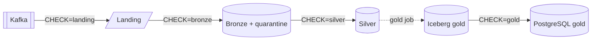

# Data quality checks

Data quality checks verify the data on the running stack; how fast it arrives is measured by the [latency probe](../operations/latency.md). Each check compares one layer with the layer before it, never with the source database, so the checks form a chain from Kafka to gold. Each layer's checks sit next to its code (`pipelines/lake/<layer>/quality.py`), and they run as one Spark job.

```sh
make data-quality                 # every check (CHECK=all)
make data-quality CHECK=landing   # Kafka -> landing
make data-quality CHECK=bronze    # landing -> bronze and its quarantine
make data-quality CHECK=silver    # bronze -> silver
make data-quality CHECK=gold      # Iceberg gold -> its PostgreSQL copy, and the gold model's rules
make up PROFILES=data-quality     # or on a schedule (off by default)
```

## Data quality chain



| Check | Compares |
| --- | --- |
| `landing` | Kafka to landing: every offset landed once, payloads unchanged |
| `bronze` | Landing to bronze and quarantine: every landed record held exactly once |
| `silver` | Bronze to silver: every change identity held exactly once |
| `gold` | Each PostgreSQL `gold_internal` table against its Iceberg table at the snapshot the copy records, then the gold model's rules on the Iceberg tables |

Silver to Iceberg gold is the gold job's transformation; the unit and infra tests and the gold rules cover it.

## How the checks run

- **Bounded by what the downstream layer committed.** A check reads the upstream position the downstream checkpoint committed, and the downstream table at the newest snapshot that holds no later batch. A batch written but not yet committed does not count, so the result does not depend on pipeline lag.
- **Output.** One JSON line per result, prefixed with `<CHECK> QUALITY`, then a `DATA QUALITY` summary. The job exits 1 when a check fails. A check that raises an error fails as one result and the others still run.
- **Report.** Every run writes `<LAKE_ROOT>/quality/reports/<UTC>.json`; `curl http://localhost:8888/buckets/lake/quality/reports/` lists them.
- **Schedule.** The optional `data-quality-job` service runs every check at start and then every `DATA_QUALITY_INTERVAL_HOURS` (default 24). It shares the free cores with lake maintenance, so one waits for the other.

### Landing

Kafka is read once per run and is the reference. Only files committed by the file sink count.

| Check | Checks that |
| --- | --- |
| `topic_found` | A configured topic has records in Kafka or landing |
| `partition_landed` | Every Kafka partition has landed records |
| `unique_offsets` | Every offset landed exactly once |
| `contiguous_offsets` | Every offset Kafka holds in the compared range landed |
| `starts_at_kafka_min_offset` | Landing starts at or before Kafka's earliest retained offset |
| `same_bytes_as_kafka` | Landed keys and values equal Kafka's |

- Gaps are measured against the offsets Kafka actually holds: transaction markers and compaction leave offsets with no record. Offsets after the last landed one are lag, not gaps.
- Landed offsets Kafka no longer retains are not counted as missing.
- An empty run fails, and a topic folder with the wrong columns raises an error instead of reading as empty.
- `LANDING_CHECK_LAST_OFFSETS=<n>` limits the comparison to the last `n` offsets of each partition.

### Bronze

Landing records are matched with bronze and quarantine by Kafka coordinates. Each table is bounded by its own query's committed batch; tombstones are left out.

| Check | Checks that |
| --- | --- |
| `landed_records_held` | Every record whose file both queries committed is in bronze or quarantine |
| `held_exactly_once` | No record is in both tables, or twice in either |
| `committed_records_only` | Each table holds only records of files its own query committed |

### Silver

Silver is compared with bronze by change identity, at the bronze snapshot silver's last committed batch had read. A change bronze holds twice is expected once.

| Check | Checks that |
| --- | --- |
| `same_changes_as_bronze` | Silver holds every change bronze held at that snapshot, and no other |
| `changes_held_once` | No change identity is in silver more than once |

If maintenance has expired that bronze snapshot, `same_changes_as_bronze` fails with the reason.

### Gold

The gold job records in `gold_internal.sync_state` the Iceberg snapshot each PostgreSQL table holds ([the gold writer](gold/writer.md)), so the copy is checked against its own upstream.

| Check | Checks that |
| --- | --- |
| `gold_copy_matches_iceberg` | Each PostgreSQL table holds exactly the rows of its Iceberg table at the recorded snapshot. History is compared from the start of the retention window |
| `gold_one_current_version` | Each business key has at most one current row |
| `gold_no_overlapping_validity` | A key's unfolded versions do not overlap, and only the last is open |
| `gold_lookups_resolve` | Every status and date key names a seeded row, or is null where the model allows it |
| `gold_business_keys_known` | Every fact's customer or product key is known to its dimension, for changes no later than the dimension's newest version |
| `gold_report_views_match_lake` | Each PostgreSQL business-question view returns the same rows as the same view in the lake, at the snapshots PostgreSQL held |

The rules run on the Iceberg tables at the same snapshots, so they check the state PostgreSQL serves. A copy changes a table and its `sync_state` row in one transaction, so the check rereads the tables whose snapshot moved meanwhile, up to three times.

## Latest results

The [latest data quality results](data-quality-results.md) page shows one full run, rendered on every docs build from `docs/results/quality/latest.json`.

```sh
make data-quality      # on the running stack: writes a new report to the lake
make docs-results      # copy the newest reports from the lake into docs/results/, then commit them
```

`make docs-results` copies the newest complete run (`CHECK=all`), passed or not. The [latency page](../operations/latency.md#latest-results) explains its other options.
