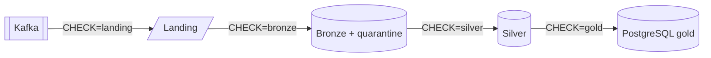

# Data quality checks

Data quality checks verify the data itself, on the running stack; how fast it gets there is measured by the [latency probe](../operations/latency.md). They are separate from unit tests (the code, on synthetic data) and from infra tests (the platform, on a throwaway stack), and run on demand. Each check compares one layer with its upstream layer only, never with the source database, so the checks form a chain from Kafka to the lake. The framework lives in `analytics/pipelines/src/pipelines/quality/`, and each layer's checks next to its code (`pipelines/lake/landing/quality.py`, `pipelines/lake/bronze/quality.py`, `pipelines/lake/silver/quality.py`, `pipelines/lake/gold/quality.py`). They run as one Spark job, `pipelines/quality/job.py`:

```sh
make data-quality                 # every check (CHECK=all)
make data-quality CHECK=landing   # Kafka -> landing
make data-quality CHECK=bronze    # landing -> bronze and its quarantine
make data-quality CHECK=silver    # bronze -> silver
make data-quality CHECK=gold      # silver -> gold in PostgreSQL, through the gold views in the lake
make up PROFILES=data-quality     # or run every check on a schedule (optional, off by default)
```

## Data quality chain

Each check compares one layer with its upstream layer only, never with the source database. Each check is bounded by what the downstream query has committed, so the result does not depend on pipeline lag (#145). `make data-quality CHECK=<check>|all` runs them as their own Spark application, never inside `make test-infra`. Each run writes a JSON report to `<LAKE_ROOT>/quality/reports/<UTC>.json` and exits 1 when a check fails.



| Check | Compares | Status |
| --- | --- | --- |
| `landing` | Kafka to landing: every offset landed once, payloads unchanged | merged (#23) |
| `bronze` | Landing to bronze and quarantine: every landed record held exactly once | merged (#151) |
| `silver` | Bronze to silver: every change identity held exactly once | merged (#179) |
| `gold` | Silver to PostgreSQL gold: each gold view against the lake gold views computed over silver, at the silver snapshots gold committed | merged (#154) |
| Schedule | Runs every check every `DATA_QUALITY_INTERVAL_HOURS` in the `data-quality` profile | merged (#180) |

## How the checks run

- **Output:** each check prints one JSON line per result, prefixed with `<CHECK> QUALITY` (`LANDING QUALITY`, `BRONZE QUALITY`, `SILVER QUALITY`, `GOLD QUALITY`), then a summary line of its own, and the run ends with a `DATA QUALITY` summary of every check that names the run's report. The job exits with code 1 if any check fails. A check that raises an error instead of returning results, for example the landing check on a topic Kafka does not host yet, fails as one `check_completed` result with the error's type and message in its `details`, and the run still runs the other checks and writes its report.
- **Report:** every run also writes one JSON file, `<LAKE_ROOT>/quality/reports/<UTC time>.json` (locally `s3a://lake/quality/reports/20261110T151803Z.json`), with each check's results and summary and the run's summary, so the results persist and can be inspected later (`curl http://localhost:8888/buckets/lake/quality/reports/` lists them). The newest complete run is shown in the docs as the [latest data quality results](#latest-results).
- **Schedule:** the `data-quality-job` service is optional and off by default: it is in its own `data-quality` profile, which neither `make up` nor `make pipeline` starts, so it runs only when requested (`make up PROFILES=data-quality`). It runs every check (`CHECK=all`) right away and then every `DATA_QUALITY_INTERVAL_HOURS` hours (default 24), each time with a fresh `spark-submit` (`spark.cores.max=2`). A failed run, a failing check included, is logged (`docker compose logs data-quality-job`) and the next run starts on schedule. Every run writes its report, so `quality/reports/` keeps the history of the scheduled runs. Next to the four streaming jobs, it shares the 2 free cores with lake maintenance, so when both profiles start together one waits for the other.
- **Bounded by what the downstream layer committed:** a check reads the upstream position the downstream stream's checkpoint committed (`pipelines/lake/shared/checkpoints.py`), and the downstream table as of the newest snapshot that holds no later batch of that stream (`pipelines/lake/shared/snapshots.py`; Iceberg's streaming sink records the query and batch, `spark.sql.streaming.queryId` and `spark.sql.streaming.epochId`, in each append's snapshot summary). A batch whose rows are in the table but whose checkpoint commit is not written yet does not count, so the result does not depend on pipeline lag.

The landing checks reconcile the landing zone with Kafka for every configured topic and every topic partition. Landed records are read through Spark, so only files committed by the file sink count; files in a topic folder that `_spark_metadata` does not record are ignored. Kafka is the reference, and it is read once per run into one snapshot, so every check sees the same records:

| Check | Checks that |
| --- | --- |
| `topic_found` | a configured topic has records in Kafka or in the landing zone |
| `partition_landed` | every Kafka partition has landed records |
| `unique_offsets` | every offset landed exactly once |
| `contiguous_offsets` | every offset Kafka holds in the compared range landed |
| `starts_at_kafka_min_offset` | landing starts at or before Kafka's earliest retained offset |
| `same_bytes_as_kafka` | landed keys and values equal Kafka's, and Kafka holds every landed offset it still retains |

- **Contiguity is measured against the offsets Kafka actually holds,** not against a dense range of numbers: transaction markers and compaction leave offsets with no record, and those are not gaps. Kafka offsets after the last landed offset are lag, not gaps.
- **Retention:** landed offsets that Kafka no longer retains are not counted as missing in Kafka, including in a partition whose records have all expired.
- **Empty runs fail:** a configured topic with no records anywhere fails `topic_found`, and a run with no results fails.
- **Schema drift fails loudly:** a topic folder whose committed files do not hold the Kafka record columns and types raises an error instead of reading as empty. Only a missing folder, or one without committed files, reads as no records.

The `partition_landed` result also reports the row count, the offset range, the number of tombstones, Kafka's offset range (`kafka_min_offset`, `kafka_max_offset`) and the lag behind Kafka; lag is expected while landing runs and is not a failure. The `contiguous_offsets` result reports the compared range (`from_offset`, `to_offset`) and the number of `missing_offsets`.

By default every landed offset is compared, from the first to the last landed offset of each partition. For large topics, `LANDING_CHECK_LAST_OFFSETS=<n> make data-quality` limits the comparison to a window of the last `n` offsets up to the last landed offset of each partition, and skips `starts_at_kafka_min_offset`. The window limits what is compared; Kafka is still read in full. The job runs with `spark.cores.max=2` and a random UI port, so it can run while the pipeline jobs are running.

The bronze checks reconcile each topic's landing records with bronze and its quarantine, by Kafka coordinates (topic, partition and offset; `_record_source`, `_source_partition` and `_source_offset` in the tables). Bronze and quarantine are written by two queries with separate checkpoints, so each side is bounded by its own query: the landing files the query's file-source log lists up to its committed batch (`<CHECKPOINT_ROOT>/bronze/<entity>/sources/0/`, including the `.compact` files), and its table as of its committed batch. Tombstones are left out, because bronze drops them.

| Check | Checks that |
| --- | --- |
| `landed_records_held` | every landed record whose file both queries committed is in bronze or in the quarantine |
| `held_exactly_once` | no record is in both tables, or twice in either |
| `committed_records_only` | each table holds only records of the landing files its own query committed |

A record whose file only one of the two queries has committed so far is not missing yet: the other query has not read it. The results report the counts (`committed_records`, `missing`, `held_records`, `duplicated`, `unexpected`) and the committed batch of each query; a topic whose queries have not committed a batch yet has nothing to check and passes.

The silver checks compare each entity's silver table with bronze by change identity: the entity key, `_commit_sequence` and `_change_op`. Silver reads bronze as an Iceberg stream, so the offset of its last committed batch (`<CHECKPOINT_ROOT>/silver/<entity>/offsets/<batch>`) names the bronze snapshot it had read up to. Silver reads bronze without a rate limit, so every batch ends at a whole snapshot. The expected changes are the distinct identities of bronze as of that snapshot, so a change bronze holds twice, such as a Kafka redelivery, is expected once. Silver is read as of its newest snapshot that holds no later batch of its stream.

| Check | Checks that |
| --- | --- |
| `same_changes_as_bronze` | silver holds every change bronze held at that snapshot, and no other |
| `changes_held_once` | no change identity is in silver more than once |

The results report the counts (`bronze_changes`, `missing`, `extra`, `silver_rows`, `duplicated`), silver's committed batch, the bronze and silver snapshots compared, and up to 10 sample identities of each mismatch. An entity whose silver stream has not committed a batch yet has nothing to check and passes. If the bronze snapshot has been expired, which lake maintenance avoids while a silver checkpoint still needs it, `same_changes_as_bronze` fails and gives the reason in its details.

The `gold` check compares every PostgreSQL `gold` view with the [gold view in the lake](gold/writer.md#gold-in-the-lake) of the same name, computed over silver, one `gold_matches_silver` result per view, `data_freshness` aside. The lake views apply gold's rules to silver at read time, so one comparison checks silver against gold in PostgreSQL and the lake views against PostgreSQL, and silver and PostgreSQL are each read once per run:

- **Same point in silver:** each gold stream's checkpoint gives the silver snapshot of its last committed batch, and of the batch it is writing, if any. The check reads the committed batches, then PostgreSQL, then the planned batches, and computes the lake views' SQL over silver at those snapshots, the committed ones first and then each combination with a planned one, because PostgreSQL commits a batch before the checkpoint does.
- **Dimension versions, not surrogate keys:** PostgreSQL's `customer_key` and `product_key` are compared as the `_commit_sequence` of the dimension version they name (through `gold_internal.dim_*`), which the lake side computes too, so the version each fact points at is checked.
- **Retention window:** the history facts are compared from the first month PostgreSQL still holds, with the lake's history computed over silver from that month; current state, dimensions, seeds and the business views in full.
- **Up to date:** a stored lake view whose query or descriptions differ from its definition fails (`stale`).
- **Output:** the metrics count the rows of each side and the rows only one side has (`lake_rows`, `postgres_rows`, `lake_only`, `postgres_only`, `stale`); the details hold the snapshots compared at, up to 10 sample rows of each side and the history start. Before every gold stream has committed a batch, each view is reported as not checked and fails.

## Latest results

The [latest data quality results](data-quality-results.md) page shows one run of every check, stamped with when it ran (the UTC time its report is named after) and the name of its report: the run's summary, then each check's results with their subject and metrics, and the details of every failed result. It is rendered on every docs build from the report committed under `docs/results/quality/latest.json`, not from the lake, so the published site shows it too.

```sh
make data-quality      # on the running stack: writes a new report to the lake
make docs-results      # copy the newest reports from the lake into docs/results/, then commit them
```

`make docs-results` copies the newest complete run, one of every check (`CHECK=all`), whether its checks passed or not, so a failure shows on the page as it happened; newer runs of only some checks are named on the page and left out. `RESULTS=quality` copies only this report; the [latency page](../operations/latency.md#latest-results) explains the target's other options and exit codes.
