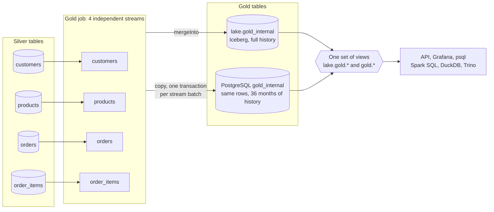

# Gold

Gold is the dimensional model: a star schema that answers the four business questions in near real time and keeps the history of every change.

**Computed once by Spark, stored twice.** The gold job runs four independent streams, one per silver table. Each batch merges its rows into Iceberg tables in `lake.gold_internal` and copies the same rows into PostgreSQL `gold_internal`, a serving copy with no business logic. Both stores expose the same views, rendered from one set of templates: `lake.gold.*` and `gold.*`.

| Stored tables | What they hold |
| --- | --- |
| `dim_customer`, `dim_product` | SCD2 versions with a deterministic surrogate key |
| `dim_date`, `dim_order_status` | Seeded |
| `fact_order_history`, `fact_order_item_history` | Every change, with its business keys |
| `current_orders`, `current_order_items` | The newest change of each order and item |

The views resolve the rest when read:

- **Point-in-time facts** join each change to the dimension version valid when it was committed: customer key, name and address, or product key, name, price and `line_amount`.
- **The four business questions** are counted from the open rows of `current_orders`.

Rules in short:

- **Open order:** current status other than `COMPLETED`, not deleted. Pending orders are the open orders; pending items are the items of open orders.
- **Current state only moves forward:** a change replaces the current row only if its `_commit_sequence` is higher. Late events are still kept as history.
- **No stream waits for another:** a fact never reads a dimension when written, so a late customer or product shows up in the facts as soon as it is stored.
- **Top 3 questions keep ties**, so they can return more than three rows.

I first modelled gold in PostgreSQL, then moved it to Spark so both copies come from one computation ([D44](../../architecture/decisions.md#d44--gold-modelled-in-spark-on-iceberg-postgresql-as-serving-copy)).

## PostgreSQL gold and the lake gold views

| | PostgreSQL gold | Lake gold |
| --- | --- | --- |
| Where | Database `analytics`: tables in `gold_internal`, views in `gold` | Tables `lake.gold_internal.<table>`, views `lake.gold.<view>` |
| Written by | The gold job: one transaction per stream batch | The gold job: one `mergeInto` per table per batch |
| Consistent | Per stream batch | Per table ([consistency](writer.md#consistency-between-the-two-copies)) |
| History | 36 months (`GOLD_RETENTION_MONTHS`) | Full |
| Keys | Surrogate keys hashed from the business key and `_commit_sequence` | The same values |
| Read by | [Analytics API](../../serving/api.md), [Grafana](../../serving/grafana.md), `psql` | Spark SQL, DuckDB, Trino ([querying the lake](../../serving/lake-access.md)) |

PostgreSQL serves the API and Grafana, which need fast reads; the Iceberg copy holds the full history for analytical engines. `make data-quality CHECK=gold` checks that both hold the same rows and give the same answers ([data quality checks](../data-quality.md#how-the-checks-run)).

- [Gold model](model.md): the tables, grain, versioning, point-in-time views, business questions and things to know about the source data.
- [Gold writer](writer.md): how each stream writes, the copy into PostgreSQL, retention, rebuilds and the lake views.
- [Table reference](../../reference/gold/index.md): every gold table and view with its columns.
