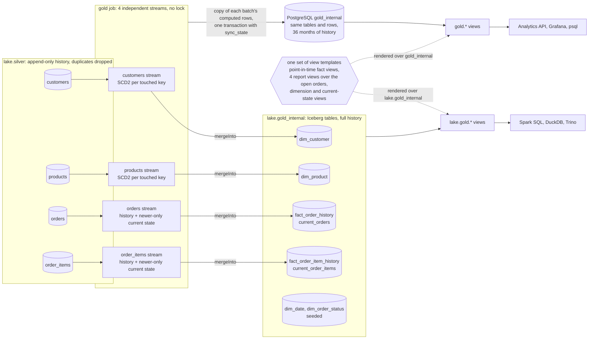

# Gold

Gold is the dimensional model: a star schema that answers the four business questions with near-real-time current state and keeps the history of every change. Spark builds it from the silver history tables in the lake.

**Gold is computed once by Spark and stored twice.** The gold job runs four independent streams, one per silver table. In each micro-batch a stream computes its own gold tables with the Spark DataFrame API, merges them into Iceberg tables in `lake.gold_internal`, next to bronze and silver, and copies the rows it computed into PostgreSQL, the `analytics` database on the `analytics-db` service. PostgreSQL holds no business logic: it is a serving copy, with the same tables in `gold_internal`. Both stores expose the same public views, rendered from one set of SQL templates: `gold.*` in PostgreSQL and `lake.gold.*` in the lake.

The stored tables:

- **SCD2 dimensions** `dim_customer` and `dim_product`, with the version columns stored and a deterministic surrogate key per version, and the seeded `dim_date` and `dim_order_status`.
- **History facts** `fact_order_history` and `fact_order_item_history`: every change, with its business keys (`customer_id`, `product_id`) and its own version columns.
- **Current state** `current_orders` and `current_order_items`: the newest change of each order and item.

The public views resolve the rest when they are read:

- **Point-in-time facts:** `gold.fact_order_history` and `gold.fact_order_item_history` join each change to the dimension version valid when it was committed, so they show the customer key, name and address, or the product key, name, price and `line_amount`, as of the change.
- **The four business questions** are counted from the open rows of `current_orders` when read, through partial indexes in PostgreSQL.

In short:

- **Open order:** current status other than `COMPLETED`, not deleted; `gold.open_orders` lists them. **Pending orders** are open orders, and **pending items** are the items of open orders.
- **Current state only moves forward:** a change replaces the current row only if its `_commit_sequence` is higher, so late or replayed events never overwrite newer state; they are still kept as history.
- **No stream waits for another:** a fact keeps its business keys and never reads a dimension when it is written, so a customer or product that arrives late, or a late version, shows up in the facts as soon as it is stored.
- **Top 3 questions include ties**, so more than three rows can come back.

## How gold got here

I first modelled gold in PostgreSQL, with Spark staging each batch and templated SQL doing the versions, the lookups and the merges, while the lake gold views recomputed the model from silver at read time. I moved the model to Spark so the two golds come from one computation and the lake's cluster does the work. A first Spark version linked facts to dimension versions at write time and kept report tables, behind one lock across the streams; it was slow, so I simplified it to the shape above, the usual lakehouse shape for SCD2 pipelines. The whole story, with the measurements, is in [D44](../../architecture/decisions.md#d44--gold-modelled-in-spark-on-iceberg-postgresql-as-serving-copy).

## PostgreSQL gold and the lake gold views

| | PostgreSQL gold | Lake gold |
| --- | --- | --- |
| Where | Database `analytics`: tables in `gold_internal`, views in `gold` | Iceberg tables `lake.gold_internal.<table>`, views `lake.gold.<view>` |
| Written by | The gold job, one transaction per stream and micro-batch, copying the rows it merged into Iceberg | The gold job, one Iceberg `MERGE` per table per micro-batch |
| Consistent | Per stream and micro-batch: a fact's history and current state commit together | Per table: a reader can briefly see a fact's history before its current state ([consistency](writer.md#consistency-between-the-two-copies)) |
| History | History facts keep 36 months by default (`GOLD_RETENTION_MONTHS`) | The full history |
| Keys | Surrogate keys (`customer_key`, `product_key`) | The same surrogate keys: they are hashed from the business key and `_commit_sequence`, so both copies hold the same values |
| Views | Rendered from `pipelines/lake/gold/sql/views/` over `gold_internal` | The same templates over `lake.gold_internal` |
| Read by | The [analytics API](../../serving/api.md), [Grafana](../../serving/grafana.md), `psql` | Spark SQL, DuckDB, Trino ([querying the lake](../../serving/lake-access.md)) |

I keep PostgreSQL for serving because the API and Grafana need low-latency reads, which the partial indexes on the open orders give; the Iceberg copy holds the whole model, full history included, for analytical engines.

`make data-quality CHECK=gold` checks that PostgreSQL holds exactly the Iceberg rows at the snapshot it records, checks the model's invariants, and checks that the four business-question views return the same rows in both stores ([data quality checks](../data-quality.md#how-the-checks-run)).

- [Gold model](model.md): the inputs from silver, the stored tables and public views, the star schema and the grain of every table, the versioning, the point-in-time views, the open-order rules, the business-question views and the things to know about the source data.
- [Gold writer](writer.md): the gold job and how each stream computes and writes its micro-batches, the copy into PostgreSQL, current state and retention, rebuilding gold from silver, and gold in the lake.
- [Table reference](../../reference/gold/index.md): every gold table and view, with its columns, types and descriptions.
