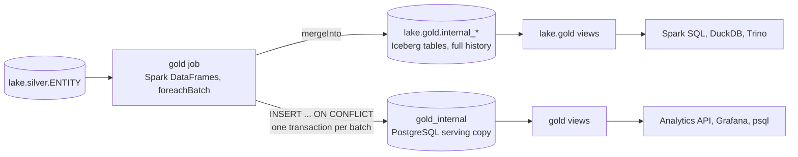

# Gold

Gold is the dimensional model: a star schema that answers the four business questions with near-real-time current state and keeps the history of every change. Spark builds it from the silver history tables in the lake.

**Gold is computed by Spark and stored twice.** The gold job computes every gold table with the Spark DataFrame API, inside each micro-batch, and writes it to Iceberg tables in `lake.gold`, next to bronze and silver. It then copies the rows it wrote into PostgreSQL, the `analytics` database on the `analytics-db` service, with plain upserts. PostgreSQL holds no business logic: it is a serving copy, in two schemas, `gold_internal` (the copied tables) and `gold` (the views consumers read). The lake has the same public relations as thin Iceberg views over the gold tables, `lake.gold.<relation>`.

Gold is built from the silver history tables: SCD2 customer and product dimensions, seeded date and order-status dimensions, history facts for orders and order items, current-state tables for orders and items, and the report tables that hold the answers to the four business questions.

In short:

- **Open order:** current status other than `COMPLETED`, not deleted; `gold.open_orders` lists them. **Pending orders** are open orders, and **pending items** are the items of open orders.
- **Current state only moves forward:** a version replaces the current row only if its `_commit_sequence` is higher, so late or replayed events never overwrite newer state; they are still kept as history.
- **The answers are precomputed:** every micro-batch recounts the business totals of the keys it touched, and ranks the two top-3 tables again, so the business-question views read small tables.
- **Top 3 questions include ties**, so more than three rows can come back.

## PostgreSQL gold and the lake gold views

| | PostgreSQL gold | Lake gold |
| --- | --- | --- |
| Where | Database `analytics`: tables in `gold_internal`, views in `gold` | Iceberg tables `lake.gold.internal_<table>`, views `lake.gold.<relation>` |
| Written by | The gold job, one transaction per micro-batch, copying what it wrote to Iceberg | The gold job, one Iceberg `MERGE` per table per micro-batch |
| Consistent | Per micro-batch: every table of a batch commits together | Per table: a reader can briefly see a dimension before its re-resolved facts ([consistency](writer.md#consistency-between-the-two-copies)) |
| History | History facts keep 36 months by default (`GOLD_RETENTION_MONTHS`) | The full history |
| Keys | Surrogate keys (`customer_key`, `product_key`) | The same surrogate keys: they are hashed from the business key and `_commit_sequence`, so both copies hold the same values |
| Read by | The [analytics API](../../serving/api.md), [Grafana](../../serving/grafana.md), `psql` | Spark SQL, DuckDB, Trino ([querying the lake](../../serving/lake-access.md)) |

I keep PostgreSQL for serving because the API and Grafana need low-latency reads that see each micro-batch whole; the Iceberg copy is the columnar store of the whole model, full history included, for analytical engines.

`make data-quality CHECK=gold` compares the two, view by view ([data quality checks](../data-quality.md)).

- [Gold model](model.md): the inputs from silver, the stored tables and public views, the star schema and the grain of every table, the versioning and open-order rules, the report tables behind the business questions and the things to know about the source data.
- [Gold writer](writer.md): the gold job and how it computes and writes each micro-batch, the copy into PostgreSQL, current state and retention, rebuilding gold from silver, and gold in the lake.
- [Table reference](../../reference/gold/index.md): every gold table and view, with its columns, types and descriptions.
