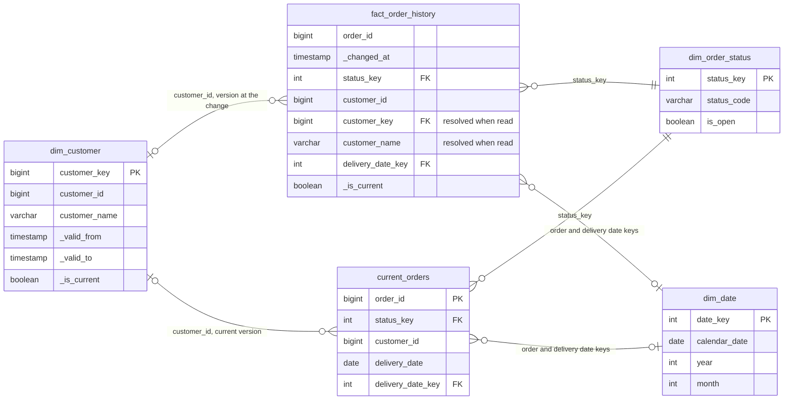
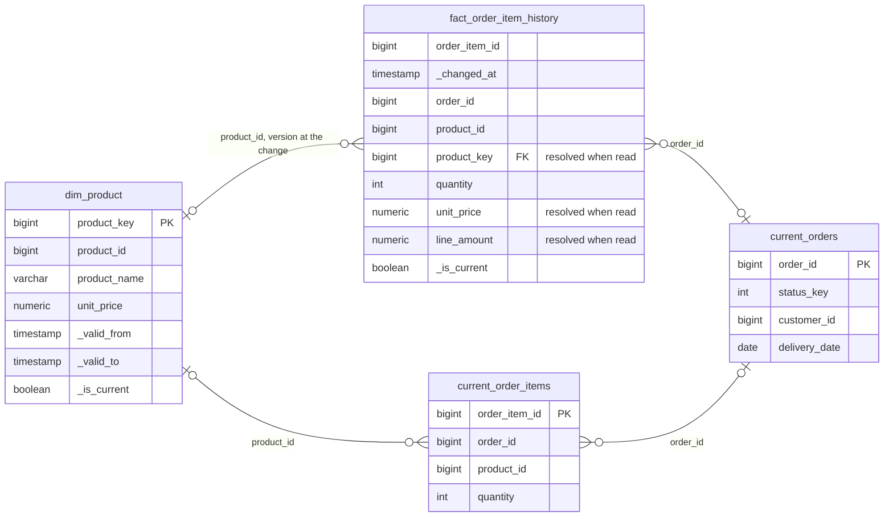

# Gold model

The design of gold: its inputs, tables, views and rules. The Iceberg tables in `lake.gold_internal` and the PostgreSQL tables in `gold_internal` hold the same rows, and both stores render the same views. How the rows are written is in [the gold writer](writer.md).

## Inputs from silver

Gold streams the append-only tables `lake.silver.<entity>`: one row per source change, with the source and audit columns under their lake names (`unity_price`, and `quantity` for the misspelled `quanity`), plus:

| Column | Meaning |
| --- | --- |
| `_commit_sequence` | The change's position in the source's write-ahead log (Debezium `source.lsn`); grows in commit order |
| `_change_op` | `snapshot`, `create`, `update` or `delete` |
| `_changed_at` | When the change was committed in the source |
| `_content_hash` | SHA-256 of the content columns |
| `_is_deleted` | Whether the change is a delete; the row keeps its last values |

Exact duplicates are already dropped. Gold reads the tables, not silver's views, because a stream can only read a table.

**Unchanged versions are folded, not dropped.** A version whose `_content_hash` and `_is_deleted` equal the previous version's is not a new version. Gold stores it with `_is_folded` set, because a late change landing between two equal versions turns the later one back into a real change.

Example: product 3 at 3.00 is stored at positions 60 and 80 (a re-snapshot), so 80 is folded. A late update to 4.00 at position 70 arrives: 60 is now valid until 70, 70 until 80, and 80 is no longer folded and becomes current.

### What `_commit_sequence` is

`_commit_sequence` is the LSN of the change: it only grows, across the whole database. Gold uses it to order a key's versions, to tell a late or replayed change from a newer one, to break ties in the point-in-time views, and in every surrogate key. Arrival order and Kafka offsets are never used for ordering.

## Internal tables and public views

The tables live in `gold_internal` and the views in `gold`, in the lake as in PostgreSQL, so readers use the same names in both. Only the gold job writes the tables; consumers read the views.

All 14 views are rendered from the templates in `pipelines/lake/gold/sql/views/`, with the `gold_internal` namespace as the only parameter. A unit test checks that the PostgreSQL and lake versions differ only in that namespace.

| Kind of view | Views | What it does |
| --- | --- | --- |
| Projections | The dimensions, `current_orders`, `current_order_items`, `open_orders`, `data_freshness` | Leave out pipeline metadata, folded versions and deleted rows |
| Point-in-time facts | `fact_order_history`, `fact_order_item_history` | Join each change to the dimension version valid when it was committed ([point-in-time attributes](#point-in-time-dimension-attributes)) |
| Business questions | The four question views | Count the open current orders when read ([the four business questions](#the-four-business-questions)) |

| Column | In the tables | In the views |
| --- | --- | --- |
| `_commit_sequence`, `_content_hash`, `_is_folded`, `_version_number` | Dimensions and facts | Left out; folded versions filtered |
| `_is_deleted` | Dimensions, facts, current state | Left out; deleted rows filtered, and a delete is the last row of a history view |
| `_valid_to`, `_is_current` | Dimensions and history facts | Kept |
| `is_open` | `current_orders` | Left out; `open_orders` and the question views filter on it |
| Customer key, name and address of an order change | Not stored | Resolved by `gold.fact_order_history` |
| Product key, name, price and `line_amount` of an item change | Not stored | Resolved by `gold.fact_order_item_history` |

## Where the definitions live

Every table, view and column, with its type, nullability and description, is defined once in the gold Avro schemas in `analytics/pipelines/src/pipelines/schemas/gold/`. A column from a source table reuses its description with `"from"`; a column only a view has is marked `"view_only"`. The same schemas give the Iceberg tables and the PostgreSQL DDL their columns. The gold DDL is generated from the schemas and templates when the stack starts; edit the templates, not the generated SQL.

## Model

Two stars over the public views, each with its facts in the centre. The history views resolve `customer_key` and `product_key` when read; the stored facts keep only the business keys.

**Orders.**



**Order items.**



### Tables and grain

| Table | Kind | Grain | Key |
| --- | --- | --- | --- |
| `dim_customer` | SCD2 dimension | One row per customer change, folded versions and the delete included; the view shows one row per version | (`customer_id`, `_commit_sequence`); surrogate `customer_key` |
| `dim_product` | SCD2 dimension | As `dim_customer`, per product; a new price is a new version | (`product_id`, `_commit_sequence`); surrogate `product_key` |
| `dim_date` | Seeded | One row per day, 2000-01-01 to 2099-12-31 | `date_key` (`yyyymmdd`) |
| `dim_order_status` | Seeded | `PENDING`, `PROCESSING`, `REPROCESSING`, `COMPLETED`, `UNKNOWN` | `status_key` |
| `fact_order_history` | History fact | One row per order change; the view leaves out unchanged changes | (`order_id`, `_commit_sequence`); in PostgreSQL also `_changed_at` |
| `fact_order_item_history` | History fact | As `fact_order_history`, per item | (`order_item_id`, `_commit_sequence`); in PostgreSQL also `_changed_at` |
| `current_orders` | Current state | One row per order, with `is_open`; the view leaves out deleted orders | `order_id` |
| `current_order_items` | Current state | One row per item; the view leaves out deleted items | `order_item_id` |

- `unity_price` is renamed `unit_price`. The business keys stay next to the surrogate keys, so facts join the source without the dimensions.
- `status_key` matches the source status exactly; a null or other status gets `UNKNOWN`. Date keys are null when the date is null or outside 2000–2099. The seeded dimensions never change with the data, so a stored key never goes stale.
- A delete is the key's last history row, with `_change_op = 'delete'`, never current, so "deleted at" stays queryable.
- In PostgreSQL the history facts are partitioned by month of `_changed_at`, so the key includes it. In Iceberg they are bucketed by business key.
- The history facts carry `_valid_to` and `_is_current`, so history can be queried as of any time.

## Rules

### Versioning

The gold job applies these rules per batch, only for the keys the batch touches. Each stream reads and writes only its own tables.

- **Recompute the touched keys.** The stored versions of each key and the batch's changes are ranked in one window by key (a change stored or delivered twice counts once), and the version columns are recomputed, ordered by `_commit_sequence`:

  | Column | Value |
  | --- | --- |
  | `_is_folded` | Same `_content_hash` and `_is_deleted` as the previous change |
  | `_version_number` | Count of unfolded versions so far; a folded change shares its version's number |
  | `_valid_to` | Start of the next version; null for the last |
  | `_is_current` | The last version, unless it is a delete; never a folded change |

  Only new or changed rows are written. A late change re-places the changes after it.
- **History is idempotent.** A row is identified by (key, `_commit_sequence`), so a replay writes nothing.
- **Current state only moves forward.** A change replaces the current row only if its `_commit_sequence` is higher. Example: order 7 is `PROCESSING` at position 500; a late `PENDING` at 420 goes to history only; `COMPLETED` at 610 then replaces the current row.
- **Deletes are soft in current state,** so an older late event cannot bring the row back.
- **Current state is the latest change, folded or not,** so a late change between two equal ones is still rejected.
- **Items may arrive before their order.** `current_order_items` has no foreign key to `current_orders`; the pending-items view joins them when read.
- **SCD2 dimensions.** `_valid_from` is the version's `_changed_at`; each unfolded version is valid until the next. A delete is the key's last version, so the key has no current version afterwards. A key has at most one current version, because its version columns are recomputed together.

### Surrogate keys

`customer_key` and `product_key` are `xxhash64(business key, _commit_sequence)`.

- **Deterministic:** a rebuild gives every version the same key, and both stores hold the same values.
- **Stable under late changes:** `_version_number` changes when a late version lands between stored ones; `_commit_sequence` never does.
- **Collisions** are a birthday problem over 2^64 values, about 3 in a million at 10 million versions. PostgreSQL keeps the surrogate key `UNIQUE`, so a collision fails the copy loudly.

### Point-in-time dimension attributes

The history facts store business keys only. The public history views resolve the dimension version valid at each change when read:

- **Join** (`LEFT JOIN`) the unfolded, undeleted versions whose [`_valid_from`, `_valid_to`) contains the change's `_changed_at`.
- **The first version also covers earlier changes,** because Debezium snapshots each table at a slightly different time.
- **The version committed last wins** when clock skew makes two ranges overlap (`row_number()` by `_commit_sequence`).
- **No version, null attributes:** a change whose customer or product is not in gold yet shows nulls until it arrives.
- **`line_amount`** is the price as of the change times the quantity, at `decimal(38, 10)`. Items are inserted right after their order, so this is the price the order was placed at.

Nothing stored goes stale and nothing is re-linked: a late customer, product or version shows up in the views as soon as its stream stores it.

Example: product 3 costs 3.00 from 10:00. An item changed at 10:30 reads 3.00. A late update to 4.00 committed at 10:20 arrives: from then on the item reads 4.00, and the stored item row is untouched.

### Open orders and pending items

| Status | Open |
| --- | --- |
| `PENDING`, `PROCESSING`, `REPROCESSING` | Yes |
| `UNKNOWN` (null or unexpected) | Yes, so it shows up instead of disappearing |
| `COMPLETED` | No |

- **Open order:** a current, undeleted order whose status is open; the rows of `gold.open_orders`. The gold job stores `is_open` with the order, so the open-order indexes can be partial ([D40](../../architecture/decisions.md#d40--gold-indexes-chosen-from-the-query-plans-of-the-current-use-cases)).
- **Pending order** (question 4): an open order. `PENDING` alone would leave out orders being processed.
- **Pending item** (question 3): an undeleted item of an open order, reported as a count and a total quantity per product.
- **Top 3** (questions 2 and 4): ranked with `rank()`, so every tie for third place is kept and more than three rows can come back.

Example: customer 3 has order 10 `PENDING` with two items of product 5 (quantities 4 and 6) and order 11 `COMPLETED` with one. Customer 3 has one pending order; product 5 has two pending items, quantity 10.

## The four business questions

Each question is a view in `gold` and `lake.gold`, computed when read from the open rows of `current_orders`:

| Question | View | Columns | How |
| --- | --- | --- | --- |
| Open orders by delivery date and status | `gold.open_orders_by_delivery_date_and_status` | `delivery_date`, `status_code`, `open_orders` | Count of open orders per date and status |
| Top 3 delivery dates with more open orders | `gold.top_delivery_dates_by_open_orders` | `delivery_date`, `open_orders` | Count per date, ranked 1 to 3 |
| Open pending items by product | `gold.pending_items_by_product` | `product_id`, `pending_items`, `pending_quantity` | Undeleted items joined to their open order, counted and summed per product |
| Top 3 customers with more pending orders | `gold.top_customers_by_pending_orders` | `customer_id`, `customer_name`, `pending_orders` | Count per customer, ranked 1 to 3, with the current customer name |

### Querying the views

```sh
docker compose exec -T analytics-db psql -U analytics -d analytics < analytics/sql/gold/01_open_orders_by_delivery_date_and_status.sql
docker compose exec analytics-db psql -U analytics -d analytics -c "select * from gold.top_customers_by_pending_orders order by pending_orders desc, customer_id"
docker compose exec analytics-db psql -U analytics -d analytics -c "select * from gold.data_freshness"
```

`gold.data_freshness` shows per entity the source commit time of the newest change gold holds, so it ages when the source stops changing, even when the pipeline is healthy.

## Things to know about the source data

- **Open orders never get items, so "pending items by product" is empty.** The supplied generator (`generate_orders` in `db-scripts/initialize_db_ddl.sql`) adds a day's items to whichever of the customer's orders that day it finds first (`... AND order_date = CURRENT_DATE LIMIT 1`, with no status filter). That is normally the first order, which the generator completes within minutes, so later orders of the day stay without items. Gold keeps every item; none is pending because its order is not open. The source stays as supplied ([D29](../../architecture/decisions.md#d29--the-source-database-and-the-debezium-connector-stay-as-provided)); [the way to production](../../architecture/production.md) recommends a fix.

    Counted in the source on 2026-11-12:

    | Orders | Count | Items | Items per order |
    | --- | --- | --- | --- |
    | Completed, first of the day | 40 | 128,258 | 3,206 on average |
    | Completed, later ones | 8,525 | 95,134 | 11 on average |
    | Open | 27 | 0 | 0 |

- `products.unity_price` is a `DECIMAL` without precision or scale. In the lake, `unit_price` and `line_amount` are `decimal(38, 10)`; in PostgreSQL they are unconstrained `NUMERIC`, which keeps every lake value exact.
