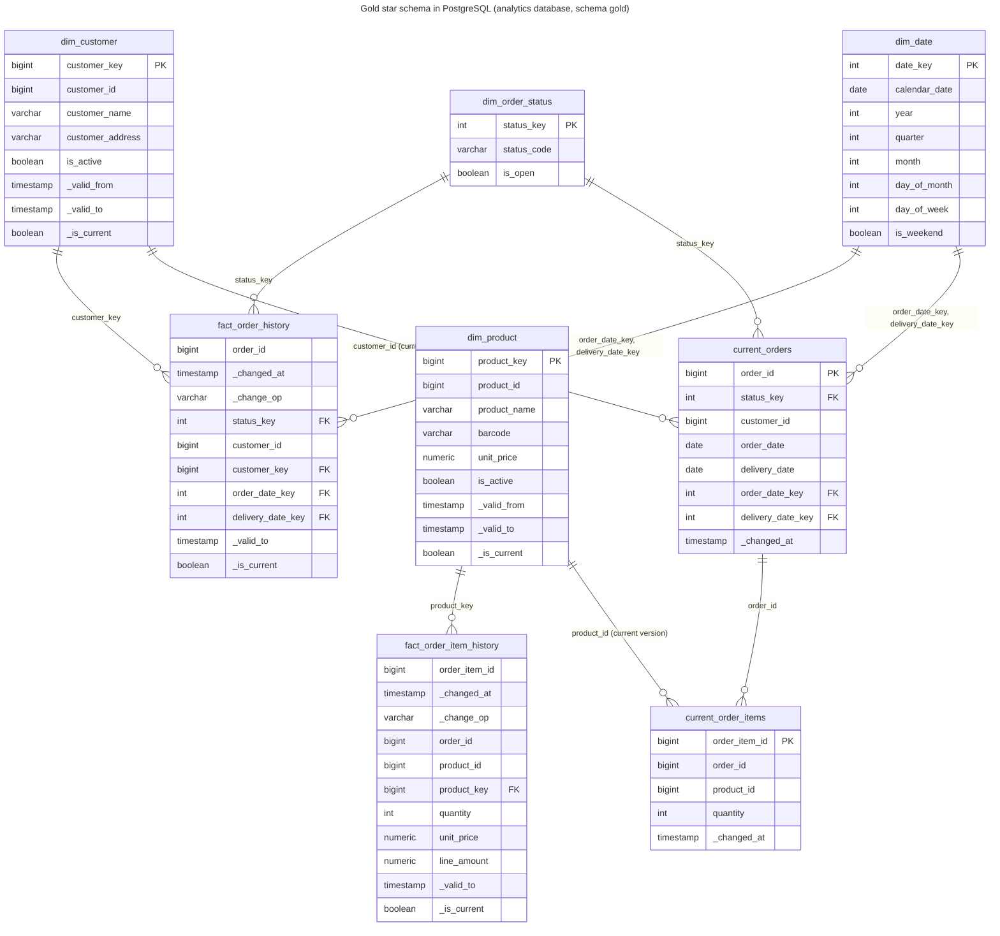

# Gold model

The design of gold in PostgreSQL: what it reads from silver, its tables and public views, the star schema and its rules, and the business-question views with the indexes behind them. How the gold job writes it, and the same model as views in the lake, are in [the gold writer](writer.md).

## Inputs from silver

Silver keeps one append-only table per source entity, `lake.silver.<entity>`, with one row per source change: the entity's source and audit columns under their lake names (so `unity_price`, and `quantity` for the misspelled `quanity`), plus:

| Column | Meaning |
| --- | --- |
| `_commit_sequence` | the change's position in the source database's write-ahead log (Debezium `source.lsn`); increases in commit order |
| `_change_op` | `snapshot`, `create`, `update` or `delete` |
| `_changed_at` | when the change was committed in the source |
| `_content_hash` | hex SHA-256 of the content columns (key and audit columns excluded) |
| `_is_deleted` | whether the change is a delete; the row keeps its last known values |

Exact duplicates are already dropped. Gold reads these tables, not silver's views, because a streaming query can only read a table.

**Unchanged versions.** Silver keeps re-snapshots and audit-only updates as rows of their own. Per key, ordered by `_commit_sequence`, a version whose `_content_hash` and `_is_deleted` both equal the previous version's is not a new version: the silver `_history` view folds it, and gold folds it too.

Gold applies the rule without dropping rows: bronze replays can append a missing change late, and a late version that lands between two equal versions turns the later one back into a real change. So gold keeps every version silver sends and stores no derived flags: the dimensions are only ever appended to, and the views `gold_internal.dim_customer_versions` and `gold_internal.dim_product_versions` derive the folded ones when they are read; the history facts fold at read time too (see [Versioning](#versioning)):

- `_is_folded` is true when a version's `_content_hash` and `_is_deleted` are not distinct from the previous stored version's by `_commit_sequence`; the first version of a key is never folded. Because it is computed from all stored versions on every read, a late version changes it without any update.
- Folded versions are never current and the `gold` views leave them out. Their `_valid_to` is the one of the version they repeat, so a folded version ends when that version ends.
- Example: product 3 at price 3.00 is stored at positions 60 and 80 (a re-snapshot): 80 is folded, 60 is current. A late update to 4.00 at position 70 arrives: 60 is valid until 70, 70 until 80, and 80 is no longer folded and becomes current.

### What `_commit_sequence` is

`_commit_sequence` is the PostgreSQL log sequence number (LSN) of the change, as a 64-bit integer: the byte position of the change in the source database's write-ahead log. It only grows, in commit order, across the whole database. For one key, a later change always has a higher position than an earlier one; snapshot rows carry the position of the snapshot, which is lower than any change streamed after it. Gold uses it to order versions of a key and to tell a late or replayed event from a newer one. Arrival order and Kafka offsets are not used for ordering.

## Internal tables and public views

Gold has two schemas:

- **`gold_internal`** holds the tables. Only the gold streaming queries write them, and they keep the metadata they need: `_commit_sequence` to skip replayed batches and to order versions, `_is_deleted` for soft deletes and the fold rule, and `_content_hash` for the fold rule. It also holds the staging tables the gold job loads every micro-batch into (see [Writing gold](writer.md#writing-gold)), and the dimension versions views, the one place that derives the dimensions' `_is_folded`, `_valid_to` and `_is_current`: the public dimension views and the facts' as-of lookups both read them.
- **`gold`** holds one view per table, with the same name, for consumers: the business question views, the API and anyone browsing the model, plus `open_orders`, the current orders that are open. The views leave out `_commit_sequence`, `_content_hash`, `_is_deleted` and `_is_folded`, and `gold.current_orders` also leaves out `is_open`; the current-state views leave out deleted rows, the dimension views leave out folded and deleted versions, and the history views leave out unchanged changes and add each change's validity range.

Consumers never need to know how the pipeline orders or deduplicates changes, and the tables can change for the pipeline without breaking them.

| Column | In `gold_internal` | In the `gold` views |
| --- | --- | --- |
| `_commit_sequence` | every table except `dim_date` and `dim_order_status` | left out |
| `_is_deleted` | every table except `dim_date` and `dim_order_status` | left out; deleted rows are filtered from the dimension and current-state views, and a delete is the last, never current, row of a history view |
| `_content_hash` | `dim_customer`, `dim_product`, `fact_order_history`, `fact_order_item_history` | left out |
| `_is_folded` | not stored; computed by `dim_customer_versions`, `dim_product_versions` | left out; folded versions are filtered |
| `_valid_to`, `_is_current` of the dimensions | not stored; computed by `dim_customer_versions`, `dim_product_versions` | taken from the versions views |
| `_valid_to`, `_is_current` of history facts | not stored | computed from the next change that is not folded, by `_commit_sequence` |
| `is_open` of an order | `current_orders`, copied from `dim_order_status` by the writer | left out of `gold.current_orders`; `gold.open_orders` filters on it |

## Where the definitions live

Every gold table's columns, their types and nullability, and every table, view and column description are defined once, in the gold Avro schemas in `analytics/pipelines/src/pipelines/schemas/gold/`, one `<table>.avsc` per table, and one `<view>.avsc` per view that has no table of its own (`data_freshness` and the [business question views](#the-four-business-questions)). A column that comes from a source table takes its description from there with `"from"` (for example `"from": "orders.delivery_date"`), so the lake and gold describe it the same way; a metadata column such as `_commit_sequence` is defined in full, exactly like in the bronze template, and a unit test keeps every definition of a `_` column the same across all schemas; a column only gold has, such as a surrogate key or `line_amount`, has its own `doc`. The record's `doc` describes the table in `gold_internal` and `public_doc` its view in `gold` when that differs; for a view without a table, `doc` describes the view.

The DDL itself is the Jinja template `analytics/pipelines/src/pipelines/gold/ddl.sql.j2`: it keeps the keys, constraints, partitions, indexes and their descriptions, seeds and view queries, and takes the column lists and the descriptions from the schemas. The public views are described like their tables, without the pipeline-only columns, plus the columns they add (`_valid_to` and `_is_current`, described like the columns of the same name in the dimension versions views, whose schemas are `dim_customer_versions.avsc` and `dim_product_versions.avsc`). `make up` renders it to the git-ignored `docker/analytics-db/initdb/02-gold-model.sql`, which PostgreSQL runs on an empty volume.

## Model

The diagram shows the `gold` views in the PostgreSQL `analytics` database; the keys and relations are enforced on the `gold_internal` tables.



### Tables and grain

| Table | Kind | Grain | Key (in `gold_internal`) |
| --- | --- | --- | --- |
| `dim_customer` | SCD2 dimension | one row per customer change from silver, folded versions and the delete included, append-only; the view shows one row per customer version | `customer_key` (surrogate); unique (`customer_id`, `_commit_sequence`) |
| `dim_product` | SCD2 dimension | as `dim_customer`, per product; a new price is a new version | `product_key` (surrogate); unique (`product_id`, `_commit_sequence`) |
| `dim_customer_versions`, `dim_product_versions` | internal views | every stored version with `_is_folded`, `_valid_to` and `_is_current`; no public view of their own | as their dimension |
| `stage_dim_customer`, `stage_dim_product` | staging, unlogged | the versions of the micro-batch being written; no view | none |
| `stage_fact_order_history`, `stage_fact_order_item_history` | staging, unlogged | the changes of the micro-batch being written to the history fact and its current-state table: the silver columns both tables load, plus the ones the lookups read (the order `status`); no view | none |
| `dim_date` | seeded dimension | one row per calendar day, 2000-01-01 to 2099-12-31 | `date_key` (`yyyymmdd`) |
| `dim_order_status` | seeded dimension | one row per status: `PENDING`, `PROCESSING`, `REPROCESSING`, `COMPLETED`, `UNKNOWN` | `status_key` |
| `fact_order_history` | history fact | one row per change to an order from silver, unchanged changes and the delete included; the view leaves unchanged changes out | (`order_id`, `_commit_sequence`, `_changed_at`); indexed on `customer_id` |
| `fact_order_item_history` | history fact | as `fact_order_history`, per order item | (`order_item_id`, `_commit_sequence`, `_changed_at`); indexed on `product_id` |
| `current_orders` | current state | one row per order, with its status's `is_open`; the view leaves deleted orders out | `order_id`; the open orders indexed on (`delivery_date`, `status_key`) and `customer_id` for the business views |
| `current_order_items` | current state | one row per order item; the view leaves deleted items out | `order_item_id`; the items not deleted indexed on `order_id` |

Notes:

- `unity_price` is renamed `unit_price` in gold. `order_id`, `customer_id`, `product_id` and `order_item_id` stay as degenerate keys next to the surrogate keys, so facts can be joined to the source without the dimensions.
- `customer_key` in `fact_order_history` is the customer version valid at the order change's `_changed_at`, or the customer's first version for an earlier change (see [Dimension keys of the facts](#dimension-keys-of-the-facts)).
- `product_key`, `unit_price` and `line_amount` (`quantity × unit_price`) in `fact_order_item_history` come from the product version valid at the item's `_changed_at` (or the product's first version for an earlier item), which is when the order was placed: the source inserts an order's items right after the order. This keeps the price the order was placed at, even after the product's price changes.
- `status_key` is the `dim_order_status` key whose `status_code` equals the source status exactly; a null or any other status gets the `UNKNOWN` key. `order_date_key` and `delivery_date_key` are the `dim_date` keys of the dates, null when the date is null or outside 2000 to 2099. History and current state derive them with the same expressions.
- A delete is a history row with `_change_op = 'delete'`, `_is_deleted` and the row's last values. The `gold` history views show it as the key's last row, with no `_valid_to` and never current, so "the order was deleted at" stays queryable.
- The history facts' keys include `_changed_at` because PostgreSQL requires the partition column in the primary key. A change always has the same `_changed_at`, so the key still identifies one change.
- The `gold` history views add `_valid_to` (the next change's `_changed_at`, ordered by `_commit_sequence`) and `_is_current`, so history can be queried as of any time, for example "open orders on 2026-11-01".

## Rules

### Versioning

- **History is idempotent.** A history row is inserted only if (key, `_commit_sequence`) is not already there. Replaying a micro-batch, or a Debezium re-send after a restart, adds nothing.
- **Unchanged changes are folded at read time in the history facts.** History stores every change silver sends, with its `_content_hash` and `_is_deleted`. The `gold` history views leave out a change whose `_content_hash` and `_is_deleted` are not distinct from the previous change's of the same key by `_commit_sequence`, and derive `_valid_to` and `_is_current` from the remaining ones, the same rule as silver's `_history` view. Nothing is stored that a late change would have to rewrite: a late change between two equal ones makes the later one visible again on the next read.
- **Current state only moves forward.** A version replaces the current row only if its `_commit_sequence` is higher than the stored one. A late version is still appended to history, where its validity range lands in the right place, but it never overwrites newer current state.

  Example: order 7 is stored as `PROCESSING` at position 500. A delayed event `PENDING` at position 420 arrives. History gets the 420 row (valid until the 500 change); `current_orders` stays `PROCESSING`. Then `COMPLETED` at 610 arrives and replaces it.
- **Deletes are soft in current state.** A delete sets `_is_deleted` and keeps the row with the delete's `_commit_sequence`, so a late event older than the delete cannot bring the row back. The `gold` current-state views leave deleted rows out.
- **Current state is the latest change, folded or not.** A re-snapshot with a higher `_commit_sequence` replaces the current row even though its content is unchanged, so `_commit_sequence` keeps rising and a late change between the two equal ones is still rejected, as the fold rule requires; `_changed_at` of the current row is then the time of the re-snapshot.
- **Items may arrive before their order.** `current_order_items` has no foreign key to `current_orders`: an item is stored in history and current state when it arrives, and the business views join it to the open current orders, so it counts as soon as its order arrives.
- **SCD2 dimensions.** `_valid_from` is the version's `_changed_at`. Among the versions that are not folded, ordered by `_commit_sequence`, each one is valid until the next one's `_valid_from`, and the last one is current unless it is a delete. A new version therefore closes the current row and becomes current itself, and a late older version gets the range between its neighbours. A delete is stored as the key's last version, so the key has no current version afterwards; replays and late events cannot revive it, because they sort before the delete. The versions views compute this on every read from the stored versions, so a key has at most one current version by construction, with no check constraint or partial index to maintain; the unique (key, `_commit_sequence`) index serves their windows, which are all partitioned by the key.

### Dimension keys of the facts

`customer_key` (order history) and `product_key`, `unit_price` and `line_amount` (item history) come from the dimension version, read from the dimension's versions view, that is not folded, not deleted, and whose [`_valid_from`, `_valid_to`) contains the change's `_changed_at`. A change older than the key's first version (by `_commit_sequence`) takes that first version, unless it is a delete: Debezium snapshots each table at a slightly different time, so an order or item can be snapshotted a few milliseconds before its customer or product, and would otherwise keep a null key. If no version matches, because the customer or product is not in gold yet or the change comes after its delete, the columns are null. If clock skew made two ranges overlap, the version with the highest `_commit_sequence` wins. The fact merge and the dimension re-resolution use the same lookup.

Those values can go stale after they are stored: a dimension row can arrive after the facts that need it, and a late dimension version can split a validity range or unfold a version. Gold therefore resolves them on both sides, in the same transaction as the write that changes them:

- the fact merge resolves the keys of the changes it inserts;
- the dimension merge, after inserting its versions, re-resolves the history rows of every business key its batch touched, and updates only the rows whose resolved values change (`IS DISTINCT FROM`). Which facts depend on which dimension is declared once, as the facts' as-of lookups in `pipelines/gold/dimensions.py`; the SQL is built from them. The indexes `fact_order_history (customer_id)` and `fact_order_item_history (product_id)` let it find those rows.

Example: product 3 costs 3.00 from a change committed at 10:00, with an unchanged re-snapshot at 10:40 (folded). An item changed at 10:30 gets the 10:00 version and 3.00. A late update to 4.00, committed at 10:20, arrives: the item is re-resolved to the 10:20 version, with `unit_price` 4.00 and its `line_amount` recomputed.

**One writer at a time.** Every gold merge transaction first takes a transaction-level advisory lock on one constant key (`pg_advisory_xact_lock(hashtextextended('gold_internal', 0))`), so the four streams' merges commit one after the other. Without it, a fact merge and a dimension merge running side by side would each read the other's tables without its uncommitted rows: the fact would be resolved against the old dimension, and the dimension's re-resolution would not see the new fact, which would keep a wrong or null key for good. Staging runs outside the lock, so Spark still loads the four staging tables in parallel; only the short merges wait for each other.

### Open orders and pending items

- **Open order:** an order in `current_orders` that is not deleted and whose status has `is_open`, the rows of `gold.open_orders`. Every status except `COMPLETED` is open. A null or unexpected status maps to `UNKNOWN`, which is open, so it shows up in the metrics instead of disappearing.

  | Status | Open |
  | --- | --- |
  | `PENDING` | yes |
  | `PROCESSING` | yes |
  | `REPROCESSING` | yes |
  | `UNKNOWN` (null or unexpected) | yes |
  | `COMPLETED` | no |

- **Stored with the order:** the writer copies `is_open` from `dim_order_status` into `current_orders` with the same lookup and `UNKNOWN` fallback as `status_key`, and every current-state merge that takes a newer change sets both, so the flag always belongs to the stored status. The open rule itself stays in the `dim_order_status` seed; a change to it would need the stored flags recomputed. History keeps only `status_key`.
- **Pending order** (question 4): an open order. `PENDING` alone would leave out orders being processed, and would not match questions 1 to 3.
- **Pending item** (question 3): an item, not deleted, of an open order. Question 3 reports both the number of pending items and their total quantity per product.
- **Top 3:** questions 2 and 4 rank by count with `RANK()` and keep places 1 to 3, so every row tied for third place is kept and more than three rows can come back. `RANK()` leaves gaps after a tie (two dates tied for first are both 1, the next is 3), so ties never add places: `DENSE_RANK()` would count a tie as one place and could return many more rows. Window functions work in any SQL engine, unlike `FETCH FIRST ... WITH TIES`.

Example: customer 3 has order 10 `PENDING` with two items of product 5 (quantities 4 and 6), and order 11 `COMPLETED` with one item of product 5. Customer 3 has one pending order; product 5 has two pending items with a total quantity of 10.

## The four business questions

Each question is a view in `gold`, built on `gold.open_orders` and the `gold` views of the current items and the dimensions, and described like every other view (from its schema in `schemas/gold/<view>.avsc`):

| Question | View | Columns |
| --- | --- | --- |
| Number of open orders by delivery date and status | `gold.open_orders_by_delivery_date_and_status` | `delivery_date`, `status_code`, `open_orders` |
| Top 3 delivery dates with more open orders | `gold.top_delivery_dates_by_open_orders` | `delivery_date`, `open_orders` |
| Number of open pending items by product | `gold.pending_items_by_product` | `product_id`, `pending_items`, `pending_quantity` |
| Top 3 customers with more pending orders | `gold.top_customers_by_pending_orders` | `customer_id`, `customer_name`, `pending_orders` |

- Open orders are the rows of `gold.open_orders`, the one place the open rule is applied (`is_open AND NOT _is_deleted` on `gold_internal.current_orders`); pending items are `current_order_items` joined to those orders, counted and summed by `product_id`; see [Open orders and pending items](#open-orders-and-pending-items).
- The two top-3 views keep ties for the third place: `rank() OVER (ORDER BY count(*) DESC)` gives tied rows the same place and skips the places after them, and the view keeps the rows ranked 3 or better, so every row tied for third is kept and no more than three places are reported. The top customers view takes the name from the current `dim_customer` version with a left join, so a customer not in `dim_customer` yet is kept with a null `customer_name`.
- **A view has no row order.** Consumers add their own `ORDER BY`. The queries in [`analytics/sql/gold/`](https://github.com/jonathan5p/deel-home-task/tree/main/analytics/sql/gold), one per question, read the views with the order the questions are reported in:

| Query | Order |
| --- | --- |
| [01](https://github.com/jonathan5p/deel-home-task/blob/main/analytics/sql/gold/01_open_orders_by_delivery_date_and_status.sql) | `delivery_date`, `status_code` |
| [02](https://github.com/jonathan5p/deel-home-task/blob/main/analytics/sql/gold/02_top_delivery_dates_by_open_orders.sql) | `open_orders` descending, then `delivery_date` |
| [03](https://github.com/jonathan5p/deel-home-task/blob/main/analytics/sql/gold/03_pending_items_by_product.sql) | `product_id` |
| [04](https://github.com/jonathan5p/deel-home-task/blob/main/analytics/sql/gold/04_top_customers_by_pending_orders.sql) | `pending_orders` descending, then `customer_id` |

```sql
SELECT delivery_date, open_orders
FROM gold.top_delivery_dates_by_open_orders
ORDER BY open_orders DESC, delivery_date;
```

### Querying the views

```sh
docker compose exec -T analytics-db psql -U analytics -d analytics < analytics/sql/gold/01_open_orders_by_delivery_date_and_status.sql
docker compose exec analytics-db psql -U analytics -d analytics -c "select * from gold.top_customers_by_pending_orders order by pending_orders desc, customer_id"
```

`gold.data_freshness` shows, per entity (customers, products, orders, order items), how up to date gold is. For now it is computed from the data, as the source commit time of the newest change gold holds, so it ages when the source stops changing even though the pipeline is healthy. Later the pipeline metrics (#127) will fill it; its shape stays the same.

```sh
docker compose exec analytics-db psql -U analytics -d analytics -c "select * from gold.data_freshness"
```

### Indexes behind the views

The planner estimates how many rows a filter keeps from the statistics of the table it filters. If open orders were only known by joining `dim_order_status`, it would assume four statuses out of five, so most of the orders, and read whole tables. With `is_open` stored in `current_orders`, its statistics show how few orders are open, and partial indexes `WHERE is_open AND NOT _is_deleted`, the predicate of `gold.open_orders`, hold only the open orders: they stay small however many completed orders accumulate, and the planner can prove the views' filter implies them.

| Index | Used by | How |
| --- | --- | --- |
| `current_orders_open_delivery_idx` (`delivery_date`, `status_key`), open orders | `open_orders_by_delivery_date_and_status`, `top_delivery_dates_by_open_orders` | index-only scan of the open orders, already in delivery date order |
| `current_orders_open_customer_idx` (`customer_id`), open orders | `top_customers_by_pending_orders` | index-only scan of the open orders; the names then come from `dim_customer_current_idx` |
| `current_order_items_live_order_idx` (`order_id`) including `product_id` and `quantity`, items not deleted | `pending_items_by_product` | nested loop from the open orders (found through `current_orders_open_delivery_idx`) into an index-only lookup of each order's items, instead of reading every item |

- The `INCLUDE` columns let the item lookups skip the table; without them the planner prefers a hash join over all items.
- One wider index for all four views was slower for the top customers and pending items views than the two narrow ones.
- The plans keep these indexes when the visibility map lags behind recent updates: the indexes hold only open orders, so the extra table reads stay few.

## Things to know about the source data

- **Open orders never get items, so "pending items by product" is empty.** The supplied generator (`generate_orders` in `db-scripts/initialize_db_ddl.sql`, run every minute by `pg_cron`) inserts a new `PENDING` order when a customer has no open order that day, then looks the order up again to add its items by customer and date only (`... AND order_date = CURRENT_DATE LIMIT 1`, without the status filter or an `ORDER BY`). The items land on whichever of the customer's orders that day comes first, normally the first one, which the generator's status updates complete within minutes. Every later order of the day stays without items. Gold keeps every item; they are not pending because their order is not open. The source was left as supplied ([D29](../../architecture/decisions.md#d29--the-source-database-and-the-debezium-connector-stay-as-provided)); [the way to production](../../architecture/production.md) includes a recommendation for generating data with pending items.

    Counted in the source on 2026-11-12:

    | Orders | Count | Items | Items per order |
    | --- | --- | --- | --- |
    | Completed, first of the day | 40 | 128,258 | 3,206 on average |
    | Completed, later ones | 8,525 | 95,134 | 11 on average |
    | Open | 27 | 0 | 0 |

- `products.unity_price` is a `DECIMAL` without precision or scale, so `unit_price` is an unconstrained `NUMERIC` in gold, which keeps every price exact.
