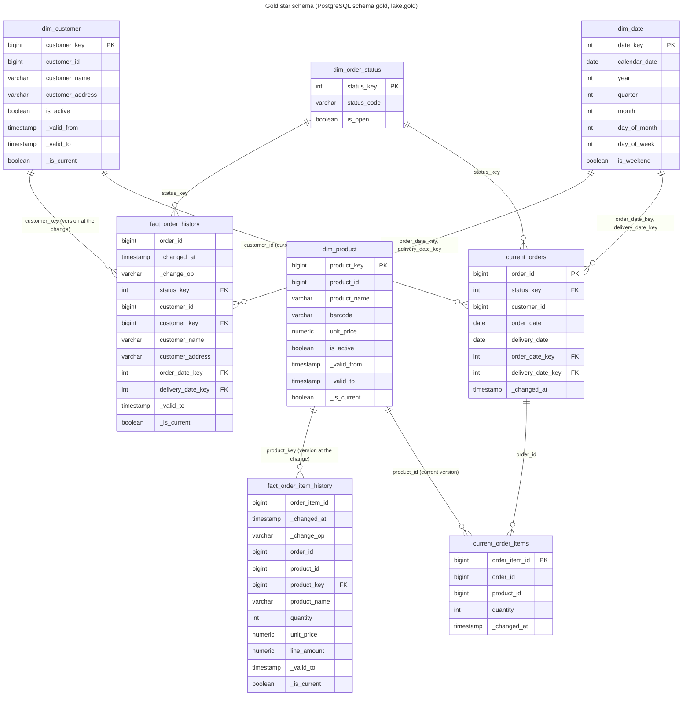

# Gold model

The design of gold: what it reads from silver, its stored tables and public views, the star schema and its rules, the point-in-time views and the views behind the business questions. Spark computes every stored table; the Iceberg tables in `lake.gold_internal` and the PostgreSQL tables in `gold_internal` hold the same rows, and both stores render the same views over them. How the gold job computes and writes the tables, and how the copy reaches PostgreSQL, are in [the gold writer](writer.md).

## Inputs from silver

Silver keeps one append-only table per source entity, `lake.silver.<entity>`, with one row per source change: the entity's source and audit columns under their lake names (so `unity_price`, and `quantity` for the misspelled `quanity`), plus:

| Column | Meaning |
| --- | --- |
| `_commit_sequence` | the change's position in the source database's write-ahead log (Debezium `source.lsn`); increases in commit order |
| `_change_op` | `snapshot`, `create`, `update` or `delete` |
| `_changed_at` | when the change was committed in the source |
| `_content_hash` | hex SHA-256 of the content columns (key and audit columns excluded) |
| `_is_deleted` | whether the change is a delete; the row keeps its last known values |

Exact duplicates are already dropped. Gold reads these tables, not silver's views, because a streaming query can only read a table.

**Unchanged versions.** Silver keeps re-snapshots and audit-only updates as rows of their own. Per key, ordered by `_commit_sequence`, a version whose `_content_hash` and `_is_deleted` both equal the previous version's is not a new version: the silver `_history` view folds it, and gold folds it too.

Gold applies the rule without dropping rows: bronze replays can append a missing change late, and a late version that lands between two equal versions turns the later one back into a real change. So gold stores every version silver sends, with the columns that place it among its key's versions (see [Versioning](#versioning)):

- `_is_folded` is true when a version's `_content_hash` and `_is_deleted` equal the previous version's by `_commit_sequence`; the first version of a key is never folded.
- Folded versions are never current and the public views leave them out. Their `_valid_to` is the one of the version they repeat, so a folded version ends when that version ends.
- Example: product 3 at price 3.00 is stored at positions 60 and 80 (a re-snapshot): 80 is folded, 60 is current. A late update to 4.00 at position 70 arrives: the batch recomputes product 3's versions, so 60 is valid until 70, 70 until 80, and 80 is no longer folded and becomes current.

### What `_commit_sequence` is

`_commit_sequence` is the PostgreSQL log sequence number (LSN) of the change, Debezium's `source.lsn`, as a 64-bit integer: the byte position of the change in the source database's write-ahead log. It only grows, in commit order, across the whole database. For one key, a later change always has a higher position than an earlier one; snapshot rows carry the position of the snapshot, which is lower than any change streamed after it. Gold uses it to order versions of a key, to tell a late or replayed event from a newer one, to break ties between overlapping dimension versions in the point-in-time views, and as half of every surrogate key. Arrival order and Kafka offsets are not used for ordering.

## Internal tables and public views

Every gold table is stored twice with the same rows: as an Iceberg table `lake.gold_internal.<table>` and as a PostgreSQL table `gold_internal.<table>`. The tables live in `gold_internal` and the public views in `gold`, in the lake as in PostgreSQL, so readers use the same names in both copies. Only the gold job writes them, and they keep the metadata it needs: `_commit_sequence` to skip replayed changes and to order versions, `_is_deleted` for soft deletes and the fold rule, `_content_hash` for the fold rule, and the version columns it computes (`_is_folded`, `_version_number`, `_valid_to`, `_is_current`). PostgreSQL also holds the unlogged staging tables the copy goes through, and `gold_internal.sync_state`, the Iceberg snapshot of each table the copy holds (see [Copying into PostgreSQL](writer.md#copying-into-postgresql)).

Consumers read views, never the tables:

- **`gold`** in PostgreSQL holds one view per public relation: one per stored table with the same name, `open_orders` (the current orders that are open), the four business-question views and `data_freshness`. The API, Grafana and anyone browsing the model read them.
- **`lake.gold.<view>`** holds the same 14 views over the Iceberg tables, with the same columns and the same SQL ([Gold in the lake](writer.md#gold-in-the-lake)).

**One set of view templates.** Every view is rendered from the templates in `pipelines/lake/gold/sql/views/`, written in the SQL both PostgreSQL and Spark accept, with the namespace of the `gold_internal` tables as the only parameter: `gold_internal` in PostgreSQL, `lake.gold_internal` in the lake. A unit test renders every view for both and checks that they differ only in that namespace, so the two stores cannot answer the same question in two ways. Three kinds of views come out of them:

- **Projections** select and filter one table: they leave out `_commit_sequence`, `_content_hash`, `_is_deleted`, `_is_folded` and `_version_number`, and `current_orders` also leaves out `is_open`. The current-state views leave out deleted rows and the dimension views leave out folded and deleted versions.
- **Point-in-time fact views** (`fact_order_history`, `fact_order_item_history`) leave out the folded changes and join each change to the dimension version valid when it was committed ([Point-in-time dimension attributes](#point-in-time-dimension-attributes)).
- **Business-question views** count the open current orders when they are read ([The four business questions](#the-four-business-questions)).

Consumers never need to know how the pipeline orders or deduplicates changes, and the tables can change for the pipeline without breaking them.

| Column | In the stored tables | In the public views |
| --- | --- | --- |
| `_commit_sequence` | every table except `dim_date` and `dim_order_status` | left out |
| `_is_deleted` | the dimensions, history facts and current-state tables | left out; deleted rows are filtered from the dimension and current-state views, and a delete is the last, never current, row of a history view |
| `_content_hash` | `dim_customer`, `dim_product`, `fact_order_history`, `fact_order_item_history` | left out |
| `_is_folded`, `_version_number` | the dimensions and history facts, computed by the gold job | left out; folded versions are filtered |
| `_valid_to`, `_is_current` | the dimensions and history facts, computed by the gold job | kept |
| `is_open` of an order | `current_orders`, looked up from `dim_order_status` by the gold job | left out of `gold.current_orders`; `gold.open_orders` and the business-question views filter on it |
| `customer_key`, `customer_name`, `customer_address` of an order change | not stored: the order history keeps `customer_id` | resolved by `gold.fact_order_history` from the customer version valid at the change |
| `product_key`, `product_name`, `unit_price`, `line_amount` of an item change | not stored: the item history keeps `product_id` | resolved by `gold.fact_order_item_history` from the product version valid at the change |

## Where the definitions live

Every gold table's columns, their types and nullability, and every table, view and column description are defined once, in the gold Avro schemas in `analytics/pipelines/src/pipelines/schemas/gold/`, one `<table>.avsc` per table, and one `<view>.avsc` per view that has no table of its own (`open_orders` and `data_freshness`). A column that comes from a source table takes its description from there with `"from"` (for example `"from": "orders.delivery_date"`), so the lake and gold describe it the same way; a metadata column such as `_commit_sequence` is defined in full, exactly like in the bronze template, and a unit test keeps every definition of a `_` column the same across all schemas; a column only gold has, such as a surrogate key or `line_amount`, has its own `doc`. A column only a view has, such as `customer_name` in the order history, is marked `"view_only": true`, and the stored table leaves it out. The record's `doc` describes the stored table and `public_doc` its view when that differs; for a view without a table, `doc` describes the view.

The same schemas give the Iceberg tables their columns and descriptions, and the PostgreSQL DDL its column lists: the Jinja template `analytics/pipelines/src/pipelines/lake/gold/sql/ddl.sql.j2` keeps the keys, partial indexes, partitions and retention functions, `pipelines/lake/gold/ddl.py` renders the tables, the staging tables and their descriptions from the schemas, and `pipelines/lake/gold/public.py` renders the public views from the view templates, for PostgreSQL and for the lake. `make up` renders it to the git-ignored `docker/analytics-db/initdb/02-gold-model.sql`, which PostgreSQL runs on an empty volume.

## Model

The diagram shows the public views; the same relations exist in PostgreSQL's `gold` schema and in `lake.gold`. The history views resolve `customer_key` and `product_key` when they are read, from the version valid at each change; the stored facts keep only the business keys.



### Tables and grain

| Table | Kind | Grain | Key |
| --- | --- | --- | --- |
| `dim_customer` | SCD2 dimension | one row per customer change from silver, folded versions and the delete included; the view shows one row per customer version | (`customer_id`, `_commit_sequence`); `customer_key` (surrogate) unique in PostgreSQL |
| `dim_product` | SCD2 dimension | as `dim_customer`, per product; a new price is a new version | (`product_id`, `_commit_sequence`); `product_key` (surrogate) unique in PostgreSQL |
| `dim_date` | seeded dimension | one row per calendar day, 2000-01-01 to 2099-12-31 | `date_key` (`yyyymmdd`) |
| `dim_order_status` | seeded dimension | one row per status: `PENDING`, `PROCESSING`, `REPROCESSING`, `COMPLETED`, `UNKNOWN` | `status_key` |
| `fact_order_history` | history fact | one row per change to an order from silver, unchanged changes and the delete included; the view leaves unchanged changes out | (`order_id`, `_commit_sequence`); in PostgreSQL also `_changed_at` |
| `fact_order_item_history` | history fact | as `fact_order_history`, per order item | (`order_item_id`, `_commit_sequence`); in PostgreSQL also `_changed_at` |
| `current_orders` | current state | one row per order, with its status's `is_open`; the view leaves deleted orders out | `order_id` |
| `current_order_items` | current state | one row per order item; the view leaves deleted items out | `order_item_id` |

The four business-question views and `data_freshness` have no table: they are computed when read (see [The four business questions](#the-four-business-questions)).

Notes:

- `unity_price` is renamed `unit_price` in gold. `order_id`, `customer_id`, `product_id` and `order_item_id` stay as degenerate keys next to the surrogate keys, so facts can be joined to the source without the dimensions.
- The stored history facts keep the business keys only. `customer_key`, `customer_name` and `customer_address` in `gold.fact_order_history` come from the customer version valid at the order change's `_changed_at`, or the customer's first version for an earlier change (see [Point-in-time dimension attributes](#point-in-time-dimension-attributes)).
- `product_key`, `product_name`, `unit_price` and `line_amount` (`quantity × unit_price`) in `gold.fact_order_item_history` come from the product version valid at the item's `_changed_at` (or the product's first version for an earlier item), which is when the order was placed: the source inserts an order's items right after the order. This keeps the price the order was placed at, even after the product's price changes.
- `status_key` is the `dim_order_status` key whose `status_code` equals the source status exactly; a null or any other status gets the `UNKNOWN` key. `order_date_key` and `delivery_date_key` are the `dim_date` keys of the dates, null when the date is null or outside 2000 to 2099. History and current state derive them with the same lookups, which the gold job runs when it writes: both dimensions are seeded and never change with the data, so a stored key never goes stale.
- A delete is a history row with `_change_op = 'delete'`, `_is_deleted` and the row's last values. The history views show it as the key's last row, with no `_valid_to` and never current, so "the order was deleted at" stays queryable.
- In PostgreSQL the history facts are partitioned by month of `_changed_at`, and PostgreSQL requires the partition column in the primary key, so their key includes `_changed_at`. A change always has the same `_changed_at`, so the key still identifies one change. In Iceberg they are bucketed by their business key and keep every month.
- The history facts carry `_valid_to` (the next version's `_changed_at`, ordered by `_commit_sequence`) and `_is_current`, so history can be queried as of any time, for example "open orders on 2026-11-01".

## Rules

### Versioning

Every rule below is applied by the gold job with Spark DataFrames, per micro-batch, only for the business keys the batch touches. Each stream reads and writes only its own tables: a dimension stream its dimension, a fact stream its history and current state.

- **Recompute the touched keys.** For each business key in the batch, the job reads the key's stored versions, adds the batch's changes, and ranks them all in one window by business key: a change already stored, or delivered twice, counts once (the stored row wins, then the lowest content hash). It then recomputes the version columns from all of them with window functions partitioned by the business key and ordered by `_commit_sequence`:
  - `_is_folded`: the change's `_content_hash` and `_is_deleted` equal the previous change's;
  - `_version_number`: the number of versions that are not folded up to this change, from 1; a folded change shares the number of the version it repeats;
  - `_valid_to`: the start of the first change of the next version number (its `_valid_from` in a dimension, its `_changed_at` in a fact), null for the last one;
  - `_is_current`: the last version number, unless it is a delete; a folded change is never current.

  These columns are stored, not derived at read time, so the public views only filter them. The job writes only the rows that are new or whose version columns changed, merged on (business key, `_commit_sequence`). A late change therefore re-places the changes after it: one landing between two equal changes unfolds the later one, and one landing between two versions splits the range around it. A key the batch does not touch is not read. A history fact's version columns come from its own key only; it reads no dimension.
- **History is idempotent.** A row is identified by (key, `_commit_sequence`). Replaying a micro-batch, or a Debezium re-send after a restart, recomputes the same columns and writes nothing.
- **Current state only moves forward.** The latest change of each key in the batch replaces the current row only if its `_commit_sequence` is higher than the stored one. A late version is still added to history, where its validity range lands in the right place, but it never overwrites newer current state.

  Example: order 7 is stored as `PROCESSING` at position 500. A delayed event `PENDING` at position 420 arrives. History gets the 420 row (valid until the 500 change); `current_orders` stays `PROCESSING`. Then `COMPLETED` at 610 arrives and replaces it.
- **Deletes are soft in current state.** A delete sets `_is_deleted` and keeps the row with the delete's `_commit_sequence`, so a late event older than the delete cannot bring the row back. The current-state views leave deleted rows out.
- **Current state is the latest change, folded or not.** A re-snapshot with a higher `_commit_sequence` replaces the current row even though its content is unchanged, so `_commit_sequence` keeps rising and a late change between the two equal ones is still rejected, as the fold rule requires; `_changed_at` of the current row is then the time of the re-snapshot.
- **Items may arrive before their order.** `current_order_items` has no foreign key to `current_orders`: an item is stored in history and current state when it arrives, and the pending-items view joins it to its order when read, so it counts as soon as its order is open.
- **SCD2 dimensions.** `_valid_from` is the version's `_changed_at`. Among the versions that are not folded, ordered by `_commit_sequence`, each one is valid until the next one's `_valid_from`, and the last one is current unless it is a delete. A new version therefore closes the current row and becomes current itself, and a late older version gets the range between its neighbours. A delete is stored as the key's last version, so the key has no current version afterwards; replays and late events cannot revive it, because they sort before the delete. A key has at most one current version by construction, because every version column of a key is recomputed together.

### Surrogate keys

`customer_key` and `product_key` are `xxhash64(business key, _commit_sequence)`, Spark's 64-bit xxHash of the two columns.

- **Deterministic.** The key depends only on the version's identity, so a rebuild from silver gives every version the same key, and the Iceberg tables and PostgreSQL hold the same values without any coordination.
- **One narrow column.** The point-in-time views refer to a dimension version with one `bigint`, and the public views identify a version without exposing `_commit_sequence` or any other pipeline metadata.
- **Stable under late changes.** I hash the LSN rather than `_version_number`: version numbers renumber when a late change lands between stored versions or a version unfolds, so a key built from them would change under the readers that hold it. A version's `_commit_sequence` never changes.
- **Collisions.** Two different versions sharing a key is a birthday problem over 2^64 values: about 3 in a million at 10 million dimension versions. PostgreSQL keeps the surrogate key `UNIQUE`, besides the (business key, `_commit_sequence`) primary key, so a collision fails the copy loudly instead of mixing two versions.

### Point-in-time dimension attributes

The history facts store the business keys (`customer_id` of an order, `product_id` of an item), never a dimension key or attribute. The public history views resolve the dimension version valid at each change when they are read, with the same SQL in PostgreSQL and in the lake:

- **Match on the business key and the stored validity.** Each change is joined (`LEFT JOIN`) to the versions of its customer or product that are not folded, not deleted, and whose [`_valid_from`, `_valid_to`) contains the change's `_changed_at`; an open `_valid_to` has no end.
- **The first version also covers earlier changes.** Debezium snapshots each table at a slightly different time, so an order or item can be snapshotted a few milliseconds before its customer or product, and would otherwise find no version.
- **The version committed last wins an overlap.** Clock skew between commits can make two ranges overlap; `row_number()` over each change, ordered by the dimension's `_commit_sequence` descending, keeps one version.
- **No version, null attributes.** A change whose customer or product is not in gold yet, or that comes after its delete, shows null keys and attributes.
- **`line_amount`** is the price as of the change times the quantity, computed at the lake's decimal type: `CAST(CAST(unit_price AS DECIMAL(27, 10)) * quantity AS DECIMAL(38, 10))`.

Resolving them when read keeps the streams independent. A fact batch never waits for its dimension's stream and never reads its tables, and nothing stored goes stale: a customer or product that arrives after its facts, or a late version that splits a range or unfolds a version, shows up in the views as soon as its dimension stream stores it. There is nothing to re-link.

Example: product 3 costs 3.00 from a change committed at 10:00, with an unchanged re-snapshot at 10:40 (folded). An item changed at 10:30 reads the 10:00 version and 3.00. A late update to 4.00, committed at 10:20, arrives in the products stream: from its next batch on, the item reads the 10:20 version, with `unit_price` 4.00 and its `line_amount` at that price, while the stored item row is untouched.

### Open orders and pending items

- **Open order:** an order in `current_orders` that is not deleted and whose status has `is_open`, the rows of `gold.open_orders`. Every status except `COMPLETED` is open. A null or unexpected status maps to `UNKNOWN`, which is open, so it shows up in the metrics instead of disappearing.

  | Status | Open |
  | --- | --- |
  | `PENDING` | yes |
  | `PROCESSING` | yes |
  | `REPROCESSING` | yes |
  | `UNKNOWN` (null or unexpected) | yes |
  | `COMPLETED` | no |

- **Stored with the order:** the gold job looks `is_open` up from `dim_order_status` with the same lookup and `UNKNOWN` fallback as `status_key`, and every newer change sets both, so the flag always belongs to the stored status. Storing it lets the open-order indexes be partial ([Reading cost](#reading-cost)). The open rule itself stays in the `dim_order_status` seed; a change to it would need the stored flags recomputed. History keeps only `status_key`.
- **Pending order** (question 4): an open order. `PENDING` alone would leave out orders being processed, and would not match questions 1 to 3.
- **Pending item** (question 3): an item, not deleted, of an open order. Question 3 reports both the number of pending items and their total quantity per product.
- **Top 3:** questions 2 and 4 rank by count with `rank()` and keep places 1 to 3, so every row tied for third place is kept and more than three rows can come back. `rank()` leaves gaps after a tie (two dates tied for first are both 1, the next is 3), so ties never add places: `dense_rank()` would count a tie as one place and could return many more rows.

Example: customer 3 has order 10 `PENDING` with two items of product 5 (quantities 4 and 6), and order 11 `COMPLETED` with one item of product 5. Customer 3 has one pending order; product 5 has two pending items with a total quantity of 10.

## The four business questions

Each question is a view in `gold` (and in `lake.gold`), computed when read from the open rows of `current_orders` (`is_open AND NOT _is_deleted`):

| Question | View | Columns |
| --- | --- | --- |
| Number of open orders by delivery date and status | `gold.open_orders_by_delivery_date_and_status` | `delivery_date`, `status_code`, `open_orders` |
| Top 3 delivery dates with more open orders | `gold.top_delivery_dates_by_open_orders` | `delivery_date`, `open_orders` |
| Number of open pending items by product | `gold.pending_items_by_product` | `product_id`, `pending_items`, `pending_quantity` |
| Top 3 customers with more pending orders | `gold.top_customers_by_pending_orders` | `customer_id`, `customer_name`, `pending_orders` |

### How the answers are computed

- **Open orders by delivery date and status** counts the open orders grouped by `delivery_date` and the `status_code` of their status.
- **Top 3 delivery dates** counts the open orders per `delivery_date` and keeps the dates ranked 1 to 3 by `rank()` over that count.
- **Pending items by product** joins the items that are not deleted (`current_order_items`) to their open order on `order_id`, then counts them and sums their quantity per `product_id`.
- **Top 3 customers** counts the open orders per `customer_id`, keeps the customers ranked 1 to 3, and takes the name of the customer's current `dim_customer` version, or null while there is none.
- **Why at read time.** The views read current state, so every answer is exact at the moment it is read and needs nothing kept in step: no counters, no state, nothing that couples the orders, items and customers streams. The open orders are a small share of all orders and the partial indexes hold only them, so the cost grows with the open orders, not with the orders or the history. The other ways to keep these counts, and why I did not pick them at this size, are in [D44](../../architecture/decisions.md#d44--gold-modelled-in-spark-on-iceberg-postgresql-as-serving-copy).
- **A view has no row order.** Consumers add their own `ORDER BY`. The queries in [`analytics/sql/gold/`](https://github.com/jonathan5p/deel-home-task/tree/main/analytics/sql/gold), one per question, read the views with the order the questions are reported in:

| Query | Order |
| --- | --- |
| [01](https://github.com/jonathan5p/deel-home-task/blob/main/analytics/sql/gold/01_open_orders_by_delivery_date_and_status.sql) | `delivery_date`, `status_code` |
| [02](https://github.com/jonathan5p/deel-home-task/blob/main/analytics/sql/gold/02_top_delivery_dates_by_open_orders.sql) | `open_orders` descending, then `delivery_date` |
| [03](https://github.com/jonathan5p/deel-home-task/blob/main/analytics/sql/gold/03_pending_items_by_product.sql) | `product_id` |
| [04](https://github.com/jonathan5p/deel-home-task/blob/main/analytics/sql/gold/04_top_customers_by_pending_orders.sql) | `pending_orders` descending, then `customer_id` |

```sql
SELECT delivery_date, open_orders
FROM gold.top_delivery_dates_by_open_orders
ORDER BY open_orders DESC, delivery_date;
```

### Querying the views

```sh
docker compose exec -T analytics-db psql -U analytics -d analytics < analytics/sql/gold/01_open_orders_by_delivery_date_and_status.sql
docker compose exec analytics-db psql -U analytics -d analytics -c "select * from gold.top_customers_by_pending_orders order by pending_orders desc, customer_id"
```

`gold.data_freshness` shows, per entity (customers, products, orders, order items), how up to date gold is. For now it is computed from the data, as the source commit time of the newest change gold holds, so it ages when the source stops changing even though the pipeline is healthy. Later the pipeline metrics (#127) will fill it; its shape stays the same.

```sh
docker compose exec analytics-db psql -U analytics -d analytics -c "select * from gold.data_freshness"
```

### Reading cost

The business-question views read only the open orders, through the partial indexes on `gold_internal.current_orders` and `gold_internal.current_order_items` that [D40](../../architecture/decisions.md#d40--gold-indexes-chosen-from-the-query-plans-of-the-current-use-cases) chose from their query plans:

- `current_orders_open_delivery_idx (delivery_date, status_key) WHERE is_open AND NOT _is_deleted`, for the two delivery-date views;
- `current_orders_open_customer_idx (customer_id) WHERE is_open AND NOT _is_deleted`, for the top customers;
- `current_order_items_live_order_idx (order_id) INCLUDE (product_id, quantity) WHERE NOT _is_deleted`, for the items of each open order.

An infra test reads the `EXPLAIN` of each view and checks that it scans the open orders through its index. Measured on the running stack: **[pending measurement: `EXPLAIN (ANALYZE)` time of each of the four business-question views]**. The lake views read the same tables without indexes; they are for analysis, not for the dashboards.

## Things to know about the source data

- **Open orders never get items, so "pending items by product" is empty.** The supplied generator (`generate_orders` in `db-scripts/initialize_db_ddl.sql`, run every minute by `pg_cron`) inserts a new `PENDING` order when a customer has no open order that day, then looks the order up again to add its items by customer and date only (`... AND order_date = CURRENT_DATE LIMIT 1`, without the status filter or an `ORDER BY`). The items land on whichever of the customer's orders that day comes first, normally the first one, which the generator's status updates complete within minutes. Every later order of the day stays without items. Gold keeps every item; they are not pending because their order is not open. The source was left as supplied ([D29](../../architecture/decisions.md#d29--the-source-database-and-the-debezium-connector-stay-as-provided)); [the way to production](../../architecture/production.md) includes a recommendation for generating data with pending items.

    Counted in the source on 2026-11-12:

    | Orders | Count | Items | Items per order |
    | --- | --- | --- | --- |
    | Completed, first of the day | 40 | 128,258 | 3,206 on average |
    | Completed, later ones | 8,525 | 95,134 | 11 on average |
    | Open | 27 | 0 | 0 |

- `products.unity_price` is a `DECIMAL` without precision or scale. In the lake, `unit_price` and `line_amount` are `decimal(38, 10)`, like silver's prices; in PostgreSQL they are unconstrained `NUMERIC`, which keeps every value the lake holds exact.
