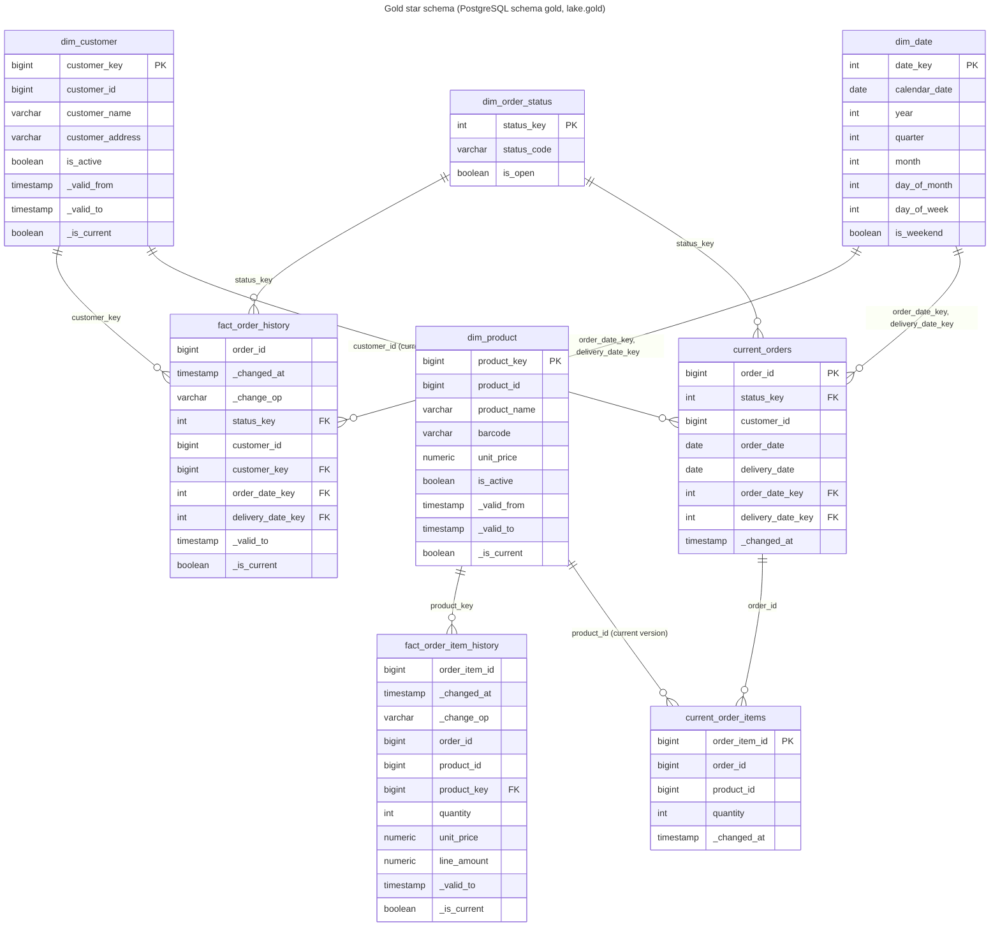

# Gold model

The design of gold: what it reads from silver, its stored tables and public views, the star schema and its rules, and the report tables behind the business questions. Spark computes every table; the Iceberg tables in `lake.gold` and the PostgreSQL tables in `gold_internal` hold the same rows. How the gold job computes and writes them, and how the copy reaches PostgreSQL, are in [the gold writer](writer.md).

## Inputs from silver

Silver keeps one append-only table per source entity, `lake.silver.<entity>`, with one row per source change: the entity's source and audit columns under their lake names (so `unity_price`, and `quantity` for the misspelled `quanity`), plus:

| Column | Meaning |
| --- | --- |
| `_commit_sequence` | the change's position in the source database's write-ahead log (Debezium `source.lsn`); increases in commit order |
| `_change_op` | `snapshot`, `create`, `update` or `delete` |
| `_changed_at` | when the change was committed in the source |
| `_content_hash` | hex SHA-256 of the content columns (key and audit columns excluded) |
| `_is_deleted` | whether the change is a delete; the row keeps its last known values |

Exact duplicates are already dropped. Gold reads these tables, not silver's views, because a streaming query can only read a table.

**Unchanged versions.** Silver keeps re-snapshots and audit-only updates as rows of their own. Per key, ordered by `_commit_sequence`, a version whose `_content_hash` and `_is_deleted` both equal the previous version's is not a new version: the silver `_history` view folds it, and gold folds it too.

Gold applies the rule without dropping rows: bronze replays can append a missing change late, and a late version that lands between two equal versions turns the later one back into a real change. So gold stores every version silver sends, with the columns that place it among its key's versions (see [Versioning](#versioning)):

- `_is_folded` is true when a version's `_content_hash` and `_is_deleted` equal the previous version's by `_commit_sequence`; the first version of a key is never folded.
- Folded versions are never current and the public views leave them out. Their `_valid_to` is the one of the version they repeat, so a folded version ends when that version ends.
- Example: product 3 at price 3.00 is stored at positions 60 and 80 (a re-snapshot): 80 is folded, 60 is current. A late update to 4.00 at position 70 arrives: the batch recomputes product 3's versions, so 60 is valid until 70, 70 until 80, and 80 is no longer folded and becomes current.

### What `_commit_sequence` is

`_commit_sequence` is the PostgreSQL log sequence number (LSN) of the change, Debezium's `source.lsn`, as a 64-bit integer: the byte position of the change in the source database's write-ahead log. It only grows, in commit order, across the whole database. For one key, a later change always has a higher position than an earlier one; snapshot rows carry the position of the snapshot, which is lower than any change streamed after it. Gold uses it to order versions of a key, to tell a late or replayed event from a newer one, and as half of every surrogate key. Arrival order and Kafka offsets are not used for ordering.

## Internal tables and public views

Every gold table is stored twice with the same rows: as an Iceberg table `lake.gold.internal_<table>` and as a PostgreSQL table `gold_internal.<table>`. The `internal_` prefix keeps the names of the lake's public views free in the same namespace. Only the gold job writes them, and they keep the metadata it needs: `_commit_sequence` to skip replayed changes and to order versions, `_is_deleted` for soft deletes and the fold rule, `_content_hash` for the fold rule, and the version columns it computes (`_is_folded`, `_version_number`, `_valid_to`, `_is_current`). PostgreSQL also holds the unlogged staging tables the copy goes through, and `gold_internal.sync_state`, the Iceberg snapshot of each table the copy holds (see [Copying into PostgreSQL](writer.md#copying-into-postgresql)).

Consumers read views, never the tables:

- **`gold`** in PostgreSQL holds one view per public table, with the same name: the business-question views, the API and anyone browsing the model, plus `open_orders`, the current orders that are open.
- **`lake.gold.<relation>`** holds the same views over the Iceberg tables, with the same columns ([Gold in the lake](writer.md#gold-in-the-lake)).

The views only select and filter stored columns: they leave out `_commit_sequence`, `_content_hash`, `_is_deleted`, `_is_folded` and `_version_number`, and `current_orders` also leaves out `is_open`. The current-state views leave out deleted rows, the dimension views leave out folded and deleted versions, and the history views leave out unchanged changes. Consumers never need to know how the pipeline orders or deduplicates changes, and the tables can change for the pipeline without breaking them.

| Column | In the stored tables | In the public views |
| --- | --- | --- |
| `_commit_sequence` | every table except `dim_date`, `dim_order_status` and the report tables | left out |
| `_is_deleted` | the dimensions, history facts and current-state tables | left out; deleted rows are filtered from the dimension and current-state views, and a delete is the last, never current, row of a history view |
| `_content_hash` | `dim_customer`, `dim_product`, `fact_order_history`, `fact_order_item_history` | left out |
| `_is_folded`, `_version_number` | the dimensions and history facts, computed by the gold job | left out; folded versions are filtered |
| `_valid_to`, `_is_current` | the dimensions and history facts, computed by the gold job | kept |
| `is_open` of an order | `current_orders`, looked up from `dim_order_status` by the gold job | left out of `gold.current_orders`; `gold.open_orders` filters on it |
| `pending_orders_by_customer` | a report table the top customers are ranked from | no view of its own |

## Where the definitions live

Every gold table's columns, their types and nullability, and every table, view and column description are defined once, in the gold Avro schemas in `analytics/pipelines/src/pipelines/schemas/gold/`, one `<table>.avsc` per table, and one `<view>.avsc` per view that has no table of its own (`open_orders` and `data_freshness`). A column that comes from a source table takes its description from there with `"from"` (for example `"from": "orders.delivery_date"`), so the lake and gold describe it the same way; a metadata column such as `_commit_sequence` is defined in full, exactly like in the bronze template, and a unit test keeps every definition of a `_` column the same across all schemas; a column only gold has, such as a surrogate key or `line_amount`, has its own `doc`. The record's `doc` describes the stored table and `public_doc` its view when that differs; for a view without a table, `doc` describes the view.

The same schemas give the Iceberg tables their columns and descriptions, and the PostgreSQL DDL its column lists: the Jinja template `analytics/pipelines/src/pipelines/lake/gold/sql/ddl.sql.j2` keeps the keys, partitions and retention functions, and `pipelines/lake/gold/ddl.py` renders the tables, the staging tables, the public views and their descriptions from the schemas. `make up` renders it to the git-ignored `docker/analytics-db/initdb/02-gold-model.sql`, which PostgreSQL runs on an empty volume.

## Model

The diagram shows the public views; the same relations exist in PostgreSQL's `gold` schema and in `lake.gold`.



### Tables and grain

| Table | Kind | Grain | Key |
| --- | --- | --- | --- |
| `dim_customer` | SCD2 dimension | one row per customer change from silver, folded versions and the delete included; the view shows one row per customer version | `customer_key` (surrogate); unique (`customer_id`, `_commit_sequence`) |
| `dim_product` | SCD2 dimension | as `dim_customer`, per product; a new price is a new version | `product_key` (surrogate); unique (`product_id`, `_commit_sequence`) |
| `dim_date` | seeded dimension | one row per calendar day, 2000-01-01 to 2099-12-31 | `date_key` (`yyyymmdd`) |
| `dim_order_status` | seeded dimension | one row per status: `PENDING`, `PROCESSING`, `REPROCESSING`, `COMPLETED`, `UNKNOWN` | `status_key` |
| `fact_order_history` | history fact | one row per change to an order from silver, unchanged changes and the delete included; the view leaves unchanged changes out | (`order_id`, `_commit_sequence`); in PostgreSQL also `_changed_at` |
| `fact_order_item_history` | history fact | as `fact_order_history`, per order item | (`order_item_id`, `_commit_sequence`); in PostgreSQL also `_changed_at` |
| `current_orders` | current state | one row per order, with its status's `is_open`; the view leaves deleted orders out | `order_id` |
| `current_order_items` | current state | one row per order item; the view leaves deleted items out | `order_item_id` |
| `open_orders_by_delivery_date_and_status` | report | one row per delivery date and status code with at least one open order | (`delivery_date`, `status_code`), nulls equal |
| `pending_orders_by_customer` | report, no view | one row per customer with at least one open order | `customer_id` |
| `pending_items_by_product` | report | one row per product with at least one pending item: the count and the total quantity | `product_id` |
| `top_delivery_dates_by_open_orders` | report | the delivery dates in the first 3 places by open orders, ties included | none: replaced whole |
| `top_customers_by_pending_orders` | report | the customers in the first 3 places by pending orders, ties included, with the current name | none: replaced whole |

Notes:

- `unity_price` is renamed `unit_price` in gold. `order_id`, `customer_id`, `product_id` and `order_item_id` stay as degenerate keys next to the surrogate keys, so facts can be joined to the source without the dimensions.
- `customer_key` in `fact_order_history` is the customer version valid at the order change's `_changed_at`, or the customer's first version for an earlier change (see [Dimension keys of the facts](#dimension-keys-of-the-facts)).
- `product_key`, `unit_price` and `line_amount` (`quantity × unit_price`) in `fact_order_item_history` come from the product version valid at the item's `_changed_at` (or the product's first version for an earlier item), which is when the order was placed: the source inserts an order's items right after the order. This keeps the price the order was placed at, even after the product's price changes.
- `status_key` is the `dim_order_status` key whose `status_code` equals the source status exactly; a null or any other status gets the `UNKNOWN` key. `order_date_key` and `delivery_date_key` are the `dim_date` keys of the dates, null when the date is null or outside 2000 to 2099. History and current state derive them with the same lookups.
- A delete is a history row with `_change_op = 'delete'`, `_is_deleted` and the row's last values. The history views show it as the key's last row, with no `_valid_to` and never current, so "the order was deleted at" stays queryable.
- In PostgreSQL the history facts are partitioned by month of `_changed_at`, and PostgreSQL requires the partition column in the primary key, so their key includes `_changed_at`. A change always has the same `_changed_at`, so the key still identifies one change. In Iceberg they are bucketed by their business key and keep every month.
- The history facts carry `_valid_to` (the next version's `_changed_at`, ordered by `_commit_sequence`) and `_is_current`, so history can be queried as of any time, for example "open orders on 2026-11-01".

## Rules

### Versioning

Every rule below is applied by the gold job with Spark DataFrames, per micro-batch, only for the business keys the batch touches.

- **Recompute the touched keys.** For each business key in the batch, the job reads the key's stored versions, adds the batch's changes not stored yet (one per key and `_commit_sequence`; a replayed change is skipped, so the stored row wins), and recomputes the version columns from all of them with window functions partitioned by the business key and ordered by `_commit_sequence`:
  - `_is_folded`: the change's `_content_hash` and `_is_deleted` equal the previous change's;
  - `_version_number`: the number of versions that are not folded up to this change, from 1; a folded change shares the number of the version it repeats;
  - `_valid_to`: the start of the first change of the next version number (its `_valid_from` in a dimension, its `_changed_at` in a fact), null for the last one;
  - `_is_current`: the last version number, unless it is a delete; a folded change is never current.

  These columns are stored, not derived at read time, so the public views only filter them. The job writes only the rows that are new or whose version columns changed, merged on (business key, `_commit_sequence`). A late change therefore re-places the changes after it: one landing between two equal changes unfolds the later one, and one landing between two versions splits the range around it. A key the batch does not touch is not read.
- **History is idempotent.** A row is identified by (key, `_commit_sequence`). Replaying a micro-batch, or a Debezium re-send after a restart, recomputes the same columns and writes nothing.
- **Current state only moves forward.** The latest change of each key in the batch replaces the current row only if its `_commit_sequence` is higher than the stored one. A late version is still added to history, where its validity range lands in the right place, but it never overwrites newer current state.

  Example: order 7 is stored as `PROCESSING` at position 500. A delayed event `PENDING` at position 420 arrives. History gets the 420 row (valid until the 500 change); `current_orders` stays `PROCESSING`. Then `COMPLETED` at 610 arrives and replaces it.
- **Deletes are soft in current state.** A delete sets `_is_deleted` and keeps the row with the delete's `_commit_sequence`, so a late event older than the delete cannot bring the row back. The current-state views leave deleted rows out.
- **Current state is the latest change, folded or not.** A re-snapshot with a higher `_commit_sequence` replaces the current row even though its content is unchanged, so `_commit_sequence` keeps rising and a late change between the two equal ones is still rejected, as the fold rule requires; `_changed_at` of the current row is then the time of the re-snapshot.
- **Items may arrive before their order.** `current_order_items` has no foreign key to `current_orders`: an item is stored in history and current state when it arrives, and the pending items are recounted when its order arrives or changes, so it counts as soon as its order is open.
- **SCD2 dimensions.** `_valid_from` is the version's `_changed_at`. Among the versions that are not folded, ordered by `_commit_sequence`, each one is valid until the next one's `_valid_from`, and the last one is current unless it is a delete. A new version therefore closes the current row and becomes current itself, and a late older version gets the range between its neighbours. A delete is stored as the key's last version, so the key has no current version afterwards; replays and late events cannot revive it, because they sort before the delete. A key has at most one current version by construction, because every version column of a key is recomputed together.

### Surrogate keys

`customer_key` and `product_key` are `xxhash64(business key, _commit_sequence)`, Spark's 64-bit xxHash of the two columns.

- **Deterministic.** The key depends only on the version's identity, so a rebuild from silver gives every version the same key, and the Iceberg tables and PostgreSQL hold the same values without any coordination.
- **One narrow column.** Facts refer to a dimension version with one `bigint`, and the public views identify a version without exposing `_commit_sequence` or any other pipeline metadata.
- **Stable under late changes.** I hash the LSN rather than `_version_number`: version numbers renumber when a late change lands between stored versions or a version unfolds, so a key built from them would change under the facts that point at it. A version's `_commit_sequence` never changes.
- **Collisions.** Two different versions sharing a key is a birthday problem over 2^64 values: about 3 in a million at 10 million dimension versions. In PostgreSQL the surrogate key is the dimension's primary key, so a collision fails the copy loudly instead of merging two versions.

### Dimension keys of the facts

The history facts get two kinds of lookups:

- **Key lookups** against the seeded dimensions: `status_key` (and `is_open` for current state) from `dim_order_status`, with the `UNKNOWN` fallback, and the date keys from `dim_date`. Both seeded dimensions are small, so the joins are broadcast.
- **As-of lookups** against the stored SCD2 versions: `customer_key` (order history) and `product_key`, `unit_price` and `line_amount` (item history) come from the dimension version that is not folded, not deleted, and whose [`_valid_from`, `_valid_to`) contains the change's `_changed_at`, as a range join on the stored validity columns. A change older than the key's first version takes that first version: Debezium snapshots each table at a slightly different time, so an order or item can be snapshotted a few milliseconds before its customer or product, and would otherwise keep a null key. If no version matches, because the customer or product is not in gold yet or the change comes after its delete, the columns are null. If clock skew made two ranges overlap, the version with the highest `_commit_sequence` wins. `line_amount` is the price as of the change times the quantity.

Those values can go stale after they are stored: a dimension row can arrive after the facts that need it, and a late dimension version can split a validity range or unfold a version. Gold therefore resolves them on both sides, with the same lookup:

- a fact batch resolves the changes it adds against the stored dimension versions;
- a dimension batch, after recomputing its versions, re-resolves the history rows of every business key it touched, and writes only the rows whose looked-up values change. Which facts depend on which dimension is declared once, as the facts' as-of lookups in `pipelines/lake/gold/dimensions.py`.

Example: product 3 costs 3.00 from a change committed at 10:00, with an unchanged re-snapshot at 10:40 (folded). An item changed at 10:30 gets the 10:00 version and 3.00. A late update to 4.00, committed at 10:20, arrives: the product batch re-resolves the item to the 10:20 version, with `unit_price` 4.00 and its `line_amount` recomputed.

**One batch at a time.** The gold job holds one lock in its driver for a whole micro-batch, from reading the stored tables to the PostgreSQL commit, so the four streams' batches run one after the other. Without it, a fact batch and a dimension batch running side by side would each read the other's tables without the other's rows: the fact would be resolved against the old dimension, and the dimension's re-resolution would not see the new fact, which would keep a wrong or null key for good.

### Open orders and pending items

- **Open order:** an order in `current_orders` that is not deleted and whose status has `is_open`, the rows of `gold.open_orders`. Every status except `COMPLETED` is open. A null or unexpected status maps to `UNKNOWN`, which is open, so it shows up in the metrics instead of disappearing.

  | Status | Open |
  | --- | --- |
  | `PENDING` | yes |
  | `PROCESSING` | yes |
  | `REPROCESSING` | yes |
  | `UNKNOWN` (null or unexpected) | yes |
  | `COMPLETED` | no |

- **Stored with the order:** the gold job looks `is_open` up from `dim_order_status` with the same lookup and `UNKNOWN` fallback as `status_key`, and every newer change sets both, so the flag always belongs to the stored status. The open rule itself stays in the `dim_order_status` seed; a change to it would need the stored flags recomputed. History keeps only `status_key`.
- **Pending order** (question 4): an open order. `PENDING` alone would leave out orders being processed, and would not match questions 1 to 3.
- **Pending item** (question 3): an item, not deleted, of an open order. Question 3 reports both the number of pending items and their total quantity per product.
- **Top 3:** questions 2 and 4 rank by count with `rank()` and keep places 1 to 3, so every row tied for third place is kept and more than three rows can come back. `rank()` leaves gaps after a tie (two dates tied for first are both 1, the next is 3), so ties never add places: `dense_rank()` would count a tie as one place and could return many more rows.

Example: customer 3 has order 10 `PENDING` with two items of product 5 (quantities 4 and 6), and order 11 `COMPLETED` with one item of product 5. Customer 3 has one pending order; product 5 has two pending items with a total quantity of 10.

## The four business questions

Each question is a view in `gold` (and in `lake.gold`) over a report table that the gold job keeps up to date every micro-batch:

| Question | View | Columns |
| --- | --- | --- |
| Number of open orders by delivery date and status | `gold.open_orders_by_delivery_date_and_status` | `delivery_date`, `status_code`, `open_orders` |
| Top 3 delivery dates with more open orders | `gold.top_delivery_dates_by_open_orders` | `delivery_date`, `open_orders` |
| Number of open pending items by product | `gold.pending_items_by_product` | `product_id`, `pending_items`, `pending_quantity` |
| Top 3 customers with more pending orders | `gold.top_customers_by_pending_orders` | `customer_id`, `customer_name`, `pending_orders` |

### How the reports are kept

- **Per-key totals, recounted for the touched keys.** The three per-key tables (open orders by delivery date and status; pending orders by customer; pending items by product, as a count and a quantity) are recounted, after the batch's current state is merged, only for the keys the batch touched. The keys come from both the old (pre-merge) and the new current rows of the batch's orders or items: an order that moves from one delivery date to another, or is completed, changes the total of its old key as well as its new one. An orders batch also recounts the products of its orders' items, because an order opening or closing changes the pending items of each of them. A total that drops to zero is deleted, so the tables hold only keys with something open.
- **Top 3, ranked from the per-key tables.** After the recount, the two top-3 tables are ranked again with `rank()` over the whole per-key table, open orders summed by delivery date for question 2, and replaced. The top customers take the name of the customer's current `dim_customer` version, or null while there is none; a customer batch ranks them again so a new name shows up.
- **Why not a streaming `groupBy`.** A streaming aggregation over the change log only adds what each change brings: it cannot take back an order's count from its previous delivery date, status or open state when a newer version replaces it, nor ignore a late version older than the stored one. Recounting the touched keys from the current state keeps every total exact, and a replayed batch recounts the same numbers.
- **Why the ranking is cheap.** It reads the per-key table, whose size is the number of delivery dates or customers with open orders, not the number of orders.
- **A view has no row order.** Consumers add their own `ORDER BY`. The queries in [`analytics/sql/gold/`](https://github.com/jonathan5p/deel-home-task/tree/main/analytics/sql/gold), one per question, read the views with the order the questions are reported in:

| Query | Order |
| --- | --- |
| [01](https://github.com/jonathan5p/deel-home-task/blob/main/analytics/sql/gold/01_open_orders_by_delivery_date_and_status.sql) | `delivery_date`, `status_code` |
| [02](https://github.com/jonathan5p/deel-home-task/blob/main/analytics/sql/gold/02_top_delivery_dates_by_open_orders.sql) | `open_orders` descending, then `delivery_date` |
| [03](https://github.com/jonathan5p/deel-home-task/blob/main/analytics/sql/gold/03_pending_items_by_product.sql) | `product_id` |
| [04](https://github.com/jonathan5p/deel-home-task/blob/main/analytics/sql/gold/04_top_customers_by_pending_orders.sql) | `pending_orders` descending, then `customer_id` |

```sql
SELECT delivery_date, open_orders
FROM gold.top_delivery_dates_by_open_orders
ORDER BY open_orders DESC, delivery_date;
```

### Querying the views

```sh
docker compose exec -T analytics-db psql -U analytics -d analytics < analytics/sql/gold/01_open_orders_by_delivery_date_and_status.sql
docker compose exec analytics-db psql -U analytics -d analytics -c "select * from gold.top_customers_by_pending_orders order by pending_orders desc, customer_id"
```

`gold.data_freshness` shows, per entity (customers, products, orders, order items), how up to date gold is. For now it is computed from the data, as the source commit time of the newest change gold holds, so it ages when the source stops changing even though the pipeline is healthy. Later the pipeline metrics (#127) will fill it; its shape stays the same.

```sh
docker compose exec analytics-db psql -U analytics -d analytics -c "select * from gold.data_freshness"
```

### Reading cost

The business-question views read the report tables, which hold one row per answer: a few delivery dates and statuses, the products with pending items, and three or a few more rows for each top 3. Their cost no longer depends on the number of orders or on the history, so they need no indexes beyond their keys. The partial indexes that served the earlier views over `current_orders` ([D40](../../architecture/decisions.md#d40--gold-indexes-chosen-from-the-query-plans-of-the-current-use-cases)) are no longer needed for the questions. `gold.open_orders` still filters `current_orders` on `is_open AND NOT _is_deleted`.

Measured on the running stack: **[pending measurement: `EXPLAIN (ANALYZE, BUFFERS)` time of each business-question view over the report tables]**.

## Things to know about the source data

- **Open orders never get items, so "pending items by product" is empty.** The supplied generator (`generate_orders` in `db-scripts/initialize_db_ddl.sql`, run every minute by `pg_cron`) inserts a new `PENDING` order when a customer has no open order that day, then looks the order up again to add its items by customer and date only (`... AND order_date = CURRENT_DATE LIMIT 1`, without the status filter or an `ORDER BY`). The items land on whichever of the customer's orders that day comes first, normally the first one, which the generator's status updates complete within minutes. Every later order of the day stays without items. Gold keeps every item; they are not pending because their order is not open. The source was left as supplied ([D29](../../architecture/decisions.md#d29--the-source-database-and-the-debezium-connector-stay-as-provided)); [the way to production](../../architecture/production.md) includes a recommendation for generating data with pending items.

    Counted in the source on 2026-11-12:

    | Orders | Count | Items | Items per order |
    | --- | --- | --- | --- |
    | Completed, first of the day | 40 | 128,258 | 3,206 on average |
    | Completed, later ones | 8,525 | 95,134 | 11 on average |
    | Open | 27 | 0 | 0 |

- `products.unity_price` is a `DECIMAL` without precision or scale. In the lake, `unit_price` and `line_amount` are `decimal(38, 10)`, like silver's prices; in PostgreSQL they are unconstrained `NUMERIC`, which keeps every value the lake holds exact.
