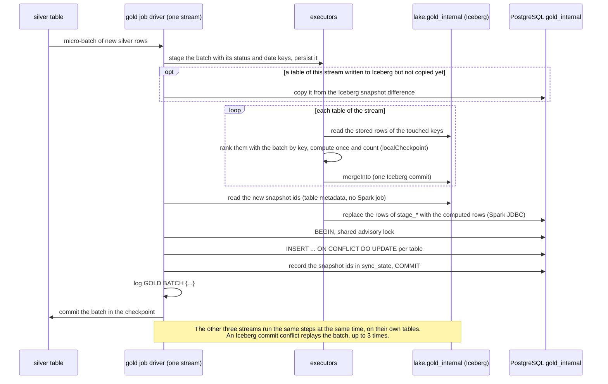
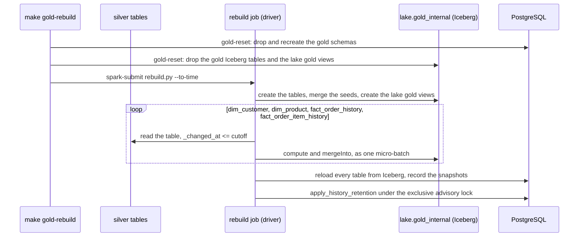

# Gold writer

How gold is written: the gold job, whose four independent streams compute their gold tables with Spark in each micro-batch and merge them into Iceberg, the copy of the computed rows into PostgreSQL, current state and retention, rebuilding gold from silver, and the same views in the lake. The model it writes is in [the gold model](model.md); every table and column is in the [table reference](../../reference/gold/index.md).

## The gold DDL

Gold has two kinds of storage, created in two places:

- **The Iceberg tables** `lake.gold_internal.<table>` are created by the gold job when it starts, if they are missing, from the gold Avro schemas (see [table and column definitions](../../development/table-definitions.md)): format version 2, merge-on-read for deletes, updates and merges, every column described, and the history facts bucketed by their business key into 16 buckets and sorted by their key within each data file. On every start the job also brings the table and column descriptions up to date, then creates or replaces the lake gold views over the tables.
- **The PostgreSQL DDL**, `docker/analytics-db/initdb/02-gold-model.sql`, is generated and git-ignored: `make up` (and `make pipeline` and `make test-infra`) renders it, on the host with [uv](https://docs.astral.sh/uv/), from the Jinja template `analytics/pipelines/src/pipelines/lake/gold/sql/ddl.sql.j2`, the same schemas, which give every column its type, nullability and description, and the view templates in `analytics/pipelines/src/pipelines/lake/gold/sql/views/`. Edit the templates or the schemas, never the SQL file. The file creates both schemas, the tables and their staging tables, the partial indexes of the business-question views, `gold_internal.sync_state`, the public views, each history table's default partition and the retention functions; the monthly history partitions are created and dropped by the retention job (see [Gold retention](../../operations/maintenance-and-recovery.md#gold-retention)). It runs on an empty volume like the other init scripts, and every statement is idempotent, so it can also be applied to an existing database without losing data:

```sh
docker compose exec -T analytics-db psql -v ON_ERROR_STOP=1 -U analytics -d analytics < docker/analytics-db/initdb/02-gold-model.sql
```

Applying it again only adds what is missing: `CREATE TABLE IF NOT EXISTS` leaves an existing table as it is, so a new column or constraint on a gold table does not reach a database created before it. There are no migration commands: a change to a stored table means resetting or rebuilding gold, leaving silver and the rest of the lake alone:

```sh
make gold-reset CONFIRM=1   # Stops the gold job, drops and recreates gold and gold_internal from the rendered DDL, drops the gold Iceberg tables and the lake gold views, deletes the gold checkpoints
make pipeline PIPELINE=gold # The gold job recreates its tables and views and reloads everything from silver
```

The same reset followed by one batch load from the silver tables, optionally only up to a point in time:

```sh
make gold-rebuild CONFIRM=1                              # gold-reset, then rebuild every gold table from silver, reload PostgreSQL and apply retention
make gold-rebuild CONFIRM=1 TO_TIME=2026-11-09T12:00:00  # only the changes committed at or before that time (UTC unless it has an offset)
make pipeline PIPELINE=gold                              # resume streaming afterwards
```

See [Rebuilding gold from silver](../../operations/maintenance-and-recovery.md#rebuilding-gold-from-silver) for how it works.

**Data loss:** all gold data is deleted, in the lake and in PostgreSQL; gold is rebuilt from silver, which keeps the full history, and the surrogate keys come back with the same values. The gold checkpoints (`<CHECKPOINT_ROOT>/gold/`, deleted through the SeaweedFS filer; set `GOLD_CHECKPOINTS` to its path for another `CHECKPOINT_ROOT`) must go with the data, or the job would resume after the batches the dropped rows came from.

## Gold job

The gold job (`analytics/pipelines/src/pipelines/lake/gold/job.py`) keeps the gold model up to date from the silver tables `<ICEBERG_CATALOG>.silver.<entity>`. It needs the four silver tables to exist when it starts, and the gold DDL to be applied (`make up`):

```sh
make pipeline PIPELINE=gold   # as a long-running service, UI on http://localhost:4045
make spark-submit SPARK_APP=analytics/pipelines/src/pipelines/lake/gold/job.py SPARK_APP_ARGS=--available-now SPARK_CONF="spark.cores.max=2" SPARK_UI_PORT=4045   # or once, ad hoc
```

- **On start,** it creates the Iceberg tables that are missing, merges the rows of the seeded dimensions (`dim_order_status`, `dim_date`) that changed, copies into PostgreSQL every table whose latest Iceberg snapshot PostgreSQL does not hold yet, and creates or replaces the lake gold views.
- **Four independent streams,** one per silver table, each reading it with Iceberg's streaming source and writing only its own gold tables, with its checkpoint in `<CHECKPOINT_ROOT>/gold/<load>/`:

  | Silver table | Load and checkpoint | Writes |
  | --- | --- | --- |
  | `customers` | `dim_customer` | `dim_customer` |
  | `products` | `dim_product` | `dim_product` |
  | `orders` | `fact_order_history` | `fact_order_history`, `current_orders` |
  | `order_items` | `fact_order_item_history` | `fact_order_item_history`, `current_order_items` |

- **No lock between them.** No stream reads another stream's tables: a fact keeps its business keys, and the public views join the dimension version valid at each change when they are read ([Point-in-time dimension attributes](model.md#point-in-time-dimension-attributes)). The streams run their micro-batches at the same time, each in a fair-scheduler pool named after its load (`spark.scheduler.mode=FAIR`), so one stream's jobs never queue behind another's. The catalog does not cache tables (`cache-enabled=false`), so every merge reads the table as last committed.
- **Every micro-batch** runs in the stream's `foreachBatch`: Spark DataFrames compute the rows to write from the batch and the stored rows of the keys it touches, `DataFrame.mergeInto` writes them to the Iceberg tables, and one PostgreSQL transaction copies the same computed rows into `gold_internal` with plain upserts. No transformation runs in PostgreSQL. Micro-batches run every `GOLD_TRIGGER_SECONDS`; `--available-now` processes what silver holds and stops.
- **Unchanged versions are folded, not dropped,** and **deletes are final:** the version columns are recomputed from all of a key's versions, so a late version can unfold a stored one, and a deleted key has no current version afterwards ([Versioning](model.md#versioning)).
- **The column lists come from the gold Avro schemas:** a column is loaded from the silver column its `from` names, a metadata column from the silver column of the same name, and `_valid_from` from `_changed_at` (`unit_price` from `unity_price`); the facts' status and date keys come from lookups declared in `pipelines/lake/gold/dimensions.py`, broadcast joins to the seeded dimensions, which the job builds in memory.
- **Shuffles:** each write ranks the stored rows and the batch's changes in one window by key, so the job sets `spark.sql.shuffle.partitions=4`, about two partitions per core it gets; adaptive query execution coalesces the rest.
- **One log line per batch:** `GOLD BATCH {...}`, with the time and Spark jobs of every step ([Monitoring](../../operations/monitoring.md#gold-batch-log)).
- **Fail fast:** like the bronze job, it stops every query when one stops or fails, and exits non-zero if one failed.

## Writing gold

Each micro-batch of a stream goes through the same steps; the code is in `pipelines/lake/gold/writer.py`, the transforms in `pipelines/lake/gold/model/`, called from `pipelines/lake/gold/batch.py`:

1. **Stage once.** The batch's rows, with the status and date keys looked up, are persisted for the whole batch and unpersisted after it.
2. **Catch up.** If an earlier batch of this stream wrote a table to Iceberg but failed before PostgreSQL committed its copy, that table is copied first (see [Copying into PostgreSQL](#copying-into-postgresql)).
3. **Compute, once per table.** For each of the stream's tables, the job reads the stored rows of the keys the batch touches (the keys are broadcast and the stored rows filtered with a `left_semi` join, so no shuffle) and ranks them with the batch's changes in one window by key, which drops repeats, places every change and compares it with its stored self:
   - a **dimension batch** gives the versions of its keys that are new or whose version columns changed;
   - a **fact batch** gives the history rows of its keys that are new or changed, then the current-state rows it makes newer.

   Each result is computed once (`localCheckpoint`) and counted in the same Spark job, so the merge and the copy read exactly the same rows even after the merge changes the table they were computed from. A table with nothing to write is skipped and gets no commit.
4. **Merge into Iceberg,** one `mergeInto` per table that has rows to write.
5. **Read the snapshot ids** from each written table's `current-snapshot-id` property, which the driver reads from the table metadata without a Spark job.
6. **Copy to PostgreSQL** in one transaction: the computed rows of every table the batch wrote, with their Iceberg snapshot ids.
7. **Log** the batch's `GOLD BATCH` line.

A batch whose Iceberg commit conflicts with another commit to the same table, for example with lake maintenance compacting it, is computed and written again, up to three times. Every write depends only on the stored rows and the batch, so the replay is idempotent.

| Write mode | Tables | Iceberg `mergeInto` | PostgreSQL copy |
| --- | --- | --- | --- |
| Merge | seeded and SCD2 dimensions, history facts | on the keys: matched → update every column; not matched → insert | `INSERT ... ON CONFLICT (key) DO UPDATE` |
| Merge newer | current state | on the key: matched and the incoming `_commit_sequence` higher → update every column; not matched → insert | `INSERT ... ON CONFLICT (key) DO UPDATE` |

The dimension and history merges match on (business key, `_commit_sequence`); the condition of the current-state merge repeats the newer-only filter, so a row another write made stale is still not applied.



**Idempotency.** Every step can run again with the same input and leave the same result: the transforms derive their rows from what is stored and the batch, a replayed change is skipped, a recomputed row equal to the stored one is not written, the current state only takes a higher `_commit_sequence`, and the copy upserts by key. A batch replayed after a failure, a whole silver table reprocessed from a fresh checkpoint, a duplicate change and a late older change all end in the same rows. No transaction spans Spark's checkpoint, Iceberg and PostgreSQL, so a batch that fails between them is simply replayed.

**Generic writer.** Nothing in the writer knows a table by hand: the Iceberg schemas, the merge keys and modes, the staging tables and the PostgreSQL statements are built from the gold schemas and the declarations in `pipelines/lake/gold/dimensions.py` (`pipelines/lake/gold/stored.py` lists every stored table with its write mode and keys). The transforms use the DataFrame API only.

**How it got here.** The writer started as SQL templates in PostgreSQL, then became a Spark writer that linked facts to dimension versions and recounted report tables under one lock across the four streams; that version ran about 170 Spark jobs per order batch. This one computes each table once, reads no other stream's tables and needs no lock ([D44](../../architecture/decisions.md#d44--gold-modelled-in-spark-on-iceberg-postgresql-as-serving-copy)).

### Copying into PostgreSQL

PostgreSQL is a serving copy: it receives the rows the batch computed and merged into Iceberg, and applies them with generic statements rendered from the schemas, with no business logic (`pipelines/lake/gold/serving.py`).

1. **Stage.** Spark's JDBC writer replaces the rows of each written table's staging table, `gold_internal.stage_<table>` (overwrite with `truncate`, so the table and its descriptions stay). The staging tables are unlogged: they hold only the batch being copied, so they need no crash safety and write faster. History older than the retention window is left out, so a late change that re-places an old version never brings a dropped month back.
2. **Copy, in one transaction.** The driver connects with [psycopg](https://www.psycopg.org/psycopg3/) and, in one transaction, takes the PostgreSQL advisory lock in shared mode, runs each table's upsert, and upserts the Iceberg snapshot id of every table it copied into `gold_internal.sync_state`.

The copies take the lock shared, so the four streams copy at the same time; [retention](#current-state-and-retention) takes it exclusively, so it never drops a partition in the middle of a copy.

Because `sync_state` commits with the rows, PostgreSQL always knows which Iceberg snapshot it holds. The copy of a batch uses the rows the batch computed, so it reads nothing back from Iceberg. Only when a copy is missing does the job compare snapshots: at start-up for every table, and before a stream's next batch for its tables after a failed one, it copies the rows that differ between the snapshot PostgreSQL holds and the current one, or the whole table (`TRUNCATE` and insert) when PostgreSQL has no snapshot of it or that snapshot has been expired. No write removes a row, so the difference never has rows to delete.

The API and Grafana keep reading PostgreSQL: its views answer in milliseconds through the partial indexes, and the read-only logins stay as they are.

### Consistency between the two copies

Each store is consistent per stream and per table, not across streams:

- **In PostgreSQL,** a stream's batch commits whole: a fact's history and current state change in the same transaction. The four streams commit independently, so for a moment an order change can be in `current_orders` before its customer's new version is in `dim_customer`; the point-in-time views resolve it as soon as the customer arrives, without rewriting the fact.
- **In Iceberg,** every table commits on its own, so a lake reader can briefly see a fact's new history before its current state. The next commit of the same batch closes the gap.
- **Between the two,** PostgreSQL holds exactly the Iceberg rows at the snapshot `sync_state` records for each table, and the views are the same SQL, so both answer the same question the same way over the same snapshots. `make data-quality CHECK=gold` checks both ([data quality checks](../data-quality.md)).

**Freshness.** `gold.data_freshness` reports, per entity, how up to date gold is. For now it is computed from the data, as the source commit time of the newest change gold holds, so it ages when the source stops changing even though the pipeline is healthy. Later it will be filled from the pipeline statistics, with the same shape. Those statistics (per micro-batch rows, durations, last `_commit_sequence`, last event time) are planned in a separate `observability` catalog in the lake, apart from the business data (#127).

## Current state and retention

**Current state is stored in tables** that every fact batch merges into, so the business-question views read only the current orders and items, however long the history grows.

The alternatives were rejected:

- A view that picks the latest version from history gets slower as history grows.
- A materialized view recomputes everything on every refresh, too slow for one refresh per micro-batch.
- Both would lose orders that are still open but whose last change is older than PostgreSQL's retention window.

**Retention:** the Iceberg history facts keep every change. In PostgreSQL the history facts keep 3 years by default: they are range-partitioned by month on `_changed_at`, so retention drops whole partitions instead of deleting rows. The retention job creates the monthly partitions ahead and drops the expired ones; the DDL creates only each history table's default partition, which catches every row outside the monthly partitions. The copy never stages history older than the window, so a dropped month stays dropped. Current-state tables and the dimensions are never trimmed, so an order that is still open keeps its current row however old it is.

The retention job (`pipelines/lake/gold/retention.py`, run once by `make up` and `make pipeline` and then daily by the `gold-retention-job` service) calls `gold_internal.apply_history_retention(keep_months, months_ahead, as_of)` in one transaction that first takes the PostgreSQL advisory lock exclusively:

1. `ensure_history_partitions(months_ahead, as_of)` creates a partition for every month from the month of `as_of` to `months_ahead` months ahead, and for every month the default partition holds rows of, moving those rows into it. The default partition fills up whenever history arrives for a month without a partition: everything the gold job copies before the first retention run, a late change, or every month before the current one when gold is reloaded from Iceberg. A partition cannot be created while the default partition holds rows of its month, so the rows are moved in the same transaction. Without this step those rows would never be dropped.
2. Every monthly partition whose upper bound is on or before the first day of the month `keep_months` months before `as_of` is dropped; the bound is read from the partition, not from its name. A month partly inside the window is kept, so the window holds at least `keep_months` full months.

```mermaid
sequenceDiagram
    participant R as retention job
    participant P as PostgreSQL
    R->>P: BEGIN
    R->>P: pg_advisory_xact_lock (exclusive; the copies take it shared)
    R->>P: apply_history_retention(36, 2, today)
    P->>P: partition the months held by the default partition and the months ahead
    P->>P: DROP the partitions that end before the window
    P-->>R: dropped partitions
    R->>P: COMMIT
```

Taking the advisory lock first means retention waits for the running copies and the copies wait for retention, always in the same order (the advisory lock, then the table locks), so they never deadlock. Dropping a partition takes a short exclusive lock on its history table; `DETACH PARTITION ... CONCURRENTLY` would avoid it, but PostgreSQL does not allow it on a table with a default partition.

## Rebuilding from silver

Silver keeps every change, so gold can always be rebuilt from it. `make gold-rebuild CONFIRM=1 [TO_TIME=...]` resets gold (`make gold-reset`) and runs the batch job `pipelines/lake/gold/rebuild.py`:

1. It drops and recreates the gold Iceberg tables, merges the seeded dimensions, and creates the lake gold views over the new tables.
2. For each load, in any order, it reads the silver table in batch, keeps the changes with `_changed_at` at or before `TO_TIME` (all of them without one), and writes them with the gold job's own writer, in one batch, to Iceberg only. Each load reads only its own silver table and writes only its own tables, and the transforms are independent of arrival order, so one batch per load gives the same rows as any sequence of micro-batches over the same changes.
3. It reloads every PostgreSQL table from its Iceberg table (`TRUNCATE` and insert, history older than the retention window left out) and records the snapshots in `sync_state`.
4. It applies [retention](#current-state-and-retention), which first partitions the months the reload put in the default partition.

A rebuild up to a cutoff therefore matches what the stream would have built had it processed exactly the changes committed up to that time, late arrivals included. The surrogate keys are hashed from each version's business key and `_commit_sequence`, so they keep their values. The gold job is left stopped; started again on the fresh checkpoints, it re-reads silver from the start, finds every change up to the cutoff already stored, and continues past it.



## Gold in the lake

The lake holds the whole gold model as columnar Iceberg tables, `lake.gold_internal.<table>`, written by the gold job, with every change of the history. For readers, `lake.gold` holds the same 14 views as PostgreSQL's `gold` schema (`dim_customer`, `dim_product`, `dim_date`, `dim_order_status`, `fact_order_history`, `fact_order_item_history`, `current_orders`, `current_order_items`, `open_orders`, the four business-question views and `data_freshness`), rendered from the same templates with `lake.gold_internal` as the namespace. So both show the same columns, surrogate keys included, and compute the same answers from the same rows, except the history PostgreSQL's retention has dropped:

- the point-in-time views join the dimension version valid at each change (customer key, name and address; product key, name, price and `line_amount`);
- the four business-question views count the open current orders when read;
- the other views project and filter their table.

How the views are kept and read:

- **Created after the tables:** Spark resolves a view's query when it creates the view, so the tables must exist first. The gold job creates or replaces the views when it starts, after creating its tables, and so does the rebuild after recreating them. `make lake-views` and every lake maintenance run refresh them too, replacing only those whose query or descriptions changed, and report `skipped:` (not a failure) while the gold tables do not exist (see [Lake maintenance](../../operations/maintenance-and-recovery.md#lake-maintenance)).
- **As fresh as the tables:** the views read the gold Iceberg tables, which the gold job commits just before it copies the batch into PostgreSQL.
- **Described from the gold schemas:** each view and column has the description of the PostgreSQL `gold` view and column of the same name.
- **Read by any engine:** the tables are standard Iceberg, so Spark SQL, DuckDB and Trino read them through the catalog. The views are stored as Spark SQL; an engine that cannot run them reads the `lake.gold_internal` tables with the views' SQL ([querying the lake](../../serving/lake-access.md)).
- **Consistent per table:** see [Consistency between the two copies](#consistency-between-the-two-copies).

The point-in-time views already carry each version's surrogate key, so a fact joins the rest of its dimension version directly, in the lake as in PostgreSQL:

```sql
SELECT i.order_item_id, i._changed_at, i.product_name, i.unit_price, p.barcode
FROM lake.gold.fact_order_item_history AS i
JOIN lake.gold.dim_product AS p ON p.product_key = i.product_key;
```

**Validation.** `make data-quality CHECK=gold` checks that each PostgreSQL `gold_internal` table holds exactly the rows of its Iceberg table at the snapshot `sync_state` records, the gold model's invariants on the Iceberg tables, and that the four business-question views return the same rows in PostgreSQL and in the lake (see the [data quality checks](../data-quality.md)).
