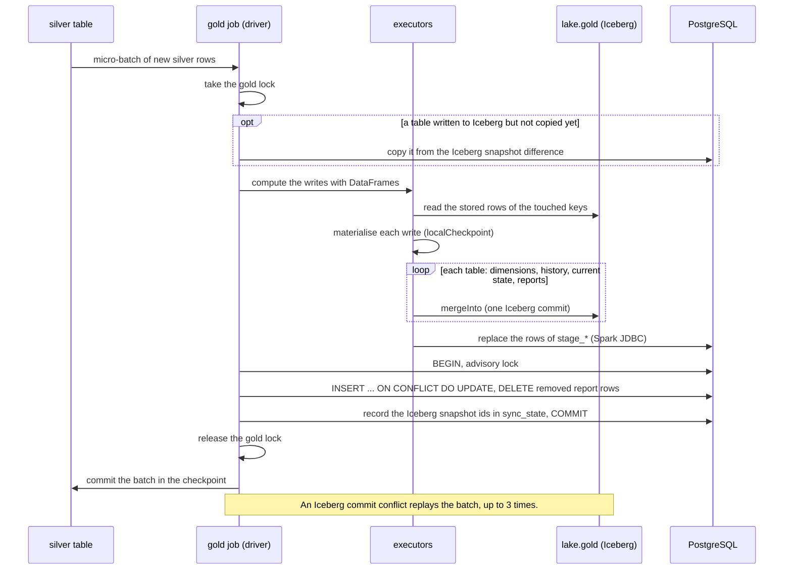
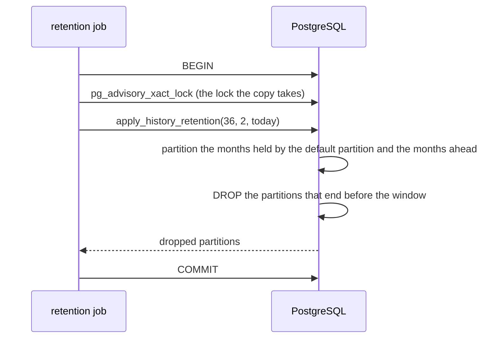
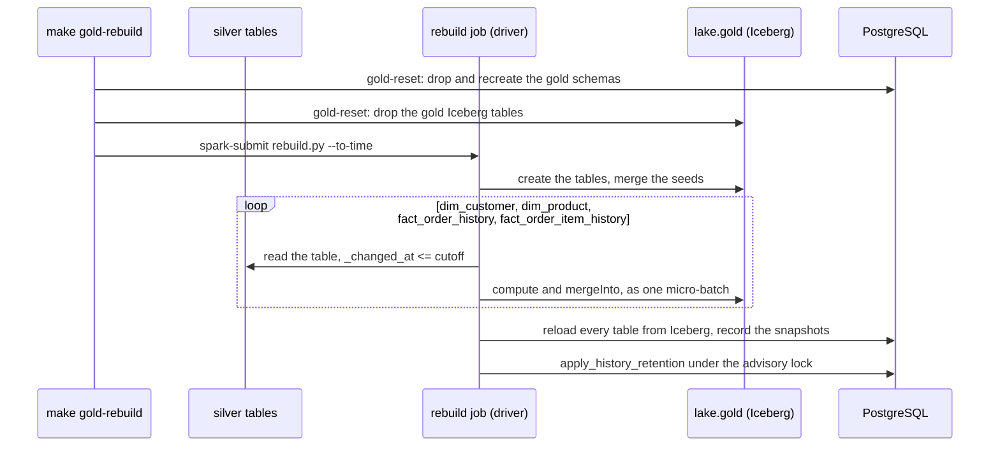
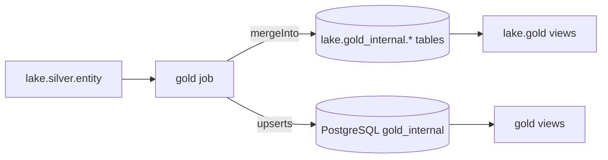

# Gold writer

How gold is written: the gold job, which computes every gold table with Spark in each micro-batch and writes it to Iceberg, the copy of what it wrote into PostgreSQL, current state and retention, rebuilding gold from silver, and the same model as views in the lake. The model it writes is in [the gold model](model.md); every table and column is in the [table reference](../../reference/gold/index.md).

## The gold DDL

Gold has two kinds of storage, created in two places:

- **The Iceberg tables** `lake.gold_internal.<table>` are created by the gold job when it starts, if they are missing, from the gold Avro schemas (see [table and column definitions](../../development/table-definitions.md)): format version 2, merge-on-read for deletes, updates and merges, every column described, and the history facts bucketed by their business key into 16 buckets and sorted by their key within each data file. On every start the job also brings the table and column descriptions up to date.
- **The PostgreSQL DDL**, `docker/analytics-db/initdb/02-gold-model.sql`, is generated and git-ignored: `make up` (and `make pipeline` and `make test-infra`) renders it, on the host with [uv](https://docs.astral.sh/uv/), from the Jinja template `analytics/pipelines/src/pipelines/lake/gold/sql/ddl.sql.j2` and the same schemas, which give every column its type, nullability and description. Edit the template or the schemas, never the SQL file. The file creates both schemas, the tables and their staging tables, `gold_internal.sync_state`, the public views, each history table's default partition and the retention functions; the monthly history partitions are created and dropped by the retention job (see [Gold retention](../../operations/maintenance-and-recovery.md#gold-retention)). It runs on an empty volume like the other init scripts, and every statement is idempotent, so it can also be applied to an existing database without losing data:

```sh
docker compose exec -T analytics-db psql -v ON_ERROR_STOP=1 -U analytics -d analytics < docker/analytics-db/initdb/02-gold-model.sql
```

Applying it again only adds what is missing: `CREATE TABLE IF NOT EXISTS` leaves an existing table as it is, so a new column or constraint on a gold table does not reach a database created before it. To rebuild only gold, leaving silver and the rest of the lake alone:

```sh
make gold-reset CONFIRM=1   # Stops the gold job, recreates gold and gold_internal from the rendered DDL, drops the gold Iceberg tables, deletes the gold checkpoints
make pipeline PIPELINE=gold # The gold job recreates its tables and reloads everything from silver
```

The same reset followed by one batch load from the silver tables, optionally only up to a point in time:

```sh
make gold-rebuild CONFIRM=1                              # gold-reset, then rebuild every gold table from silver, reload PostgreSQL and apply retention
make gold-rebuild CONFIRM=1 TO_TIME=2026-11-09T12:00:00  # only the changes committed at or before that time (UTC unless it has an offset)
make pipeline PIPELINE=gold                              # resume streaming afterwards
```

See [Rebuilding gold from silver](../../operations/maintenance-and-recovery.md#rebuilding-gold-from-silver) for how it works.

**Data loss:** all gold data is deleted, in the lake and in PostgreSQL; gold is rebuilt from silver, which keeps the full history. The gold checkpoints (`<CHECKPOINT_ROOT>/gold/`, deleted through the SeaweedFS filer; set `GOLD_CHECKPOINTS` to its path for another `CHECKPOINT_ROOT`) must go with the data, or the job would resume after the batches the dropped rows came from.

## Gold job

The gold job (`analytics/pipelines/src/pipelines/lake/gold/job.py`) keeps the gold model up to date from the silver tables `<ICEBERG_CATALOG>.silver.<entity>`: the SCD2 dimensions `dim_customer` and `dim_product` from `customers` and `products`, the history facts `fact_order_history` and `fact_order_item_history` with their current-state tables `current_orders` and `current_order_items` from `orders` and `order_items`, and the report tables from the current state. It needs the four silver tables to exist when it starts, and the gold DDL to be applied (`make up`):

```sh
make pipeline PIPELINE=gold   # as a long-running service, UI on http://localhost:4045
make spark-submit SPARK_APP=analytics/pipelines/src/pipelines/lake/gold/job.py SPARK_APP_ARGS=--available-now SPARK_CONF="spark.cores.max=2" SPARK_UI_PORT=4045   # or once, ad hoc
```

- **On start,** it creates the Iceberg tables that are missing, merges the rows of the seeded dimensions (`dim_order_status`, `dim_date`) that changed, and copies into PostgreSQL every table whose latest Iceberg snapshot PostgreSQL does not hold yet.
- **Four streaming queries,** one per silver table (customers, products, orders, order items), reading it with Iceberg's streaming source, with its checkpoint in `<CHECKPOINT_ROOT>/gold/<table>/` (`dim_customer`, `dim_product`, `fact_order_history`, `fact_order_item_history`). Micro-batches run every `GOLD_TRIGGER_SECONDS`; `--available-now` processes what silver holds and stops.
- **Every micro-batch** runs in the query's `foreachBatch`: Spark DataFrames compute the rows to write from the batch and the stored rows of the keys it touches, `DataFrame.mergeInto` writes them to the Iceberg tables, and one PostgreSQL transaction copies the same rows into `gold_internal` with plain upserts. No transformation runs in PostgreSQL.
- **One batch at a time:** one lock in the driver serialises the four queries' batches, from reading the stored tables to the PostgreSQL commit, so a fact batch never resolves against dimension versions another batch is changing.
- **Unchanged versions are folded, not dropped,** and **deletes are final:** the version columns are recomputed from all of a key's versions, so a late version can unfold a stored one, and a deleted key has no current version afterwards ([Versioning](model.md#versioning)).
- **Dimension keys as of the change:** a history fact row takes the customer or product version valid at its `_changed_at`; a dimension batch re-resolves the fact rows of the keys it touched, so a late customer or product, or a late version that changes a validity range, still ends in the right key ([Dimension keys of the facts](model.md#dimension-keys-of-the-facts)).
- **The column lists come from the gold Avro schemas:** a column is loaded from the silver column its `from` names, a metadata column from the silver column of the same name, and `_valid_from` from `_changed_at` (`unit_price` from `unity_price`); the facts' status, date and dimension keys come from lookups declared in `pipelines/lake/gold/dimensions.py`.
- **Shuffles:** the version windows, joins and recounts shuffle, so the job sets `spark.sql.shuffle.partitions=4`, about two partitions per core it gets.
- **Fail fast:** like the bronze job, it stops every query when one stops or fails, and exits non-zero if one failed.

## Writing gold

The gold job runs four streaming queries, one per silver table: `customers` into `dim_customer`, `products` into `dim_product`, `orders` into `fact_order_history`, `current_orders` and the order reports, and `order_items` into `fact_order_item_history`, `current_order_items` and the pending items by product. Each micro-batch goes through the same steps, under the driver's gold lock:

1. **Catch up.** If an earlier batch wrote a table to Iceberg but failed before PostgreSQL committed its copy, that table is copied first (see [Copying into PostgreSQL](#copying-into-postgresql)).
2. **Compute.** The job reads the stored Iceberg tables and computes, with DataFrames, the rows each table needs (the transforms are in `pipelines/lake/gold/model/`, called from `pipelines/lake/gold/batch.py`):
   - a **dimension batch**: the recomputed versions of its keys that are new or changed, then for each history fact that looks the dimension up, the fact rows whose as-of values change; a customer batch also ranks the top customers again, for their names;
   - a **fact batch**: the recomputed history rows of its keys that are new or changed, the current-state rows it makes newer, then the recounted per-key reports for the keys it touched and the two top-3 tables ranked again.

   Each result is materialised (`localCheckpoint`) before anything is written, so writing one table never changes what another write reads.
3. **Write to Iceberg,** in order (dimensions before facts, current state before reports), one `mergeInto` per table that has rows to write; a table with nothing to change gets no commit.
4. **Copy to PostgreSQL** in one transaction, with the Iceberg snapshot id of every table it copies.

A batch whose Iceberg commit conflicts with another commit to the same table is computed and written again, up to three times. Every write depends only on the stored rows and the batch, so the replay is idempotent.

| Write mode | Tables | Iceberg `mergeInto` | PostgreSQL copy |
| --- | --- | --- | --- |
| Merge | seeded and SCD2 dimensions, history facts | on the keys: matched → update every column; not matched → insert | `INSERT ... ON CONFLICT (key) DO UPDATE` |
| Merge newer | current state | on the key: matched and the incoming `_commit_sequence` higher → update every column; not matched → insert | `INSERT ... ON CONFLICT (key) DO UPDATE` of the rows the merge applied |
| Recount | per-key reports | on the keys, nulls equal: matched and `_is_removed` → delete; matched → update the totals; not matched and not `_is_removed` → insert | `DELETE` the removed keys (`IS NOT DISTINCT FROM`), then upsert the others |
| Replace | top-3 reports | overwrite the table | `DELETE` every row, then `INSERT` |

The history merges match on (business key, `_commit_sequence`); the condition of the current-state merge repeats the newer-only filter, so a row that another write made stale is still not applied.



**Idempotency.** Every step can run again with the same input and leave the same result: the transforms derive their rows from what is stored and the batch, a replayed change is skipped, a recomputed row equal to the stored one is not written, the current state only takes a higher `_commit_sequence`, the recounts give the same totals, and the copy upserts by key. A batch replayed after a failure, a whole silver table reprocessed from a fresh checkpoint, a duplicate change and a late older change all end in the same rows. No transaction spans Spark's checkpoint, Iceberg and PostgreSQL, so a batch that fails between them is simply replayed.

**Generic writer.** Nothing in the writer knows a table by hand: the Iceberg schemas, the merge keys and modes, the staging tables and the PostgreSQL statements are built from the gold schemas and the declarations in `pipelines/lake/gold/dimensions.py` (`pipelines/lake/gold/stored.py` lists every stored table with its write mode and keys). The transforms use the DataFrame API only.

### Copying into PostgreSQL

PostgreSQL is a serving copy: it receives the rows the batch wrote to Iceberg and applies them with generic statements rendered from the schemas, with no business logic (`pipelines/lake/gold/serving.py`).

1. **Stage.** Spark's JDBC writer replaces the rows of each written table's staging table, `gold_internal.stage_<table>` (overwrite with `truncate`, so the table and its descriptions stay). The staging tables are unlogged: they hold only the batch being copied, so they need no crash safety and write faster. History older than the retention window is left out, so a re-resolved row never brings a dropped month back.
2. **Copy, in one transaction.** The driver connects with [psycopg](https://www.psycopg.org/psycopg3/) and, in one transaction, takes the PostgreSQL advisory lock that [retention](#current-state-and-retention) also takes, runs each table's statements from the table above, and upserts the Iceberg snapshot id of every table it copied into `gold_internal.sync_state`.

Because `sync_state` commits with the rows, PostgreSQL always knows which Iceberg snapshot it holds. If the job stops after an Iceberg commit and before the PostgreSQL commit, the next batch, or the next start, copies that table before anything else: the rows that differ between the snapshot PostgreSQL holds and the current one, plus the report keys no longer there, or the whole table (`TRUNCATE` and insert) when PostgreSQL has no snapshot of it or that snapshot has been expired.

The API and Grafana keep reading PostgreSQL: its views see every micro-batch whole and answer in milliseconds, and the read-only logins stay as they are.

### Consistency between the two copies

Iceberg commits per table, so a batch that writes a dimension and then re-resolves the facts that look it up makes two commits: for a moment a lake reader can see the new dimension versions before the facts point at them, or the new current state before the reports are recounted. The next commit of the same batch closes the gap. PostgreSQL commits every table of a batch in one transaction, so its readers always see a batch whole; that is why the business questions are served from it.

**Freshness.** `gold.data_freshness` reports, per entity, how up to date gold is. For now it is computed from the data, as the source commit time of the newest change gold holds, so it ages when the source stops changing even though the pipeline is healthy. Later it will be filled from the pipeline statistics, with the same shape. Those statistics (per micro-batch rows, durations, last `_commit_sequence`, last event time) are planned in a separate `observability` catalog in the lake, apart from the business data (#127).

## Current state and retention

**Current state is stored in tables** that every fact batch merges into, so the reports are recounted from them and the views read only small tables, however long the history grows.

The alternatives were rejected:

- A view that picks the latest version from history gets slower as history grows.
- A materialized view recomputes everything on every refresh, too slow for one refresh per micro-batch.
- Both would lose orders that are still open but whose last change is older than PostgreSQL's retention window.

**Retention:** the Iceberg history facts keep every change. In PostgreSQL the history facts keep 3 years by default: they are range-partitioned by month on `_changed_at`, so retention drops whole partitions instead of deleting rows. The retention job creates the monthly partitions ahead and drops the expired ones; the DDL creates only each history table's default partition, which catches every row outside the monthly partitions. The copy never stages history older than the window, so a dropped month stays dropped. Current-state tables, the dimensions and the reports are never trimmed, so an order that is still open keeps its current row however old it is.

The retention job (`pipelines/lake/gold/retention.py`, run once by `make up` and `make pipeline` and then daily by the `gold-retention-job` service) calls `gold_internal.apply_history_retention(keep_months, months_ahead, as_of)` in one transaction that first takes the PostgreSQL advisory lock the copy takes:

1. `ensure_history_partitions(months_ahead, as_of)` creates a partition for every month from the month of `as_of` to `months_ahead` months ahead, and for every month the default partition holds rows of, moving those rows into it. The default partition fills up whenever history arrives for a month without a partition: everything the gold job copies before the first retention run, a late change, or every month before the current one when gold is reloaded from Iceberg. A partition cannot be created while the default partition holds rows of its month, so the rows are moved in the same transaction. Without this step those rows would never be dropped.
2. Every monthly partition whose upper bound is on or before the first day of the month `keep_months` months before `as_of` is dropped; the bound is read from the partition, not from its name. A month partly inside the window is kept, so the window holds at least `keep_months` full months.



Taking the advisory lock first means retention waits for a running copy and a copy waits for retention, always in the same order (the advisory lock, then the table locks), so the two never deadlock. Dropping a partition takes a short exclusive lock on its history table; `DETACH PARTITION ... CONCURRENTLY` would avoid it, but PostgreSQL does not allow it on a table with a default partition.

## Rebuilding from silver

Silver keeps every change, so gold can always be rebuilt from it. `make gold-rebuild CONFIRM=1 [TO_TIME=...]` resets gold (`make gold-reset`) and runs the batch job `pipelines/lake/gold/rebuild.py`:

1. It drops and recreates the gold Iceberg tables and merges the seeded dimensions.
2. For each load, dimensions first, it reads the silver table in batch, keeps the changes with `_changed_at` at or before `TO_TIME` (all of them without one), and writes them with the gold job's own writer, in one batch, to Iceberg only. The transforms are the stream's and are independent of arrival order, so one batch per load gives the same rows as any sequence of micro-batches over the same changes.
3. It reloads every PostgreSQL table from its Iceberg table (`TRUNCATE` and insert, history older than the retention window left out) and records the snapshots in `sync_state`.
4. It applies [retention](#current-state-and-retention), which first partitions the months the reload put in the default partition.

A rebuild up to a cutoff therefore matches what the stream would have built had it processed exactly the changes committed up to that time, late arrivals included. The surrogate keys are hashed from each version's business key and `_commit_sequence`, so they keep their values. The gold job is left stopped; started again on the fresh checkpoints, it re-reads silver from the start, finds every change up to the cutoff already stored, and continues past it.



## Gold in the lake

The lake holds the whole gold model as columnar Iceberg tables, `lake.gold_internal.<table>`, written by the gold job, with every change of the history. For readers, `lake.gold` also holds one thin Iceberg view per public gold relation (`dim_customer`, `dim_product`, `dim_date`, `dim_order_status`, `fact_order_history`, `fact_order_item_history`, `current_orders`, `current_order_items`, `open_orders`, the four business-question views and `data_freshness`). Each view selects and filters the stored columns exactly like the PostgreSQL `gold` view of the same name, so both show the same columns, surrogate keys included, and the same rows, except the history PostgreSQL's retention has dropped.

- **Kept current:** `make lake-views` creates the views right after the silver views, and replaces only those whose query or descriptions changed; every lake maintenance run does the same (see [Lake maintenance](../../operations/maintenance-and-recovery.md#lake-maintenance)).
- **Described from the gold schemas:** each view and column has the description of the PostgreSQL `gold` view and column of the same name.
- **Read by any engine:** the tables are standard Iceberg, so Spark SQL, DuckDB and Trino read them through the catalog. The views are Spark SQL; an engine that cannot run them reads the `lake.gold_internal` tables with the same filters ([querying the lake](../../serving/lake-access.md)).
- **Consistent per table:** see [Consistency between the two copies](#consistency-between-the-two-copies).



The surrogate keys are deterministic, so a fact joins its dimension version directly, in the lake as in PostgreSQL:

```sql
SELECT i.order_item_id, i._changed_at, p.product_name, i.unit_price
FROM lake.gold.fact_order_item_history AS i
JOIN lake.gold.dim_product AS p ON p.product_key = i.product_key;
```

**Validation.** `make data-quality CHECK=gold` compares each PostgreSQL `gold` view with the lake view of the same name, and history from the first month PostgreSQL keeps (see the [data quality checks](../data-quality.md)).
