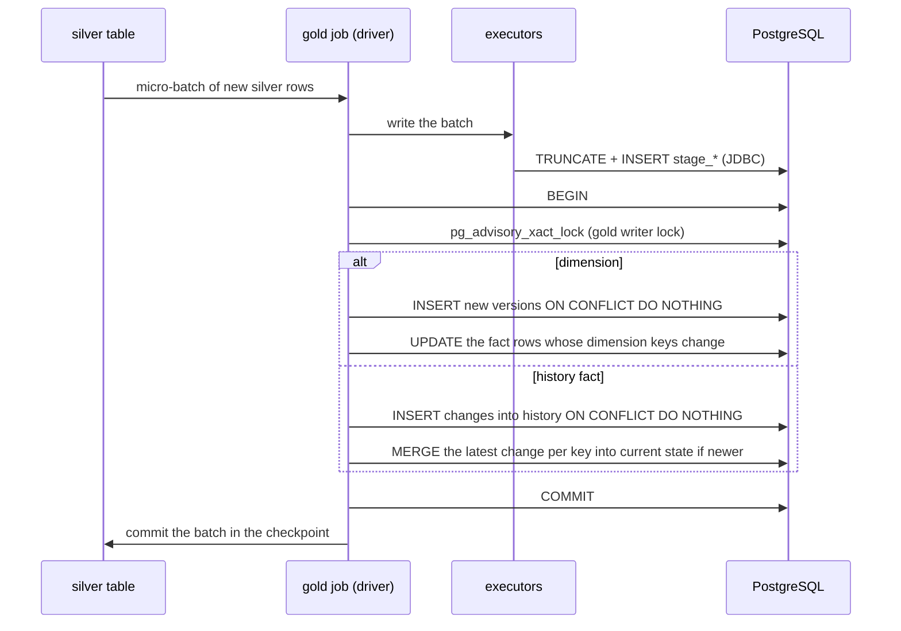
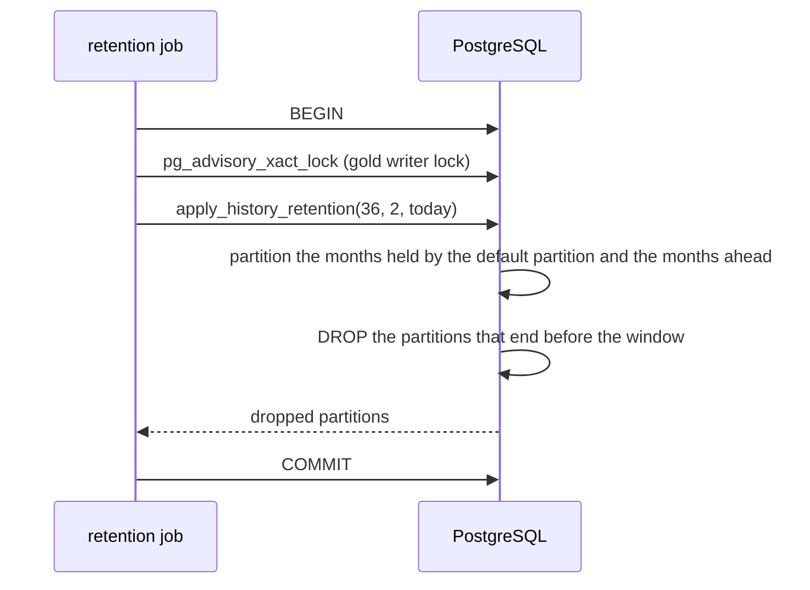
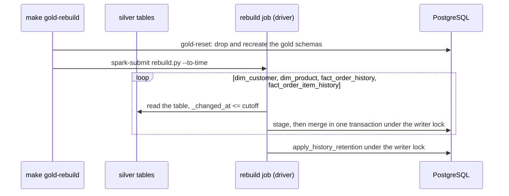
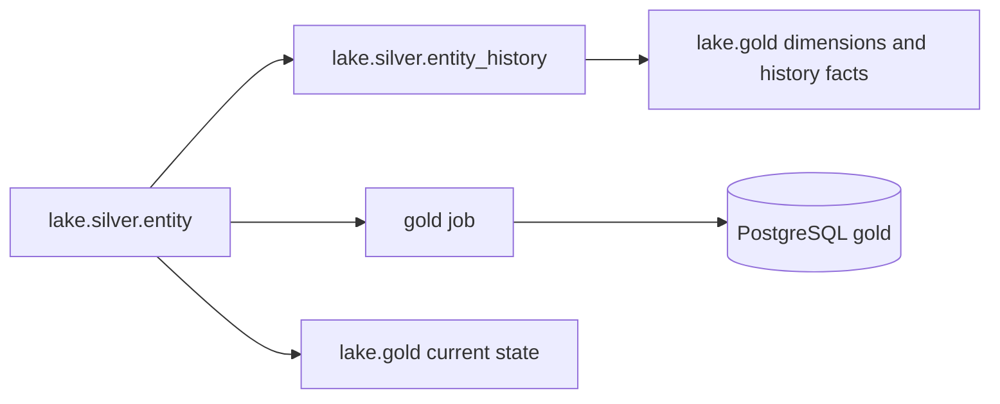

# Gold writer

How gold is written: the gold DDL in PostgreSQL, the gold job and its micro-batch merges, current state and retention, rebuilding gold from silver, and the same model as views in the lake. The model it writes is in [the gold model](model.md); every table and column is in the [table reference](../../reference/gold/index.md).

## The gold DDL

`docker/analytics-db/initdb/02-gold-model.sql` is generated and git-ignored: `make up` (and `make pipeline` and `make test-infra`) renders it, on the host with [uv](https://docs.astral.sh/uv/), from the Jinja template `analytics/pipelines/src/pipelines/lake/gold/sql/ddl.sql.j2` and the gold Avro schemas (see [table and column definitions](../../development/table-definitions.md)), which give every column its type, nullability and description. Edit the template or the schemas, never the SQL file. The file creates both schemas, the tables, views and seeds, and each history table's default partition; the monthly history partitions are created and dropped by the retention job (see [Gold retention](../../operations/maintenance-and-recovery.md#gold-retention)). It runs on an empty volume like the other init scripts, and every statement is idempotent, so it can also be applied to an existing database without losing data:

```sh
docker compose exec -T analytics-db psql -v ON_ERROR_STOP=1 -U analytics -d analytics < docker/analytics-db/initdb/02-gold-model.sql
```

Applying it again only adds what is missing: `CREATE TABLE IF NOT EXISTS` leaves an existing table as it is, so a new column or constraint on a gold table does not reach a database created before it. To rebuild only gold, leaving the lake and the Iceberg catalog alone:

```sh
make gold-reset CONFIRM=1   # Stops the gold job, recreates gold and gold_internal from the rendered DDL, deletes the gold checkpoints
make pipeline PIPELINE=gold # The gold job reloads everything from silver
```

The same reset followed by one batch load from the silver tables, optionally only up to a point in time:

```sh
make gold-rebuild CONFIRM=1                              # gold-reset, then reload every silver change and apply retention
make gold-rebuild CONFIRM=1 TO_TIME=2026-11-09T12:00:00  # only the changes committed at or before that time (UTC unless it has an offset)
make pipeline PIPELINE=gold                              # resume streaming afterwards
```

See [Rebuilding gold from silver](../../operations/maintenance-and-recovery.md#rebuilding-gold-from-silver) for how it works.

**Data loss:** all gold data is deleted; gold is rebuilt from silver, which keeps the full history. The gold checkpoints (`<CHECKPOINT_ROOT>/gold/`, deleted through the SeaweedFS filer; set `GOLD_CHECKPOINTS` to its path for another `CHECKPOINT_ROOT`) must go with the data, or the job would resume after the batches the dropped rows came from.

## Gold job

The gold job (`analytics/pipelines/src/pipelines/lake/gold/job.py`) keeps the gold model in the `analytics` database up to date from the silver tables `<ICEBERG_CATALOG>.silver.<entity>`: the SCD2 dimensions `gold_internal.dim_customer` and `gold_internal.dim_product` from `customers` and `products`, and the history facts `gold_internal.fact_order_history` and `gold_internal.fact_order_item_history` with their current-state tables `current_orders` and `current_order_items` from `orders` and `order_items`. It needs the four silver tables to exist when it starts, and the gold DDL to be applied (`make up`):

```sh
make pipeline PIPELINE=gold   # as a long-running service, UI on http://localhost:4045
make spark-submit SPARK_APP=analytics/pipelines/src/pipelines/lake/gold/job.py SPARK_APP_ARGS=--available-now SPARK_CONF="spark.cores.max=2" SPARK_UI_PORT=4045   # or once, ad hoc
```

- **Four streaming queries,** one per silver table (customers, products, orders, order items), reading it with Iceberg's streaming source, with its checkpoint in `<CHECKPOINT_ROOT>/gold/<table>/` (`dim_customer`, `dim_product`, `fact_order_history`, `fact_order_item_history`). Micro-batches run every `GOLD_TRIGGER_SECONDS`; `--available-now` processes what silver holds and stops.
- **Every micro-batch** is loaded by Spark's JDBC writer into the stream's unlogged staging table (`gold_internal.stage_<table>`, emptied first), then merged by the driver in one PostgreSQL transaction ([psycopg](https://www.psycopg.org/psycopg3/)). For a dimension, only the versions not stored yet are inserted: the dimensions are append-only, and the fold flag, the validity range and the current flag are computed when they are read, by the `gold_internal.<table>_versions` views, from all of a key's stored versions. For orders and order items, every change is appended to the history fact and the latest change of each key replaces its current-state row only if its `_commit_sequence` is higher. A replayed batch, a duplicate or a late change therefore lands correctly, and a failed batch is simply replayed.
- **Unchanged versions are folded, not dropped:** a version whose `_content_hash` and `_is_deleted` equal the previous version's is kept, so a late version that arrives between two equal ones can turn it back into a real version. The dimension versions views mark it with `_is_folded`, and the `gold` dimension views read them and leave folded and deleted versions out; the `gold` history views of the facts leave unchanged changes out at read time.
- **Deletes are final:** a delete is stored as the key's last version, so the key has no current version afterwards, and replays or late events cannot bring it back; the `gold` current-state views leave deleted orders and items out.
- **Dimension keys as of the change:** a history fact row takes the customer or product version valid at its `_changed_at` (`customer_key`, or `product_key` with its `unit_price` and `line_amount`), or the first version when the change is older than it, as happens when tables are snapshotted a few milliseconds apart; null while there is none or after a delete. A dimension merge re-resolves the fact rows of the keys it touched, so a customer or product that arrives late, or a late version that changes a validity range, still ends in the right key; the lookup reads the dimension versions views, so it applies the same fold and validity rule as the `gold` dimension views. Every merge first takes one PostgreSQL advisory lock, so these merges never run side by side and miss each other's rows.
- **Early items:** an item that arrives before its order is stored; the business views count it once the order arrives.
- **The column lists come from the gold Avro schemas:** the staging tables, the merge SQL and the dimension versions views are built from the gold `.avsc` files; a column is loaded from the silver column its `from` names, a metadata column from the silver column of the same name, and `_valid_from` from `_changed_at` (`unit_price` from `unity_price`); the facts' status, date and dimension keys come from lookups declared in `pipelines/lake/gold/dimensions.py`.
- **Fail fast:** like the bronze job, it stops every query when one stops or fails, and exits non-zero if one failed.

The details, with the fold rule, the transactions and the dimension keys of the facts, follow in [Writing gold](#writing-gold).

## Writing gold

The gold job (`pipelines/lake/gold/job.py`) runs four streaming queries, one per silver table: `customers` into `dim_customer`, `products` into `dim_product`, `orders` into `fact_order_history` and `current_orders`, and `order_items` into `fact_order_item_history` and `current_order_items`. Each has its checkpoint in `<CHECKPOINT_ROOT>/gold/<table>/`, named after its dimension or history fact, and writes every micro-batch in two steps:

1. **Stage.** Spark's JDBC writer replaces the rows of the stream's staging table, `gold_internal.stage_<table>` (overwrite with `truncate`, so the table and its descriptions stay). The staging tables are unlogged: they hold only the batch being written, so they need no crash safety and write faster.
2. **Merge, in one transaction.** The driver connects with psycopg and, in one PostgreSQL transaction, takes the [gold writer lock](model.md#dimension-keys-of-the-facts), then for a dimension:
   1. inserts the staged versions not stored yet (`ON CONFLICT (key, _commit_sequence) DO NOTHING`); nothing stored is ever updated, because the versions views derive `_is_folded`, `_valid_to` and `_is_current` from all of a key's versions ordered by `_commit_sequence` whenever they are read;
   2. re-resolves the dimension keys of the history facts that look it up, for the keys the batch touched.

   And for a history fact:
   1. appends the staged changes not stored yet to the history (`ON CONFLICT (key, _commit_sequence, _changed_at) DO NOTHING`), with their status, date and as-of dimension keys;
   2. takes the latest staged change of each key (`DISTINCT ON (key) ... ORDER BY key, _commit_sequence DESC`) and merges it into the current-state table with PostgreSQL `MERGE`: a key not stored yet is inserted (`WHEN NOT MATCHED THEN INSERT`), and a stored row is replaced only if the change's `_commit_sequence` is higher (`WHEN MATCHED AND source._commit_sequence > target._commit_sequence THEN UPDATE`). The writer lock keeps two merges from inserting the same new key at once.



**Idempotency.** Both steps can run again with the same input and leave the same result: staging is replaced, the inserts skip stored versions and changes, the current state only takes a higher `_commit_sequence`, and the versions views and the re-resolution derive their values from what is stored, not from the batch. A batch replayed after a failure, a whole silver table reprocessed from a fresh checkpoint, a duplicate change and a late older change all end in the same rows. No transaction spans Spark's checkpoint and PostgreSQL, so a batch that fails between them is simply replayed.

**Generic writer.** The staging tables' columns, the INSERT and MERGE column lists, the dimension versions views and the re-resolution SQL are built from the gold schemas, never written by hand: `pipelines/lake/gold/scd2.py` for the dimensions (with the SQL in the templates `scd2_insert.sql.j2` and `scd2_versions.sql.j2` in `sql/` next to it) and `pipelines/lake/gold/facts.py` for the history facts and their current-state tables (with the SQL in the templates `fact_history.sql.j2`, `fact_current.sql.j2`, `fact_dimension_version_lookup.sql.j2` and `fact_resolve.sql.j2`, in the same `sql/` folder). A column is loaded from the silver column its `from` names (`<entity>.<lake name>`), a metadata column from the silver column of the same name, `_valid_from` from `_changed_at`, and any other column from a rename the dimension declares (`unit_price` from `unity_price`) or a lookup the fact declares (`status_key` and `is_open`, the date keys and the as-of dimension columns, in `pipelines/lake/gold/dimensions.py`). The surrogate keys are left to PostgreSQL, the dimensions' derived columns to their versions views, and the looked-up columns to the merge. The gold views in the lake are built from the same declarations.

**Freshness.** `gold.data_freshness` reports, per entity, how up to date gold is. For now it is computed from the data, as the source commit time of the newest change gold holds, so it ages when the source stops changing even though the pipeline is healthy. Later it will be filled from the pipeline statistics, with the same shape. Those statistics (per micro-batch rows, durations, last `_commit_sequence`, last event time) are planned in a separate `observability` catalog in the lake, apart from the business data (#127).

## Current state and retention

**Current state is stored in tables** updated by the streaming queries, in the same database transaction as the history insert. The metric views read only these small tables, so they stay fast as history grows.

The alternatives were rejected:

- A view that picks the latest version from history gets slower as history grows.
- A materialized view recomputes everything on every refresh, too slow for one refresh per micro-batch.
- Both would lose orders that are still open but whose last change is older than the retention window.

**Retention:** the history facts keep 3 years by default in PostgreSQL. They are range-partitioned by month on `_changed_at`, so retention drops whole partitions instead of deleting rows. The retention job creates the monthly partitions ahead and drops the expired ones; the DDL creates only each history table's default partition, which catches every row outside the monthly partitions. Current-state tables and the dimensions are never trimmed, so an order that is still open keeps its current row however old it is. The gold views in the lake keep the full history, from silver.

The retention job (`pipelines/lake/gold/retention.py`, run once by `make up` and `make pipeline` and then daily by the `gold-retention-job` service) calls `gold_internal.apply_history_retention(keep_months, months_ahead, as_of)` in one transaction that first takes the [gold writer lock](model.md#dimension-keys-of-the-facts):

1. `ensure_history_partitions(months_ahead, as_of)` creates a partition for every month from the month of `as_of` to `months_ahead` months ahead, and for every month the default partition holds rows of, moving those rows into it. The default partition fills up whenever history arrives for a month without a partition: everything the gold job writes before the first retention run, a late change, or every month before the current one when gold is reloaded from silver. A partition cannot be created while the default partition holds rows of its month, so the rows are moved in the same transaction. Without this step those rows would never be dropped.
2. Every monthly partition whose upper bound is on or before the first day of the month `keep_months` months before `as_of` is dropped; the bound is read from the partition, not from its name. A month partly inside the window is kept, so the window holds at least `keep_months` full months.



Taking the writer lock first means retention waits for a running merge and a merge waits for retention, always in the same order (the advisory lock, then the table locks), so the two never deadlock. Dropping a partition takes a short exclusive lock on its history table; `DETACH PARTITION ... CONCURRENTLY` would avoid it, but PostgreSQL does not allow it on a table with a default partition.

## Rebuilding from silver

Silver keeps every change, so gold can always be rebuilt from it. `make gold-rebuild CONFIRM=1 [TO_TIME=...]` resets gold (`make gold-reset`) and runs the batch job `pipelines/lake/gold/rebuild.py`:

1. For each load, dimensions first, it reads the silver table in batch and keeps the changes with `_changed_at` at or before `TO_TIME` (all of them without one).
2. It writes them with the gold job's own sink: the staging load, then one merge transaction under the [gold writer lock](model.md#dimension-keys-of-the-facts). The merges are idempotent and independent of arrival order, so one batch per load gives the same rows as any sequence of micro-batches over the same changes.
3. It applies [retention](#current-state-and-retention), which first partitions the months the reload put in the default partition.

A rebuild up to a cutoff therefore matches what the stream would have built had it processed exactly the changes committed up to that time, late arrivals included. The generated surrogate keys get new values. The gold job is left stopped; started again on the fresh checkpoints, it re-reads silver from the start, the merges skip what the rebuild stored, and it continues past the cutoff.



## Gold in the lake

The lake has the gold model too, for consumers that read the lake rather than PostgreSQL: one Iceberg view per public gold relation in `lake.gold` (`dim_customer`, `dim_product`, `dim_date`, `dim_order_status`, `fact_order_history`, `fact_order_item_history`, `current_orders`, `current_order_items`, `open_orders`, the four business-question views and `data_freshness`). Silver is already an append-only store of every version, so the lake keeps no copy of gold: the views compute it from silver on every read, and nothing writes them but `make lake-views`, which creates them after the silver views and replaces only those whose query or descriptions changed. The gold job writes PostgreSQL only. The lake keeps the full history; PostgreSQL's retention window does not apply to it.

- **Kept current:** `make lake-views` creates them right after the silver views, and replaces only those whose query or descriptions changed; every lake maintenance run does the same (see [Lake maintenance](../../operations/maintenance-and-recovery.md#lake-maintenance)).
- **Built from the same declarations as the gold writer:** `pipelines/lake/gold/views/views.py` renders the SQL templates in `sql/` next to it (`dimension.sql.j2`, `fact.sql.j2`, ...) from the gold Avro schemas and the lookups in `pipelines/lake/gold/dimensions.py`; the descriptions are the public ones of the gold schemas. The calendar and the statuses are generated in the views (`dim_date.sql.j2`, `dim_order_status.sql.j2`); an infra test checks they equal PostgreSQL's seeds.



**Same rules, read time instead of write time.** The views apply the rules of [Rules](model.md#rules) and give the rows the PostgreSQL `gold` views show:

- **Folding and validity** come from silver's `<entity>_history` views, which apply the fold rule of [Inputs from silver](model.md#inputs-from-silver) and give each remaining version `_valid_from`, `_valid_to` and `_is_current`. The dimension views leave deletes out, so the version before a delete ends at it and a deleted key has no current version; the history facts keep the delete as the key's last row, never current.
- **Current state** is the latest change of each key by `_commit_sequence`, folded or not, read from the silver table, without deleted keys: the change PostgreSQL's current-state tables hold, with the same `_changed_at`.
- **Key lookups** (`status_key` with the `UNKNOWN` fallback, the date keys) join the `dim_order_status` and `dim_date` views. Those two generate their rows (a `VALUES` list and a `sequence` of days); an infra test checks they equal PostgreSQL's seeds.
- **As-of attributes** (`unit_price` and `line_amount` of the item history) come from the product version that is not deleted and whose [`_valid_from`, `_valid_to`) contains the change's `_changed_at`, or the product's first version for an older change, the highest `_commit_sequence` winning when clock skew overlaps two ranges. A late product version needs no re-resolution: the next read takes it into account.
- **Freshness** is the newest `_changed_at` of each silver table.
- **Open orders and the business questions** are the same SQL as in PostgreSQL, over the lake views: `open_orders` keeps the current orders whose status is open, and the four business-question views read it.
- **Described from the gold schemas:** each view and column has the description of the PostgreSQL `gold` view and column of the same name.

**Natural keys, no surrogate keys.** PostgreSQL generates the surrogate keys (`customer_key`, `product_key`), and the lake cannot reproduce them, so the lake views leave them out. Facts refer to the dimensions by their natural keys (`customer_id`, `product_id`) and carry the dimension attributes resolved as of each change (`unit_price`, `line_amount`). To look up any other attribute of the version valid at a change, join on the natural key and the validity range:

```sql
SELECT i.order_item_id, i._changed_at, p.product_name
FROM lake.gold.fact_order_item_history AS i
JOIN lake.gold.dim_product AS p
  ON p.product_id = i.product_id
 AND p._valid_from <= i._changed_at
 AND (p._valid_to IS NULL OR i._changed_at < p._valid_to);
```

This join finds no version for a change older than the product's first version (the tables are snapshotted a few milliseconds apart), and finds two when clock skew overlaps two ranges; the attributes the fact carries handle both cases as PostgreSQL does.

**Validation.** `make data-quality CHECK=gold` compares each PostgreSQL `gold` view with its lake view computed over silver at the snapshots the gold job has committed, so it checks silver against gold and the lake views against PostgreSQL in one pass. It matches dimension versions through `_commit_sequence` rather than through a public column, and history from the first month PostgreSQL keeps (see the [data quality checks](../data-quality.md)).
