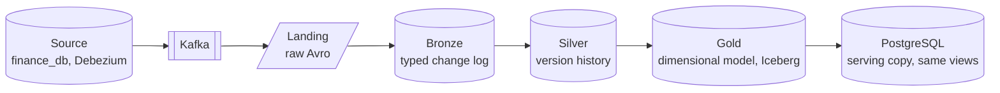

# Lakehouse

The lakehouse follows a medallion architecture: bronze, silver and gold, each refining the layer before it. Debezium captures every source change into Kafka, and landing keeps a raw, replayable copy of every record.

- [Source database and CDC](source-and-cdc.md): the supplied database, the Debezium topics and the change event format.
- [Landing](landing.md): the raw Avro copy of every Kafka record, and how to inspect it with Spark SQL.
- [Bronze](bronze.md): the typed change log, its quarantine, the content hash and schema evolution.
- [Silver](silver.md): the deduplicated version history and its history and current views.
- [Gold](gold/index.md): the dimensional model, computed by Spark into Iceberg tables in the lake and copied into PostgreSQL for serving, with the same views in both; its [model](gold/model.md) and its [writer](gold/writer.md).
- [Data quality checks](data-quality.md): the checks run between the layer boundaries, each one comparing a layer with the one before it, from Kafka to gold.

Where each layer is stored and what it guarantees, side by side, is in the [architecture overview](../architecture/overview.md#data-flow); every table and column is in the [table reference](../reference/index.md).
