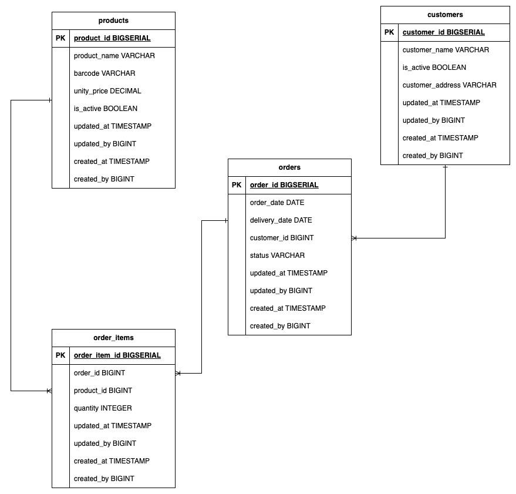

# Source database and CDC

The source is the `finance_db` PostgreSQL database supplied with the assignment, with Debezium streaming its changes to Kafka. Both are used exactly as provided ([decision D29](../architecture/decisions.md#d29--the-source-database-and-the-debezium-connector-stay-as-provided)); the supplied text is kept in [the original README](../reference/original-readme.md).

## Source database

The `operations` schema holds four tables:



Once you have the Database up and running feel free to connect to this using any tool you want, for this you can use the following credentials:

- **Username**: `finance_db_user`
- **Password**: `1234`
- **Database**: `finance_db`

## Debezium CDC

The stack includes a Debezium CDC pipeline that streams database changes to Kafka in real-time. Kafka is available at `localhost:9092`.

### Topics

| Kafka Topic | Source Table |
|---|---|
| `finance_db.operations.customers` | `operations.customers` |
| `finance_db.operations.products` | `operations.products` |
| `finance_db.operations.orders` | `operations.orders` |
| `finance_db.operations.order_items` | `operations.order_items` |

When the connector starts, it first takes a snapshot of each table (`op` = `r`) and then streams every change. The source database and the connector are used exactly as provided; the pipeline handles their format.

### Message format

Each topic has one partition, messages carry no headers, and both key and value are JSON without embedded schemas.

- **Key:** the row's primary key, for example `{"order_id": 1}`.
- **Value:** a Debezium change event:

| Field | Meaning |
|---|---|
| `before` | The row before the change. `null` for snapshot reads and inserts; the full row for updates and deletes, because the source tables use `REPLICA IDENTITY FULL`. |
| `after` | The row after the change. `null` for deletes. |
| `op` | `r` snapshot read, `c` insert, `u` update, `d` delete. |
| `ts_ms` | When Debezium processed the change, in epoch milliseconds. |
| `source` | Origin of the change: `table`, `txId`, `lsn` (position in the source's write-ahead log, increasing in commit order), `ts_ms` (commit time in the source) and `snapshot` (`first`, `true`, `last` and similar while snapshotting; `false` for streamed changes). |
| `transaction` | Always `null`: transaction metadata is not enabled. |

An update to an order, abbreviated:

```json
{
  "before": {"order_id": 1, "order_date": 20765, "delivery_date": 20775, "status": "PENDING", "updated_at": 1794147633457, "...": "..."},
  "after":  {"order_id": 1, "order_date": 20765, "delivery_date": 20775, "status": "REPROCESSING", "updated_at": 1794147660022, "...": "..."},
  "source": {"connector": "postgresql", "table": "orders", "txId": 952, "lsn": 26767664, "ts_ms": 1794147660025, "snapshot": "false", "...": "..."},
  "op": "u",
  "ts_ms": 1794147660561,
  "transaction": null
}
```

Column values are encoded by type:

| Source type | Columns | Encoding | Example | Reading it in Spark |
|---|---|---|---|---|
| `BIGSERIAL`, `BIGINT`, `INTEGER` | ids, `updated_by`, `created_by`, `quanity` | JSON number | `157` | cast to `long` or `int` |
| `VARCHAR` | names, `barcode`, `status`, `customer_address` | JSON string | `"PENDING"` | as is |
| `BOOLEAN` | `is_active` | JSON boolean | `true` | as is |
| `TIMESTAMP(3)` | `updated_at`, `created_at` | Milliseconds since the epoch of the stored wall-clock time, read as UTC (the source runs in UTC) | `1794147660022` = 2026-11-08 14:21:00.022 | `timestamp_millis(col)`, with the session time zone set to UTC |
| `DATE` | `order_date`, `delivery_date` | Days since 1970-01-01 | `20775` = 2026-11-18 | `date_from_unix_date(col)` |
| `DECIMAL` (no precision or scale) | `unity_price` | Debezium's variable-scale decimal: an object with the `scale` and the unscaled value as base64 big-endian two's-complement bytes | `{"scale": 2, "value": "AJk="}` = 153 × 10⁻² = 1.53 | decode the bytes to an integer and divide by 10^`scale` |

Column names are kept as in the source, including `order_items.quanity`.

**Deletes:** the data generator never deletes rows. If a row is deleted, Debezium sends an event with `op` = `d`, the full row in `before` and `after` = `null`, followed by a *tombstone*: a message with the same key and a `null` value. Consumers must accept `null` values.

**Heartbeats:** every 10 seconds the connector writes `{"ts_ms": ...}` with the key `{"serverName": "finance_db"}` to `__debezium-heartbeat.finance_db`, so the replication slot keeps advancing while the tables are idle. The pipeline does not read this topic.

### Kafka Connection Example

```properties
bootstrap.servers=localhost:9092
```
