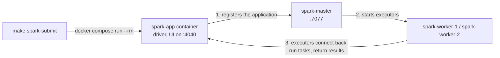

# Spark cluster

`make up` also starts a Spark 4.1.4 standalone cluster: one master and two workers built from the `spark` target of `docker/spark/Dockerfile`. Drivers run from the `app` target, which is built on top of the `spark` target and adds the application packages, so drivers and executors always share Spark, Java and Python versions.

| Service | UI | Resources |
|---|---|---|
| `spark-master` | <http://localhost:8080> | Cluster manager; accepts jobs at `SPARK_MASTER_URL` |
| `spark-worker-1` | <http://localhost:8081> | 5 cores, 5 GiB executor memory |
| `spark-worker-2` | <http://localhost:8082> | 5 cores, 5 GiB executor memory |
| `spark-history` (optional) | <http://localhost:18080> | History server for finished, crashed and running applications; started with `make spark-history` |
| `spark-app` (one container per run) | <http://localhost:4040> | Driver of an application started by `make spark-submit`; its UI is only available while it runs |
| `landing-job` (optional) | <http://localhost:4040> | Driver of the landing job, a long-running service started by `make pipeline` (see [Running the pipeline](../operations/running-the-pipeline.md)) |
| `bronze-job` (optional) | <http://localhost:4041> | Driver of the bronze job, started the same way |
| `silver-job` (optional) | <http://localhost:4042> | Driver of the silver job, started the same way |
| `gold-job` (optional) | <http://localhost:4045> | Driver of the gold job, a long-running service started by `make pipeline PIPELINE=gold` (see [Gold job](../layers/gold.md#gold-job)) |

Spark runs PySpark on **Python 3.14** (3.14.10), the newest version PySpark 4.1.4 supports. The official `apache/spark` images ship Python 3.10, so the Dockerfile installs CPython 3.14 with [uv](https://docs.astral.sh/uv/) at build time and points `PYSPARK_PYTHON` at it; every driver and executor uses it.

Worker resources are set with `SPARK_WORKER_CORES` and `SPARK_WORKER_MEMORY` in `docker-compose.yaml`. They cap what executors can claim on each worker, 10 GiB across both workers; the master, worker and driver JVMs need memory on top of that, so make sure Docker has enough memory for the whole stack.

`SPARK_MASTER_URL` defaults to `spark://spark-master:7077` in `.env`, which Docker Compose loads automatically. Exporting the variable in your shell overrides it; recreate the Spark services (`make up`) after changing it.

`.env` also pins the Compose project name (`COMPOSE_PROJECT_NAME=deel_home_task`), so every checkout of the repository, including git worktrees, drives the same local stack. `make up` rebuilds the Spark images from the checkout it runs in. A rebuild without changes keeps the image IDs, so running `make up` again does not restart the cluster or the jobs running on it. Two things keep the IDs stable: each Spark image has a single builder (`spark-master` builds the cluster image, which the workers and the History Server reuse; `spark-app` builds the driver image, which the pipeline jobs reuse), and the Makefile turns off build attestations (`BUILDX_NO_DEFAULT_ATTESTATIONS=1`), which would otherwise give every build a new ID.

## Iceberg catalog

Every Spark job gets an [Apache Iceberg](https://iceberg.apache.org/) catalog named `lake`, configured in `docker/spark/spark-defaults.conf`:

- table metadata (the catalog) lives in the `iceberg_catalog` database of `analytics-db`, through Iceberg's JDBC catalog;
- table data and metadata files live in SeaweedFS under `s3://lake/warehouse/<namespace>/<table>/`.

The Spark image bundles Iceberg 1.12.0 (`iceberg-spark-runtime-4.1_2.13`, `iceberg-aws-bundle`) and the PostgreSQL JDBC driver 42.7.14, with pinned checksums, so jobs need no `--packages`. The driver reads the database and S3 credentials from its environment (the `.env` values above).

## Query the lake from DuckDB

The optional `catalog` profile serves the same catalog through the [Iceberg REST catalog API](https://iceberg.apache.org/rest-catalog-spec/), so any engine that speaks it can attach the lake by name. The `iceberg-rest` service runs Apache's REST catalog server (`apache/iceberg-rest-fixture` 1.10.1, plus the PostgreSQL JDBC driver) on top of the JDBC catalog that Spark writes, so both see the same tables; Spark keeps using JDBC. It logs in with the read-only `lake_catalog_reader`, so clients can list and read but not create or change anything through it.

```sh
make up PROFILES=catalog   # REST catalog on http://localhost:8181
make db-logins             # Once on an existing volume: creates lake_catalog_reader
```

On a volume created before this service existed, run `make up` first so `analytics-db` gets the new login's credentials, then `make db-logins`. Then, in DuckDB 2.0 or later:

```sql
INSTALL iceberg;
LOAD iceberg;
CREATE SECRET lake_s3 (
    TYPE s3, KEY_ID 'lakeadmin', SECRET 'lakeadmin-secret',
    ENDPOINT 'localhost:8333', URL_STYLE 'path', USE_SSL false, REGION 'us-east-1'
);
ATTACH 'warehouse' AS lake (TYPE iceberg, URI 'http://localhost:8181', AUTHORIZATION_TYPE 'none', ACCESS_DELEGATION_MODE 'none');

SHOW ALL TABLES;
SELECT _change_op, count(*) AS changes FROM lake.bronze.orders GROUP BY _change_op;

-- Live orders by status: the latest version of each order, unless it was deleted.
SELECT status, count(*) AS orders
FROM (
    SELECT * FROM lake.silver.orders
    QUALIFY row_number() OVER (PARTITION BY order_id ORDER BY _commit_sequence DESC) = 1
)
WHERE NOT _is_deleted
GROUP BY status;
```

DuckDB 1.x takes `ENDPOINT 'http://localhost:8181'` instead of `URI`.

DuckDB reads the lake's tables only. The lake's Iceberg views (the silver `_history` and `_current` views and `lake.gold.*`) are stored in Spark SQL, which DuckDB cannot run, so in DuckDB write the equivalent SQL over the silver tables.

The S3 secret above uses the lake's admin key: the REST catalog is read-only, but S3 access with that key is not.

## Kafka, Avro and plain files in the lake

The image also bundles, with pinned checksums:

| Library | Version | Used for |
| --- | --- | --- |
| `spark-sql-kafka-0-10`, `spark-token-provider-kafka-0-10`, `kafka-clients`, `commons-pool2` | 4.1.4, 4.1.4, 3.9.1, 2.12.1 | Reading the CDC topics with `spark.readStream.format("kafka")` |
| `spark-avro` | 4.1.4 | Reading and writing Avro files |
| `hadoop-aws` and the AWS SDK's `s3-transfer-manager` and `apache-client` | 3.4.2, 2.54.17 | The S3A filesystem for plain files and streaming checkpoints in SeaweedFS |

Iceberg tables use `s3://` paths through the catalog above. Plain files, such as the landing zone, and streaming checkpoints use `s3a://lake/...` paths. S3A uses the same AWS SDK version as the Iceberg bundle (2.54.17); the image adds only the two SDK modules the bundle does not contain.

Spark does not substitute `${env:...}` in `spark.hadoop.*` settings, so `make spark-submit` passes the S3A credentials from the driver container's environment (`LAKE_S3_ACCESS_KEY`, `LAKE_S3_SECRET_KEY`). Spark ships them to the executors and shows them as `*********(redacted)` in the UI and event logs.

Run the smoke job to check the whole path. It creates or replaces `lake.smoke.iceberg_check`, writes four rows, reads them back, and fails if they differ:

```sh
make spark-submit SPARK_APP=tests/infra/apps/iceberg_smoke_check.py
```

To inspect the result:

```sh
docker compose exec analytics-db psql -U analytics -d iceberg_catalog -c "select * from iceberg_tables"
```

The table files are visible at <http://localhost:8888/buckets/lake/warehouse/smoke/iceberg_check/>.

## Submitting a job

```sh
make spark-submit                                                               # Run the one-minute UI check job (default)
make spark-submit SPARK_APP=tests/infra/apps/iceberg_smoke_check.py             # Run another application
make spark-submit SPARK_APP=path/to/app.py SPARK_APP_ARGS="--date 2026-11-05"  # Pass arguments to the application
make spark-submit SPARK_CONF="spark.cores.max=2" SPARK_UI_PORT=4050             # Cap cores and publish the UI on another port
```

| Variable | Default | Meaning |
|---|---|---|
| `SPARK_APP` | `tests/infra/apps/spark_ui_check.py` | Application to run, as a path from the repository root |
| `SPARK_APP_ARGS` | empty | Arguments passed to the application unchanged |
| `SPARK_CONF` | empty | Space-separated `key=value` Spark settings, each passed as `--conf` |
| `SPARK_UI_PORT` | `4040` | Host port for the application UI; `0` picks a free port |

Each run starts its own driver container from the `app` image with `docker compose run --rm`, in client mode, and the container is removed when the application ends. A batch job's container ends with the job; a streaming job's container lives as long as the stream. `make spark-submit` rebuilds the `app` image first when the code changed, and the cluster must already be running (`make up`).



Because every run has its own container, one application's memory, logs and lifecycle never affect another, and stopping `make spark-submit` (Ctrl+C) stops its driver. Executors reach the driver through the container's IP address, and the `common` and `pipelines` packages are shipped to them with `--py-files`.

To run several applications at the same time, give each its own UI port and cap its cores: the standalone master gives an application every free core unless `spark.cores.max` is set, so a second application would wait until the first one ends.

The [sizing strategy](../architecture/sizing.md) explains how the cores and memory are shared between the jobs, ties each setting to a variable, and names the metrics that show whether the sizing holds.

While the pipeline jobs run (`make pipeline`), they hold ports 4040 and up (see [Running the pipeline](../operations/running-the-pipeline.md)), so give ad-hoc runs another port, for example `make spark-submit SPARK_UI_PORT=4050` (the same applies to `make spark-sql`); otherwise Docker refuses to start the driver with `port is already allocated`.

## Spark History Server (optional)

Every driver writes event logs to the `spark-events` volume, whether or not the history server is running. Logs roll over at 128 MiB, so long-running streaming applications stay in bounded files. Start the history server only when you need to inspect past runs:

```sh
make spark-history          # Start the history server if it is stopped (http://localhost:18080), stop it if it is running
make up PROFILES=history    # Or start it together with the rest of the stack
```

`make spark-history` is a toggle: run it once to start the history server and again to stop and remove its container. The event logs stay in the volume either way.

When it starts, it lists every application whose event logs are in the volume, including runs that happened while it was stopped. `make down` stops it with the rest of the stack, and `make clean CONFIRM=1` deletes the event logs.

## Checking the application UI

The application UI at <http://localhost:4040> exists only while a driver runs. The default job, [`tests/infra/apps/spark_ui_check.py`](https://github.com/jonathan5p/deel-home-task/blob/main/tests/infra/apps/spark_ui_check.py), is a dummy streaming query that runs for one minute so the UI can be inspected. It reads Spark's built-in `rate` source and counts rows per 10-second window every five seconds. While the job runs, open <http://localhost:4040>:

| Tab | What to look at |
|---|---|
| Jobs and Stages | One job per micro-batch; the windowed count adds a shuffle stage |
| SQL / DataFrame | The plan of each micro-batch |
| Executors | Executors on both workers |
| Structured Streaming | The `rate_window_counts` query, with input and processing rates and batch durations |

The job prints the progress of the latest micro-batch every five seconds. When it finishes, the UI on port 4040 closes.
