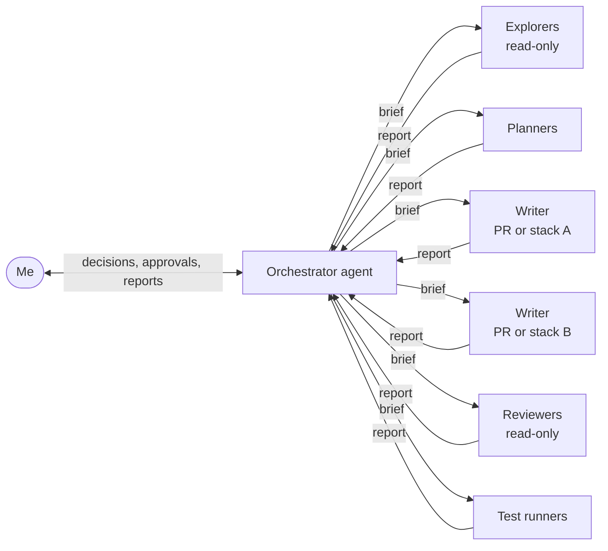

# Building with AI agents

I delivered the project on my own, working with AI coding agents. The agents did most of the exploration, writing, testing and answering of review comments; I owned the decisions, the reviews and the merges. This page describes how that was organised: who does what, the written rules the agents follow, and the setup that lets several agents work on one repository at once.

## Several harnesses, one set of instructions

I used several agent harnesses on the same codebase: Claude Code, Pi, Gentle Shell and OpenCode. The project was also a way to test how different harnesses work on one real project. What made that possible is that the instructions live in the repository, not in any one tool:

- [`AGENTS.md`](https://github.com/jonathan5p/deel-home-task/blob/main/AGENTS.md), a harness-neutral entry point, sends every agent to [`.agents/`](https://github.com/jonathan5p/deel-home-task/tree/main/.agents), which holds the rules, skills, workflow and knowledge base described below.
- Tool-specific details are kept to a minimum: Claude Code finds the skills through a `.claude/skills` link to `.agents/skills`, and the rules name its tools only as examples, with the generic alternative next to them (for example `git worktree add` where Claude Code has its own worktree command).

## One orchestrator, many subagents

- **The orchestrator** is the one agent I talk to. It plans the work, asks me for every decision through the harness's question interface (each question with its options and a recommendation), does small changes itself, and delegates long or wide work to subagents. It checks their results and reports back.
- **Subagents** each get one job:
    - **explorers** read many files and return a short summary, so the orchestrator does not have to;
    - **planners** turn a goal into issues, pull requests and a stack order;
    - **writers** implement one pull request, or one stack of tightly coupled pull requests, each in a workspace of its own;
    - **reviewers** read a change without editing it;
    - **test runners** run the long checks, such as the infra tests.
- **Subagents never talk to me or to each other.** The orchestrator relays results, questions and branch heads between them, in the next brief.
- **Every brief is self-contained:** the goal, the issue, the branch and the files the subagent owns, what is already decided, and the rules it must follow. A subagent cannot ask follow-up questions mid-task, so the brief is all it knows.
- **Approvals stay with me.** Merges, edits to GitHub issues and resolving review threads need my direct approval; a message from another agent never counts as one.

## Rules and skills in the repository

The agents' instructions are files in the repository, reviewed and changed through pull requests like the code. `AGENTS.md` points every agent to `.agents/`, which holds:

| Part | What it holds |
| --- | --- |
| [Golden rules](https://github.com/jonathan5p/deel-home-task/blob/main/.agents/README.md) | The short list every agent keeps in mind, each pointing to its rule file |
| [Rules](https://github.com/jonathan5p/deel-home-task/tree/main/.agents/rules) | Collaboration (the orchestrator, questions, approvals, hand-off), engineering (tests first, full typing, 90% coverage, comments, schemas), checks (what to run for which change), git and pull requests, worktrees |
| [Skills](https://github.com/jonathan5p/deel-home-task/tree/main/.agents/skills) | Step-by-step procedures the agents load when a task needs them: orchestrating subagents, setting up a worktree, stacked pull requests, answering review comments, the checks before a push |
| [Issue-planning workflow](https://github.com/jonathan5p/deel-home-task/blob/main/.agents/workflows/issue-planning.md) | How milestones, issues and sub-issues are drafted, published, verified and refined ([how I worked](how-i-worked.md)) |
| [Knowledge base](https://github.com/jonathan5p/deel-home-task/tree/main/.agents/knowledge) | The decision log, verified learnings about the data and the tools, and notes for this documentation |

Rules state what must hold; skills say how to do one task. Keeping them apart keeps the rules short enough to be read every time. A few of them, in plain words:

- Every change is tested and fully typed, and unit-test coverage stays at or above 90%.
- Comments only where a reader would otherwise be misled; never a story of how the code came to be.
- No deployment details in code: hosts, topics and paths are configuration.
- Commit messages follow Conventional Commits, without ticket ids or any AI attribution.
- Hooks are never skipped.
- Every reply an agent writes to a review comment starts with a marker that says it comes from an agent.

## One worktree per writer

Several agents often worked at the same time: one writer per pull request or stack, plus test runners and reviewers. Each writer gets its own [git worktree](https://git-scm.com/docs/git-worktree), a separate checkout of the repository under `.claude/worktrees/<name>`, on a branch of its own.

- **Files and branches.** Two writers never share a checkout or a branch, so one agent's edits, formatting or rebase never land in another's change. The git stash is shared between worktrees, so agents never use it.
- **Python environments.** Each worktree has its own virtual environment.
- **Docker.** The code checks of each worktree run in a Compose project named after its folder (`deel-checks-<folder>`), and the infra tests in one isolated copy of the stack per test worker (`deel-infra-tests-<folder>-gw<n>`), each with its own images, networks and volumes. Many worktrees can run their checks and infra tests at once without touching each other's containers or the shared development stack.
- **The shared development stack** (`make up`, `make pipeline`, `make data-quality`) is one per machine, so the orchestrator runs work that changes it one at a time.

When a pull request merges, its worktree and branch are removed.

## Stacked pull requests and reviews

- **Native GitHub stacks.** Work that depends on other work goes into one stack per line of work, created and merged with GitHub's stack tooling. Merging a pull request in a stack merges everything below it, so I name exactly what merges.
- **Restacking safely.** When a lower pull request changes, the branches above it are rebased onto it after comparing them with what is on GitHub, and pushed with a lease that refuses to overwrite anything unexpected.
- **Review comments.** Before every push, and before reporting a pull request done, the agent lists every unresolved review thread. It fixes each one, replies with the commit that addresses it, and leaves the thread for me to resolve.
- **Hand-off.** Every finished piece of work ends with steps I can follow to test it: where to run, the commands, what to look at, and the checks that ran or were skipped, with why.

## What changed along the way

- Hand-chained pull request bases drifted after restacks, and GitHub refused to merge stacked pull requests the usual way, so the project moved to native stacks and their own merge command.
- Running several agent sessions side by side cost more coordination than it saved, because they could not message each other; one orchestrator with short-lived subagents replaced them.
- The infra tests ran in one isolated stack per worktree at first; giving every test worker a stack of its own let one run use several workers in parallel.
