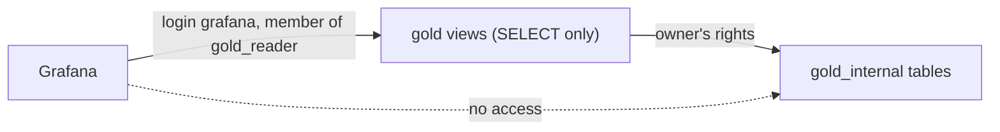

# Grafana

[Grafana](https://grafana.com/oss/grafana/) (`grafana`, image `grafana/grafana-oss`) starts with `make up` and serves the metrics on http://localhost:3000. Visitors are anonymous viewers, so no login is needed to look; sign in as `admin` / `admin` (`GRAFANA_ADMIN_USER`, `GRAFANA_ADMIN_PASSWORD` in `.env`, local development credentials) to administer it. Its own settings, users and sessions live in the `grafana-data` volume.

Monitoring configuration lives in the root `monitoring/` folder, one subfolder per tool (`monitoring/grafana/` and `monitoring/prometheus/`). Everything Grafana shows is provisioned as code from `monitoring/grafana/provisioning/`, mounted read-only:

- `datasources/gold.yaml` defines the **Gold** datasource (uid `gold`, the default one): the `analytics` database on `analytics-db:5432`, read only and not editable in the UI.
- `datasources/prometheus.yaml` defines the **Prometheus** datasource (uid `prometheus`): the `prometheus` service of the optional `metrics` profile on `prometheus:9090`, with a 10 s minimum interval to match the scrape interval, not editable in the UI. Without the profile it reports an error and the Spark dashboards stay empty (see [Monitoring Spark](../operations/monitoring.md)).
- `dashboards/gold.yaml` loads `monitoring/grafana/dashboards/gold-metrics.json` into the **Gold** folder, and `dashboards/spark-and-lake.yaml` loads every dashboard in `monitoring/grafana/dashboards/spark-and-lake/` into the **Spark and lake** folder; they cannot be changed or deleted from the UI. The Gold provider names its file rather than the directory, because Grafana walks a provider's directory recursively and would load the Spark and lake dashboards into the Gold folder too.

Every dashboard in the **Spark and lake** folder carries the `spark-and-lake` tag and a links bar listing the dashboards with that tag, so each one links to the others, keeping the time range. The Gold dashboard has no links bar.

Grafana connects as its own [service login](../architecture/infrastructure.md#read-only-service-logins), `grafana` (`GRAFANA_READER_USER`, `GRAFANA_READER_PASSWORD` in `.env`), a member of the read-only role `gold_reader`: it reads the views of the public `gold` schema and nothing else, has no rights on `gold_internal`, where the pipeline keeps its tables, and its sessions are read-only with a 30 s statement timeout, so a heavy panel query cannot hold the database. On an analytics volume created before this login existed, `make db-logins` creates it.

## Gold metrics dashboard

`monitoring/grafana/dashboards/gold-metrics.json` is the **Gold metrics** dashboard (http://localhost:3000/d/gold-metrics), also Grafana's home page. It refreshes every 30 seconds and reads only the `gold` views:

| Panel | Type | Reads |
| --- | --- | --- |
| Freshness: time since the newest change | one stat per entity, green under 5 minutes, yellow under an hour, red above | `gold.data_freshness` |
| Open orders by delivery date and status | table | `gold.open_orders_by_delivery_date_and_status` |
| Top 3 delivery dates by open orders | table, ties for third place included | `gold.top_delivery_dates_by_open_orders` |
| Pending items by product | table: items and total quantity | `gold.pending_items_by_product` |
| Top 3 customers by pending orders | table, ties for third place included | `gold.top_customers_by_pending_orders` |

Each business-question panel runs exactly the query of its file in `analytics/sql/gold/`, so the dashboard and the documented queries always agree. Freshness is measured from the data, as the time since the source commit of the newest change gold holds, so it also grows while the source is idle.

## Spark dashboards

The **Spark and lake** folder holds three Spark dashboards over the Prometheus datasource, for the live state of the streaming jobs, the history of their stages, and for [sizing the cluster](../architecture/sizing.md#key-metrics). Every query uses Grafana's `$__rate_interval`, so rates stay correct at any zoom level. [Monitoring Spark](../operations/monitoring.md) explains where the metrics come from and how to read them.

**Spark cluster** (http://localhost:3000/d/spark-cluster), the last 6 hours:

| Row | Panel | Shows |
| --- | --- | --- |
| Workers | Worker cores used and free | Cores each worker has given to executors and cores still free |
| Workers | Worker memory used and free | Executor memory each worker has given out and memory still free |
| Workers | Applications running and waiting | Applications the master runs or keeps waiting for cores, and alive workers |
| Workers | Busy task slots per application | Running tasks against the cores the master granted, per application |
| Executors | Executor peak heap and RSS vs 1 GiB | Peak JVM heap and resident memory of each executor, against the 1 GiB executor heap |
| Executors | GC share of task time | Share of task time spent in garbage collection, per application, against 10 % |
| Executors | Failed tasks | Failed tasks per application |
| Drivers | Driver heap | Heap used and maximum, per driver |
| Drivers | Driver GC share | Share of each driver's time spent in garbage collection |
| Scrapes | Scrape health | Whether Prometheus reaches each Spark target |

**Spark streaming** (http://localhost:3000/d/spark-streaming), the last hour, filtered by the `service` (driver) and `query` variables:

| Row | Panel | Shows |
| --- | --- | --- |
| Throughput | Input vs processing rate | Rows per second read and processed in the last micro-batch, per query |
| Throughput | Processing / input ratio | Processing rate divided by input rate while rows arrive, against 1 |
| Batch duration | Batch duration vs the 10 s trigger | Duration of the last micro-batch, against the trigger |
| Batch duration | Share of time over the trigger | Share of samples in which the last micro-batch took longer than the trigger |
| State | State rows, State size, State growth | Rows, memory and growth of each query's state store (silver's deduplication) |
| Stages and tasks | Completed stages and tasks, Failed stages and tasks | Stages and tasks completed per second and failed, per driver |

**Spark stages** (http://localhost:3000/d/spark-stages), the last 24 hours, filtered by the `app` (application name) and `query` (streaming query; batch jobs have none) variables, from the [stage exporter](../operations/monitoring.md#stage-history):

| Row | Panel | Shows |
| --- | --- | --- |
| Stages | Stage duration p50 and p95 | Median and 95th percentile stage duration |
| Stages | Skew p95 | Slowest over median task duration, and largest over median task read, at the 95th percentile of stages, against 3 |
| Stages | Tasks per stage | Average tasks per stage |
| Stages | Stages with a median task under 100 ms | Share of stages split into more tasks than their data needs |
| CPU and memory | CPU time / run time | Share of task time on the CPU |
| CPU and memory | GC time / run time | Share of task time in garbage collection, against 10 % |
| CPU and memory | Spill | Bytes spilled from memory and to disk |
| Shuffle and network | Shuffle read: local and remote | Shuffle bytes read locally, read from other executors and written |
| Shuffle and network | Remote share of shuffle reads | Share of shuffle bytes read from other executors |
| Shuffle and network | Shuffle fetch wait / run time | Share of task time spent waiting for shuffle blocks |
| Data volume | Bytes read and written, Records read and written, Bytes per record read | Source and sink volumes per application |

## Editing the dashboards

The dashboards are plain JSON, edited by hand or in Grafana and exported back (Share → Export → JSON, then replace the file). The tests in `tests/grafana/` (run by `make test`) check every dashboard's stable uid, read-only flag, refresh interval and unique panel ids, that each provider loads its folder's dashboards and every dashboard is loaded exactly once, and that every Spark and lake dashboard has the links bar and the Gold dashboard none. For the Gold dashboard they also check that it keeps one panel per question plus freshness, that every query uses the Gold datasource and reads only `gold` views, and that each question panel's query equals its file. For the Spark dashboards they check that every query uses the Prometheus datasource and `$__rate_interval`, and reads only metric names that Prometheus stores: the names the scrape configuration produces from real Spark 4.1.4 pages captured in `tests/prometheus/scrapes/`, and those the stage exporter serves after recording real History Server responses.
