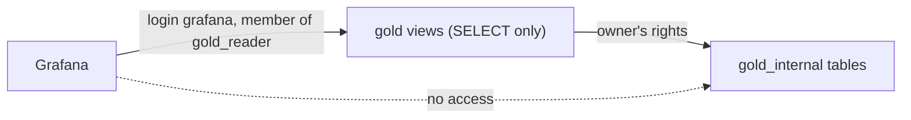

# Grafana

[Grafana](https://grafana.com/oss/grafana/) (`grafana`, image `grafana/grafana-oss`) starts with `make up` and serves the metrics on http://localhost:3000. Visitors are anonymous viewers, so no login is needed to look; sign in as `admin` / `admin` (`GRAFANA_ADMIN_USER`, `GRAFANA_ADMIN_PASSWORD` in `.env`, local development credentials) to administer it. Its own settings, users and sessions live in the `grafana-data` volume.

Monitoring configuration lives in the root `monitoring/` folder, one subfolder per tool (`monitoring/grafana/` now, room for Prometheus and Loki later). Everything Grafana shows is provisioned as code from `monitoring/grafana/provisioning/`, mounted read-only:

- `datasources/gold.yaml` defines the **Gold** datasource (uid `gold`, the default one): the `analytics` database on `analytics-db:5432`, read only and not editable in the UI.
- `dashboards/gold.yaml` loads every dashboard in `monitoring/grafana/dashboards/` into the **Gold** folder; they cannot be changed or deleted from the UI.

Grafana connects as its own [service login](../architecture/infrastructure.md#read-only-service-logins), `grafana` (`GRAFANA_READER_USER`, `GRAFANA_READER_PASSWORD` in `.env`), a member of the read-only role `gold_reader`: it reads the views of the public `gold` schema and nothing else, has no rights on `gold_internal`, where the pipeline keeps its tables, and its sessions are read-only with a 30 s statement timeout, so a heavy panel query cannot hold the database. On an analytics volume created before this login existed, `make db-logins` creates it.

## Gold metrics dashboard

`monitoring/grafana/dashboards/gold-metrics.json` is the **Gold metrics** dashboard (http://localhost:3000/d/gold-metrics), also Grafana's home page. It refreshes every 30 seconds and reads only the `gold` views:

| Panel | Type | Reads |
| --- | --- | --- |
| Freshness: time since the newest change | one stat per entity, green under 5 minutes, yellow under an hour, red above | `gold.data_freshness` |
| Open orders by delivery date and status | table | `gold.open_orders_by_delivery_date_and_status` |
| Top 3 delivery dates by open orders | table, ties for third place included | `gold.top_delivery_dates_by_open_orders` |
| Pending items by product | table: items and total quantity | `gold.pending_items_by_product` |
| Top 3 customers by pending orders | table, ties for third place included | `gold.top_customers_by_pending_orders` |

Each business-question panel runs exactly the query of its file in `analytics/sql/gold/`, so the dashboard and the documented queries always agree. Freshness is measured from the data, as the time since the source commit of the newest change gold holds, so it also grows while the source is idle.

The dashboard is plain JSON, edited by hand or in Grafana and exported back (Share → Export → JSON, then replace the file). The tests in `tests/grafana/` (run by `make test`) check that it keeps one panel per question plus freshness, that every query uses the Gold datasource and reads only `gold` views, that each question panel's query equals its file, and the refresh interval.
