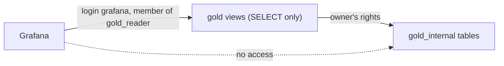

# Grafana

[Grafana](https://grafana.com/oss/grafana/) starts with `make up` on http://localhost:3000. Visitors are anonymous viewers; sign in as `admin` / `admin` (local credentials in `.env`) to administer it.

Everything Grafana shows is provisioned as code from `monitoring/grafana/provisioning/` and cannot be changed from the UI:

| File | Provides |
| --- | --- |
| `datasources/gold.yaml` | The default **Gold** datasource: the `analytics` database, read-only |
| `datasources/prometheus.yaml` | The **Prometheus** datasource; empty dashboards when the `metrics` profile is off |
| `dashboards/gold.yaml` | The **Gold metrics** dashboard, in the **Gold** folder |
| `dashboards/spark-and-lake.yaml` | The Spark and Iceberg dashboards, in the **Spark and lake** folder, linked to each other |

Grafana connects as its own read-only [service login](../architecture/infrastructure.md#read-only-service-logins), `grafana`: it reads the `gold` views and nothing else, with a 30 s statement timeout.

## Gold metrics dashboard

`monitoring/grafana/dashboards/gold-metrics.json` is the **Gold metrics** dashboard (http://localhost:3000/d/gold-metrics), also Grafana's home page. It refreshes every 30 seconds and reads only the `gold` views:

| Panel | Type | Reads |
| --- | --- | --- |
| Freshness: time since the newest change | one stat per entity, green under 5 minutes, yellow under an hour, red above | `gold.data_freshness` |
| Open orders by delivery date and status | table | `gold.open_orders_by_delivery_date_and_status` |
| Top 3 delivery dates by open orders | table, ties for third place included | `gold.top_delivery_dates_by_open_orders` |
| Pending items by product | table: items and total quantity | `gold.pending_items_by_product` |
| Top 3 customers by pending orders | table, ties for third place included | `gold.top_customers_by_pending_orders` |

Each question panel runs exactly the query of its file in `analytics/sql/gold/`, so the dashboard and the documented queries agree ([the four business questions](../lakehouse/gold/model.md#the-four-business-questions)). Freshness is the time since the source commit of the newest change gold holds, so it also grows while the source is idle.

## Spark dashboards

Three Spark dashboards over Prometheus show the streams' live state, their stage history and the numbers for [sizing the cluster](../architecture/sizing.md#key-metrics). [Monitoring Spark](../operations/monitoring.md) explains how to read them.

**Spark cluster** (http://localhost:3000/d/spark-cluster), the last 6 hours:

| Row | Panel | Shows |
| --- | --- | --- |
| Workers | Worker cores used and free | Cores each worker has given to executors and cores still free |
| Workers | Worker memory used and free | Executor memory each worker has given out and memory still free |
| Workers | Applications running and waiting | Applications the master runs or keeps waiting for cores, and alive workers |
| Workers | Busy task slots per application | Running tasks against the cores the master granted, per application |
| Executors | Executor peak heap and RSS vs 1 GiB | Peak JVM heap and resident memory of each executor, against the 1 GiB executor heap |
| Executors | GC share of task time | Share of task time spent in garbage collection, per application, against 10 % |
| Executors | Failed tasks | Failed tasks per application |
| Drivers | Driver heap | Heap used and maximum, per driver |
| Drivers | Driver GC share | Share of each driver's time spent in garbage collection |
| Scrapes | Scrape health | Whether Prometheus reaches each Spark target |

**Spark streaming** (http://localhost:3000/d/spark-streaming), the last hour, filtered by the `service` (driver) and `query` variables:

| Row | Panel | Shows |
| --- | --- | --- |
| Throughput | Input vs processing rate | Rows per second read and processed in the last micro-batch, per query |
| Throughput | Processing / input ratio | Processing rate divided by input rate while rows arrive, against 1 |
| Batch duration | Batch duration / trigger | Duration of the last micro-batch as a share of its job's trigger interval, against 100 % |
| Batch duration | Share of time over the trigger | Share of samples in which the last micro-batch took longer than its job's trigger |
| State | State rows, State size, State growth | Rows, memory and growth of each query's state store (silver's deduplication) |
| Stages and tasks | Completed stages and tasks, Failed stages and tasks | Stages and tasks completed per second and failed, per driver |

**Spark stages** (http://localhost:3000/d/spark-stages), the last 24 hours, filtered by the `app` (application name) and `query` (streaming query; batch jobs have none) variables, from the [stage exporter](../operations/monitoring.md#stage-history):

| Row | Panel | Shows |
| --- | --- | --- |
| Stages | Stage duration p50 and p95 | Median and 95th percentile stage duration |
| Stages | Skew p95 | Slowest over median task duration, and largest over median task read, at the 95th percentile of stages, against 3 |
| Stages | Tasks per stage | Average tasks per stage |
| Stages | Stages with a median task under 100 ms | Share of stages split into more tasks than their data needs |
| CPU and memory | CPU time / run time | Share of task time on the CPU |
| CPU and memory | GC time / run time | Share of task time in garbage collection, against 10 % |
| CPU and memory | Spill | Bytes spilled from memory and to disk |
| Shuffle and network | Shuffle read: local and remote | Shuffle bytes read locally, read from other executors and written |
| Shuffle and network | Remote share of shuffle reads | Share of shuffle bytes read from other executors |
| Shuffle and network | Shuffle fetch wait / run time | Share of task time spent waiting for shuffle blocks |
| Data volume | Bytes read and written, Records read and written, Bytes per record read | Source and sink volumes per application |

## Iceberg tables dashboard

The **Spark and lake** folder also holds **Iceberg tables** (http://localhost:3000/d/iceberg-tables), the last 24 hours, filtered by `namespace` (`bronze`, `silver` and `gold_internal` by default) and `table`, over the exporter's [Iceberg table statistics](../operations/monitoring.md#iceberg-tables):

| Row | Panel | Shows |
| --- | --- | --- |
| Files | Data files per table | Data files in each table's current snapshot |
| Files | Data files added or removed per hour | Change in data files over the last hour; drops at each compaction |
| Files | Small files per table | Data files below `SMALL_FILE_BYTES` |
| Files | Average data file size | Average size of the data files |
| Volume | Table size, Records | Bytes and records of the current snapshot |
| Partitions | Partitions with the most small files | The 20 partitions holding the most small files |

## Editing the dashboards

The dashboards are plain JSON, edited by hand or in Grafana and exported back (Share → Export → JSON). The tests in `tests/grafana/` (run by `make test`) check their uids, read-only flags, folders and panel ids; that the Gold dashboard reads only `gold` views with exactly the documented queries; and that the Spark dashboards read only metric names Prometheus really stores, taken from captured Spark 4.1.4 pages.
